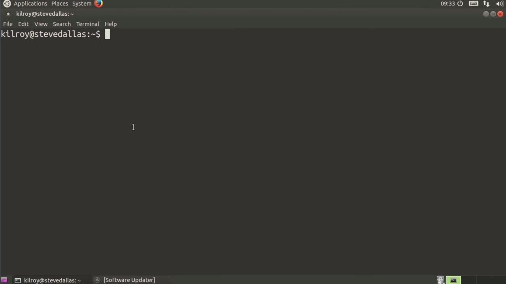
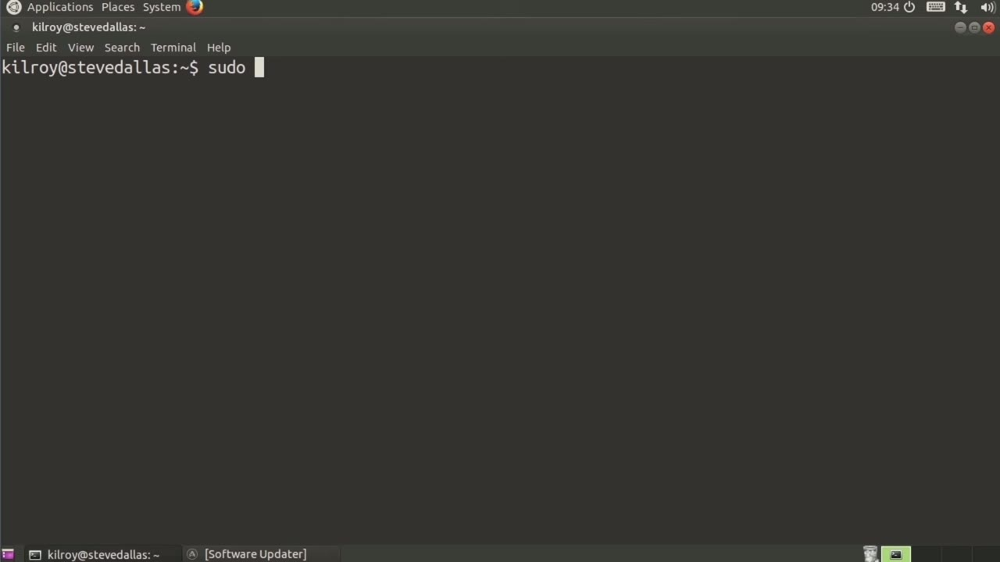
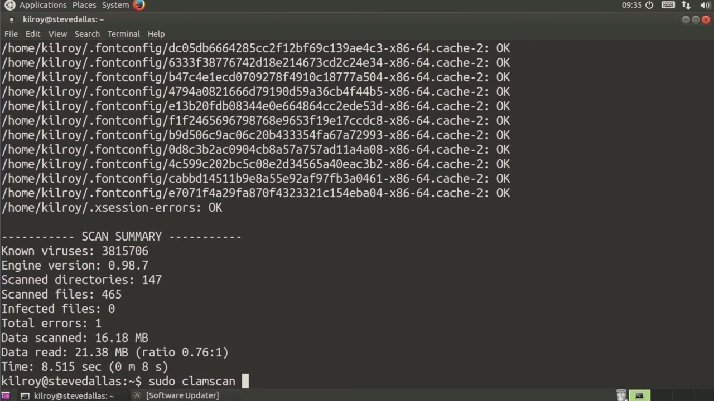
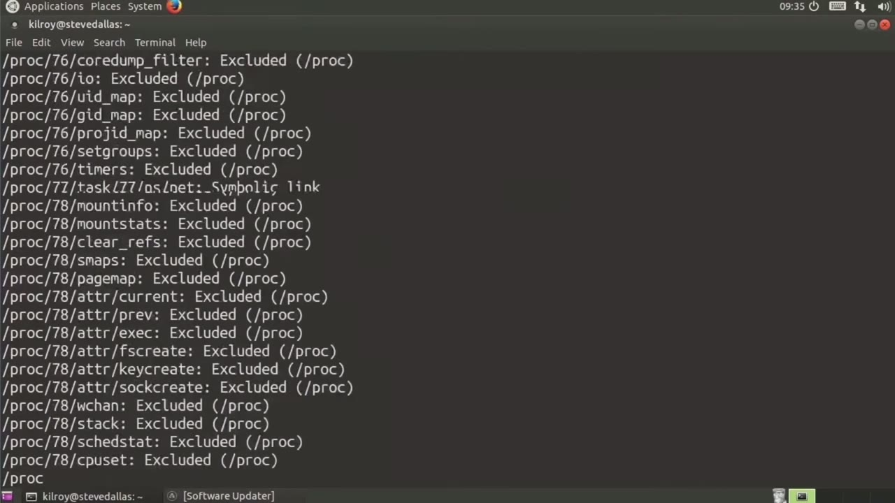

[← Course contents](../../02.md)

# 39. What you will learn in this Module

**Course:** [Linux Security & Administration From Boot Process to Firewalls](https://www.youtube.com/watch?v=_WB3evmgxYA)  
**Transcript:** [`Linux Security & Administration From Boot Process to Firewalls transcript`](../../../../course_videos/Linux%20Security%20%26%20Administration%20From%20Boot%20Process%20to%20Firewalls/Linux%20Security%20%26%20Administration%20From%20Boot%20Process%20to%20Firewalls.txt)  
**Video:** 02:53:50–02:57:33 ([open at this time](https://www.youtube.com/watch?v=_WB3evmgxYA&t=10430s))

## Introduction

Every operating system needs some antivirus solution. It doesn't matter what operating system you're running. Certainly there are people who believe that only Windows is subject to viruses. It's absolutely not true. Every desktop operating system, even server operating systems are prone to viruses. This includes Linux.

## Detailed Explanation

<details>
  <summary>Step 1 — Run `sudo`</summary>

### Step 1 — Run `sudo`

- [x] **Every operating system needs some antivirus solution**
  - Every operating system needs some antivirus solution.
  - It doesn't matter what operating system you're running.
  - Certainly there are people who believe that only Windows is subject to viruses. It's absolutely not true.

- [x] **Every desktop operating system, even server operating systems are**
  - Every desktop operating system, even server operating systems are prone to viruses. This includes Linux.
  - So you need some sort of antivirus solution, particularly if you're running a server, where files may be coming into your system.
  - If you've got a website, for example, where people are allowed to upload anything, you absolutely need antivirus.

- [x] **If you're running a mail server, it's really helpful to have an**
  - If you're running a mail server, it's really helpful to have an antivirus solution running on your system.
  - So there are a handful of antivirus solutions that will run under Linux.
  - One of them happens to be open source, and it's called Clam av.

- [x] **Use `sudo`**
  - So there are a couple of components, to clam av that I want to talk about here. The first one is called Fresh Clam. Fresh Clam is the program that will go and make sure that your signatures are up to date. Now you'll notice that I used `sudo` in order to run Fresh Clam. That's because this is a system level activity,
  - Meaning that the signatures are all stored at the operating system level.
  - So for the entire system, that means I need administrative privileges in order to make these update changes.

- [x] **So once I have got an update, what I can do is I can now run clam scan**
  - So once I have got an update, what I can do is I can now run clam scan.
  - And I'm going to do a recursive clam scan.

```bash
sudo
```





</details>

<details>
  <summary>Step 2 — Run `sudo`</summary>

### Step 2 — Run `sudo`

- [x] **It should just be running against all of the files in my home**
  - It should just be running against all of the files in my home directory.
  - We did a recursive scan that looked through everything.
  - I scanned 465 files and ended up finding nothing there.

- [x] **Use `sudo`**
  - So in order to scan the entire system, now I need to say ClamScan, and now I've got to run with administrative privileges.
  - So I need `sudo`, and I'm going to say recursive again, and we're going to run it against slash.
  - So now we're going to scan every file on the operating system.

- [x] **Everything in the file system is going to be scanned**
  - Everything in the file system is going to be scanned.
  - There are a number of directories that I'm just not going to be able to scan.

```bash
sudo
```



</details>

<details>
  <summary>Step 3 — Run `sudo -file`</summary>

### Step 3 — Run `sudo -file`

- [x] **Use `sudo -file`**
  - The `sudo -file` systems like sis and Proc and probably most of dev aren't going to be able to be scanned.
  - We're going to get a number of errors, but we're going to scan basically everything else.
  - We're going to make a complete scan of the entire operating system.

- [x] **And then once it's done, we'll get a report just as we did when I**
  - And then once it's done, we'll get a report just as we did when I scanned my home directory.
  - We'll get a report of all of the files that are on the file system.
  - So let me just cut this short here because it's scanning a very large file system and it just want to stop it short so we can wrap this up and not have it just screaming across the screen like that.

- [x] **So Fresh Clam gets you signature updates**
  - So Fresh Clam gets you signature updates.
  - Clam av, as I said, is an open source antivirus solution that runs on Linux.
  - And as I said, Linux is definitely prone to viruses.

- [x] **You should absolutely get an antivirus solution if you are running a**
  - You should absolutely get an antivirus solution if you are running a desktop.
  - And if you're running a server where files are coming through, your system absolutely get antivirus in place.

```bash
sudo -file
```



</details>

<details>
  <summary>Questions and Answers</summary>

## Questions and Answers

### Question 1: What does `sudo` do in this chapter?

<details>
<summary>Answer</summary>

- [x] So there are a couple of components, to clam av that I want to talk about here. The first one is called Fresh Clam. Fresh Clam is the program that will go and make sure that your signatures are up to date. Now you'll notice that I used `sudo` in order to run Fresh Clam. That's because this is a system level activity,

</details>

### Question 2: What does `sudo -file` do in this chapter?

<details>
<summary>Answer</summary>

- [x] The `sudo -file` systems like sis and Proc and probably most of dev aren't going to be able to be scanned.

</details>

### Question 3: What does step 1 cover (Run sudo)?

<details>
<summary>Answer</summary>

- [x] Every operating system needs some antivirus solution.
- [x] It doesn't matter what operating system you're running.
- [x] Certainly there are people who believe that only Windows is subject to viruses. It's absolutely not true.

</details>

### Question 4: What does step 2 cover (Run sudo)?

<details>
<summary>Answer</summary>

- [x] It should just be running against all of the files in my home directory.
- [x] We did a recursive scan that looked through everything.
- [x] I scanned 465 files and ended up finding nothing there.

</details>

### Question 5: What does step 3 cover (Run sudo -file)?

<details>
<summary>Answer</summary>

- [x] The `sudo -file` systems like sis and Proc and probably most of dev aren't going to be able to be scanned.
- [x] We're going to get a number of errors, but we're going to scan basically everything else.
- [x] We're going to make a complete scan of the entire operating system.

</details>

</details>

## Summary

This chapter, What you will learn in this Module, walks through Run sudo; Run sudo; Run sudo -file. Commands from the transcript: `sudo`, `sudo -file`.

## References

- [Linux Security & Administration From Boot Process to Firewalls (YouTube)](https://www.youtube.com/watch?v=_WB3evmgxYA)
- [This chapter at 02:53:50](https://www.youtube.com/watch?v=_WB3evmgxYA&t=10430s)
- [Local transcript](../../../../course_videos/Linux%20Security%20%26%20Administration%20From%20Boot%20Process%20to%20Firewalls/Linux%20Security%20%26%20Administration%20From%20Boot%20Process%20to%20Firewalls.txt)
