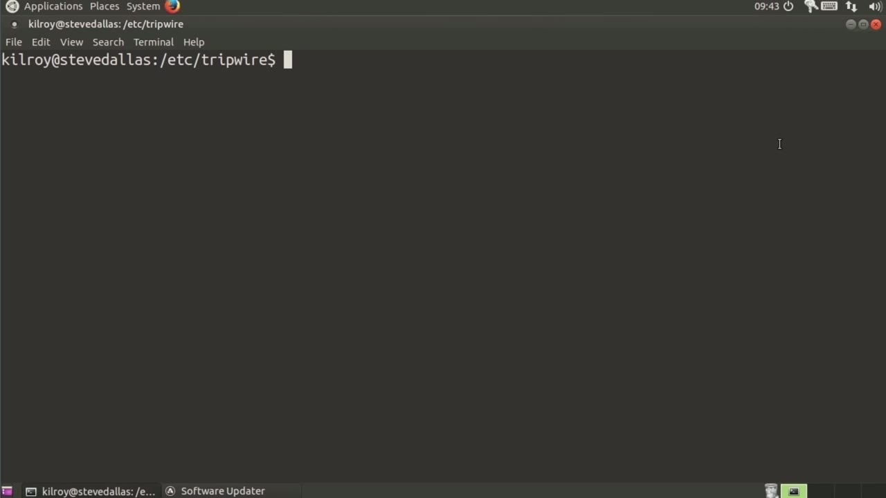
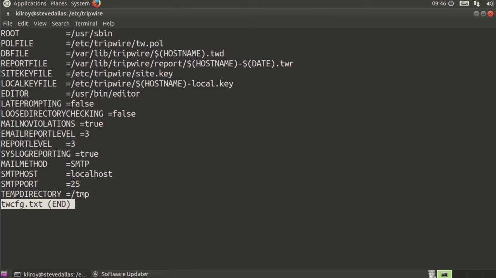
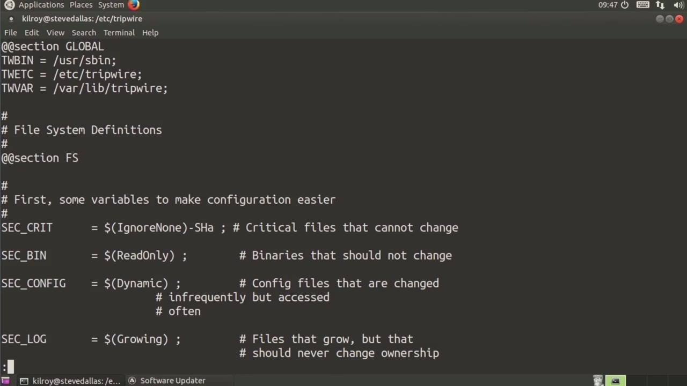
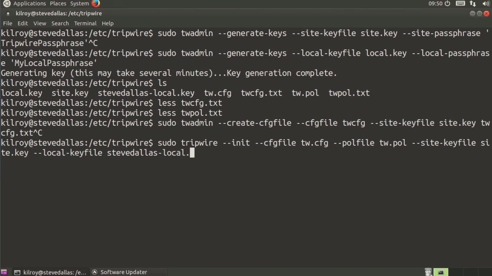

[← Course contents](../../02.md)

# 40. Tripwire

**Course:** [Linux Security & Administration From Boot Process to Firewalls](https://www.youtube.com/watch?v=_WB3evmgxYA)  
**Transcript:** [`Linux Security & Administration From Boot Process to Firewalls transcript`](../../../../course_videos/Linux%20Security%20%26%20Administration%20From%20Boot%20Process%20to%20Firewalls/Linux%20Security%20%26%20Administration%20From%20Boot%20Process%20to%20Firewalls.txt)  
**Video:** 02:57:33–03:04:41 ([open at this time](https://www.youtube.com/watch?v=_WB3evmgxYA&t=10653s))

## Introduction

In addition to antivirus, intrusion detection systems are important. One of the oldest host-based intrusion detection systems is one called Tripwire. So we're going to take a look at Tripwire. By host-based intrusion detection systems, what I'm talking about is a program that makes sure that critical files and binaries or applications on your system don't get modified without your knowledge.

## Detailed Explanation

<details>
  <summary>Step 1 — Run `tripwire`</summary>

### Step 1 — Run `tripwire`

- [x] **Use `tripwire`**
  - In addition to antivirus, intrusion detection systems are important.
  - One of the oldest host-based intrusion detection systems is one called `tripwire`.
  - So we're going to take a look at `tripwire`.

- [x] **Use `tripwire`**
  - By host-based intrusion detection systems, what I'm talking about is a program that makes sure that critical files and binaries or applications on your system don't get modified without your knowledge.
  - Now, `tripwire` takes the concept of security pretty seriously, so it's not just a question of, we're going to scan your system and we're going to make sure that everything matches up.
  - The thing is, we've got to make sure that when we run a check, that we have valid and verifiable results and that they can't be manipulated after the fact by some attacker who's gotten in.

- [x] **Use `tripwire`**
  - `tripwire` results so that the next time you run it shows that a file that actually has been modified hasn't been modified then that's a problem so we use encryption keys in order to help solve that problem we need to create a couple of keys here so i'm going to run tw admin generate keys
  - And we need a site key so site key file is going to be site dot key and then site -passphrase.
  - Now I can run tw admin here and generate my keys for this.

- [x] **I actually already have a key, so I'm not going to run this**
  - I actually already have a key, so I'm not going to run this.
  - I don't want to clobber the key I already have.

```bash
tripwire
```



</details>

<details>
  <summary>Step 2 — Run `tripwire`</summary>

### Step 2 — Run `tripwire`

- [x] **The next thing I need to do is create a local key**
  - The next thing I need to do is create a local key.
  - And then I'm going to say local key file in this case.
  - So I have my site key file and my local key file.

- [x] **And this is just going to be local.ckey**
  - And this is just going to be local.ckey.
  - And then I say local passphrase again here.
  - These aren't particularly good, but give it a good passphrase so that you can generate a key that actually has some value to it.

- [x] **Use `tripwire`**
  - I do already have keys in place. This is the local key that I will be using, but I wanted to show you what the generation process actually looks like as well.
  - So now we have a couple of text files, and those are going to be important for us.
  - This has a number of settings where we can change how `tripwire` actually works.

- [x] **Use `tripwire`**
  - They tell us the route for where `tripwire` is, the policy file, the database file, and then we've got the report file, all of those things.
  - So the next one I want to take a look at is actually the policy file.
  - So the policy file is important because it tells us, what we're going to be looking at.

- [x] **So first of all, we've got the tw binary location is user S-Bin**
  - So first of all, we've got the tw binary location is user S-Bin.

```bash
tripwire
```



</details>

<details>
  <summary>Step 3 — Run `tripwire`, `sudo`</summary>

### Step 3 — Run `tripwire`, `sudo`

- [x] **Use `tripwire`**
  - The /etc location is /etc `tripwire`, and the var location is Var-Lib `tripwire`.
  - So now we've got a number of configuration parameters, we've got `tripwire` binaries.
  - These are the actual `tripwire` binaries so that `tripwire` can know where it is.

- [x] **And then we've got a number of other settings indicating where**
  - And then we've got a number of other settings indicating where important system files are located and the password files.
  - And then we've got rule changes around system boot and various log files that we may not want to pay attention to.
  - And then a number of other locations that we want to scan.

- [x] **Use `sudo`**
  - So this policy is really the places that we want to scan and the things that maybe we don't want to pay so much attention to.
  - So we use tw admin again in order to, and again, I need to be `sudo`.
  - So tw admin, create, cfg file, and my cfg file is going to be my twig, and the site key file is going to be site.comkey.

- [x] **And then I need to give it the input file, which is going to be**
  - And then I need to give it the input file, which is going to be TWConfig.txT. This would ask me for my site passphrase and then it's going to write out my configuration file.
  - So I've already got a configuration file written. I'm not going to do that. I'm also not going to do a policy file because I've already got that created.
  - I do want to jump up to making sure that we have actually created the database and then run a scan.

- [x] **You would also have to do the same thing for the policy file**
  - You would also have to do the same thing for the policy file.
  - So you would do tw admin and then create Paul file.
  - And then basically the same parameters, you give it the policy file, and then the configuration file, the site key, and then the text-based version of the policy.

- [x] **Use `tripwire`**
  - So now I'm going to run `tripwire`, In it.
  - My cfg file is going to be TW.cg, and then my policy file is twpol, and then site key file is going to be site.
  - And then my local key file is going to be the one that was created when I did the installation.

```bash
tripwire
sudo
```



</details>

<details>
  <summary>Step 4 — Run `tripwire`, `tripwire --chek`</summary>

### Step 4 — Run `tripwire`, `tripwire --chek`

- [x] **Use `tripwire`**
  - So when I did the installation of `tripwire` on, this Ubuntu system, it actually walked through doing the creation of the keys.
  - And it was really just as simple as you give it a passphrase, you verify the passphrase, and it goes off and creates the keys for you.
  - Now I'm going to do an initialization here.

- [x] **Use `tripwire --chek`**
  - We are going to be generating the database with all of the initial values.
  - So what it's doing is it's going through the entire file system creating hashes of all of the important files and then storing it in this protected database.
  - Once we've got the initial file done, all I have to do is run `tripwire --chek`, and that will run checks against the policy and the configuration, and then check it against the existing database.

- [x] **Use `tripwire`**
  - So that's how you would use `tripwire` to help protect your system against any unauthorized or unexpected changes to critical system files or binaries.
  - `tripwire`, of course, is not the only host-based intrusion detection system.

```bash
tripwire
tripwire --chek
```



</details>

<details>
  <summary>Questions and Answers</summary>

## Questions and Answers

### Question 1: What does `tripwire` do in this chapter?

<details>
<summary>Answer</summary>

- [x] One of the oldest host-based intrusion detection systems is one called `tripwire`.

</details>

### Question 2: What does `sudo` do in this chapter?

<details>
<summary>Answer</summary>

- [x] So we use tw admin again in order to, and again, I need to be `sudo`.

</details>

### Question 3: What does `tripwire --chek` do in this chapter?

<details>
<summary>Answer</summary>

- [x] Once we've got the initial file done, all I have to do is run `tripwire --chek`, and that will run checks against the policy and the configuration, and then check it against the existing database.

</details>

### Question 4: What does step 1 cover (Run tripwire)?

<details>
<summary>Answer</summary>

- [x] In addition to antivirus, intrusion detection systems are important.
- [x] One of the oldest host-based intrusion detection systems is one called `tripwire`.
- [x] So we're going to take a look at `tripwire`.

</details>

### Question 5: What does step 2 cover (Run tripwire)?

<details>
<summary>Answer</summary>

- [x] The next thing I need to do is create a local key.
- [x] And then I'm going to say local key file in this case.
- [x] So I have my site key file and my local key file.

</details>

### Question 6: What does step 3 cover (Run tripwire, sudo)?

<details>
<summary>Answer</summary>

- [x] The /etc location is /etc `tripwire`, and the var location is Var-Lib `tripwire`.
- [x] So now we've got a number of configuration parameters, we've got `tripwire` binaries.
- [x] These are the actual `tripwire` binaries so that `tripwire` can know where it is.

</details>

### Question 7: What does step 4 cover (Run tripwire, tripwire --chek)?

<details>
<summary>Answer</summary>

- [x] So when I did the installation of `tripwire` on, this Ubuntu system, it actually walked through doing the creation of the keys.
- [x] And it was really just as simple as you give it a passphrase, you verify the passphrase, and it goes off and creates the keys for you.
- [x] Now I'm going to do an initialization here.

</details>

</details>

## Summary

This chapter, Tripwire, walks through Run tripwire; Run tripwire; Run tripwire, sudo; Run tripwire, tripwire --chek. Commands from the transcript: `tripwire`, `sudo`, `tripwire --chek`.

## References

- [Linux Security & Administration From Boot Process to Firewalls (YouTube)](https://www.youtube.com/watch?v=_WB3evmgxYA)
- [This chapter at 02:57:33](https://www.youtube.com/watch?v=_WB3evmgxYA&t=10653s)
- [Local transcript](../../../../course_videos/Linux%20Security%20%26%20Administration%20From%20Boot%20Process%20to%20Firewalls/Linux%20Security%20%26%20Administration%20From%20Boot%20Process%20to%20Firewalls.txt)
