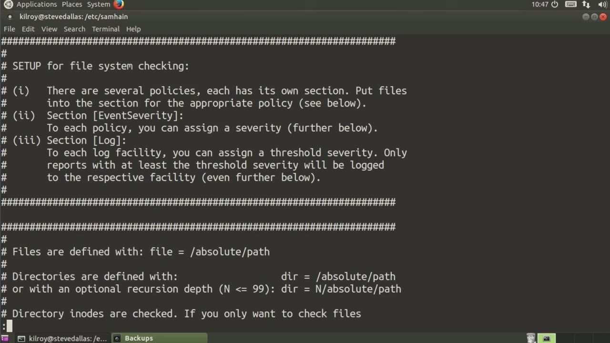
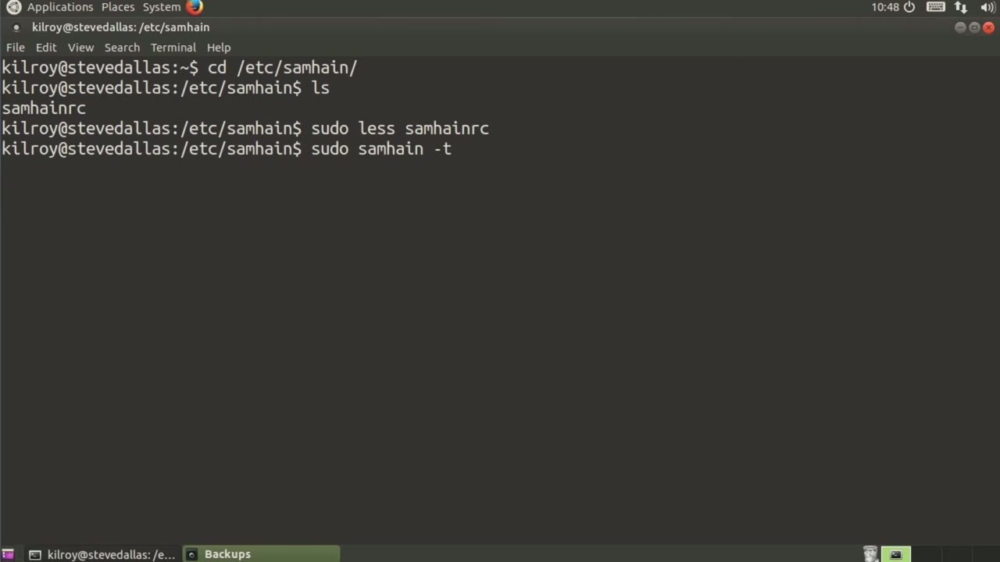
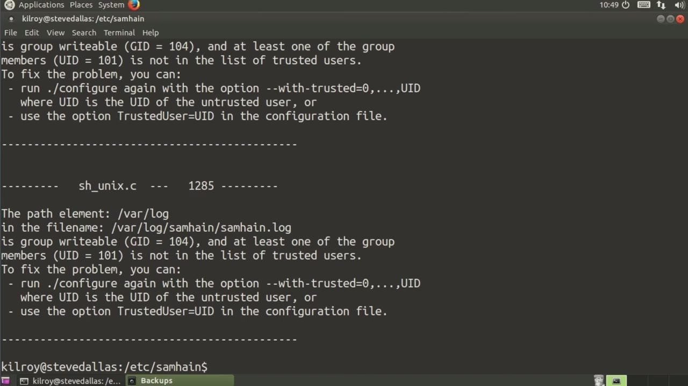

[← Course contents](../../02.md)

# 41. Samhaim

**Course:** [Linux Security & Administration From Boot Process to Firewalls](https://www.youtube.com/watch?v=_WB3evmgxYA)  
**Transcript:** [`Linux Security & Administration From Boot Process to Firewalls transcript`](../../../../course_videos/Linux%20Security%20%26%20Administration%20From%20Boot%20Process%20to%20Firewalls/Linux%20Security%20%26%20Administration%20From%20Boot%20Process%20to%20Firewalls.txt)  
**Video:** 03:04:41–03:07:54 ([open at this time](https://www.youtube.com/watch?v=_WB3evmgxYA&t=11081s))

## Introduction

And I should probably be clear in saying that doing file verification and integrity checking isn't the only way of doing host-based intrusion detection, but it is the classic way, and it's the way that we've been doing host-based intrusion detection for quite a while now. Another way of doing file verification, file integrity checking is to the use of a program called Samhane. So we're going to pop into the Samhane directory here, and you'll see that we've got just a configuration file. We can do basically the same sorts of things that we could do with Tripwire.

## Detailed Explanation

<details>
  <summary>Step 1 — Run `tripwire`</summary>

### Step 1 — Run `tripwire`

- [x] **And I should probably be clear in saying that doing file verification**
  - And I should probably be clear in saying that doing file verification and integrity checking isn't the only way of doing host-based intrusion detection, but it is the classic way, and it's the way that we've been doing host-based intrusion detection for quite a while now.
  - Another way of doing file verification, file integrity checking is to the use of a program called Samhane.
  - So we're going to pop into the Samhane directory here, and you'll see that we've got just a configuration file.

- [x] **Use `tripwire`**
  - We can do basically the same sorts of things that we could do with `tripwire`.
  - You can set all of the different directories that you want to look at.
  - You can specify files that you want to see.

- [x] **So for example, these files that you can see listed here, we're only**
  - So for example, these files that you can see listed here, we're only going to be checking for changes in permissions and ownership.

```bash
tripwire
```



</details>

<details>
  <summary>Step 2 — Run `tripwire`</summary>

### Step 2 — Run `tripwire`

- [x] **We've got log files that we're going to look at**
  - We've got log files that we're going to look at.
  - So a lot of different sections here in the configuration file that we can use to set up exactly how we want to monitor our system.
  - Once we have got the configuration file set up the way that we want to, the first thing that we need to do is initialize the database.

- [x] **Use `tripwire`**
  - Just as we did with `tripwire`, we have to create a baseline.
  - So we're going to go through and generate signatures for all of the files that we are specifying.
  - At this point, we've gone through and we have done the initial creation of the database that it's going to use.

- [x] **Now you'll notice that one thing that we haven't done here is we**
  - Now you'll notice that one thing that we haven't done here is we haven't signed anything.

```bash
tripwire
```



</details>

<details>
  <summary>Step 3 — there is no signature on anything, not using any sort of cryptographic</summary>

### Step 3 — there is no signature on anything, not using any sort of cryptographic

- [x] **So there is no signature on anything, not using any sort of**
  - So there is no signature on anything, not using any sort of cryptographic hash, any sort of signature, nothing like that.
  - Now what you can do certainly is you can use something like gpg to do the signing by hand if that's what you want to do.
  - Now, once we have done the initialization of the database, all we need to do is run periodic checks against it, and we can do that using -T check. So now we're going to run through, and obviously at this point, we haven't really done anything because we just barely ran the initialization. So we haven't found

- [x] **Anything here. So you can use Sam Hane as another way of doing file**
  - Anything here. So you can use Sam Hane as another way of doing file integrity checking You're going to configure it with all of the things that you care to be looking at.
  - And once you've got an initialized database, you can just keep running checks against it.
  - Of course, if you want to change your baseline, you need to re-initialize your database.

- [x] **And that same is true with any file integrity checking program**
  - And that same is true with any file integrity checking program.
  - If you want to update your baseline because you have done a system update, for example.
  - You need to re-initialize your database so you can create the new set of all of the hashes that correspond with the files on your system. What I want to do right now is take a look



</details>

<details>
  <summary>Questions and Answers</summary>

## Questions and Answers

### Question 1: What does `tripwire` do in this chapter?

<details>
<summary>Answer</summary>

- [x] We can do basically the same sorts of things that we could do with `tripwire`.

</details>

### Question 2: What does step 1 cover (Run tripwire)?

<details>
<summary>Answer</summary>

- [x] And I should probably be clear in saying that doing file verification and integrity checking isn't the only way of doing host-based intrusion detection, but it is the classic way, and it's the way that we've been doing host-based intrusion detection for quite a while now.
- [x] Another way of doing file verification, file integrity checking is to the use of a program called Samhane.
- [x] So we're going to pop into the Samhane directory here, and you'll see that we've got just a configuration file.

</details>

### Question 3: What does step 2 cover (Run tripwire)?

<details>
<summary>Answer</summary>

- [x] We've got log files that we're going to look at.
- [x] So a lot of different sections here in the configuration file that we can use to set up exactly how we want to monitor our system.
- [x] Once we have got the configuration file set up the way that we want to, the first thing that we need to do is initialize the database.

</details>

### Question 4: What does step 3 cover (there is no signature on anything, not using any sort of cryptographic)?

<details>
<summary>Answer</summary>

- [x] So there is no signature on anything, not using any sort of cryptographic hash, any sort of signature, nothing like that.
- [x] Now what you can do certainly is you can use something like gpg to do the signing by hand if that's what you want to do.
- [x] Now, once we have done the initialization of the database, all we need to do is run periodic checks against it, and we can do that using -T check. So now we're going to run through, and obviously at this point, we haven't really done anything because we just barely ran the initialization. So we haven't found

</details>

</details>

## Summary

This chapter, Samhaim, walks through Run tripwire; Run tripwire; there is no signature on anything, not using any sort of cryptographic. Commands from the transcript: `tripwire`.

## References

- [Linux Security & Administration From Boot Process to Firewalls (YouTube)](https://www.youtube.com/watch?v=_WB3evmgxYA)
- [This chapter at 03:04:41](https://www.youtube.com/watch?v=_WB3evmgxYA&t=11081s)
- [Local transcript](../../../../course_videos/Linux%20Security%20%26%20Administration%20From%20Boot%20Process%20to%20Firewalls/Linux%20Security%20%26%20Administration%20From%20Boot%20Process%20to%20Firewalls.txt)
