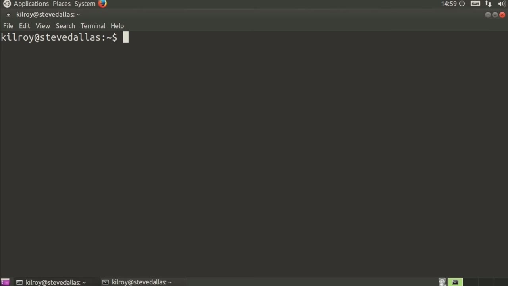
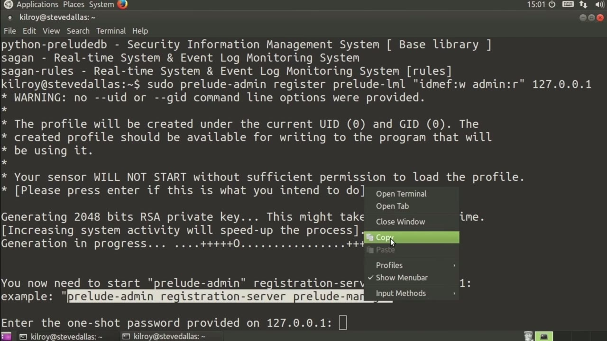
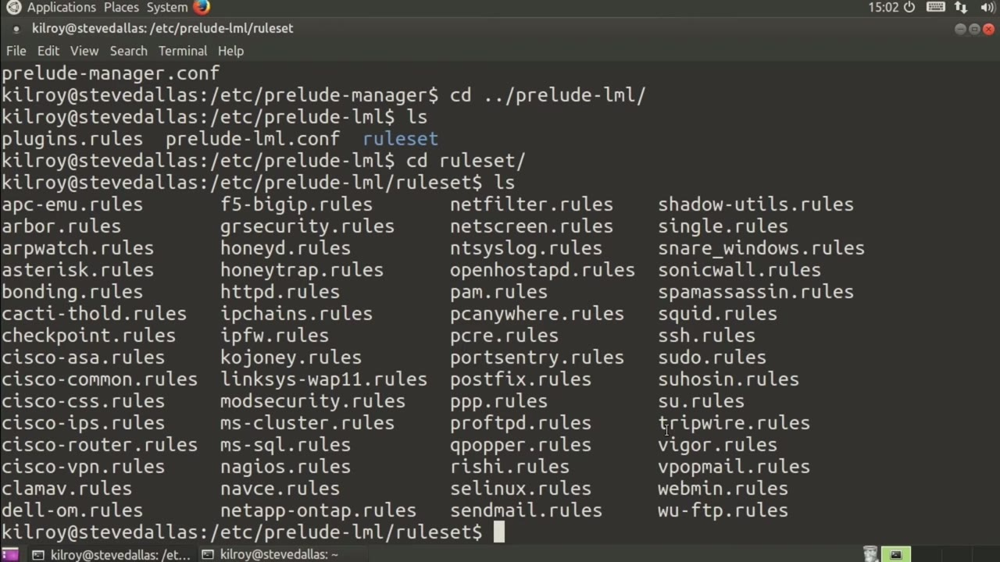

[← Course contents](../../02.md)

# 42. Prelude

**Course:** [Linux Security & Administration From Boot Process to Firewalls](https://www.youtube.com/watch?v=_WB3evmgxYA)  
**Transcript:** [`Linux Security & Administration From Boot Process to Firewalls transcript`](../../../../course_videos/Linux%20Security%20%26%20Administration%20From%20Boot%20Process%20to%20Firewalls/Linux%20Security%20%26%20Administration%20From%20Boot%20Process%20to%20Firewalls.txt)  
**Video:** 03:07:54–03:11:31 ([open at this time](https://www.youtube.com/watch?v=_WB3evmgxYA&t=11274s))

## Introduction

at Prelude. Prelude is a way of sending alerts from a few different types of intrusion detection systems into a single place so that you've got one location to store them. Now I have installed various Prelude components here. And I can show you which ones are actually installed. I'm on an Ubuntu system here, and if I just search for Prelude, we've got Prelude Correlator, Prelude Log Agent, or Prelude lml, Prelude Manager, and Prelude Notify.

## Detailed Explanation

<details>
  <summary>Step 1 — at Prelude. Prelude is a way of sending alerts from a few different</summary>

### Step 1 — at Prelude. Prelude is a way of sending alerts from a few different

- [x] **at Prelude. Prelude is a way of sending alerts from a few different**
  - at Prelude. Prelude is a way of sending alerts from a few different types of intrusion detection systems into a single place so that you've got one location to store them.
  - Now I have installed various Prelude components here.
  - And I can show you which ones are actually installed.

- [x] **I'm on an Ubuntu system here, and if I just search for Prelude, we've**
  - I'm on an Ubuntu system here, and if I just search for Prelude, we've got Prelude Correlator, Prelude Log Agent, or Prelude lml, Prelude Manager, and Prelude Notify.
  - We've also got some additional components that would have to be installed with libraries and so forth.
  - But I just want to show you Prelude at the moment in how we would get the Log Manager agent registered to the Prelude server.

- [x] **The first thing I need to do is run as administrator, Prelude-Admin**
  - The first thing I need to do is run as administrator, Prelude-Admin, register, and we're going to register Prelude lml.
  - So we need to register all of our agents into the Prelude server.
  - Now I need to give permissions for alerts.

- [x] **So I'm going to say write and then admin is going to get read**
  - So I'm going to say write and then admin is going to get read privileges here.
  - And then that's 127.0.0.1 is going to be my local host here.
  - I'm going to just say yes here and it's going to generate a key.

- [x] **Now it's looking for a one-shot password**
  - Now it's looking for a one-shot password.
  - So what I need to do is go to another window here.



</details>

<details>
  <summary>Step 2 — I am going to run this command right here that's going to generate me a</summary>

### Step 2 — I am going to run this command right here that's going to generate me a

- [x] **And I am going to run this command right here that's going to**
  - And I am going to run this command right here that's going to generate me a one-time password that's going to allow me to complete the registration.
  - If I just run this and they need to be administrator here, it's asking for the password on the other window.
  - So we'll go back over here, paste it in, and it should ask me to verify.

- [x] **Now we have succeeded with the authentication, and we're going**
  - Now we have succeeded with the authentication, and we're going...
  - To connect to the registration server and over here we've got to approve the registration.
  - Now we have successfully registered the log manager into our Prelude admin and you would do the same thing with other agents that you wanted to connect into your Prelude system. You would have to register them and go through the process of key generation and then getting them associated as we did here.

- [x] **There are places that you can go for additional configuration here**
  - There are places that you can go for additional configuration here.



</details>

<details>
  <summary>Step 3 — Run `sudo`, `snort`</summary>

### Step 3 — Run `sudo`, `snort`

- [x] **For example, if we go into Prelude Manager, there's a configuration**
  - For example, if we go into Prelude Manager, there's a configuration file there.
  - If we go up into Prelude-LML, there's...
  - Configuration files here as well. In addition, there's rule sets. So if we were to look at the rules, there would be rules related to the various services that are on this particular system.

- [x] **Use `sudo`**
  - So for example, we could take a look at `sudo` rules here. I'm going to look at the `sudo` rules.
  - You can see we've got rules that are related to what it's going to look for in the log files.
  - And this is going to tell Prelude lml what it's going to be looking for and how it's going to alert on it.

- [x] **Use `snort`**
  - So Pralute is another thing that you can have on your system that's going to help you manage different components like intrusion detection systems like `snort` and again like this Prelude Log Manager, Prelude lml.

```bash
sudo
snort
```



</details>

<details>
  <summary>Questions and Answers</summary>

## Questions and Answers

### Question 1: What does `sudo` do in this chapter?

<details>
<summary>Answer</summary>

- [x] So for example, we could take a look at `sudo` rules here. I'm going to look at the `sudo` rules.

</details>

### Question 2: What does `snort` do in this chapter?

<details>
<summary>Answer</summary>

- [x] So Pralute is another thing that you can have on your system that's going to help you manage different components like intrusion detection systems like `snort` and again like this Prelude Log Manager, Prelude lml.

</details>

### Question 3: What does step 1 cover (at Prelude. Prelude is a way of sending alerts from a few different)?

<details>
<summary>Answer</summary>

- [x] at Prelude. Prelude is a way of sending alerts from a few different types of intrusion detection systems into a single place so that you've got one location to store them.
- [x] Now I have installed various Prelude components here.
- [x] And I can show you which ones are actually installed.

</details>

### Question 4: What does step 2 cover (I am going to run this command right here that's going to generate me a)?

<details>
<summary>Answer</summary>

- [x] And I am going to run this command right here that's going to generate me a one-time password that's going to allow me to complete the registration.
- [x] If I just run this and they need to be administrator here, it's asking for the password on the other window.
- [x] So we'll go back over here, paste it in, and it should ask me to verify.

</details>

### Question 5: What does step 3 cover (Run sudo, snort)?

<details>
<summary>Answer</summary>

- [x] For example, if we go into Prelude Manager, there's a configuration file there.
- [x] If we go up into Prelude-LML, there's...
- [x] Configuration files here as well. In addition, there's rule sets. So if we were to look at the rules, there would be rules related to the various services that are on this particular system.

</details>

</details>

## Summary

This chapter, Prelude, walks through at Prelude. Prelude is a way of sending alerts from a few different; I am going to run this command right here that's going to generate me a; Run sudo, snort. Commands from the transcript: `sudo`, `snort`.

## References

- [Linux Security & Administration From Boot Process to Firewalls (YouTube)](https://www.youtube.com/watch?v=_WB3evmgxYA)
- [This chapter at 03:07:54](https://www.youtube.com/watch?v=_WB3evmgxYA&t=11274s)
- [Local transcript](../../../../course_videos/Linux%20Security%20%26%20Administration%20From%20Boot%20Process%20to%20Firewalls/Linux%20Security%20%26%20Administration%20From%20Boot%20Process%20to%20Firewalls.txt)
