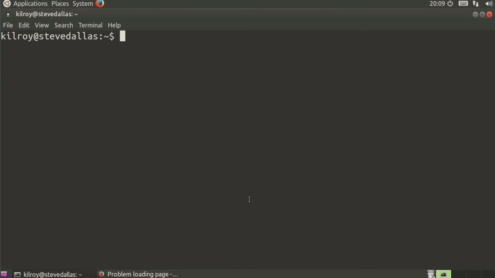
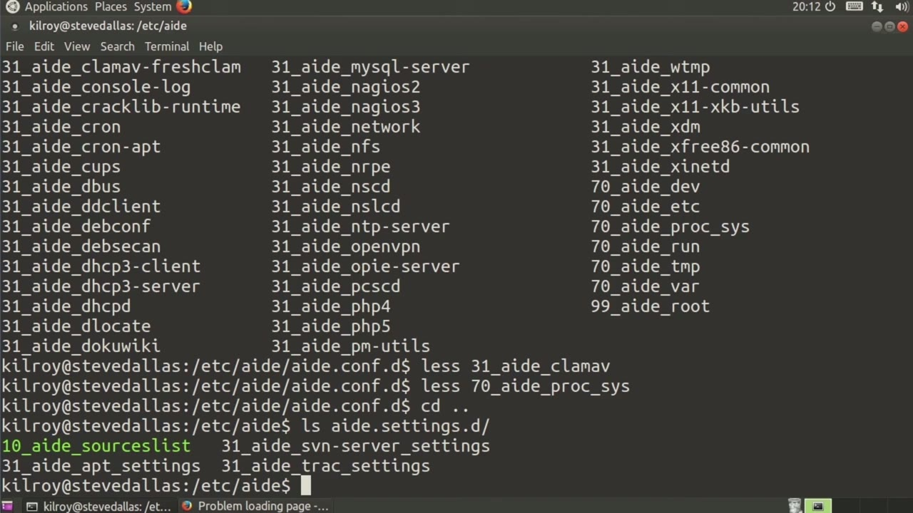
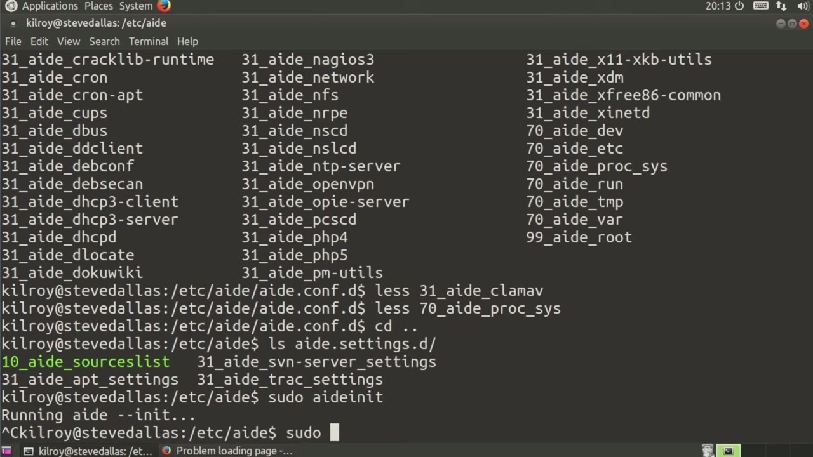

[← Course contents](../../02.md)

# 43. AIDE

**Course:** [Linux Security & Administration From Boot Process to Firewalls](https://www.youtube.com/watch?v=_WB3evmgxYA)  
**Transcript:** [`Linux Security & Administration From Boot Process to Firewalls transcript`](../../../../course_videos/Linux%20Security%20%26%20Administration%20From%20Boot%20Process%20to%20Firewalls/Linux%20Security%20%26%20Administration%20From%20Boot%20Process%20to%20Firewalls.txt)  
**Video:** 03:11:31–03:15:10 ([open at this time](https://www.youtube.com/watch?v=_WB3evmgxYA&t=11491s))

## Introduction

Now, there are a number of different intrusion detection packages that you can install on Linux. Mostly, they do this file integrity checking that is really important on systems to make sure that your files aren't being adjusted without you knowing about them, particularly with respect to system files, so you don't have like root kits installed and that sort of thing. We're going to take a look at aid in this case, which is the advanced intrusion detection environment. So I'm going to just take a look at aid.comf here.

## Detailed Explanation

  
Step 1 — Now, there are a number of different intrusion detection packages that

### Step 1 — Now, there are a number of different intrusion detection packages that

- [x] **Now, there are a number of different intrusion detection packages**
  - Now, there are a number of different intrusion detection packages that you can install on Linux.
  - Mostly, they do this file integrity checking that is really important on systems to make sure that your files aren't being adjusted without you knowing about them, particularly with respect to system files, so you don't have like root kits installed and that sort of thing.
  - We're going to take a look at aid in this case, which is the advanced intrusion detection environment.

- [x] **So I'm going to just take a look at aid.comf here**
  - So I'm going to just take a look at aid.comf here.
  - Pretty standard configuration tells us where the database is.
  - There are a number of other parameters here.

- [x] **I'm not actually going to change any of these**
  - I'm not actually going to change any of these.
  - We're just kind of skim through here and see what we've got.
  - We can set a number of other rules here.

- [x] **I'm going to set my log rules to say owner mode**
  - I'm going to set my log rules to say owner mode.
  - And you'll see what we've got here are a number of configuration files for different packages.
  - For Clam av. That's good. We've got a set of log files there. We're going to take a look at Proxys here.

- [x] **This is another configuration file. So you can see it specifies a**
  - This is another configuration file. So you can see it specifies a number of configuration files.
  - What this says is don't do these directories. It's fine. We've got a number of configuration settings that are specific to different packages that may be on the system. So let's just pop back up and take a look at what we've got.

  
Step 2 — we've now got some other settings with respect to sources and app

### Step 2 — we've now got some other settings with respect to sources and app

- [x] **And we've now got some other settings with respect to sources and app**
  - And we've now got some other settings with respect to sources and app.
  - What Aid Init itself does is it's kind of a wrapper.
  - If I were just to run Ade--Init before I had run aed In-it, there would be an error message saying it couldn't open a particular file.

- [x] **So this wrapper program here does some additional setup for me**
  - So this wrapper program here does some additional setup for me.
  - And now we're just doing an initialization on the database.
  - Once we have gone through this initialization, we can run a check on it.

- [x] **Now there's a couple of different ways to do that**
  - Now there's a couple of different ways to do that.

  
Step 3 — I'm just going to kill this just to show you because it's going to take

### Step 3 — I'm just going to kill this just to show you because it's going to take

- [x] **So I'm just going to kill this just to show you because it's going to**
  - So I'm just going to kill this just to show you because it's going to take a while to run through the entire file system.
  - What I'm going to do is say aid -dash check is one way of doing it.
  - The other way of doing it is saying aid.

- [x] **Dot wrapper is a wrapper script to make sure that everything is kind**
  - Dot wrapper is a wrapper script to make sure that everything is kind of in place.
  - Now there's something else that we've got going on here, which is going to be our Cron script.
  - Our Cron script should be set up in Cron.daily so that we have a script that is actually going to run through and run the aid check every day for us.

- [x] **And you can see that we've got the aid script set up in our Cron**
  - And you can see that we've got the aid script set up in our Cron.
  - Cron, again, is going to run through everything on an hourly daily basis.
  - And you can see that aid is scheduled to run once a day.

  
Questions and Answers

## Questions and Answers

### Question 1: What does step 1 cover (Now, there are a number of different intrusion detection packages that)?

Answer

- [x] Now, there are a number of different intrusion detection packages that you can install on Linux.
- [x] Mostly, they do this file integrity checking that is really important on systems to make sure that your files aren't being adjusted without you knowing about them, particularly with respect to system files, so you don't have like root kits installed and that sort of thing.
- [x] We're going to take a look at aid in this case, which is the advanced intrusion detection environment.

### Question 2: What does step 2 cover (we've now got some other settings with respect to sources and app)?

Answer

- [x] And we've now got some other settings with respect to sources and app.
- [x] What Aid Init itself does is it's kind of a wrapper.
- [x] If I were just to run Ade--Init before I had run aed In-it, there would be an error message saying it couldn't open a particular file.

### Question 3: What does step 3 cover (I'm just going to kill this just to show you because it's going to take)?

Answer

- [x] So I'm just going to kill this just to show you because it's going to take a while to run through the entire file system.
- [x] What I'm going to do is say aid -dash check is one way of doing it.
- [x] The other way of doing it is saying aid.

## Summary

This chapter, AIDE, walks through Now, there are a number of different intrusion detection packages that; we've now got some other settings with respect to sources and app; I'm just going to kill this just to show you because it's going to take.

## References

- [Linux Security & Administration From Boot Process to Firewalls (YouTube)](https://www.youtube.com/watch?v=_WB3evmgxYA)
- [This chapter at 03:11:31](https://www.youtube.com/watch?v=_WB3evmgxYA&t=11491s)
- [Local transcript](../../../../course_videos/Linux%20Security%20%26%20Administration%20From%20Boot%20Process%20to%20Firewalls/Linux%20Security%20%26%20Administration%20From%20Boot%20Process%20to%20Firewalls.txt)
