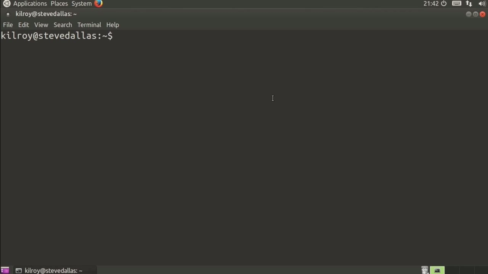
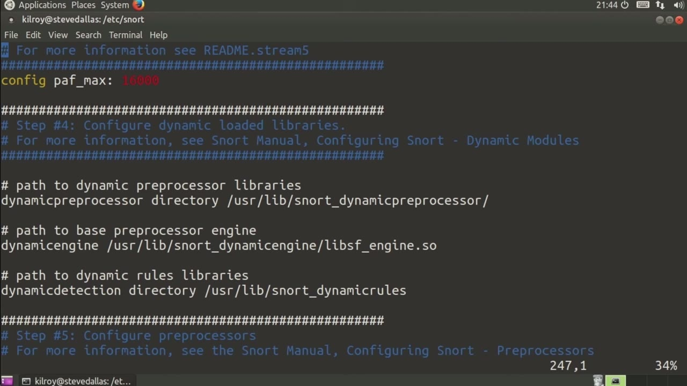
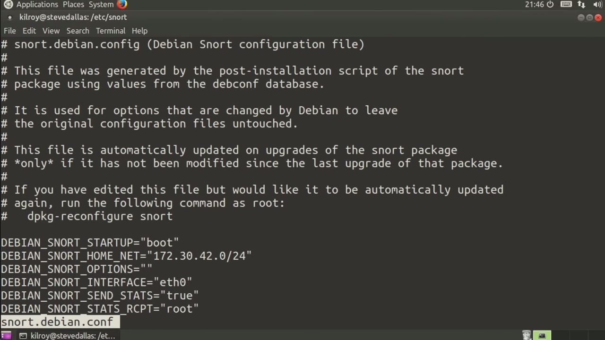
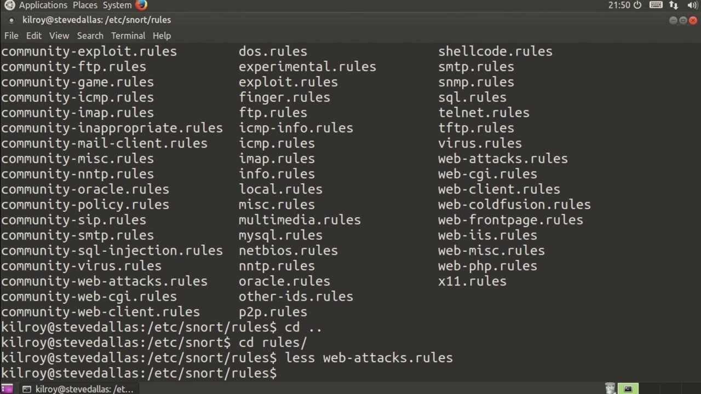

[← Course contents](../../02.md)

# 44. Snort

**Course:** [Linux Security & Administration From Boot Process to Firewalls](https://www.youtube.com/watch?v=_WB3evmgxYA)  
**Transcript:** [`Linux Security & Administration From Boot Process to Firewalls transcript`](../../../../course_videos/Linux%20Security%20%26%20Administration%20From%20Boot%20Process%20to%20Firewalls/Linux%20Security%20%26%20Administration%20From%20Boot%20Process%20to%20Firewalls.txt)  
**Video:** 03:15:10–03:22:16 ([open at this time](https://www.youtube.com/watch?v=_WB3evmgxYA&t=11710s))

## Introduction

We're going to take a look at a different type of intrusion detection system at this point. Rather than looking at host-based intrusion detection, we're going to take a look at network-based intrusion detection. The common network-based intrusion detection program or application that runs on Linux and, frankly, runs on other operating systems as well. But the common one that's used is one that's called Snort.

## Detailed Explanation

<details>
  <summary>Step 1 — Run `snort`</summary>

### Step 1 — Run `snort`

- [x] **We're going to take a look at a different type of intrusion detection**
  - We're going to take a look at a different type of intrusion detection system at this point.
  - Rather than looking at host-based intrusion detection, we're going to take a look at network-based intrusion detection.
  - The common network-based intrusion detection program or application that runs on Linux and, frankly, runs on other operating systems as well.

- [x] **Use `snort`**
  - But the common one that's used is one that's called `snort`.
  - Now, there are pretty easy ways to install `snort` on most versions of Linux, or most Linux distributions, rather.
  - And we can certainly do that here on this Ubuntu system.

- [x] **Use `snort`**
  - Let me just do a quick search for `snort`.
  - And you'll see that we've got `snort`, `snort` Common, `snort` Common Library, `snort` Doc, and `snort` Rules default.
  - If I were just to say, App -Get install `snort`, then it's going to install all of the right pieces for me.

- [x] **And in fact, that's what I've done here**
  - And in fact, that's what I've done here.
  - So let's just take a quick skim through the configuration file.
  - And I'm going to edit it in admin mode just so that if I make changes, I can actually write them out.

- [x] **This is a fairly detailed configuration file, very well documented**
  - This is a fairly detailed configuration file, very well documented.
  - You want to set your home network and then your external network.
  - This is going to be set actually as this note.

- [x] **Use `snort`**
  - There is /etc `snort`, `snort`.debion.com.
  - That this particular variable is overridden by.
  - So we should take a look and make sure that that's not actually there.

- [x] **This is an Ubuntu system, but it does inherit from Debian**
  - This is an Ubuntu system, but it does inherit from Debian.
  - So we want to make sure that that's not there as well.
  - Now we've got DNS servers, SMTP servers.

- [x] **You can certainly configure all of these variables and ports if you**
  - You can certainly configure all of these variables and ports if you want to.
  - The important parts down here are the rules.
  - And then of course there's also white lists, paths and blacklist paths if you want to do that.

- [x] **Now we can configure the various decoders that are going to be used**
  - Now we can configure the various decoders that are going to be used.
  - And you can see most of this is actually enabled by default.
  - Certainly, if you want to look at oversized alerts, if the length is actually greater than the length of the packet, you can turn that on.

```bash
snort
```



</details>

<details>
  <summary>Step 2 — Run `snort`, `tcpdump`</summary>

### Step 2 — Run `snort`, `tcpdump`

- [x] **Use `snort`**
  - There's oversized drops. There are ignore ports if you want to ignore some things.
  - And normally you would also have to configure outputs as well towards the bottom of the file here.
  - But in more recent versions of `snort`, what they have done, and let's just hop down to the output section here.

- [x] **What they have done recently is shut off all of the old ways of doing**
  - What they have done recently is shut off all of the old ways of doing output.
  - So you used to be able to do syslog as well as different databases.
  - Now they just write out to a binary log file called `snort`.log.

- [x] **Use `snort`**
  - Actually, there's not even any other way of doing it.
  - With the more recent `snort` installations.
  - You've got Unified 2, you've got your `snort`.log.

- [x] **Use `tcpdump`, `snort`**
  - There is another program that you can use to actually handle the conversion of this binary log file to other formats, and we'll get a look at that a little bit later on.
  - So what I'm going to do here is turn on syslog, and then I'm going to also turn on pcap, because what I want is I want some `tcpdump` output that I can actually look at in Wireshark.
  - And then what I need to do is restart `snort`.

- [x] **Use `snort`**
  - So I'm just restarting `snort` with these new parameters.
  - We do have the `snort`.debion.conf, and we'll take a quick look at that before moving into the rules directory.
  - So here's the various configurations that are set up on this system.

```bash
snort
tcpdump
```



</details>

<details>
  <summary>Step 3 — Run `snort interface`, `snort`</summary>

### Step 3 — Run `snort interface`, `snort`

- [x] **Use `snort interface`**
  - So we've got our home network, our `snort interface`, and then We've got a couple of other parameters that we don't really care so much about in terms of things that we might want to consider changing.
  - Now let's hop into the rules directory. And you can see all of these rules are here.
  - These are actually enabled just by virtue of being here for the most part unless you've disabled some of them.

- [x] **Use `snort`**
  - In the `snort` configuration file.
  - Now these are updated periodically and there are a handful of ways that you can actually keep these rules up to date.
  - You can use a program called pulled pork, for example, to pull current rules and make sure that your `snort` rules are regularly kept up to date.

- [x] **Use `snort`**
  - For our purposes, these are going to be just fine.
  - Again, we've taken a look at `snort` here, which is a network.
  - Based intrusion detection system, that means that it listens on the network interface for various types of attacks or intrusion attempts. When something like that happens, it matches on a particular rule, and let's just take a look at one of these rules, so that you can see what we're actually

- [x] **Talking about here. These are going to be written in**
  - Talking about here. These are going to be written in...
  - A form where they are being matched against network packets.
  - So let's just take a look at the web attacks. rules.

```bash
snort interface
snort
```



</details>

<details>
  <summary>Step 4 — Run `snort`</summary>

### Step 4 — Run `snort`

- [x] **What we've got here is an alert if it's TCP from an external network**
  - What we've got here is an alert if it's TCP from an external network to one of our HTTP servers on an HTTP port, then we get a web attacks message.
  - And what we're looking at here is a class type of web application attack.
  - You can see that some of this is actually fairly easy to read.

- [x] **Others, you really need to be looking a little bit more closely at it**
  - Others, you really need to be looking a little bit more closely at it to be able to determine what's really happening.
  - As an example, what we're looking at here is for the existence of /bin slash ps in the uri content.
  - So there are other places where you may just want to be looking in the content of the message itself and you can see those down here.

- [x] **As an example and some of these you can see no case meaning we don't**
  - As an example and some of these you can see no case meaning we don't really care about what case it actually happens in.
  - You can see the hex encoding here, this is ascii encoding. The percent 20 is an indication that this is actually a space because the percent 20 says this is actually a hexadecimal value that should be converted to an ascii character code.
  - 20 converts to 32 in decimal and 32 in decimal in the ASCy tables is a space.

- [x] **So if we see ps percent 20 in the uri, that's really a ps space**
  - So if we see ps percent 20 in the uri, that's really a ps space.
  - So that would actually be an attack there.
  - So you can see there's a lot of attack types.

- [x] **Use `snort`**
  - There are a number of other attacks as well.
  - So `snort` is a very powerful intrusion detection system.
  - If you need something for your network where you are looking at all of the traffic that's passing by your network interface, `snort` is going to be a really good option for you on a Linux system.

```bash
snort
```



</details>

<details>
  <summary>Questions and Answers</summary>

## Questions and Answers

### Question 1: What does `snort` do in this chapter?

<details>
<summary>Answer</summary>

- [x] But the common one that's used is one that's called `snort`.

</details>

### Question 2: What does `tcpdump` do in this chapter?

<details>
<summary>Answer</summary>

- [x] So what I'm going to do here is turn on syslog, and then I'm going to also turn on pcap, because what I want is I want some `tcpdump` output that I can actually look at in Wireshark.

</details>

### Question 3: What does `snort interface` do in this chapter?

<details>
<summary>Answer</summary>

- [x] So we've got our home network, our `snort interface`, and then We've got a couple of other parameters that we don't really care so much about in terms of things that we might want to consider changing.

</details>

### Question 4: What does step 1 cover (Run snort)?

<details>
<summary>Answer</summary>

- [x] We're going to take a look at a different type of intrusion detection system at this point.
- [x] Rather than looking at host-based intrusion detection, we're going to take a look at network-based intrusion detection.
- [x] The common network-based intrusion detection program or application that runs on Linux and, frankly, runs on other operating systems as well.

</details>

### Question 5: What does step 2 cover (Run snort, tcpdump)?

<details>
<summary>Answer</summary>

- [x] There's oversized drops. There are ignore ports if you want to ignore some things.
- [x] And normally you would also have to configure outputs as well towards the bottom of the file here.
- [x] But in more recent versions of `snort`, what they have done, and let's just hop down to the output section here.

</details>

### Question 6: What does step 3 cover (Run snort interface, snort)?

<details>
<summary>Answer</summary>

- [x] So we've got our home network, our `snort interface`, and then We've got a couple of other parameters that we don't really care so much about in terms of things that we might want to consider changing.
- [x] Now let's hop into the rules directory. And you can see all of these rules are here.
- [x] These are actually enabled just by virtue of being here for the most part unless you've disabled some of them.

</details>

### Question 7: What does step 4 cover (Run snort)?

<details>
<summary>Answer</summary>

- [x] What we've got here is an alert if it's TCP from an external network to one of our HTTP servers on an HTTP port, then we get a web attacks message.
- [x] And what we're looking at here is a class type of web application attack.
- [x] You can see that some of this is actually fairly easy to read.

</details>

</details>

## Summary

This chapter, Snort, walks through Run snort; Run snort, tcpdump; Run snort interface, snort; Run snort. Commands from the transcript: `snort`, `tcpdump`, `snort interface`.

## References

- [Linux Security & Administration From Boot Process to Firewalls (YouTube)](https://www.youtube.com/watch?v=_WB3evmgxYA)
- [This chapter at 03:15:10](https://www.youtube.com/watch?v=_WB3evmgxYA&t=11710s)
- [Local transcript](../../../../course_videos/Linux%20Security%20%26%20Administration%20From%20Boot%20Process%20to%20Firewalls/Linux%20Security%20%26%20Administration%20From%20Boot%20Process%20to%20Firewalls.txt)
