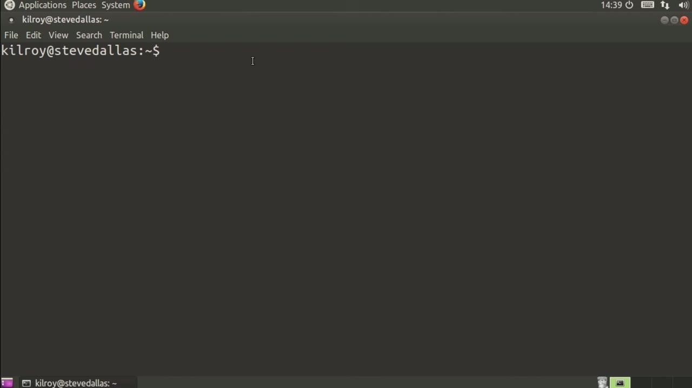
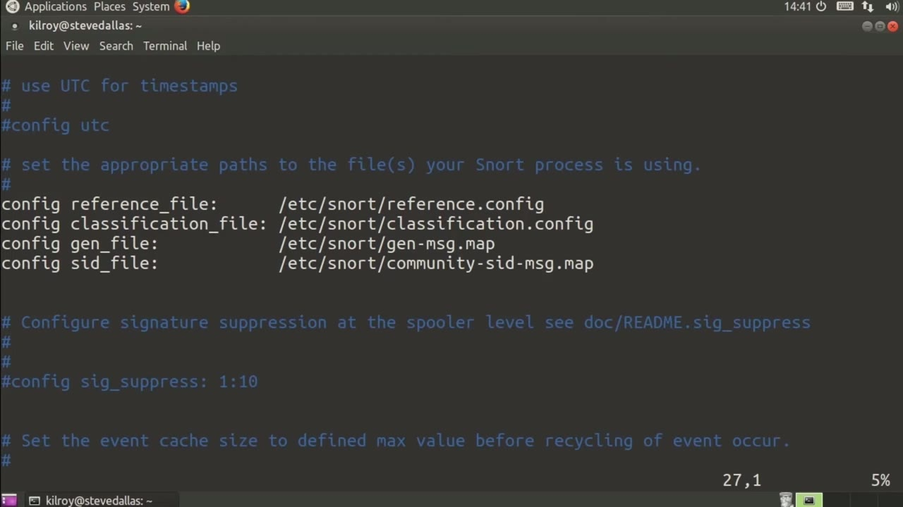
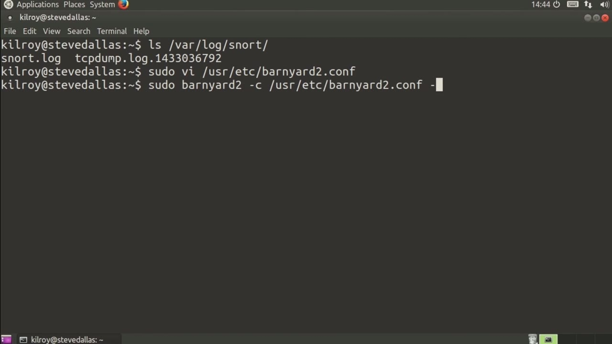

[← Course contents](../../02.md)

# 45. Alerting With Snort

**Course:** [Linux Security & Administration From Boot Process to Firewalls](https://www.youtube.com/watch?v=_WB3evmgxYA)  
**Transcript:** [`Linux Security & Administration From Boot Process to Firewalls transcript`](../../../../course_videos/Linux%20Security%20%26%20Administration%20From%20Boot%20Process%20to%20Firewalls/Linux%20Security%20%26%20Administration%20From%20Boot%20Process%20to%20Firewalls.txt)  
**Video:** 03:22:16–03:27:31 ([open at this time](https://www.youtube.com/watch?v=_WB3evmgxYA&t=12136s))

## Introduction

Now, once we've got Snort configured, we need to be able to do something to get alerts out of it. Remember, what we've done with Snort is we've created a unified log file that's really in binary format. So that's not going to be very useful in most cases. So we need something that's going to read that output file and generate alerts and maybe put the output into different forms for us.

## Detailed Explanation

<details>
  <summary>Step 1 — Run `snort`</summary>

### Step 1 — Run `snort`

- [x] **Use `snort`**
  - Now, once we've got `snort` configured, we need to be able to do something to get alerts out of it.
  - Remember, what we've done with `snort` is we've created a unified log file that's really in binary format.
  - So that's not going to be very useful in most cases.

- [x] **So we need something that's going to read that output file and**
  - So we need something that's going to read that output file and generate alerts and maybe put the output into different forms for us.
  - Logging out to different formats like databases and prelude sim.
  - But right now what we've got is really just this one log file.

- [x] **Use `snort`**
  - So we've got var log `snort` and we've got `snort`.log.
  - So we need something that's going to be able to read that log file for us, that binary formatted log file and then do something useful with it.
  - As it turns out, we have a program called Barnyard 2.

- [x] **And we are going to just take a quick look at the configuration file**
  - And we are going to just take a quick look at the configuration file here.
  - And this is one of those that you would have to build on your local system.
  - In the case of Ubuntu, there is not a package for it.

- [x] **For Red Hat, you can't just do an easy quick package install**
  - For Red Hat, you can't just do an easy quick package install.

```bash
snort
```



</details>

<details>
  <summary>Step 2 — Run `snort`, `tcpdump`, `mysql`</summary>

### Step 2 — Run `snort`, `tcpdump`, `mysql`

- [x] **Use `snort`**
  - So I've got a Barnyard installation here, and we're going to just take a quick skim through the configuration file.
  - It's looking for files that `snort` is using for configuration and mapping various pieces of information that `snort` uses.
  - And we're going to skim down to the output section so that we've got a way of doing alerts and output.

- [x] **So the very first thing is the input, and I'm going to breeze by**
  - So the very first thing is the input, and I'm going to breeze by that, as it says, it's not very hard.
  - Unified 2 is the only way that you can do that.
  - So one output format here is the common event format.

- [x] **If you happen to have a server that handles common event format, you**
  - If you happen to have a server that handles common event format, you may want to enable that output here.
  - And there are some examples, as you can see.
  - If you've got a Bro IDS, you can configure that as well.

- [x] **I've also got Alert Fast, and this is saying AlertFast is just going**
  - I've also got Alert Fast, and this is saying AlertFast is just going to std out, which is fine.
  - That is going to generate alerts to our standard out, which is going to just go to console.
  - You can also, if you've got this built-in, you can go to Prelude, which is a SIM or a Hybrid IDS, if you want to look at it that way.

- [x] **Use `tcpdump`**
  - So we could configure the alert to go to our Prelude SIM and then have that plus our log information and other input sources all in a single location.
  - We can also alert out to syslog. We could use syslog full, and then we're talking about Log Aski and log `tcpdump`. You can see I've got `tcpdump` configured here so that we can output into `tcpdump` format that we could then read in using Wireshark.
  - There are a few others. Squeal right here is a ui that you can use for Snorp.

- [x] **Use `mysql`**
  - And then of course, we've got database output here as well.
  - You can go to `mysql`, Postgres, odbc, mssql, and Oracle.
  - So you can see we've got a number of output formats.

- [x] **I'm going to hand it my configuration file**
  - I'm going to hand it my configuration file.

```bash
snort
tcpdump
mysql
```



</details>

<details>
  <summary>Step 3 — Run `snort`, `tail -n20 /var`</summary>

### Step 3 — Run `snort`, `tail -n20 /var`

- [x] **Use `snort`**
  - And then I'm going to say the directory is varlog `snort` because that's where our `snort` alerts and our `snort` output go to.
  - The file we are looking for is `snort`.log.
  - And then I am going to hand it another configuration setting here.

- [x] **So we're going to write out to another file**
  - So we're going to write out to another file.
  - It should now be running in continuous mode, which is demon mode.
  - And we should be able to just take a quick check at the syslog to see what happened here.

- [x] **Use `tail -n20 /var`**
  - So going to say `tail -n20 /var` slash log slash syslog, which is where the application would have dumped some output too.
  - It looks like it read the configuration and then started up.
  - So now you can see that it started it up and it actually has read some information.

- [x] **Use `snort`**
  - It doesn't look like it got anything in, but you can see that it dumped some output out to our syslog file.
  - You can, as I said, use Barnyard to read your binary unified to `snort` log.
  - And you can use Barnyard to take that and then output to various other places so that you can have alerts and log files and do other things with them.

```bash
snort
tail -n20 /var
```



</details>

<details>
  <summary>Questions and Answers</summary>

## Questions and Answers

### Question 1: What does `snort` do in this chapter?

<details>
<summary>Answer</summary>

- [x] Now, once we've got `snort` configured, we need to be able to do something to get alerts out of it.

</details>

### Question 2: What does `tcpdump` do in this chapter?

<details>
<summary>Answer</summary>

- [x] We can also alert out to syslog. We could use syslog full, and then we're talking about Log Aski and log `tcpdump`. You can see I've got `tcpdump` configured here so that we can output into `tcpdump` format that we could then read in using Wireshark.

</details>

### Question 3: What does `mysql` do in this chapter?

<details>
<summary>Answer</summary>

- [x] You can go to `mysql`, Postgres, odbc, mssql, and Oracle.

</details>

### Question 4: What does `tail -n20 /var` do in this chapter?

<details>
<summary>Answer</summary>

- [x] So going to say `tail -n20 /var` slash log slash syslog, which is where the application would have dumped some output too.

</details>

### Question 5: What does step 1 cover (Run snort)?

<details>
<summary>Answer</summary>

- [x] Now, once we've got `snort` configured, we need to be able to do something to get alerts out of it.
- [x] Remember, what we've done with `snort` is we've created a unified log file that's really in binary format.
- [x] So that's not going to be very useful in most cases.

</details>

### Question 6: What does step 2 cover (Run snort, tcpdump, mysql)?

<details>
<summary>Answer</summary>

- [x] So I've got a Barnyard installation here, and we're going to just take a quick skim through the configuration file.
- [x] It's looking for files that `snort` is using for configuration and mapping various pieces of information that `snort` uses.
- [x] And we're going to skim down to the output section so that we've got a way of doing alerts and output.

</details>

### Question 7: What does step 3 cover (Run snort, tail -n20 /var)?

<details>
<summary>Answer</summary>

- [x] And then I'm going to say the directory is varlog `snort` because that's where our `snort` alerts and our `snort` output go to.
- [x] The file we are looking for is `snort`.log.
- [x] And then I am going to hand it another configuration setting here.

</details>

</details>

## Summary

This chapter, Alerting With Snort, walks through Run snort; Run snort, tcpdump, mysql; Run snort, tail -n20 /var. Commands from the transcript: `snort`, `tcpdump`, `mysql`, `tail -n20 /var`.

## References

- [Linux Security & Administration From Boot Process to Firewalls (YouTube)](https://www.youtube.com/watch?v=_WB3evmgxYA)
- [This chapter at 03:22:16](https://www.youtube.com/watch?v=_WB3evmgxYA&t=12136s)
- [Local transcript](../../../../course_videos/Linux%20Security%20%26%20Administration%20From%20Boot%20Process%20to%20Firewalls/Linux%20Security%20%26%20Administration%20From%20Boot%20Process%20to%20Firewalls.txt)
