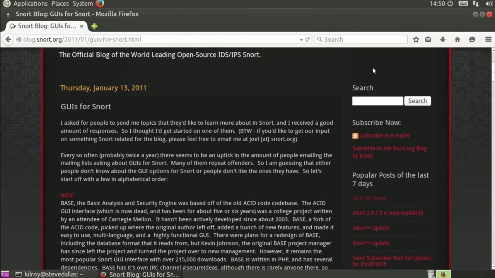
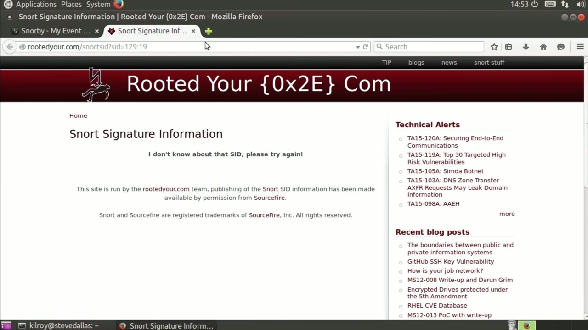
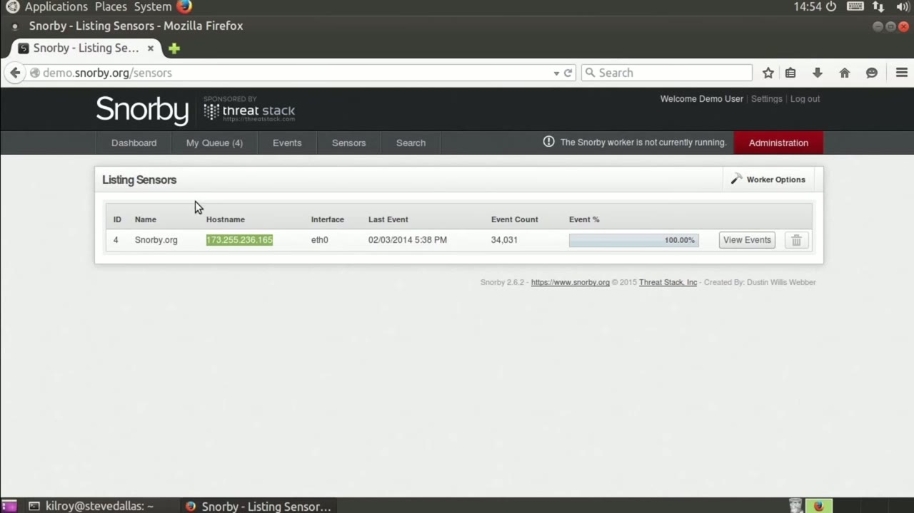

[← Course contents](../../02.md)

# 46. Snort Console

**Course:** [Linux Security & Administration From Boot Process to Firewalls](https://www.youtube.com/watch?v=_WB3evmgxYA)  
**Transcript:** [`Linux Security & Administration From Boot Process to Firewalls transcript`](../../../../course_videos/Linux%20Security%20%26%20Administration%20From%20Boot%20Process%20to%20Firewalls/Linux%20Security%20%26%20Administration%20From%20Boot%20Process%20to%20Firewalls.txt)  
**Video:** 03:27:31–03:31:25 ([open at this time](https://www.youtube.com/watch?v=_WB3evmgxYA&t=12451s))

## Introduction

When you're dealing with a lot of information about security events as you would be when you were looking at the Snort IDS, what you really want is a way to see it easily. Just having a bunch of text output isn't going to be really helpful. You really want an interface where you can drill into the information if you need and also be able to get quick overviews. There are a handful of graphical user interfaces.

## Detailed Explanation

<details>
  <summary>Step 1 — Run `snort`</summary>

### Step 1 — Run `snort`

- [x] **Use `snort`**
  - When you're dealing with a lot of information about security events as you would be when you were looking at the `snort` IDS, what you really want is a way to see it easily.
  - Just having a bunch of text output isn't going to be really helpful.
  - You really want an interface where you can drill into the information if you need and also be able to get quick overviews.

- [x] **Use `snort`**
  - There are a handful of graphical user interfaces.
  - These are primarily web interfaces that you can interface with `snort`.
  - There was one long ago called Acid and that was replaced by bass.

- [x] **Now there's also OS Sim, Placid, Squeal, Snorby and Squirt. Now there**
  - Now there's also OS Sim, Placid, Squeal, Snorby and Squirt. Now there are others as well. These are kind of the primary ones.
  - There is another one called Prelude, which is a hybrid IDS. It's also called a SIM, which is a security incident event management. I want to show you one of these GUI so you can actually see it. So we're going to go to demo.snorby.org.
  - which will allow us to take a look at what Snorby actually looks like.

- [x] **So I'm going to log in with their demo password**
  - So I'm going to log in with their demo password.
  - What we're looking at right now is the dashboard.

```bash
snort
```



</details>

<details>
  <summary>Step 2 — Run `mysql`</summary>

### Step 2 — Run `mysql`

- [x] **So you can see the number of events that have happened in the last 24**
  - So you can see the number of events that have happened in the last 24 hours.
  - We could take a look at what has happened in the last month this quarter.
  - And this year it doesn't look like their demo has actually attached to much of anything at the moment, so we're not seeing any events, but you can certainly take a look at the GUI, and we've got the Severities, protocols, signatures, and then we've got sources here.

- [x] **Now the other thing I want to show you is in MyQ, we've got some**
  - Now the other thing I want to show you is in MyQ, we've got some events here.
  - Let's just take a look at one of these events. So you can see the header information.
  - The signature information that's associated with this.

- [x] **Use `mysql`**
  - I query the signature database and apparently doesn't know anything about that signature id at the moment, but there have been an awful lot of activities around this particular signature, and it looks like this is a `mysql` event based on the destination port, because it's 3306.
  - And we can take a look at the events that have shown up here.
  - Again, if we click on this, we can drill down into the information.

- [x] **And again, we've got a signature id with a category here, and then**
  - And again, we've got a signature id with a category here, and then we've got the source and destination IP addresses.
  - So finally here, we've got the number of sensors.
  - It looks like there's only one sensor that's configured to this particular console.

- [x] **You can, of course, have multiple that will report back to the same**
  - You can, of course, have multiple that will report back to the same console.

```bash
mysql
```



</details>

<details>
  <summary>Step 3 — Run `snort`</summary>

### Step 3 — Run `snort`

- [x] **Use `snort`**
  - Snorby is just another user interface that you can use with `snort`.
  - It is also one of those that doesn't have packages for at least some of the Linux distributions.
  - For example, Red Hat and Ubuntu don't actually have packages for Snorby, nor do they have packages for the other user interfaces for `snort`.

- [x] **Use `snort`**
  - So if you're going to run `snort` on Linux, and you want to be able to have consoles and something like Barnyard, then you're kind of on your own in terms of building those, which isn't a huge challenge because there are certainly plenty of pages that will walk through all of the creation and configuration
  - Of these additional packages, but it's not something that you're just going to be able to go app -get install Snorby, for example.
  - Because the package just doesn't exist on Ubuntu.

- [x] **It also doesn't exist for Red Hat Enterprise Linux as part of the**
  - It also doesn't exist for Red Hat Enterprise Linux as part of the primary repositories.

```bash
snort
```



</details>

<details>
  <summary>Questions and Answers</summary>

## Questions and Answers

### Question 1: What does `snort` do in this chapter?

<details>
<summary>Answer</summary>

- [x] When you're dealing with a lot of information about security events as you would be when you were looking at the `snort` IDS, what you really want is a way to see it easily.

</details>

### Question 2: What does `mysql` do in this chapter?

<details>
<summary>Answer</summary>

- [x] I query the signature database and apparently doesn't know anything about that signature id at the moment, but there have been an awful lot of activities around this particular signature, and it looks like this is a `mysql` event based on the destination port, because it's 3306.

</details>

### Question 3: What does step 1 cover (Run snort)?

<details>
<summary>Answer</summary>

- [x] When you're dealing with a lot of information about security events as you would be when you were looking at the `snort` IDS, what you really want is a way to see it easily.
- [x] Just having a bunch of text output isn't going to be really helpful.
- [x] You really want an interface where you can drill into the information if you need and also be able to get quick overviews.

</details>

### Question 4: What does step 2 cover (Run mysql)?

<details>
<summary>Answer</summary>

- [x] So you can see the number of events that have happened in the last 24 hours.
- [x] We could take a look at what has happened in the last month this quarter.
- [x] And this year it doesn't look like their demo has actually attached to much of anything at the moment, so we're not seeing any events, but you can certainly take a look at the GUI, and we've got the Severities, protocols, signatures, and then we've got sources here.

</details>

### Question 5: What does step 3 cover (Run snort)?

<details>
<summary>Answer</summary>

- [x] Snorby is just another user interface that you can use with `snort`.
- [x] It is also one of those that doesn't have packages for at least some of the Linux distributions.
- [x] For example, Red Hat and Ubuntu don't actually have packages for Snorby, nor do they have packages for the other user interfaces for `snort`.

</details>

</details>

## Summary

This chapter, Snort Console, walks through Run snort; Run mysql; Run snort. Commands from the transcript: `snort`, `mysql`.

## References

- [Linux Security & Administration From Boot Process to Firewalls (YouTube)](https://www.youtube.com/watch?v=_WB3evmgxYA)
- [This chapter at 03:27:31](https://www.youtube.com/watch?v=_WB3evmgxYA&t=12451s)
- [Local transcript](../../../../course_videos/Linux%20Security%20%26%20Administration%20From%20Boot%20Process%20to%20Firewalls/Linux%20Security%20%26%20Administration%20From%20Boot%20Process%20to%20Firewalls.txt)
