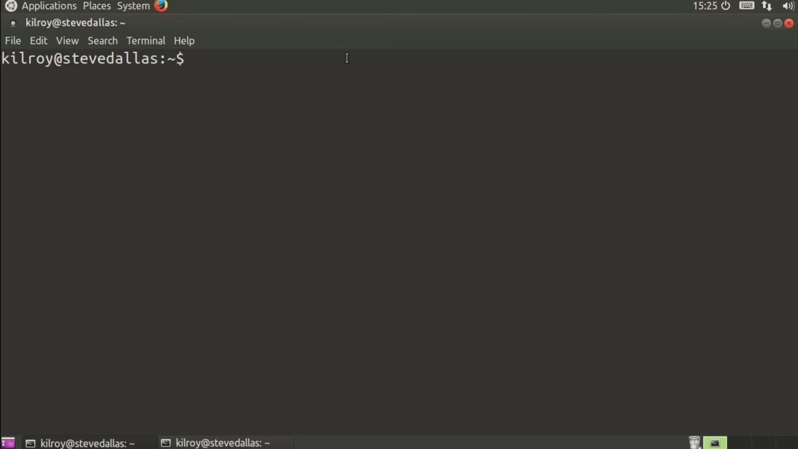
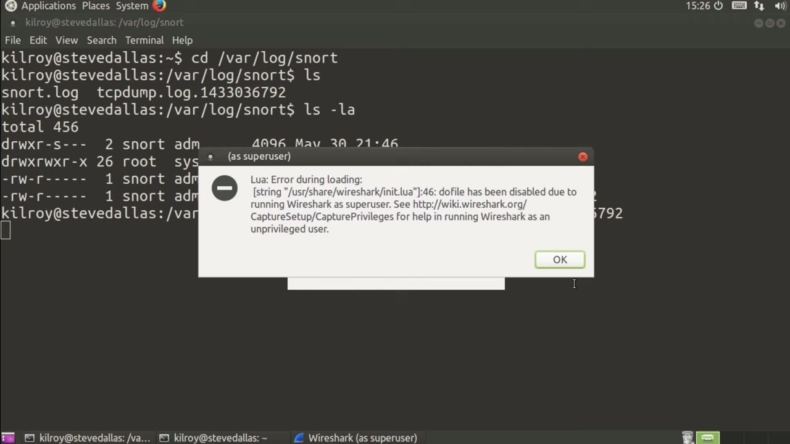
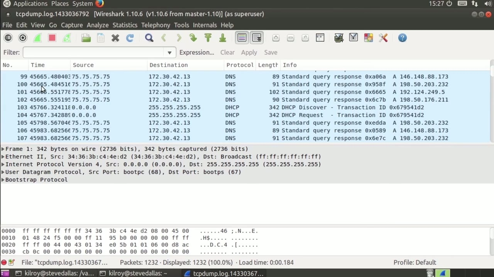

[← Course contents](../../02.md)

# 47. Reading Snort Traces With Wireshark

**Course:** [Linux Security & Administration From Boot Process to Firewalls](https://www.youtube.com/watch?v=_WB3evmgxYA)  
**Transcript:** [`Linux Security & Administration From Boot Process to Firewalls transcript`](../../../../course_videos/Linux%20Security%20%26%20Administration%20From%20Boot%20Process%20to%20Firewalls/Linux%20Security%20%26%20Administration%20From%20Boot%20Process%20to%20Firewalls.txt)  
**Video:** 03:31:25–03:33:51 ([open at this time](https://www.youtube.com/watch?v=_WB3evmgxYA&t=12685s))

## Introduction

Now, another advantage of Snort is it has the ability to actually capture packets that are taking place around the time that it is noticed in incident. It will dump captured packets out to disk so that you can then look at them using a packet capture utility. Let's take a look at what we've got here. So if I go into Varlog, Snort, what I've got is the Unified Log.

## Detailed Explanation

<details>
  <summary>Step 1 — Run `snort`</summary>

### Step 1 — Run `snort`

- [x] **Use `snort`**
  - Now, another advantage of `snort` is it has the ability to actually capture packets that are taking place around the time that it is noticed in incident.
  - It will dump captured packets out to disk so that you can then look at them using a packet capture utility.
  - Let's take a look at what we've got here.

- [x] **Use `snort`**
  - So if I go into Varlog, `snort`, what I've got is the Unified Log.
  - And then you can see I've got a tcpdump.log.
  - So if I take a quick look at that, we can see that we've got these two files here.

- [x] **And I should be able to just open up tcpdump.org in Wireshark**
  - And I should be able to just open up tcpdump.org in Wireshark.

```bash
snort
```



</details>

<details>
  <summary>Step 2 — I'm going to run Wireshark and feed a tcpdump.log</summary>

### Step 2 — I'm going to run Wireshark and feed a tcpdump.log

- [x] **So I'm going to run Wireshark and feed a tcpdump.log**
  - So I'm going to run Wireshark and feed a tcpdump.log.
  - And now I can just take a look at all of the packets that were captured as part of the different events.
  - Now you'll see this is not a linear sort of progression in terms of the time.

- [x] **What it's doing is it's dumping pieces of the network transactions**
  - What it's doing is it's dumping pieces of the network transactions out to this file as it gets them.
  - There will be big gaps in the time that we see here because of course we're not constantly getting one attack after another.
  - So you'll see these fairly large spaces in time here where we're not getting anything at all.

- [x] **And then suddenly there's a handful of them**
  - And then suddenly there's a handful of them.



</details>

<details>
  <summary>Step 3 — Run `tcpdump`, `snort`</summary>

### Step 3 — Run `tcpdump`, `snort`

- [x] **Use `tcpdump`**
  - It's really easy if you've got it configured, of course, to output to `tcpdump`.
  - Now you've actually got the network capture data that's associated with a particular event so that you can see, rather than just the alert, you can go look at the packet capture, and you can really see what happens.
  - So as an example, it looks like there were a number of SNMP get requests here on a particular system.

- [x] **Use `snort`**
  - So we had an SNMP attack, and then we've got some ICMP destination unreachable, port unreachable messages.
  - So that could be something like a port scan, for example.
  - You can see we've got the actual network data, which, as I said, is far better to look at giving you much more of an idea of what actually happened than just a simple alert message that you may get if you were just using `snort` simply for alerting.

```bash
tcpdump
snort
```



</details>

<details>
  <summary>Questions and Answers</summary>

## Questions and Answers

### Question 1: What does `snort` do in this chapter?

<details>
<summary>Answer</summary>

- [x] Now, another advantage of `snort` is it has the ability to actually capture packets that are taking place around the time that it is noticed in incident.

</details>

### Question 2: What does `tcpdump` do in this chapter?

<details>
<summary>Answer</summary>

- [x] It's really easy if you've got it configured, of course, to output to `tcpdump`.

</details>

### Question 3: What does step 1 cover (Run snort)?

<details>
<summary>Answer</summary>

- [x] Now, another advantage of `snort` is it has the ability to actually capture packets that are taking place around the time that it is noticed in incident.
- [x] It will dump captured packets out to disk so that you can then look at them using a packet capture utility.
- [x] Let's take a look at what we've got here.

</details>

### Question 4: What does step 2 cover (I'm going to run Wireshark and feed a tcpdump.log)?

<details>
<summary>Answer</summary>

- [x] So I'm going to run Wireshark and feed a tcpdump.log.
- [x] And now I can just take a look at all of the packets that were captured as part of the different events.
- [x] Now you'll see this is not a linear sort of progression in terms of the time.

</details>

### Question 5: What does step 3 cover (Run tcpdump, snort)?

<details>
<summary>Answer</summary>

- [x] It's really easy if you've got it configured, of course, to output to `tcpdump`.
- [x] Now you've actually got the network capture data that's associated with a particular event so that you can see, rather than just the alert, you can go look at the packet capture, and you can really see what happens.
- [x] So as an example, it looks like there were a number of SNMP get requests here on a particular system.

</details>

</details>

## Summary

This chapter, Reading Snort Traces With Wireshark, walks through Run snort; I'm going to run Wireshark and feed a tcpdump.log; Run tcpdump, snort. Commands from the transcript: `snort`, `tcpdump`.

## References

- [Linux Security & Administration From Boot Process to Firewalls (YouTube)](https://www.youtube.com/watch?v=_WB3evmgxYA)
- [This chapter at 03:31:25](https://www.youtube.com/watch?v=_WB3evmgxYA&t=12685s)
- [Local transcript](../../../../course_videos/Linux%20Security%20%26%20Administration%20From%20Boot%20Process%20to%20Firewalls/Linux%20Security%20%26%20Administration%20From%20Boot%20Process%20to%20Firewalls.txt)
