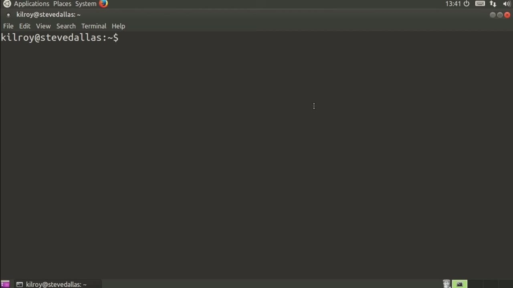
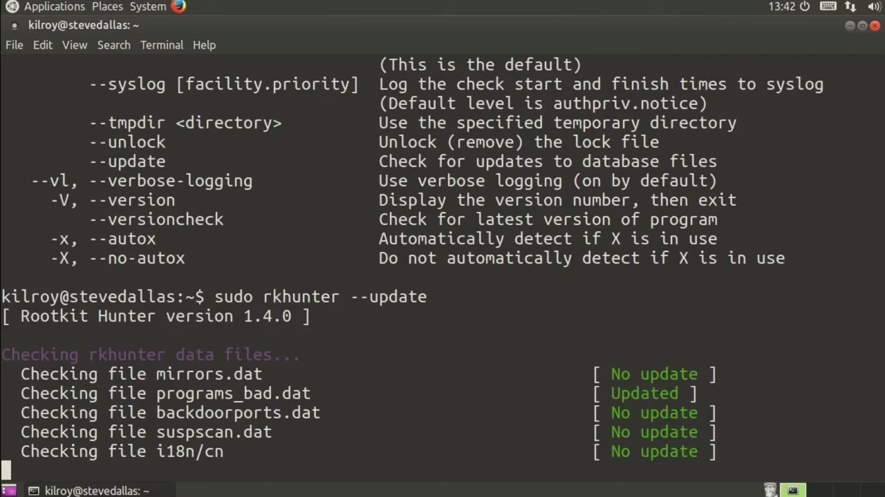
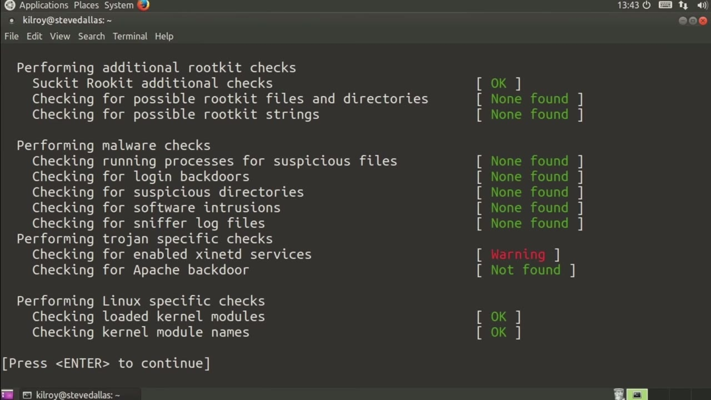

[← Course contents](../../02.md)

# 48. RootKitHunter

**Course:** [Linux Security & Administration From Boot Process to Firewalls](https://www.youtube.com/watch?v=_WB3evmgxYA)  
**Transcript:** [`Linux Security & Administration From Boot Process to Firewalls transcript`](../../../../course_videos/Linux%20Security%20%26%20Administration%20From%20Boot%20Process%20to%20Firewalls/Linux%20Security%20%26%20Administration%20From%20Boot%20Process%20to%20Firewalls.txt)  
**Video:** 03:33:51–03:37:26 ([open at this time](https://www.youtube.com/watch?v=_WB3evmgxYA&t=12831s))

## Introduction

There's another program that's a little bit similar to an antivirus, except it's more specific. The program that I'm talking about is rk Hunter. Rk Hunter looks for rootkits within a system. RootKit Hunter is actually a program or a shell script specifically that looks for evidence on your system that there may be a root kit.

## Detailed Explanation

  
Step 1 — There's another program that's a little bit similar to an antivirus

### Step 1 — There's another program that's a little bit similar to an antivirus

- [x] **There's another program that's a little bit similar to an antivirus**
  - There's another program that's a little bit similar to an antivirus, except it's more specific.
  - The program that I'm talking about is rk Hunter.
  - Rk Hunter looks for rootkits within a system.

- [x] **RootKit Hunter is actually a program or a shell script specifically**
  - RootKit Hunter is actually a program or a shell script specifically that looks for evidence on your system that there may be a root kit.
  - So a root kit is a piece of software that is intended to hide the existence of either a backdoor or a virus or some other piece of malicious activity.
  - We can just run RootKit Hunter. It's very simple.

- [x] **So you can see that I can update, I can do a version check, I can**
  - So you can see that I can update, I can do a version check, I can just do a check on it, which is of course what I want to do here.

  
Step 2 — going to say rk Hunter, so let's just get an update first and make sure

### Step 2 — going to say rk Hunter, so let's just get an update first and make sure

- [x] **I'm going to say rk Hunter, so let's just get an update first and**
  - I'm going to say rk Hunter, so let's just get an update first and make sure that we have the very latest and it looks like there are a couple of updates here.
  - This is actually going to just generate a lot of output here.
  - We're going to be looking for different strings within the binaries on the system.

- [x] **Once it gets through each category, it pauses and waits for you to**
  - Once it gets through each category, it pauses and waits for you to look at what it found and then click enter once you are done looking. So again, we're going to hit the enter key.
  - Apparently nothing in the way of Root Kits was found right here.
  - You can see all of the root kits that it knows and every one of them says not found.

- [x] **There was a warning up here where it's looking at unhide and that's a**
  - There was a warning up here where it's looking at unhide and that's a Ruby script and it does indicate a warning. So we'll see what it says at the end about the summary of what it found.

  
Step 3 — it's looking through root kits and directories, looking for malware

### Step 3 — it's looking through root kits and directories, looking for malware

- [x] **Now it's looking through root kits and directories, looking for**
  - Now it's looking through root kits and directories, looking for malware, checking for enabled XinetD services and it did find a warning there.
  - So there's a couple of warnings that are being indicated here.
  - And we can now look at the log file that was generated.

- [x] **This is a lot of detail about what it's looking for and everything**
  - This is a lot of detail about what it's looking for and everything that it found.
  - It's looking for different strings in the various binaries.
  - Indicating that there was a warning, but we can certainly look through here and actually it says the reason it didn't find the capital warning was because of a case mismatch. So this says the command on hide.rb has been replaced by a script. Okay, that's not a problem. So let's look for

- [x] **Another warning now. Same thing there. So now looking for the X-INetD**
  - Another warning now. Same thing there. So now looking for the X-INetD services.
  - And it looks like it did find an enabled x-i-netd service.
  - That's okay. We've got FTP enabled through x-i-n-d, which is what we would expect to have here.

- [x] **You can see as we look through the logs, there's a lot of detail**
  - You can see as we look through the logs, there's a lot of detail there, and we can make a determination from that detail whether it's something that we want to look a little bit more into in more depth.
  - And you can see this case on this system, we took just one minute and one second to run this.
  - So this is definitely something that you probably want to run on a regular basis.

- [x] **And it's actually something that's generally a good idea to put into**
  - And it's actually something that's generally a good idea to put into your Cron jobs so that it will run on a daily or weekly basis.

  
Questions and Answers

## Questions and Answers

### Question 1: What does step 1 cover (There's another program that's a little bit similar to an antivirus)?

Answer

- [x] There's another program that's a little bit similar to an antivirus, except it's more specific.
- [x] The program that I'm talking about is rk Hunter.
- [x] Rk Hunter looks for rootkits within a system.

### Question 2: What does step 2 cover (going to say rk Hunter, so let's just get an update first and make sure)?

Answer

- [x] I'm going to say rk Hunter, so let's just get an update first and make sure that we have the very latest and it looks like there are a couple of updates here.
- [x] This is actually going to just generate a lot of output here.
- [x] We're going to be looking for different strings within the binaries on the system.

### Question 3: What does step 3 cover (it's looking through root kits and directories, looking for malware)?

Answer

- [x] Now it's looking through root kits and directories, looking for malware, checking for enabled XinetD services and it did find a warning there.
- [x] So there's a couple of warnings that are being indicated here.
- [x] And we can now look at the log file that was generated.

## Summary

This chapter, RootKitHunter, walks through There's another program that's a little bit similar to an antivirus; going to say rk Hunter, so let's just get an update first and make sure; it's looking through root kits and directories, looking for malware.

## References

- [Linux Security & Administration From Boot Process to Firewalls (YouTube)](https://www.youtube.com/watch?v=_WB3evmgxYA)
- [This chapter at 03:33:51](https://www.youtube.com/watch?v=_WB3evmgxYA&t=12831s)
- [Local transcript](../../../../course_videos/Linux%20Security%20%26%20Administration%20From%20Boot%20Process%20to%20Firewalls/Linux%20Security%20%26%20Administration%20From%20Boot%20Process%20to%20Firewalls.txt)
