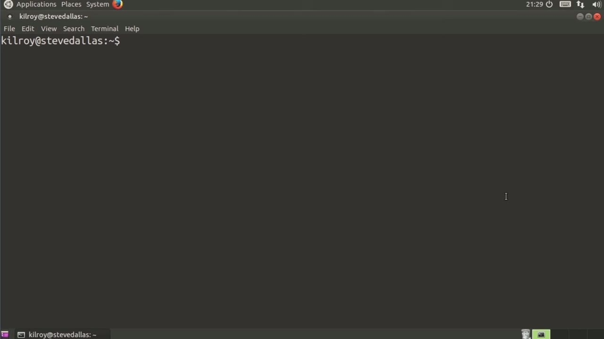
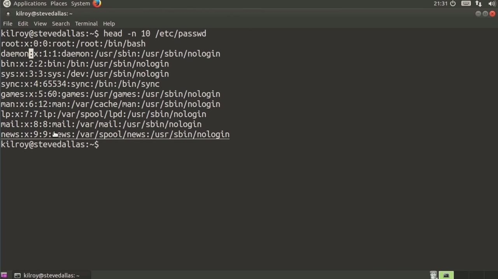
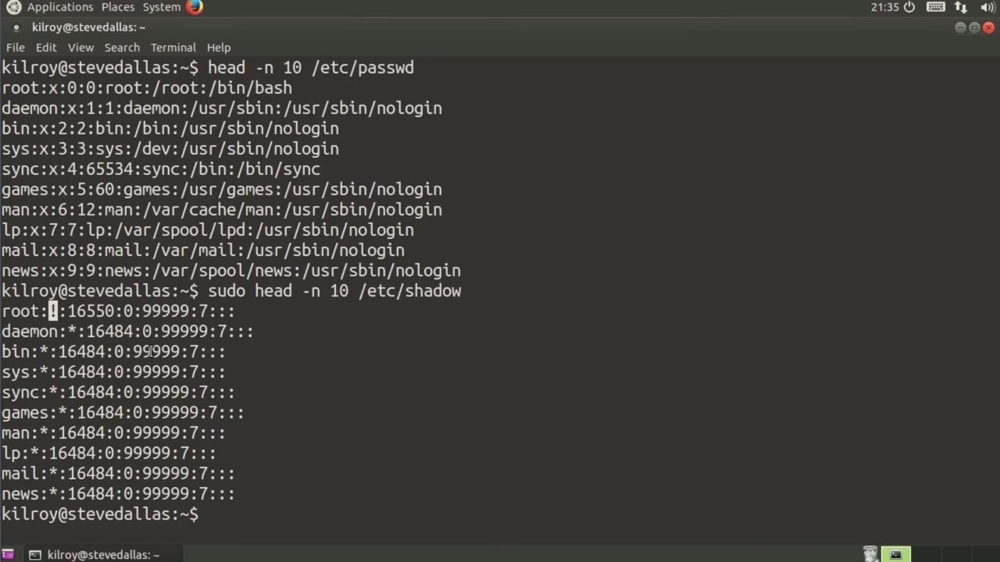

[← Course contents](../../02.md)

# 49. What you will learn in this Module

**Course:** [Linux Security & Administration From Boot Process to Firewalls](https://www.youtube.com/watch?v=_WB3evmgxYA)  
**Transcript:** [`Linux Security & Administration From Boot Process to Firewalls transcript`](../../../../course_videos/Linux%20Security%20%26%20Administration%20From%20Boot%20Process%20to%20Firewalls/Linux%20Security%20%26%20Administration%20From%20Boot%20Process%20to%20Firewalls.txt)  
**Video:** 03:37:26–03:44:31 ([open at this time](https://www.youtube.com/watch?v=_WB3evmgxYA&t=13046s))

## Introduction

While there are a number of different ways to be able to configure your Linux system to handle user authentication, The heart and soul of doing that authentication on most Linux systems actually resides within just a couple of files. Those two files are stored in the /etc directory. Of course, you may remember or may know that the /etc directory is where configuration files for the system and for system level applications commonly lie. So what we're going to do is we're going to take a look at the password file.

## Detailed Explanation

<details>
  <summary>Step 1 — While there are a number of different ways to be able to configure your</summary>

### Step 1 — While there are a number of different ways to be able to configure your

- [x] **While there are a number of different ways to be able to configure**
  - While there are a number of different ways to be able to configure your Linux system to handle user authentication, The heart and soul of doing that authentication on most Linux systems actually resides within just a couple of files.
  - Those two files are stored in the /etc directory.
  - Of course, you may remember or may know that the /etc directory is where configuration files for the system and for system level applications commonly lie.

- [x] **So what we're going to do is we're going to take a look at the**
  - So what we're going to do is we're going to take a look at the password file.
  - The password file is just stored in /etc, and you'll notice the spelling.
  - Now, I'm not going to look at the whole password file.

- [x] **We're just going to look at a few lines of it**
  - We're just going to look at a few lines of it.
  - You can see that there are a number of sections to each line in the password file.
  - So the very first column, and you can see that we're all delimited by colons here.

- [x] **So we've got one column, colon, another column, colon, and so on**
  - So we've got one column, colon, another column, colon, and so on.
  - So the first column on this line that we're looking at here is Damon, and that's the username.
  - That X indicates that the password is not stored in the password file.

- [x] **That actually hasn't been the case for quite a while now**
  - That actually hasn't been the case for quite a while now.
  - The password file is actually stored in a separate file, and we're going to take a look at that one next.



</details>

<details>
  <summary>Step 2 — that's the numeric value for this particular user</summary>

### Step 2 — that's the numeric value for this particular user

- [x] **Now that's the numeric value for this particular user**
  - Now that's the numeric value for this particular user.
  - That's the one that the system itself knows about.
  - You are going to know this particular user by the username Demon.

- [x] **The system, however, is going to use the number one when it is doing**
  - The system, however, is going to use the number one when it is doing things like permissions.
  - So file permissions have a value of one for the user.
  - Rather than the string of characters that says demon.

- [x] **The next one over after the first one is a second one**
  - The next one over after the first one is a second one.
  - The group identifier in this case is one.
  - If I were to take a look at the group file, and we'll take a quick look at that shortly, you would see that one probably relates to the group named demon.

- [x] **The next column over, is going to be the user id**
  - The next column over, is going to be the user id.
  - Information and in this case it just says demon that's because we don't really have to say much of anything about that after that we get the home directory in this case the home directory for this user is user sbin it's not a home directory we don't ever expect this user to be logged in



</details>

<details>
  <summary>Step 3 — Run `bash`, `ls`</summary>

### Step 3 — Run `bash`, `ls`

- [x] **Use `bash`**
  - After that we get the shell that you would use when you are logging in commonly that's going to be something like /bin slash `bash` or /bin slash sh.
  - In this case, it's set to user sbin no login.
  - And the reason for that is we don't actually want this user ever to log in.

- [x] **So now let's take a look at the password file itself**
  - So now let's take a look at the password file itself.
  - And the password file in this case I'm talking about is the shadow file.
  - The shadow file is where the passwords are actually stored.

- [x] **Use `ls`**
  - Now, you may have noticed that I was able to read the password file without having administrative privileges.
  - The reason for that is, and actually the reason for the shadow file, is there's a lot of information in the password file that everybody on the system needs to be able to get to.
  - So when I do an `ls`, for example, it's going to read the numeric user id and the numeric group id.

- [x] **And it has to look those up from somewhere**
  - And it has to look those up from somewhere.
  - So it's going to look those up from the password file and the group file.
  - So we need to store passwords and sensitive information in a different location so that we can lock it down and only have access from an administrative user.

- [x] **And in this case, I don't actually have sections with a password in**
  - And in this case, I don't actually have sections with a password in it for a good reason, obviously.
  - Even though the password is not stored in clear text, it's actually stored in a hash format using a secure hash algorithm 1 hash or shawl 1 hash.

```bash
bash
ls
```


</details>

<details>
  <summary>Step 4 — Run `sudo`, `which`</summary>

### Step 4 — Run `sudo`, `which`

- [x] **The place where the password is stored is actually this column here**
  - The place where the password is stored is actually this column here.
  - The exclamation mark here suggests that the root user doesn't actually have a password.
  - Would not be able to log directly into the system.

- [x] **Use `sudo`, `which`**
  - You'd have to log in through another root user and then switch over to the root user or use something like `sudo` `which` is what we've been doing.
  - Other than that though we've got some similar fields here. The first field is the username and again we're using a colon as the delimiter. The next one is the password. This should be a hashed version of the password. The next field after that is the last time your password was changed.
  - Following that is the minimum number of days required between password changes, and then the maximum number of days between password changes.

- [x] **So the maximum number of days a password is actually valid**
  - So the maximum number of days a password is actually valid.
  - And then after that is the number of days before the password is going to expire when we start warning the user.
  - After that, and in these cases we don't actually have values for any of these fields.

- [x] **We have the number of days after a password expires that the account**
  - We have the number of days after a password expires that the account is disabled.
  - And then finally, we have a number of days since the Unix epic, `which` is January 1st, 1970, that the account is disabled.
  - So this is an absolute date saying when the login is no longer usable.

- [x] **So now we've got the password file and the shadow file**
  - So now we've got the password file and the shadow file.
  - And finally, we're going to take a quick look at the group file.
  - That's the third file that we will be looking at here.

- [x] **And I need to put in the number of lines**
  - And I need to put in the number of lines.
  - The group file is the name of the group, the password for the group.
  - You can see here that we've got two users who are members of the adm group.

- [x] **So anytime we add users, change users, we're actually manipulating**
  - So anytime we add users, change users, we're actually manipulating these files, and you can do that directly, but better, you'll use the utilities that are installed with the operating system in order to make changes to your users.

```bash
sudo
which
```



</details>

<details>
  <summary>Questions and Answers</summary>

## Questions and Answers

### Question 1: What does `bash` do in this chapter?

<details>
<summary>Answer</summary>

- [x] After that we get the shell that you would use when you are logging in commonly that's going to be something like /bin slash `bash` or /bin slash sh.

</details>

### Question 2: What does `ls` do in this chapter?

<details>
<summary>Answer</summary>

- [x] So when I do an `ls`, for example, it's going to read the numeric user id and the numeric group id.

</details>

### Question 3: What does `sudo` do in this chapter?

<details>
<summary>Answer</summary>

- [x] You'd have to log in through another root user and then switch over to the root user or use something like `sudo` which is what we've been doing.

</details>

### Question 4: What does `which` do in this chapter?

<details>
<summary>Answer</summary>

- [x] You'd have to log in through another root user and then switch over to the root user or use something like sudo `which` is what we've been doing.

</details>

### Question 5: What does step 1 cover (While there are a number of different ways to be able to configure your)?

<details>
<summary>Answer</summary>

- [x] While there are a number of different ways to be able to configure your Linux system to handle user authentication, The heart and soul of doing that authentication on most Linux systems actually resides within just a couple of files.
- [x] Those two files are stored in the /etc directory.
- [x] Of course, you may remember or may know that the /etc directory is where configuration files for the system and for system level applications commonly lie.

</details>

### Question 6: What does step 2 cover (that's the numeric value for this particular user)?

<details>
<summary>Answer</summary>

- [x] Now that's the numeric value for this particular user.
- [x] That's the one that the system itself knows about.
- [x] You are going to know this particular user by the username Demon.

</details>

### Question 7: What does step 3 cover (Run bash, ls)?

<details>
<summary>Answer</summary>

- [x] After that we get the shell that you would use when you are logging in commonly that's going to be something like /bin slash `bash` or /bin slash sh.
- [x] In this case, it's set to user sbin no login.
- [x] And the reason for that is we don't actually want this user ever to log in.

</details>

### Question 8: What does step 4 cover (Run sudo, which)?

<details>
<summary>Answer</summary>

- [x] The place where the password is stored is actually this column here.
- [x] The exclamation mark here suggests that the root user doesn't actually have a password.
- [x] Would not be able to log directly into the system.

</details>

</details>

## Summary

This chapter, What you will learn in this Module, walks through While there are a number of different ways to be able to configure your; that's the numeric value for this particular user; Run bash, ls; Run sudo, which. Commands from the transcript: `bash`, `ls`, `sudo`, `which`.

## References

- [Linux Security & Administration From Boot Process to Firewalls (YouTube)](https://www.youtube.com/watch?v=_WB3evmgxYA)
- [This chapter at 03:37:26](https://www.youtube.com/watch?v=_WB3evmgxYA&t=13046s)
- [Local transcript](../../../../course_videos/Linux%20Security%20%26%20Administration%20From%20Boot%20Process%20to%20Firewalls/Linux%20Security%20%26%20Administration%20From%20Boot%20Process%20to%20Firewalls.txt)
