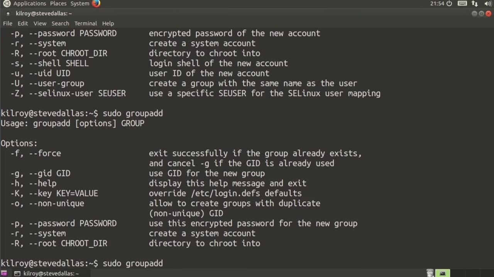
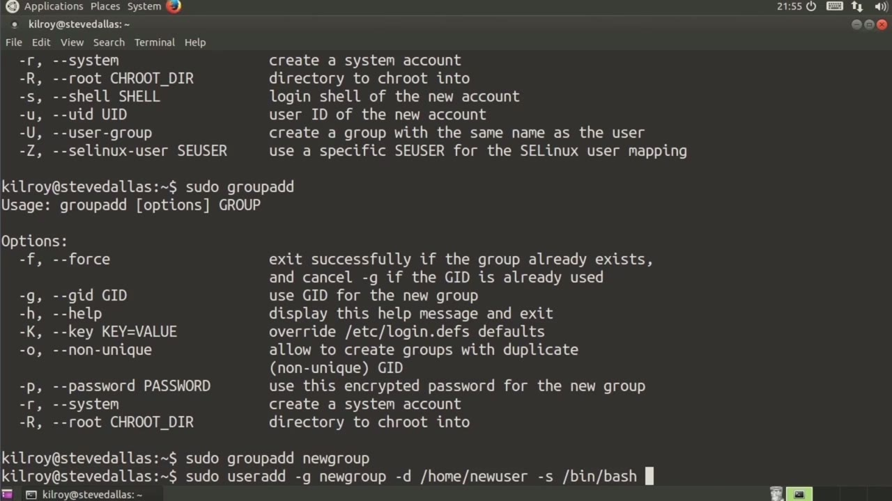
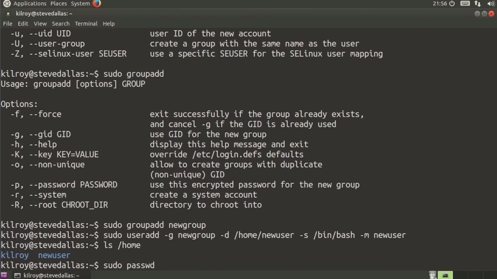

[← Course contents](../../02.md)

# 50. Creating Users

**Course:** [Linux Security & Administration From Boot Process to Firewalls](https://www.youtube.com/watch?v=_WB3evmgxYA)  
**Transcript:** [`Linux Security & Administration From Boot Process to Firewalls transcript`](../../../../course_videos/Linux%20Security%20%26%20Administration%20From%20Boot%20Process%20to%20Firewalls/Linux%20Security%20%26%20Administration%20From%20Boot%20Process%20to%20Firewalls.txt)  
**Video:** 03:44:31–03:47:52 ([open at this time](https://www.youtube.com/watch?v=_WB3evmgxYA&t=13471s))

## Introduction

Well, now that we know where all of the information about the users is stored, Let's go about actually creating some users. So typically we would use the command user ad, and that's going to bring up the help for user ad. Very simply, all you have to do is say user ad and give it a username. I want to give it some more specific configuration settings.

## Detailed Explanation

<details>
  <summary>Step 1 — Run `groupadd`</summary>

### Step 1 — Run `groupadd`

- [x] **Well, now that we know where all of the information about the users**
  - Well, now that we know where all of the information about the users is stored, Let's go about actually creating some users.
  - So typically we would use the command user ad, and that's going to bring up the help for user ad.
  - Very simply, all you have to do is say user ad and give it a username.

- [x] **I want to give it some more specific configuration settings**
  - I want to give it some more specific configuration settings.
  - Then I've got a group that I can actually add the user to.
  - And again, we've got a set of parameters that I can pass.

- [x] **Use `groupadd`**
  - In this case, I want to just say `groupadd` and just say new group.
  - And now I'm going to say -G is going to be new group that is going to be the primary group for this particular user.
  - And then I want to say -D is going to be home, new user.

- [x] **So -D is the directory or the home directory for the user**
  - So -D is the directory or the home directory for the user.
  - So you can see -D is the home directory.
  - And I'm going to specify -M at the end, which is going to create the directory for me.

- [x] **Now, the other thing I want to do is I want to set a shell**
  - Now, the other thing I want to do is I want to set a shell.

```bash
groupadd
```



</details>

<details>
  <summary>Step 2 — Run `bash`</summary>

### Step 2 — Run `bash`

- [x] **Use `bash`**
  - The user interface when you log in in an interactive fashion using this terminal window, for example.
  - If I were also to use a secure shell to get in remotely, this is the shell that would run that would give me interactive access to this particular system. So we're going to say /bin slash `bash`.
  - And there are a number of other parameters, of course, that I can use.

- [x] **I'm going to let the system create the user id or the numeric value**
  - I'm going to let the system create the user id or the numeric value for this particular user.
  - And now I'm going to say -M, in other words, create the directory for me for the home for this user.
  - So now you should see that we've got a directory called new user in the home directory.

- [x] **I'm going to use the paswd or password command**
  - I'm going to use the paswd or password command.

```bash
bash
```



</details>

<details>
  <summary>Step 3 — Run `sudo`, `which`</summary>

### Step 3 — Run `sudo`, `which`

- [x] **Use `sudo`, `which`**
  - If I just run this now, though, it's actually going to change the root password because I'm running it `sudo`, `which` means I'm running it as administrator.
  - I could change my own password here by just saying password, and it's going to prompt me to change my own password.
  - In this case, though, I want to say password, new user, and that's going to be setting the password for new user.

- [x] **It's going to ask me to retype it to make sure that I haven't screwed**
  - It's going to ask me to retype it to make sure that I haven't screwed anything up and typoed and then end up with a password that's unusable.
  - So I have now just created a new user and I have also set the password on that new user and I've created a group for the user.
  - And set that user to also have that group id that we created.

```bash
sudo
which
```



</details>

<details>
  <summary>Questions and Answers</summary>

## Questions and Answers

### Question 1: What does `groupadd` do in this chapter?

<details>
<summary>Answer</summary>

- [x] In this case, I want to just say `groupadd` and just say new group.

</details>

### Question 2: What does `bash` do in this chapter?

<details>
<summary>Answer</summary>

- [x] If I were also to use a secure shell to get in remotely, this is the shell that would run that would give me interactive access to this particular system. So we're going to say /bin slash `bash`.

</details>

### Question 3: What does `sudo` do in this chapter?

<details>
<summary>Answer</summary>

- [x] If I just run this now, though, it's actually going to change the root password because I'm running it `sudo`, which means I'm running it as administrator.

</details>

### Question 4: What does `which` do in this chapter?

<details>
<summary>Answer</summary>

- [x] If I just run this now, though, it's actually going to change the root password because I'm running it sudo, `which` means I'm running it as administrator.

</details>

### Question 5: What does step 1 cover (Run groupadd)?

<details>
<summary>Answer</summary>

- [x] Well, now that we know where all of the information about the users is stored, Let's go about actually creating some users.
- [x] So typically we would use the command user ad, and that's going to bring up the help for user ad.
- [x] Very simply, all you have to do is say user ad and give it a username.

</details>

### Question 6: What does step 2 cover (Run bash)?

<details>
<summary>Answer</summary>

- [x] The user interface when you log in in an interactive fashion using this terminal window, for example.
- [x] If I were also to use a secure shell to get in remotely, this is the shell that would run that would give me interactive access to this particular system. So we're going to say /bin slash `bash`.
- [x] And there are a number of other parameters, of course, that I can use.

</details>

### Question 7: What does step 3 cover (Run sudo, which)?

<details>
<summary>Answer</summary>

- [x] If I just run this now, though, it's actually going to change the root password because I'm running it `sudo`, `which` means I'm running it as administrator.
- [x] I could change my own password here by just saying password, and it's going to prompt me to change my own password.
- [x] In this case, though, I want to say password, new user, and that's going to be setting the password for new user.

</details>

</details>

## Summary

This chapter, Creating Users, walks through Run groupadd; Run bash; Run sudo, which. Commands from the transcript: `groupadd`, `bash`, `sudo`, `which`.

## References

- [Linux Security & Administration From Boot Process to Firewalls (YouTube)](https://www.youtube.com/watch?v=_WB3evmgxYA)
- [This chapter at 03:44:31](https://www.youtube.com/watch?v=_WB3evmgxYA&t=13471s)
- [Local transcript](../../../../course_videos/Linux%20Security%20%26%20Administration%20From%20Boot%20Process%20to%20Firewalls/Linux%20Security%20%26%20Administration%20From%20Boot%20Process%20to%20Firewalls.txt)
