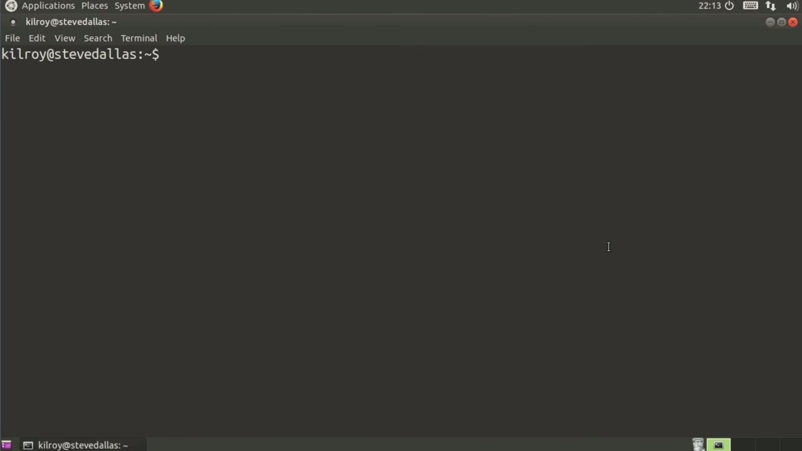
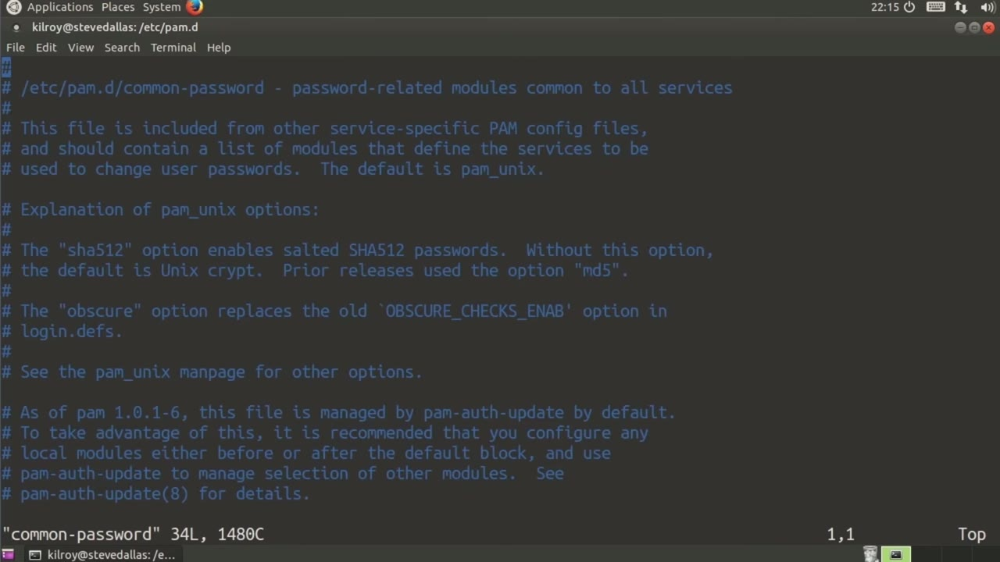
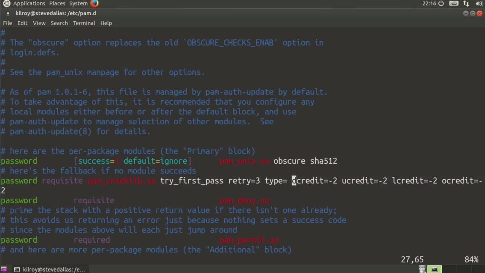

[← Course contents](../../02.md)

# 51. Securing Passwords

**Course:** [Linux Security & Administration From Boot Process to Firewalls](https://www.youtube.com/watch?v=_WB3evmgxYA)  
**Transcript:** [`Linux Security & Administration From Boot Process to Firewalls transcript`](../../../../course_videos/Linux%20Security%20%26%20Administration%20From%20Boot%20Process%20to%20Firewalls/Linux%20Security%20%26%20Administration%20From%20Boot%20Process%20to%20Firewalls.txt)  
**Video:** 03:47:52–03:51:20 ([open at this time](https://www.youtube.com/watch?v=_WB3evmgxYA&t=13672s))

## Introduction

Now we've created users and we've set passwords. We need to think about how we are going to protect our users by enforcing password policy. The first thing that I want to look at is a file called login.deaf. So there are a number of settings in here.

## Detailed Explanation

  
Step 1 — we've created users and we've set passwords

### Step 1 — we've created users and we've set passwords

- [x] **Now we've created users and we've set passwords**
  - Now we've created users and we've set passwords.
  - We need to think about how we are going to protect our users by enforcing password policy.
  - The first thing that I want to look at is a file called login.deaf.

- [x] **So there are a number of settings in here**
  - So there are a number of settings in here.
  - The ones we are really interested in looking at, though, are the ones related to password.
  - So I'm just going to look for pass here.

- [x] **And here you can see we can set the maximum days that a password can**
  - And here you can see we can set the maximum days that a password can be used, the minimum days that a password has to be used before we allow a password to be changed, and then the warning.
  - These are all set on a per user basis based on these defaults in the shadow file.
  - Where we looked at these settings that were on each individual line for the particular user.

- [x] **All of those settings are taken from this login.defs file, which are**
  - All of those settings are taken from this login.defs file, which are the defaults for login.
  - So now I want to take a look at how we can make sure that the passwords that our users are using have some complexity to them. So we are going to go into pAM.d.
  - PAM is plug-able authentication modules.

- [x] **It is how Linux systems do authentication**
  - It is how Linux systems do authentication.
  - The PAM modules determine how users are going to log into the system.

  
Step 2 — we are in the PAM directory where all the configuration files are

### Step 2 — we are in the PAM directory where all the configuration files are

- [x] **So we are in the PAM directory where all the configuration files are**
  - So we are in the PAM directory where all the configuration files are.
  - I want to look at the common password file here.
  - Now each of these lines that say password, are a number of modules that are going to be called here.

- [x] **First of all, we're going to say password and then basically if**
  - First of all, we're going to say password and then basically if there's success, then we're going to allow it.
  - This is using the Unix login here and it's using Shaw 512 as the hash value here.
  - And here we're going to say that this library module is required.

- [x] **So the first password that the user logs in, which is try first pass**
  - So the first password that the user logs in, which is try first pass.

  
Step 3 — here is where we are going to specify the password complexity

### Step 3 — here is where we are going to specify the password complexity

- [x] **And here is where we are going to specify the password complexity**
  - And here is where we are going to specify the password complexity.
  - The decredit, is actually the number of numeric values in a password.
  - So we're acquiring two numbers, two lowercase letters, and finally two symbols.

- [x] **Now, of course, you can change all of these to be whatever you would**
  - Now, of course, you can change all of these to be whatever you would like them to be, but this line is the type of line you would put into either your common password or your system off file, depending on which one you had.
  - On this particular system, there's no system off file.
  - So I'm putting this particular line into my common password file.

- [x] **So I can set my password complexity policy here in this file, and**
  - So I can set my password complexity policy here in this file, and we're going to use the crack lib module that will be installed as part of Pam in order to check the password complexity requirements before you can actually set a password.

  
Questions and Answers

## Questions and Answers

### Question 1: What does step 1 cover (we've created users and we've set passwords)?

Answer

- [x] Now we've created users and we've set passwords.
- [x] We need to think about how we are going to protect our users by enforcing password policy.
- [x] The first thing that I want to look at is a file called login.deaf.

### Question 2: What does step 2 cover (we are in the PAM directory where all the configuration files are)?

Answer

- [x] So we are in the PAM directory where all the configuration files are.
- [x] I want to look at the common password file here.
- [x] Now each of these lines that say password, are a number of modules that are going to be called here.

### Question 3: What does step 3 cover (here is where we are going to specify the password complexity)?

Answer

- [x] And here is where we are going to specify the password complexity.
- [x] The decredit, is actually the number of numeric values in a password.
- [x] So we're acquiring two numbers, two lowercase letters, and finally two symbols.

## Summary

This chapter, Securing Passwords, walks through we've created users and we've set passwords; we are in the PAM directory where all the configuration files are; here is where we are going to specify the password complexity.

## References

- [Linux Security & Administration From Boot Process to Firewalls (YouTube)](https://www.youtube.com/watch?v=_WB3evmgxYA)
- [This chapter at 03:47:52](https://www.youtube.com/watch?v=_WB3evmgxYA&t=13672s)
- [Local transcript](../../../../course_videos/Linux%20Security%20%26%20Administration%20From%20Boot%20Process%20to%20Firewalls/Linux%20Security%20%26%20Administration%20From%20Boot%20Process%20to%20Firewalls.txt)
