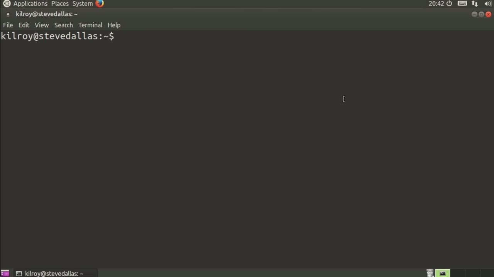
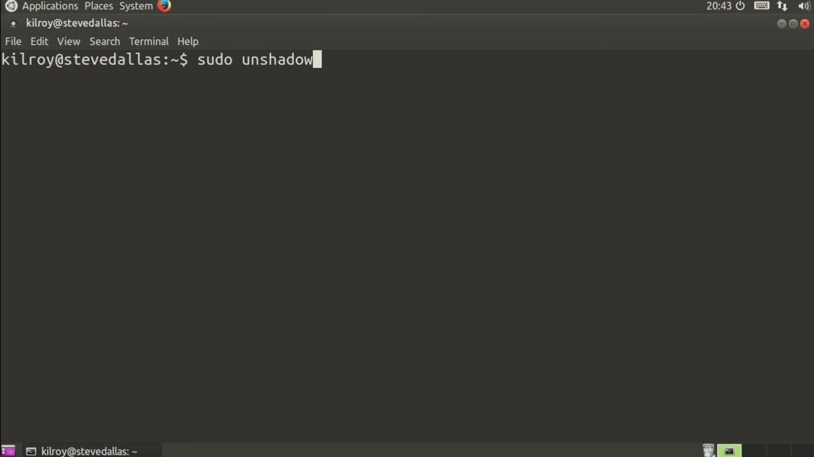
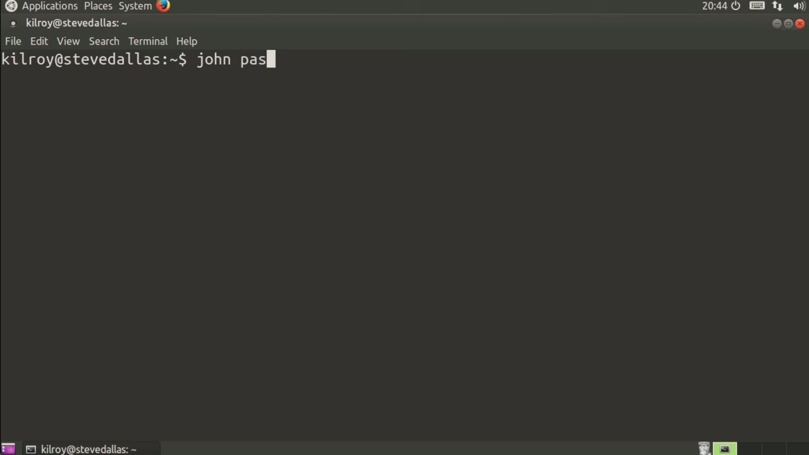
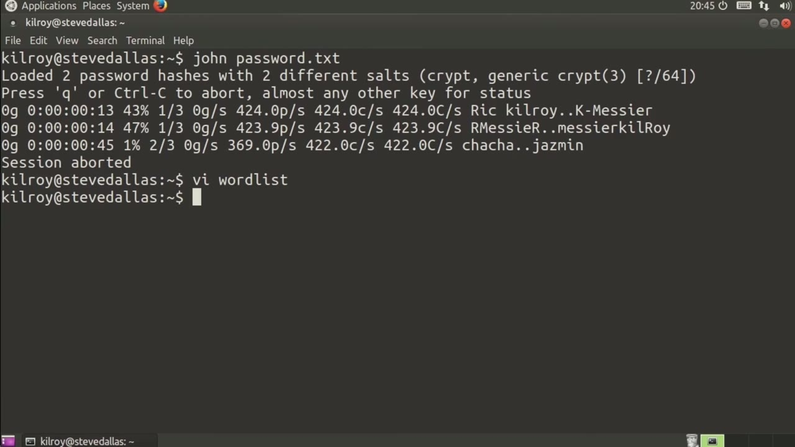

[← Course contents](../../02.md)

# 52. Cracking Passwords

**Course:** [Linux Security & Administration From Boot Process to Firewalls](https://www.youtube.com/watch?v=_WB3evmgxYA)  
**Transcript:** [`Linux Security & Administration From Boot Process to Firewalls transcript`](../../../../course_videos/Linux%20Security%20%26%20Administration%20From%20Boot%20Process%20to%20Firewalls/Linux%20Security%20%26%20Administration%20From%20Boot%20Process%20to%20Firewalls.txt)  
**Video:** 03:51:20–03:54:39 ([open at this time](https://www.youtube.com/watch?v=_WB3evmgxYA&t=13880s))

## Introduction

One practice that many system administrators use is to periodically attempt to crack passwords on their system. The reason for that isn't because they want to know their user's passwords. It's to make sure that the passwords that are there can't easily be cracked or determined by either another user or some adversary or attacker who's potentially gotten into the system. So there's a pretty good reason for actually doing this periodic password cracking.

## Detailed Explanation

<details>
  <summary>Step 1 — Run `unshadow`</summary>

### Step 1 — Run `unshadow`

- [x] **One practice that many system administrators use is to periodically**
  - One practice that many system administrators use is to periodically attempt to crack passwords on their system.
  - The reason for that isn't because they want to know their user's passwords.
  - It's to make sure that the passwords that are there can't easily be cracked or determined by either another user or some adversary or attacker who's potentially gotten into the system.

- [x] **So there's a pretty good reason for actually doing this periodic**
  - So there's a pretty good reason for actually doing this periodic password cracking.
  - Fortunately, there's a utility that we can use that will crack the passwords for us.
  - And it uses a couple of different methods.

- [x] **Use `unshadow`**
  - And we're going to, first of all, need some passwords and the users that are associated with them.
  - We're going to use a utility called `unshadow`.
  - And that's going to take the user and password information out of this shadow suite that is in place.

- [x] **We're going to dump it into a file that we're just going to call**
  - We're going to dump it into a file that we're just going to call password.text.
  - You can just see it's really a combination of the password and shadow files.
  - And if there are users that actually have a password in place, that will show up in this file.

```bash
unshadow
```





</details>

<details>
  <summary>Step 2 — Run `john`</summary>

### Step 2 — Run `john`

- [x] **Use `john`**
  - We're just going to say `john`, which is the name of the password cracker.
  - It's called `john` the Ripper.
  - We're going to just say `john` Password.T.

- [x] **There are apparently two password hashes in this particular file**
  - There are apparently two password hashes in this particular file.
  - That's going to be okay, so we're going to be doing a number of guesses against the two passwords that are in this file. Since I haven't actually done any parameters here, it's going to go through a few iterations on this with a couple of different methods. One thing I could do is if I had
  - A word list, so let's just create a word list, and it doesn't much matter what we put in here.

- [x] **We'll just put some random passwords in**
  - We'll just put some random passwords in.

```bash
john
```



</details>

<details>
  <summary>Step 3 — Run `john`</summary>

### Step 3 — Run `john`

- [x] **Use `john`**
  - Okay, so now we've created a word list here.
  - So now I could say `john` WordList, and I could specify the word list is going to be word list, which is the name of my word list here, and then I'm going to say password.t.
  - It ran through the word list and didn't, of course, actually find anything because those passwords didn't match up.

- [x] **Use `john`**
  - I can use a word list and then we can do an incremental mode in order to try to break the passwords and crack the passwords.
  - Of course, if you get all the way through and you weren't able to crack anything, That means you've got some reasonably strong passwords.
  - Of course, somebody with an extensive word list and a lot of time on their hands may still be able to crack the password, but if you can run `john` against it and have it run all the way through and not get anything out of it, then you've got a pretty good chance

- [x] **That you've got some strong passwords that are going to be resistant**
  - That you've got some strong passwords that are going to be resistant to these sorts of attacks.

```bash
john
```



</details>

<details>
  <summary>Questions and Answers</summary>

## Questions and Answers

### Question 1: What does `unshadow` do in this chapter?

<details>
<summary>Answer</summary>

- [x] We're going to use a utility called `unshadow`.

</details>

### Question 2: What does `john` do in this chapter?

<details>
<summary>Answer</summary>

- [x] We're just going to say `john`, which is the name of the password cracker.

</details>

### Question 3: What does step 1 cover (Run unshadow)?

<details>
<summary>Answer</summary>

- [x] One practice that many system administrators use is to periodically attempt to crack passwords on their system.
- [x] The reason for that isn't because they want to know their user's passwords.
- [x] It's to make sure that the passwords that are there can't easily be cracked or determined by either another user or some adversary or attacker who's potentially gotten into the system.

</details>

### Question 4: What does step 2 cover (Run john)?

<details>
<summary>Answer</summary>

- [x] We're just going to say `john`, which is the name of the password cracker.
- [x] It's called `john` the Ripper.
- [x] We're going to just say `john` Password.T.

</details>

### Question 5: What does step 3 cover (Run john)?

<details>
<summary>Answer</summary>

- [x] Okay, so now we've created a word list here.
- [x] So now I could say `john` WordList, and I could specify the word list is going to be word list, which is the name of my word list here, and then I'm going to say password.t.
- [x] It ran through the word list and didn't, of course, actually find anything because those passwords didn't match up.

</details>

</details>

## Summary

This chapter, Cracking Passwords, walks through Run unshadow; Run john; Run john. Commands from the transcript: `unshadow`, `john`.

## References

- [Linux Security & Administration From Boot Process to Firewalls (YouTube)](https://www.youtube.com/watch?v=_WB3evmgxYA)
- [This chapter at 03:51:20](https://www.youtube.com/watch?v=_WB3evmgxYA&t=13880s)
- [Local transcript](../../../../course_videos/Linux%20Security%20%26%20Administration%20From%20Boot%20Process%20to%20Firewalls/Linux%20Security%20%26%20Administration%20From%20Boot%20Process%20to%20Firewalls.txt)
