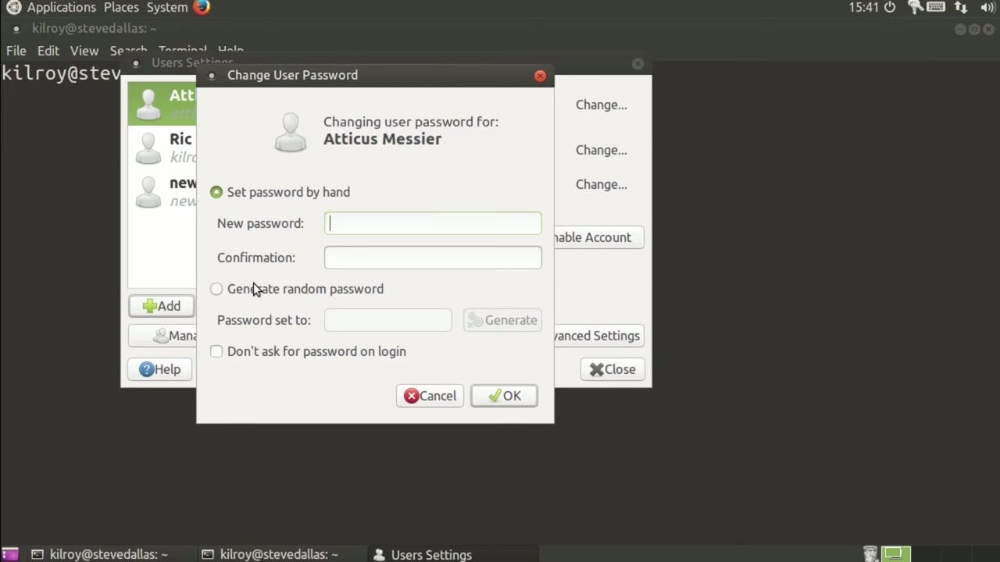
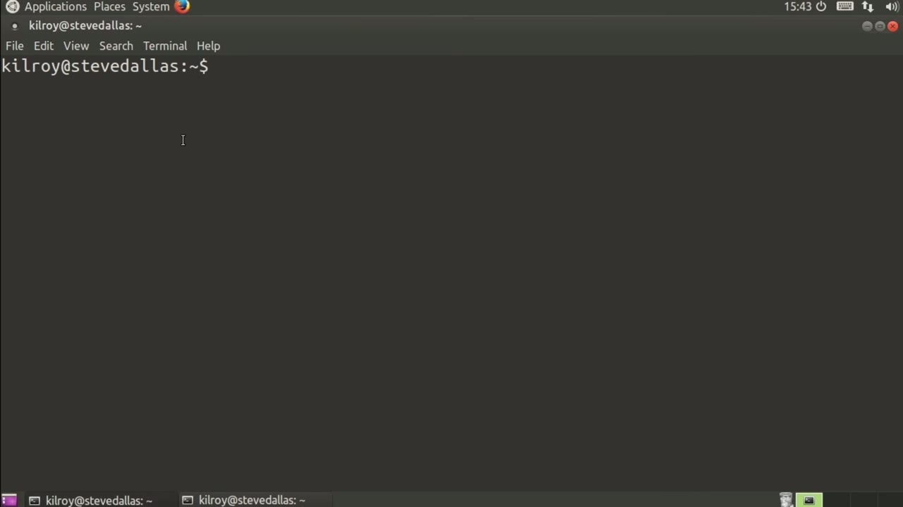

[← Course contents](../../02.md)

# 53. Alternate User Management

**Course:** [Linux Security & Administration From Boot Process to Firewalls](https://www.youtube.com/watch?v=_WB3evmgxYA)  
**Transcript:** [`Linux Security & Administration From Boot Process to Firewalls transcript`](../../../../course_videos/Linux%20Security%20%26%20Administration%20From%20Boot%20Process%20to%20Firewalls/Linux%20Security%20%26%20Administration%20From%20Boot%20Process%20to%20Firewalls.txt)  
**Video:** 03:54:39–03:57:49 ([open at this time](https://www.youtube.com/watch?v=_WB3evmgxYA&t=14079s))

## Introduction

Now, we've done an awful lot of work using the command line. Of course, it's not the only way to do system administration. With the case of users and groups, we actually have a graphical utility that we can use to configure those. So on an Ubuntu system, if I go to system administration and then users and groups, it will launch this particular interface here.

## Detailed Explanation

<details>
  <summary>Step 1 — Now, we've done an awful lot of work using the command line</summary>

### Step 1 — Now, we've done an awful lot of work using the command line

- [x] **Now, we've done an awful lot of work using the command line**
  - Now, we've done an awful lot of work using the command line.
  - Of course, it's not the only way to do system administration.
  - With the case of users and groups, we actually have a graphical utility that we can use to configure those.

- [x] **So on an Ubuntu system, if I go to system administration and then**
  - So on an Ubuntu system, if I go to system administration and then users and groups, it will launch this particular interface here.
  - I can go to add and this would add my user.
  - It's asking me to authenticate myself so that we can be sure that we're not just allowing anybody who happens to walk up to a console that is logged in and start adding users.

- [x] **I can say my name and it's going to suggest a username**
  - I can say my name and it's going to suggest a username.


</details>

<details>
  <summary>Step 2 — Of course, I don't have to take that if I don't want to</summary>

### Step 2 — Of course, I don't have to take that if I don't want to

- [x] **Of course, I don't have to take that if I don't want to**
  - Of course, I don't have to take that if I don't want to.
  - And then once I've created that, it's going to allow me to set a password by hand or I could generate a random password and we can just keep clicking generate if that's what we wanted to do. In this particular case I am going to create a password here for this particular user. I can go to advanced settings here. It will give me the
  - Ability to set the office location, work phone, home phone user privileges.

- [x] **So I could allow this user to configure printers, share files with**
  - So I could allow this user to configure printers, share files with the local network.
  - Some of this has to do with the groups that this user would be added into.
  - And then of course I can disable the account, set the home directory.

- [x] **So all of the other things that we could do with user ad we can do**
  - So all of the other things that we could do with user ad we can do here as well, just in a graphical format.



</details>

<details>
  <summary>Step 3 — Run `users`</summary>

### Step 3 — Run `users`

- [x] **You can see all of the groups that are here if I were to select one**
  - You can see all of the groups that are here if I were to select one and bring up properties.
  - It would tell me who is actually in the group.
  - And of course, I can add people if I wanted to do that.

- [x] **That would allow me to add users to these groups**
  - That would allow me to add `users` to these groups.
  - I can select one I could delete if that's what I wanted or I can certainly add a new group to my list of groups.
  - And then, of course, create group numbers at the same time.

- [x] **Now we've got a new group in our list and I can close this**
  - Now we've got a new group in our list and I can close this.
  - Here's another way that you can manage your `users` if you get tired of doing a lot of typing.
  - And you'd rather use the mouse, you can certainly use that system utility.

- [x] **Use `users`**
  - So that would be used if you were using `users` on your local system rather than using something like ldap or maybe connecting to an active directory server that is somewhere else.
  - Also, nist and nis Plus would have different user configuration or user management capabilities.
  - But if you are managing local `users` using the standard, password and shadow files, you can either use the command line for that or you can use this graphical utility. If you go to system administration and then `users` and groups, you can manage your `users` and groups in that way as well. Right now we're going to talk about

```bash
users
```



</details>

<details>
  <summary>Questions and Answers</summary>

## Questions and Answers

### Question 1: What does `users` do in this chapter?

<details>
<summary>Answer</summary>

- [x] So that would be used if you were using `users` on your local system rather than using something like ldap or maybe connecting to an active directory server that is somewhere else.

</details>

### Question 2: What does step 1 cover (Now, we've done an awful lot of work using the command line)?

<details>
<summary>Answer</summary>

- [x] Now, we've done an awful lot of work using the command line.
- [x] Of course, it's not the only way to do system administration.
- [x] With the case of users and groups, we actually have a graphical utility that we can use to configure those.

</details>

### Question 3: What does step 2 cover (Of course, I don't have to take that if I don't want to)?

<details>
<summary>Answer</summary>

- [x] Of course, I don't have to take that if I don't want to.
- [x] And then once I've created that, it's going to allow me to set a password by hand or I could generate a random password and we can just keep clicking generate if that's what we wanted to do. In this particular case I am going to create a password here for this particular user. I can go to advanced settings here. It will give me the
- [x] Ability to set the office location, work phone, home phone user privileges.

</details>

### Question 4: What does step 3 cover (Run users)?

<details>
<summary>Answer</summary>

- [x] You can see all of the groups that are here if I were to select one and bring up properties.
- [x] It would tell me who is actually in the group.
- [x] And of course, I can add people if I wanted to do that.

</details>

</details>

## Summary

This chapter, Alternate User Management, walks through Now, we've done an awful lot of work using the command line; Of course, I don't have to take that if I don't want to; Run users. Commands from the transcript: `users`.

## References

- [Linux Security & Administration From Boot Process to Firewalls (YouTube)](https://www.youtube.com/watch?v=_WB3evmgxYA)
- [This chapter at 03:54:39](https://www.youtube.com/watch?v=_WB3evmgxYA&t=14079s)
- [Local transcript](../../../../course_videos/Linux%20Security%20%26%20Administration%20From%20Boot%20Process%20to%20Firewalls/Linux%20Security%20%26%20Administration%20From%20Boot%20Process%20to%20Firewalls.txt)
