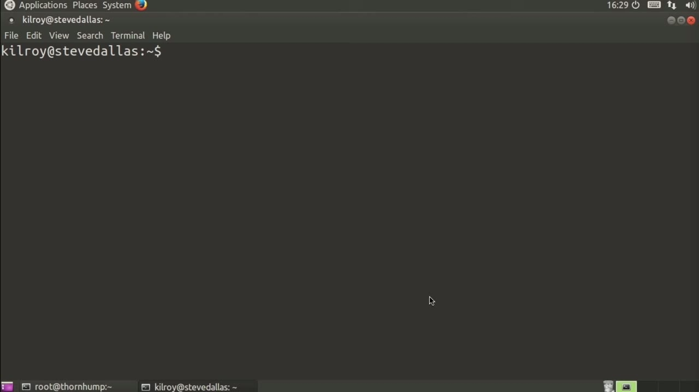
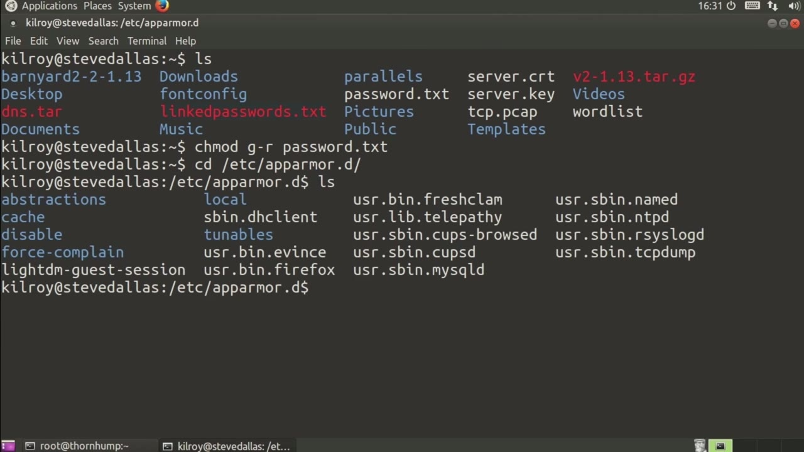
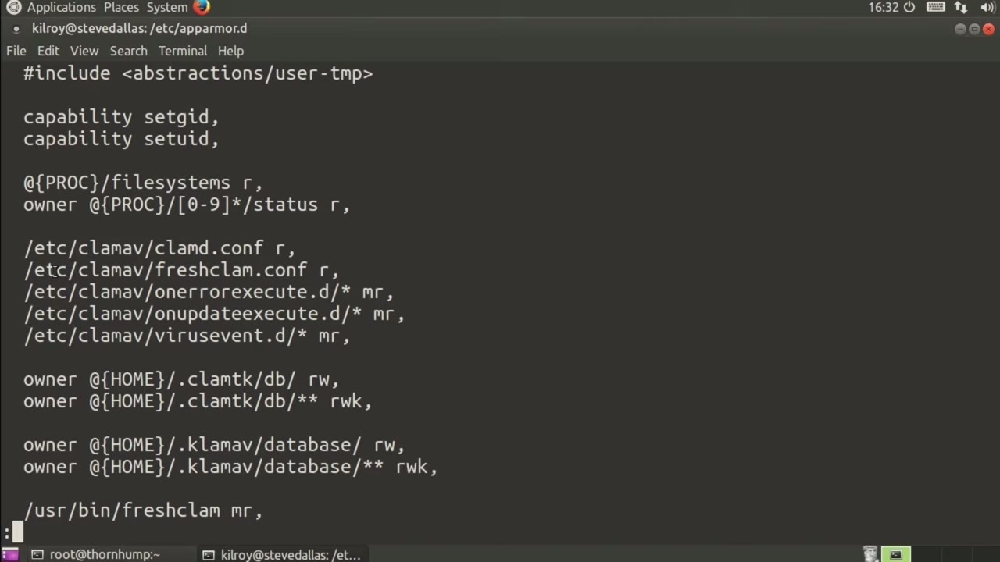

[← Course contents](../../02.md)

# 54. AppArmor

**Course:** [Linux Security & Administration From Boot Process to Firewalls](https://www.youtube.com/watch?v=_WB3evmgxYA)  
**Transcript:** [`Linux Security & Administration From Boot Process to Firewalls transcript`](../../../../course_videos/Linux%20Security%20%26%20Administration%20From%20Boot%20Process%20to%20Firewalls/Linux%20Security%20%26%20Administration%20From%20Boot%20Process%20to%20Firewalls.txt)  
**Video:** 03:57:49–04:00:54 ([open at this time](https://www.youtube.com/watch?v=_WB3evmgxYA&t=14269s))

## Introduction

AppArmor, which is a way of implementing mandatory access controls. Mandatory access controls are a way of setting system-wide policies on files and users and the way that the different components and objects of a system interact with one another. This is different from discretionary access controls where, for example, I as a user could actually set my own permission. So, for example, I could say drop group access to...

## Detailed Explanation

  
Step 1 — AppArmor, which is a way of implementing mandatory access controls

### Step 1 — AppArmor, which is a way of implementing mandatory access controls

- [x] **AppArmor, which is a way of implementing mandatory access controls**
  - AppArmor, which is a way of implementing mandatory access controls.
  - Mandatory access controls are a way of setting system-wide policies on files and users and the way that the different components and objects of a system interact with one another.
  - This is different from discretionary access controls where, for example, I as a user could actually set my own permission.

- [x] **So, for example, I could say drop group access to**
  - So, for example, I could say drop group access to...
  - So this is an example of discretionary access controls, meaning that I as a user have the discretion to be able to change permissions for the different files in my directory.
  - Any owner of an object could change permissions and settings on that object in a discretionary access control system.

- [x] **This is not the case if you are using something like AppArmor, for**
  - This is not the case if you are using something like AppArmor, for example.

  
Step 2 — We've got AppArmor, and we're going to drop into the AppArmor

### Step 2 — We've got AppArmor, and we're going to drop into the AppArmor

- [x] **We've got AppArmor, and we're going to drop into the AppArmor**
  - We've got AppArmor, and we're going to drop into the AppArmor directory, and what you've got here is a set of policies.
  - So let's just take a look at one of them.
  - We're going to take a look at Fresh Clam.

- [x] **Let me just copy this, and we'll just take a quick look at this**
  - Let me just copy this, and we'll just take a quick look at this particular configuration file.
  - What we've got is a set of configurations for what this particular file here, UserBin FreshClam, which is an executable, can actually do.
  - We've got capabilities, so this can set group id and it can also set user id.

- [x] **There are places where it can get access to the file system**
  - There are places where it can get access to the file system.

  
Step 3 — We want to give it access to the proc directory, and of course we

### Step 3 — We want to give it access to the proc directory, and of course we

- [x] **We want to give it access to the proc directory, and of course we**
  - We want to give it access to the proc directory, and of course we certainly want it to be able to read from its own configuration files.
  - And then there are places where you want it to be able to read and write to the configuration databases in the home directory.
  - We give different capabilities and permissions to some of these programs here.

- [x] **You can also see that we have cases where we want to deny access to**
  - You can also see that we have cases where we want to deny access to this particular binary or executable here.
  - We would use these profiles in order to configure mandatory access control settings on various programs within the system.
  - When AppArmor is installed, uses a set of kernel modules in order to monitor these sorts of behaviors so that AppArmor can make determinations as to what to allow and what not to allow.

- [x] **If you are running into cases where things aren't working quite**
  - If you are running into cases where things aren't working quite right, you may want to look and see what you've got...
  - In terms of AppArmor profiles that may be blocking access to specific files or specific areas of the file system.

  
Questions and Answers

## Questions and Answers

### Question 1: What does step 1 cover (AppArmor, which is a way of implementing mandatory access controls)?

Answer

- [x] AppArmor, which is a way of implementing mandatory access controls.
- [x] Mandatory access controls are a way of setting system-wide policies on files and users and the way that the different components and objects of a system interact with one another.
- [x] This is different from discretionary access controls where, for example, I as a user could actually set my own permission.

### Question 2: What does step 2 cover (We've got AppArmor, and we're going to drop into the AppArmor)?

Answer

- [x] We've got AppArmor, and we're going to drop into the AppArmor directory, and what you've got here is a set of policies.
- [x] So let's just take a look at one of them.
- [x] We're going to take a look at Fresh Clam.

### Question 3: What does step 3 cover (We want to give it access to the proc directory, and of course we)?

Answer

- [x] We want to give it access to the proc directory, and of course we certainly want it to be able to read from its own configuration files.
- [x] And then there are places where you want it to be able to read and write to the configuration databases in the home directory.
- [x] We give different capabilities and permissions to some of these programs here.

## Summary

This chapter, AppArmor, walks through AppArmor, which is a way of implementing mandatory access controls; We've got AppArmor, and we're going to drop into the AppArmor; We want to give it access to the proc directory, and of course we.

## References

- [Linux Security & Administration From Boot Process to Firewalls (YouTube)](https://www.youtube.com/watch?v=_WB3evmgxYA)
- [This chapter at 03:57:49](https://www.youtube.com/watch?v=_WB3evmgxYA&t=14269s)
- [Local transcript](../../../../course_videos/Linux%20Security%20%26%20Administration%20From%20Boot%20Process%20to%20Firewalls/Linux%20Security%20%26%20Administration%20From%20Boot%20Process%20to%20Firewalls.txt)
