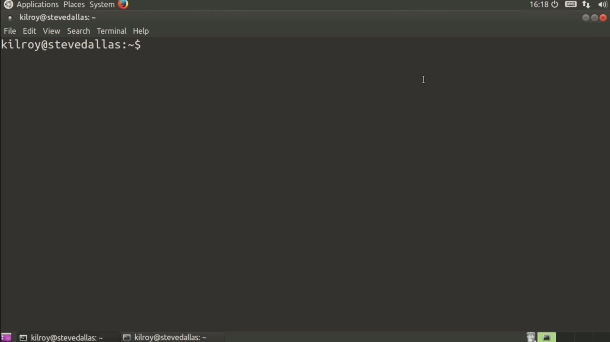
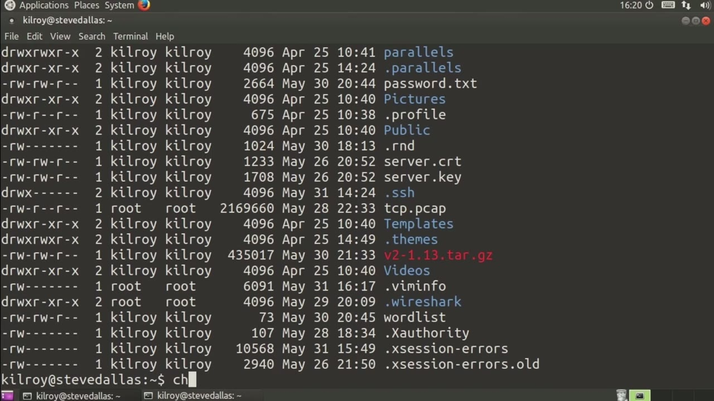
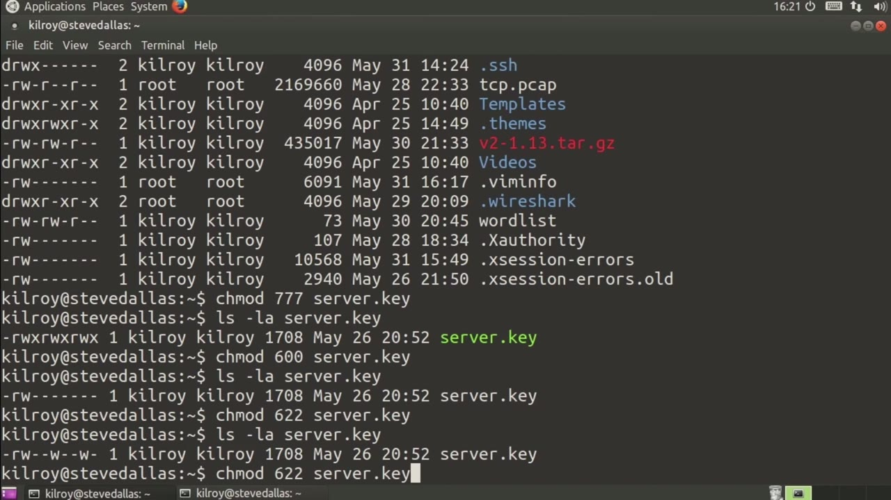

[← Course contents](../../02.md)

# 55. Unix Permissions

**Course:** [Linux Security & Administration From Boot Process to Firewalls](https://www.youtube.com/watch?v=_WB3evmgxYA)  
**Transcript:** [`Linux Security & Administration From Boot Process to Firewalls transcript`](../../../../course_videos/Linux%20Security%20%26%20Administration%20From%20Boot%20Process%20to%20Firewalls/Linux%20Security%20%26%20Administration%20From%20Boot%20Process%20to%20Firewalls.txt)  
**Video:** 04:00:54–04:04:54 ([open at this time](https://www.youtube.com/watch?v=_WB3evmgxYA&t=14454s))

## Introduction

Let's talk about Unix permissions. Now, traditional Unix permissions are a set of three, where we are talking about the user group and world scenario. What that means is we've got our permissions here, so let's just take a look at this. We're going to ignore the first one on the far left. So right here we've got user is these three permissions right here, the very first three on the left-hand side. Following that are a set of three permissions for group, and then finally World is on the right-hand side of the selection here.

## Detailed Explanation

<details>
  <summary>Step 1 — Let's talk about Unix permissions. Now, traditional Unix permissions</summary>

### Step 1 — Let's talk about Unix permissions. Now, traditional Unix permissions

- [x] **Let's talk about Unix permissions. Now, traditional Unix permissions**
  - Let's talk about Unix permissions. Now, traditional Unix permissions are a set of three, where we are talking about the user group and world scenario. What that means is we've got our permissions here, so let's just take a look at this. We're going to ignore the first one on the far left.
  - So right here we've got user is these three permissions right here, the very first three on the left-hand side.
  - Following that are a set of three permissions for group, and then finally World is on the right-hand side of the selection here.

- [x] **The way we do that is we have rewrite and execute for each of them**
  - The way we do that is we have rewrite and execute for each of them.
  - So for the user, we have rewrite execute, and for group we have read, write, execute, and world, read, write, execute, and so on.
  - Now, these permissions carry numeric values because that's how they are stored.

- [x] **The read permission would be a four, right would be a two, and then**
  - The read permission would be a four, right would be a two, and then execute would be a one.



</details>

<details>
  <summary>Step 2 — Run `chmod`</summary>

### Step 2 — Run `chmod`

- [x] **Use `chmod`**
  - If I wanted to change permissions, let's say I wanted to give read, write, execute to everybody across the board.
  - I would say use the utility `chmod`, and then I would say 777, which would be 4 plus 2 plus 1 for all of them.
  - And then we could say server.key is the one that we were looking at.

- [x] **We should see read, write, execute on all of the different ones here**
  - We should see read, write, execute on all of the different ones here.
  - So sure enough, we've got read, write, execute, read, write execute, read, write execute, read, write execute.
  - Now, if I wanted to say leave read and write for my user, and then have nothing for anybody else, I would say Schmod 600, server.key.

- [x] **And now if I look at that again, sure enough, I get read-write on my**
  - And now if I look at that again, sure enough, I get read-write on my user and then nothing anywhere else.

```bash
chmod
```



</details>

<details>
  <summary>Step 3 — that would be read-write for me and write for the others</summary>

### Step 3 — that would be read-write for me and write for the others

- [x] **So that would be read-write for me and write for the others**
  - So that would be read-write for me and write for the others.
  - If I wanted to do read-write for me and then read for the others, it would be 644.
  - So I'm going to give write permissions to the group and I'm going to say server.key.

- [x] **And we have added write permissions to the group there**
  - And we have added write permissions to the group there.
  - So if I want to drop right permissions for the group, I can say G -W and then I have dropped right permissions.
  - So the user in this particular case, which is me, can read and write the file. Anybody who is part of the group that owns this file, and you can see that in the second column right here, the first column being the user and the second column in terms of user group.

- [x] **Being that one right there. So anybody who is part of that group**
  - Being that one right there. So anybody who is part of that group would have right permissions. Anybody who was not either the user or part of the group becomes the world or everybody else, and they're going to have read permissions in this particular case.
  - So Unix permissions are fairly simple. It does take a little bit of work to kind of figure out how you're going to manage these permissions given I can either give you read, write, or execute permission, some combination of those.
  - And you can either be the owner of the file or you can be the group or I have to give everybody that same set of permissions, which means you may have people in lots of different groups just to give them the right permissions so that they can get to files and make changes to them



</details>

<details>
  <summary>Questions and Answers</summary>

## Questions and Answers

### Question 1: What does `chmod` do in this chapter?

<details>
<summary>Answer</summary>

- [x] I would say use the utility `chmod`, and then I would say 777, which would be 4 plus 2 plus 1 for all of them.

</details>

### Question 2: What does step 1 cover (Let's talk about Unix permissions. Now, traditional Unix permissions)?

<details>
<summary>Answer</summary>

- [x] Let's talk about Unix permissions. Now, traditional Unix permissions are a set of three, where we are talking about the user group and world scenario. What that means is we've got our permissions here, so let's just take a look at this. We're going to ignore the first one on the far left.
- [x] So right here we've got user is these three permissions right here, the very first three on the left-hand side.
- [x] Following that are a set of three permissions for group, and then finally World is on the right-hand side of the selection here.

</details>

### Question 3: What does step 2 cover (Run chmod)?

<details>
<summary>Answer</summary>

- [x] If I wanted to change permissions, let's say I wanted to give read, write, execute to everybody across the board.
- [x] I would say use the utility `chmod`, and then I would say 777, which would be 4 plus 2 plus 1 for all of them.
- [x] And then we could say server.key is the one that we were looking at.

</details>

### Question 4: What does step 3 cover (that would be read-write for me and write for the others)?

<details>
<summary>Answer</summary>

- [x] So that would be read-write for me and write for the others.
- [x] If I wanted to do read-write for me and then read for the others, it would be 644.
- [x] So I'm going to give write permissions to the group and I'm going to say server.key.

</details>

</details>

## Summary

This chapter, Unix Permissions, walks through Let's talk about Unix permissions. Now, traditional Unix permissions; Run chmod; that would be read-write for me and write for the others. Commands from the transcript: `chmod`.

## References

- [Linux Security & Administration From Boot Process to Firewalls (YouTube)](https://www.youtube.com/watch?v=_WB3evmgxYA)
- [This chapter at 04:00:54](https://www.youtube.com/watch?v=_WB3evmgxYA&t=14454s)
- [Local transcript](../../../../course_videos/Linux%20Security%20%26%20Administration%20From%20Boot%20Process%20to%20Firewalls/Linux%20Security%20%26%20Administration%20From%20Boot%20Process%20to%20Firewalls.txt)
