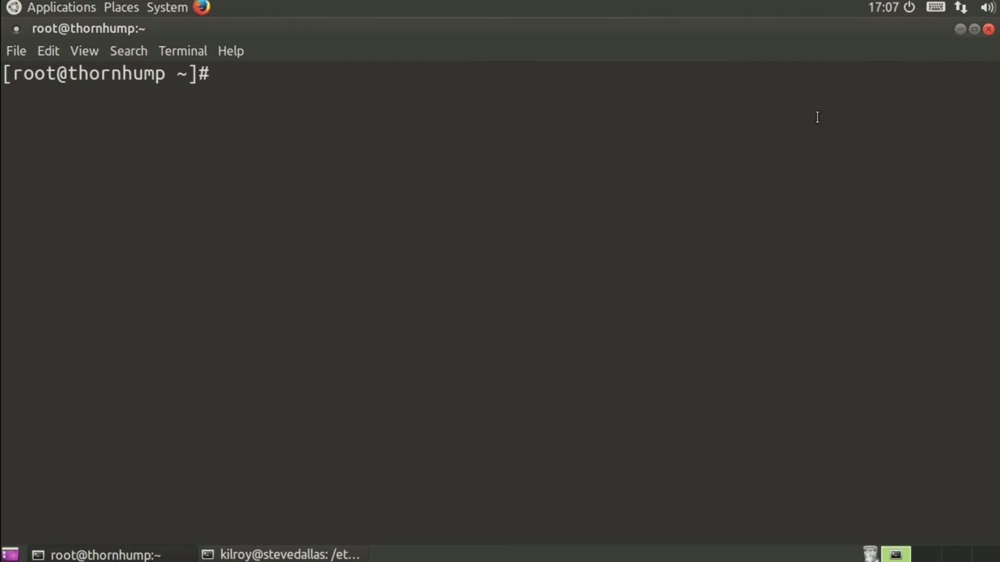
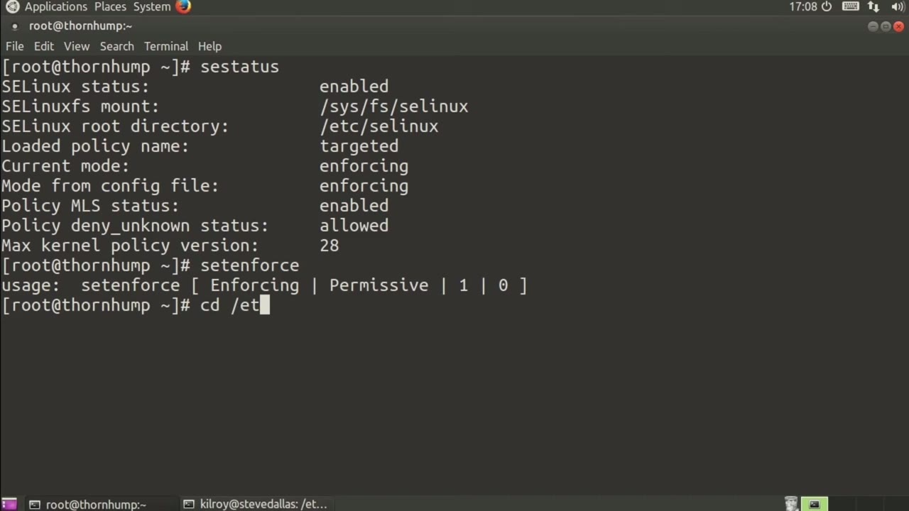
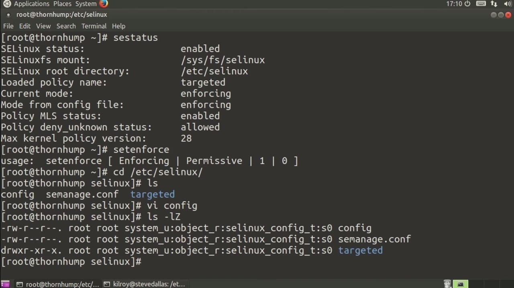

[← Course contents](../../02.md)

# 56. SELinux

**Course:** [Linux Security & Administration From Boot Process to Firewalls](https://www.youtube.com/watch?v=_WB3evmgxYA)  
**Transcript:** [`Linux Security & Administration From Boot Process to Firewalls transcript`](../../../../course_videos/Linux%20Security%20%26%20Administration%20From%20Boot%20Process%20to%20Firewalls/Linux%20Security%20%26%20Administration%20From%20Boot%20Process%20to%20Firewalls.txt)  
**Video:** 04:04:54–04:07:45 ([open at this time](https://www.youtube.com/watch?v=_WB3evmgxYA&t=14694s))

## Introduction

Another way of using mandatory access controls or applying mandatory access controls to Linux systems is to use SELinux, which was originally developed by the nsa as an enhancement to the Linux operating system, and a way of ensuring that there were mandatory access controls installed. So the first thing I want to do here, I'm on a Red Hat Linux system. SELinux is installed by default on Red Hat Enterprise Linux. So I'm just going to check the status of SELinix.

## Detailed Explanation

<details>
  <summary>Step 1 — Another way of using mandatory access controls or applying mandatory</summary>

### Step 1 — Another way of using mandatory access controls or applying mandatory

- [x] **Another way of using mandatory access controls or applying mandatory**
  - Another way of using mandatory access controls or applying mandatory access controls to Linux systems is to use SELinux, which was originally developed by the nsa as an enhancement to the Linux operating system, and a way of ensuring that there were mandatory access controls installed.
  - So the first thing I want to do here, I'm on a Red Hat Linux system.
  - SELinux is installed by default on Red Hat Enterprise Linux.

- [x] **So I'm just going to check the status of SELinix**
  - So I'm just going to check the status of SELinix.
  - I could do set enforce which would determine whether I were enforcing or permissive.
  - Enforcing means that all of the policies are active.

- [x] **And permissive means that while SELinux is on and enabled, none of**
  - And permissive means that while SELinux is on and enabled, none of the policies are actually being enforced.



</details>

<details>
  <summary>Step 2 — This would allow you to monitor what was actually happening</summary>

### Step 2 — This would allow you to monitor what was actually happening

- [x] **This would allow you to monitor what was actually happening**
  - This would allow you to monitor what was actually happening.
  - If I wanted to go into SELinux here, I could make changes to the configuration.
  - So I could take a look at the config file here.

- [x] **And this would be a change that I would make at the time of boot**
  - And this would be a change that I would make at the time of boot.
  - So if I were to set to permissive, I would get warnings rather than actually enforcing the policy.
  - Now, I can have the type set to be targeted minimum or mls, where mls is multi-level security.

- [x] **Currently, we are targeted, meaning that there are specific processes**
  - Currently, we are targeted, meaning that there are specific processes that are being protected here.



</details>

<details>
  <summary>Step 3 — Run `ls suddenly`</summary>

### Step 3 — Run `ls suddenly`

- [x] **One way that SELinux is implemented is by expanding permissions that**
  - One way that SELinux is implemented is by expanding permissions that Unix uses to have a broader range here.
  - So we would have a user, we would have a role, and then we would have a type.
  - And I can actually see that by doing this right here.

- [x] **Use `ls suddenly`**
  - If I add a capital Z as a parameter to ls, suddenly you see the SELinux permissions that are set on here.
  - So we've got System U, Object R, and SELinux config as the type.
  - We're going to get into taking a look at some additional aspects of SELinux coming up, but this is just kind of a basic understanding of what SELinux is, and then we'll talk about context and using labels on files.

```bash
ls suddenly
```



</details>

<details>
  <summary>Questions and Answers</summary>

## Questions and Answers

### Question 1: What does `ls suddenly` do in this chapter?

<details>
<summary>Answer</summary>

- [x] If I add a capital Z as a parameter to ls, suddenly you see the SELinux permissions that are set on here.

</details>

### Question 2: What does step 1 cover (Another way of using mandatory access controls or applying mandatory)?

<details>
<summary>Answer</summary>

- [x] Another way of using mandatory access controls or applying mandatory access controls to Linux systems is to use SELinux, which was originally developed by the nsa as an enhancement to the Linux operating system, and a way of ensuring that there were mandatory access controls installed.
- [x] So the first thing I want to do here, I'm on a Red Hat Linux system.
- [x] SELinux is installed by default on Red Hat Enterprise Linux.

</details>

### Question 3: What does step 2 cover (This would allow you to monitor what was actually happening)?

<details>
<summary>Answer</summary>

- [x] This would allow you to monitor what was actually happening.
- [x] If I wanted to go into SELinux here, I could make changes to the configuration.
- [x] So I could take a look at the config file here.

</details>

### Question 4: What does step 3 cover (Run ls suddenly)?

<details>
<summary>Answer</summary>

- [x] One way that SELinux is implemented is by expanding permissions that Unix uses to have a broader range here.
- [x] So we would have a user, we would have a role, and then we would have a type.
- [x] And I can actually see that by doing this right here.

</details>

</details>

## Summary

This chapter, SELinux, walks through Another way of using mandatory access controls or applying mandatory; This would allow you to monitor what was actually happening; Run ls suddenly. Commands from the transcript: `ls suddenly`.

## References

- [Linux Security & Administration From Boot Process to Firewalls (YouTube)](https://www.youtube.com/watch?v=_WB3evmgxYA)
- [This chapter at 04:04:54](https://www.youtube.com/watch?v=_WB3evmgxYA&t=14694s)
- [Local transcript](../../../../course_videos/Linux%20Security%20%26%20Administration%20From%20Boot%20Process%20to%20Firewalls/Linux%20Security%20%26%20Administration%20From%20Boot%20Process%20to%20Firewalls.txt)
