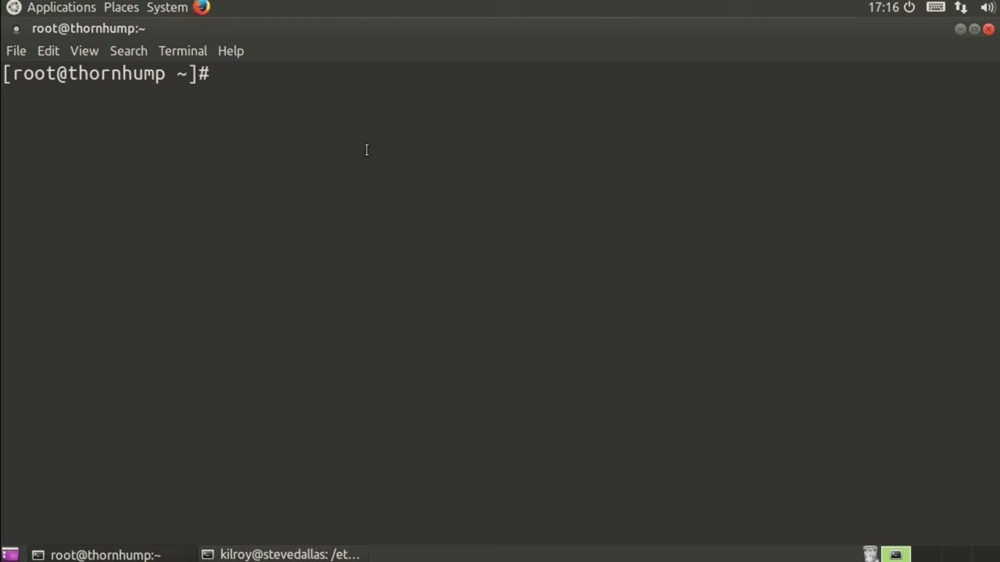
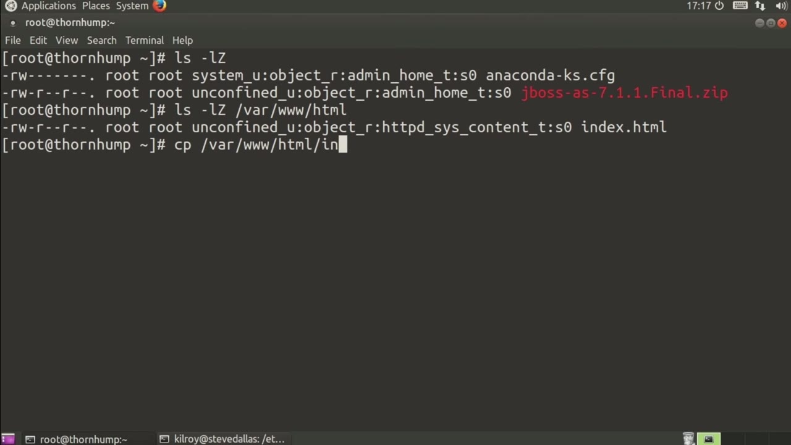
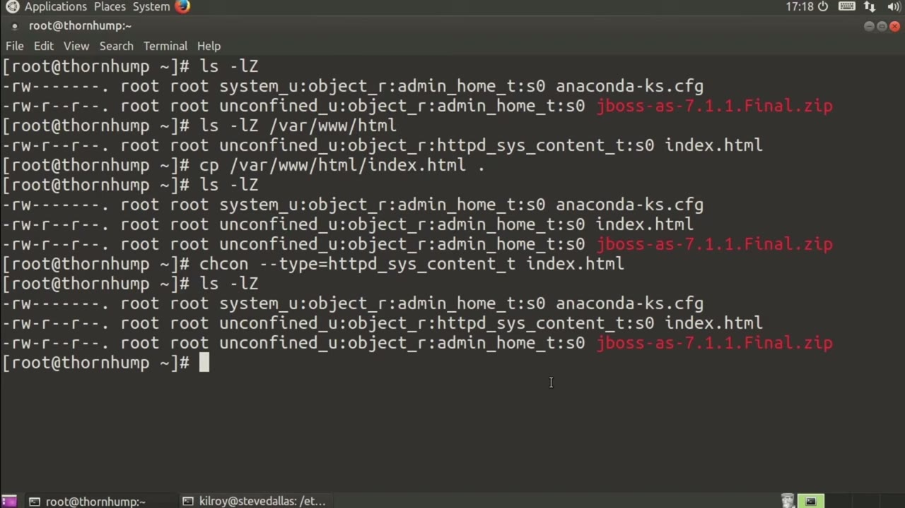

[← Course contents](../../02.md)

# 57. Modifying SELinux Permissions

**Course:** [Linux Security & Administration From Boot Process to Firewalls](https://www.youtube.com/watch?v=_WB3evmgxYA)  
**Transcript:** [`Linux Security & Administration From Boot Process to Firewalls transcript`](../../../../course_videos/Linux%20Security%20%26%20Administration%20From%20Boot%20Process%20to%20Firewalls/Linux%20Security%20%26%20Administration%20From%20Boot%20Process%20to%20Firewalls.txt)  
**Video:** 04:07:45–04:11:10 ([open at this time](https://www.youtube.com/watch?v=_WB3evmgxYA&t=14865s))

## Introduction

Let's talk a little bit about labels on files within the file system using SELinux. Now, in order for SELinux to work, there have to be a set of labels that go beyond what Unix permissions offer. So we've got a few different ways of labeling them. Let's just take a look at some permissions here.

## Detailed Explanation

  
Step 1 — Let's talk a little bit about labels on files within the file system

### Step 1 — Let's talk a little bit about labels on files within the file system

- [x] **Let's talk a little bit about labels on files within the file system**
  - Let's talk a little bit about labels on files within the file system using SELinux.
  - Now, in order for SELinux to work, there have to be a set of labels that go beyond what Unix permissions offer.
  - So we've got a few different ways of labeling them.

- [x] **Let's just take a look at some permissions here**
  - Let's just take a look at some permissions here.
  - So you can see I've got a couple of files in here and they actually have a couple of different sets of contexts here. So I've got system user, this case I've got unconfined user, but then we've got object role and then both of them are admin home type. Now just for
  - Comparison sake, let's take a look at the directory where the html pages for the Apache server are stored. So we've got a different set of contexts here.

- [x] **The important one is we've got HTTP sis content as the type**
  - The important one is we've got HTTP sis content as the type.

  
Step 2 — going to actually copy var www.html slash index.html

### Step 2 — going to actually copy var www.html slash index.html

- [x] **I'm going to actually copy var www.html slash index.html**
  - I'm going to actually copy var www.html slash index.html.
  - Let's say I want to make changes to that in my own directory here and then be able to move it back.
  - So when it comes over, you'll notice it immediately changes to admin home type.

- [x] **I can say change con and I can say type equals httbd sys content**
  - I can say change con and I can say type equals httbd sys content underscore t and then index.html.
  - So I should be able to see that show up here now.
  - And sure enough, we have created htdd underscore cis underscore content.

- [x] **The thing that I didn't do there was I didn't actually make that**
  - The thing that I didn't do there was I didn't actually make that change more or less permanent.

  
Step 3 — The next time this file system is relabeled, what will happen is those

### Step 3 — The next time this file system is relabeled, what will happen is those

- [x] **The next time this file system is relabeled, what will happen is**
  - The next time this file system is relabeled, what will happen is those contexts will actually be restored.
  - So in order to fix that, I can use se Manage F context, which is file context -A.
  - And -T, HTTPD underscore sis underscore content, underscore T, and then index.html.

- [x] **So now that the context has actually been changed, let me actually**
  - So now that the context has actually been changed, let me actually restore that back.
  - So we're going to change the context back here, and I'm going to say admin home underscore T is going to be the type that we are going to apply to this particular file.
  - And now if I move this file back into place, we're going to put it back into var www.html. I'm going to overwrite the file that's there and now we can say -lz var, www. And what we get now is since I did a move, it actually retained the type that was in place where it was.

- [x] **Now I've got a different type here associated with this file than**
  - Now I've got a different type here associated with this file than would normally be there.
  - I would change this context back or I could just do a restore context and we'll take a look at restoring contexts coming up.

  
Questions and Answers

## Questions and Answers

### Question 1: What does step 1 cover (Let's talk a little bit about labels on files within the file system)?

Answer

- [x] Let's talk a little bit about labels on files within the file system using SELinux.
- [x] Now, in order for SELinux to work, there have to be a set of labels that go beyond what Unix permissions offer.
- [x] So we've got a few different ways of labeling them.

### Question 2: What does step 2 cover (going to actually copy var www.html slash index.html)?

Answer

- [x] I'm going to actually copy var www.html slash index.html.
- [x] Let's say I want to make changes to that in my own directory here and then be able to move it back.
- [x] So when it comes over, you'll notice it immediately changes to admin home type.

### Question 3: What does step 3 cover (The next time this file system is relabeled, what will happen is those)?

Answer

- [x] The next time this file system is relabeled, what will happen is those contexts will actually be restored.
- [x] So in order to fix that, I can use se Manage F context, which is file context -A.
- [x] And -T, HTTPD underscore sis underscore content, underscore T, and then index.html.

## Summary

This chapter, Modifying SELinux Permissions, walks through Let's talk a little bit about labels on files within the file system; going to actually copy var www.html slash index.html; The next time this file system is relabeled, what will happen is those.

## References

- [Linux Security & Administration From Boot Process to Firewalls (YouTube)](https://www.youtube.com/watch?v=_WB3evmgxYA)
- [This chapter at 04:07:45](https://www.youtube.com/watch?v=_WB3evmgxYA&t=14865s)
- [Local transcript](../../../../course_videos/Linux%20Security%20%26%20Administration%20From%20Boot%20Process%20to%20Firewalls/Linux%20Security%20%26%20Administration%20From%20Boot%20Process%20to%20Firewalls.txt)
