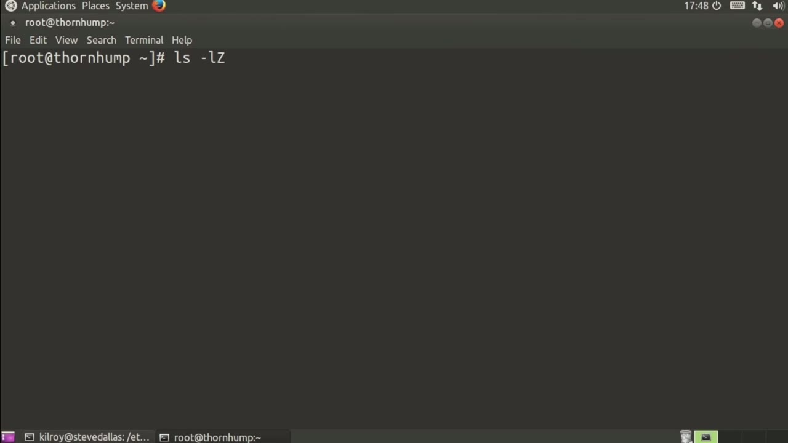
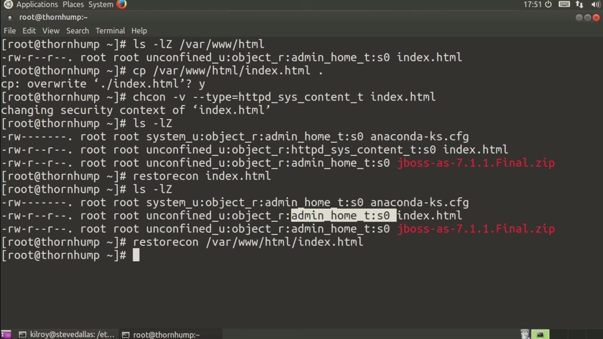

[← Course contents](../../02.md)

# 58. Restoring SELinux Permissions

**Course:** [Linux Security & Administration From Boot Process to Firewalls](https://www.youtube.com/watch?v=_WB3evmgxYA)  
**Transcript:** [`Linux Security & Administration From Boot Process to Firewalls transcript`](../../../../course_videos/Linux%20Security%20%26%20Administration%20From%20Boot%20Process%20to%20Firewalls/Linux%20Security%20%26%20Administration%20From%20Boot%20Process%20to%20Firewalls.txt)  
**Video:** 04:11:10–04:13:48 ([open at this time](https://www.youtube.com/watch?v=_WB3evmgxYA&t=15070s))

## Introduction

Now what we did previously was we changed the context of a file in the directory where html content is stored. Is the type and let's actually just copy that VARWHtml index to Roots Home Directory and I'm going to overwrite the index.html there. Now they want to change the context in the Home directory or in the root directory here from admin home to be the HTTP underscore sis underscore content type. So we're Going to change context and I'm going to say type. Equals HTTPD underscore sis underscore Content underscore T and then index.h.html.

## Detailed Explanation

<details>
  <summary>Step 1 — what we did previously was we changed the context of a file in the</summary>

### Step 1 — what we did previously was we changed the context of a file in the

- [x] **Now what we did previously was we changed the context of a file in**
  - Now what we did previously was we changed the context of a file in the directory where html content is stored.
  - Is the type and let's actually just copy that VARWHtml index to Roots Home Directory and I'm going to overwrite the index.html there. Now they want to change the context in the Home directory or in the root directory here from admin home to be the HTTP underscore sis underscore content type. So we're
  - Going to change context and I'm going to say type.

- [x] **Equals HTTPD underscore sis underscore Content underscore T and then**
  - Equals HTTPD underscore sis underscore Content underscore T and then index.h.html.
  - So we're changing that in our current directory here.
  - So now I have an index.html that is set to HTTPD underscore Sys underscore content type in the root home directory.

- [x] **What I can do if I want to restore that to be the correct context is**
  - What I can do if I want to restore that to be the correct context is I can actually restore con, and then I can say index.html here.



</details>

<details>
  <summary>Step 2 — Run `ls -lz`</summary>

### Step 2 — Run `ls -lz`

- [x] **Use `ls -lz`**
  - So now what we've got is restored to the correct context and the correct SELinux context and permission settings on that particular file.
  - I can also do a RestorCon on var www.html.
  - And then if I do `ls -lz` on that directory, what I will get is the correct context setback.

- [x] **What I can do, if I want to make some of these changes permanent**
  - What I can do, if I want to make some of these changes permanent because these file systems will get relabeled periodically, what I can do is say, se manage F context because I'm going to change the file context and I'm going to add type HTTP underscore sis underscore content underscore type and then I want that to be on the index.html file here
  - In my current directory. I have just changed the context to be that particular context on this particular file right in my home directory.
  - If I were to have the file system relabeled, and anything had happened to this particular context, it would just get changed back for me.

```bash
ls -lz
```



</details>

<details>
  <summary>Questions and Answers</summary>

## Questions and Answers

### Question 1: What does `ls -lz` do in this chapter?

<details>
<summary>Answer</summary>

- [x] And then if I do `ls -lz` on that directory, what I will get is the correct context setback.

</details>

### Question 2: What does step 1 cover (what we did previously was we changed the context of a file in the)?

<details>
<summary>Answer</summary>

- [x] Now what we did previously was we changed the context of a file in the directory where html content is stored.
- [x] Is the type and let's actually just copy that VARWHtml index to Roots Home Directory and I'm going to overwrite the index.html there. Now they want to change the context in the Home directory or in the root directory here from admin home to be the HTTP underscore sis underscore content type. So we're
- [x] Going to change context and I'm going to say type.

</details>

### Question 3: What does step 2 cover (Run ls -lz)?

<details>
<summary>Answer</summary>

- [x] So now what we've got is restored to the correct context and the correct SELinux context and permission settings on that particular file.
- [x] I can also do a RestorCon on var www.html.
- [x] And then if I do `ls -lz` on that directory, what I will get is the correct context setback.

</details>

</details>

## Summary

This chapter, Restoring SELinux Permissions, walks through what we did previously was we changed the context of a file in the; Run ls -lz. Commands from the transcript: `ls -lz`.

## References

- [Linux Security & Administration From Boot Process to Firewalls (YouTube)](https://www.youtube.com/watch?v=_WB3evmgxYA)
- [This chapter at 04:11:10](https://www.youtube.com/watch?v=_WB3evmgxYA&t=15070s)
- [Local transcript](../../../../course_videos/Linux%20Security%20%26%20Administration%20From%20Boot%20Process%20to%20Firewalls/Linux%20Security%20%26%20Administration%20From%20Boot%20Process%20to%20Firewalls.txt)
