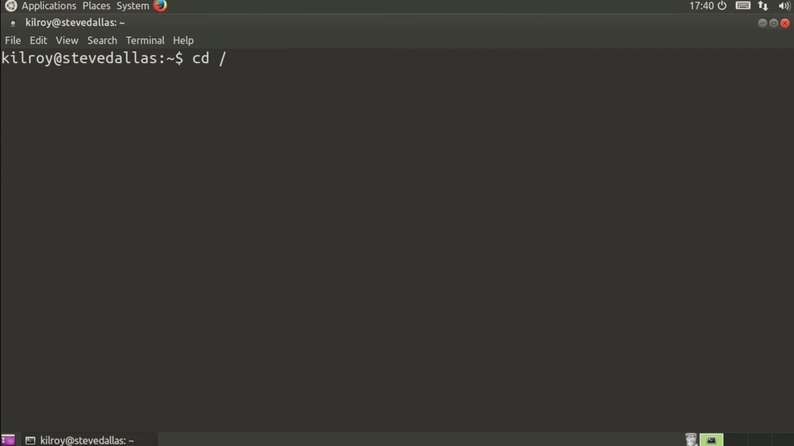
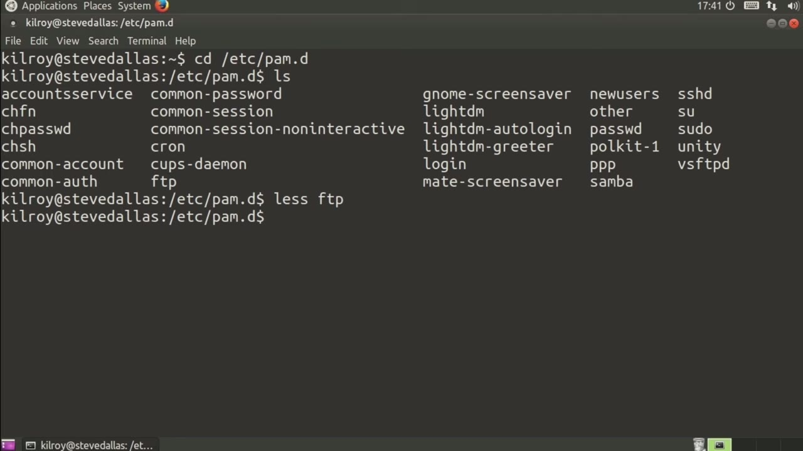
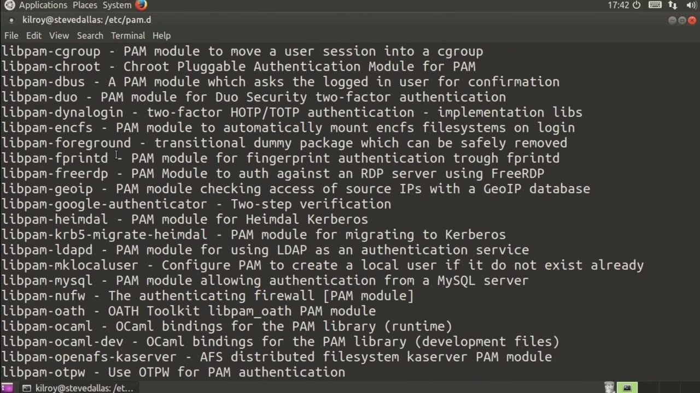

[← Course contents](../../02.md)

# 59. PAM

**Course:** [Linux Security & Administration From Boot Process to Firewalls](https://www.youtube.com/watch?v=_WB3evmgxYA)  
**Transcript:** [`Linux Security & Administration From Boot Process to Firewalls transcript`](../../../../course_videos/Linux%20Security%20%26%20Administration%20From%20Boot%20Process%20to%20Firewalls/Linux%20Security%20%26%20Administration%20From%20Boot%20Process%20to%20Firewalls.txt)  
**Video:** 04:13:48–04:17:03 ([open at this time](https://www.youtube.com/watch?v=_WB3evmgxYA&t=15228s))

## Introduction

Now, I want to take a final look here at Pam. Now, we've taken a little bit of a look before, and I just want to skim back over it again, because it's such an important piece of software on a Linux system. So you can see the various configuration files that we have. Different pieces of software because Pam may be in charge of managing authentication on that software.

## Detailed Explanation

<details>
  <summary>Step 1 — Now, I want to take a final look here at Pam</summary>

### Step 1 — Now, I want to take a final look here at Pam

- [x] **Now, I want to take a final look here at Pam**
  - Now, I want to take a final look here at Pam.
  - Now, we've taken a little bit of a look before, and I just want to skim back over it again, because it's such an important piece of software on a Linux system.
  - So you can see the various configuration files that we have.

- [x] **Different pieces of software because Pam may be in charge of managing**
  - Different pieces of software because Pam may be in charge of managing authentication on that software.
  - So for example, we can take a look at FTP and you can see that we are using common off, common account and common session. And in this case, it's using a PAM module PAM FTP.
  - We've also got another PAM module, Pam List file.

- [x] **And we've got a number of parameters that we are setting to that**
  - And we've got a number of parameters that we are setting to that particular module.



</details>

<details>
  <summary>Step 2 — Run `sshd`</summary>

### Step 2 — Run `sshd`

- [x] **Use `sshd`**
  - So those are standard configuration settings for FTP.
  - Of course, we can also take a look at `sshd`, where you may want to have different settings for people who are trying to come in remotely.
  - Again, we're using common off, and then we are disallowing non-root logins when /etc no login exists.

- [x] **If we set the file /etc no login, we would disallow non-root login**
  - If we set the file /etc no login, we would disallow non-root login.
  - All of these things are managed by the plug-able authentication modules, and there really are a lot of modules that are available.
  - So if we were to do a search on an Ubuntu system, we could look for LibPAM.

- [x] **And we should see we've got LibPAM Unix 2, LibPAM USB, so we could do**
  - And we should see we've got LibPAM Unix 2, LibPAM USB, so we could do authentication with removable USB block devices. Blowfish capable Pam module and Blowfish is a way of doing encryption.

```bash
sshd
```



</details>

<details>
  <summary>Step 3 — you can see all of the different modules that we could use with Pam</summary>

### Step 3 — you can see all of the different modules that we could use with Pam

- [x] **And you can see all of the different modules that we could use with**
  - And you can see all of the different modules that we could use with Pam. You can also use Pam to allow you to do authentication using l-dap if you wanted to have an l-dap server, for example.
  - You can also use Pam in order to allow you to authenticate to a Windows Active Directory service.
  - So we would use something like Winbind in addition to a Pam LDap configuration.

- [x] **And that would allow us to authenticate to a Windows Active Directory**
  - And that would allow us to authenticate to a Windows Active Directory server.
  - If you have a Windows network and you wanted to make sure that you are using the same user database and the same password policies on your Linux system, all you'd have to do would be to use Pam to integrate your authentication on your Linux system with your Windows Active Directory database.
  - But you can definitely see that there are a lot of modules that you can make use of when you are using Pam.

- [x] **In order to allow different types of authentication on your system to**
  - In order to allow different types of authentication on your system to happen, as well as enforce different policies with your authentication when you are making use of certain services.



</details>

<details>
  <summary>Questions and Answers</summary>

## Questions and Answers

### Question 1: What does `sshd` do in this chapter?

<details>
<summary>Answer</summary>

- [x] Of course, we can also take a look at `sshd`, where you may want to have different settings for people who are trying to come in remotely.

</details>

### Question 2: What does step 1 cover (Now, I want to take a final look here at Pam)?

<details>
<summary>Answer</summary>

- [x] Now, I want to take a final look here at Pam.
- [x] Now, we've taken a little bit of a look before, and I just want to skim back over it again, because it's such an important piece of software on a Linux system.
- [x] So you can see the various configuration files that we have.

</details>

### Question 3: What does step 2 cover (Run sshd)?

<details>
<summary>Answer</summary>

- [x] So those are standard configuration settings for FTP.
- [x] Of course, we can also take a look at `sshd`, where you may want to have different settings for people who are trying to come in remotely.
- [x] Again, we're using common off, and then we are disallowing non-root logins when /etc no login exists.

</details>

### Question 4: What does step 3 cover (you can see all of the different modules that we could use with Pam)?

<details>
<summary>Answer</summary>

- [x] And you can see all of the different modules that we could use with Pam. You can also use Pam to allow you to do authentication using l-dap if you wanted to have an l-dap server, for example.
- [x] You can also use Pam in order to allow you to authenticate to a Windows Active Directory service.
- [x] So we would use something like Winbind in addition to a Pam LDap configuration.

</details>

</details>

## Summary

This chapter, PAM, walks through Now, I want to take a final look here at Pam; Run sshd; you can see all of the different modules that we could use with Pam. Commands from the transcript: `sshd`.

## References

- [Linux Security & Administration From Boot Process to Firewalls (YouTube)](https://www.youtube.com/watch?v=_WB3evmgxYA)
- [This chapter at 04:13:48](https://www.youtube.com/watch?v=_WB3evmgxYA&t=15228s)
- [Local transcript](../../../../course_videos/Linux%20Security%20%26%20Administration%20From%20Boot%20Process%20to%20Firewalls/Linux%20Security%20%26%20Administration%20From%20Boot%20Process%20to%20Firewalls.txt)
