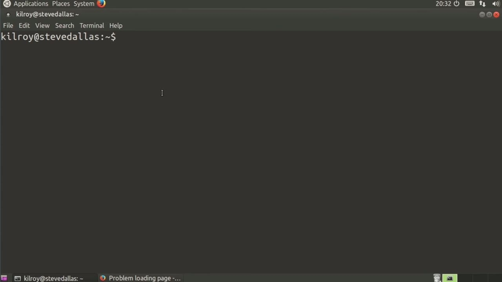
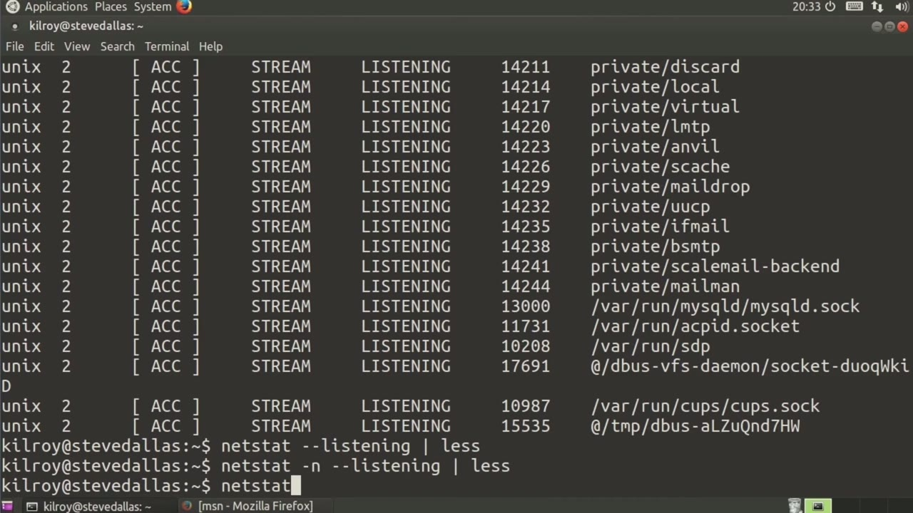
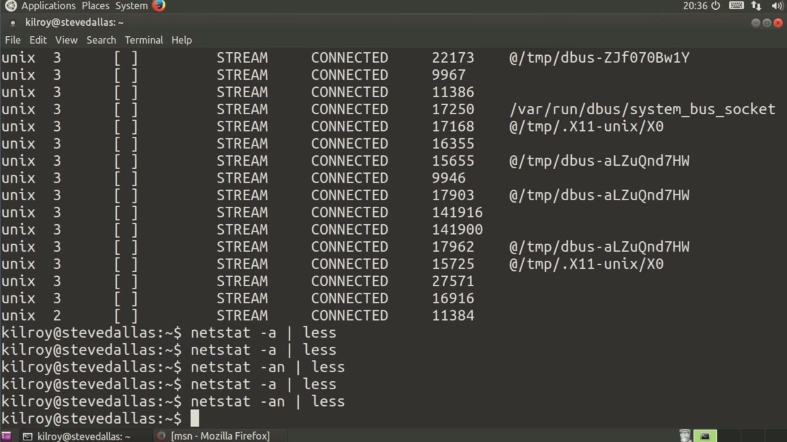

[← Course contents](../../02.md)

# 60. What you will learn in this Module

**Course:** [Linux Security & Administration From Boot Process to Firewalls](https://www.youtube.com/watch?v=_WB3evmgxYA)  
**Transcript:** [`Linux Security & Administration From Boot Process to Firewalls transcript`](../../../../course_videos/Linux%20Security%20%26%20Administration%20From%20Boot%20Process%20to%20Firewalls/Linux%20Security%20%26%20Administration%20From%20Boot%20Process%20to%20Firewalls.txt)  
**Video:** 04:17:03–04:21:01 ([open at this time](https://www.youtube.com/watch?v=_WB3evmgxYA&t=15423s))

## Introduction

One utility that you'll probably use on a fairly regular basis is netstat. netstat is used for network statistics. One of the easiest things to use it for is to check for listening services. Now, of course, I can go scrolling back up here and look at them that way, or since there's so much detail, I can just pipe Netsdat out to less.

## Detailed Explanation

<details>
  <summary>Step 1 — Run `netstat`</summary>

### Step 1 — Run `netstat`

- [x] **Use `netstat`**
  - One utility that you'll probably use on a fairly regular basis is `netstat`.
  - `netstat` is used for network statistics.
  - One of the easiest things to use it for is to check for listening services.

- [x] **Now, of course, I can go scrolling back up here and look at them that**
  - Now, of course, I can go scrolling back up here and look at them that way, or since there's so much detail, I can just pipe Netsdat out to less.
  - So I'm going to use the vertical bar there, which is the pipe character, and I can pipe it out to less, which is our pager, meaning it shows us a page at a time.
  - Now I've got all of my listening services here, all of my ports that are actually open.

- [x] **So I've got my SQL, I've got domain ports, I've got PostgresQL, SMTP**
  - So I've got my SQL, I've got domain ports, I've got PostgresQL, SMTP, and so forth.
  - Now you'll notice that it actually gives me the name of the service.
  - If I wanted to just get the port number, all I would have to do would be to say -n, which is numeric.

- [x] **So now I have the numeric equivalent here**
  - So now I have the numeric equivalent here.
  - 3306 actually happens to be my SQL, 25 is SMTP.
  - And we've got the domain ports, which is 53 here, and so forth.

- [x] **So now I've got a way to check my listening ports**
  - So now I've got a way to check my listening ports.
  - I can also get all of my listeners here.

```bash
netstat
```



</details>

<details>
  <summary>Step 2 — Run `netstat -A`</summary>

### Step 2 — Run `netstat -A`

- [x] **Actually, let's pop open a different web page here**
  - Actually, let's pop open a different web page here.
  - But we'll get one that's going to give me some constantly updated pages here.
  - So let's just say MSN.com and I can actually shrink this down because it doesn't much matter.

- [x] **Use `netstat -A`**
  - So now I can say `netstat -A` and I'm going to get all of my ports now, not just the ones that are listening, but I'm going to get connected ones as well.
  - And I've kind of run out of my buffer to scroll back.
  - So again, I'm going to pipe this out to less.

- [x] **And now you can see not only do I have a listen state, but I've also**
  - And now you can see not only do I have a listen state, but I've also got an established state as well.
  - Other ones that we've got. These are connections that have been established.
  - So this is a communication stream that's actually happening at the moment.

- [x] **So time wait means that we have started to close this particular**
  - So time wait means that we have started to close this particular session down. It hasn't finished yet.
  - So you can see now we've got a number of others.
  - Obviously, I've got a lot of ports open just from that one web page.

- [x] **I've got a lot of communication ports open to a number of different**
  - I've got a lot of communication ports open to a number of different servers where I'm getting portions of that web page.
  - Probably a lot of these are for images and that sort of thing.

```bash
netstat -A
```



</details>

<details>
  <summary>Step 3 — Run `netstat`</summary>

### Step 3 — Run `netstat`

- [x] **If I were to say -a.n, the other thing that I would lose here**
  - If I were to say -a.n, the other thing that I would lose here, actually, let me just do this again and show you.
  - The actual name of the host there. So I've got the host name. If I do -a.n here, what I'm going to get is just the IP address. Now I've got the numeric value. So not only do I get the numeric value of the service name, where the service is actually looked up in the /etc
  - Services file. In this case, if I do N, I'm going to get the numeric value of the IP address, meaning I'm not going to look up the IP address into a host name.

- [x] **Use `netstat`**
  - If I were to do this without the N, it takes a short period of time to actually look up because I've actually got to do a reverse lookup on all of those IP addresses.
  - If I do -a.n, it comes up much faster because I'm not doing that reverse lookup there.
  - So you can see `netstat` is really helpful, gets you listener ports, gets you any open port connections that are on your system.

- [x] **Use `netstat`**
  - There are a number of other things that it will do as well, but those are a couple of really key functions that `netstat` can perform for you. There are a couple of tools that you can use for

```bash
netstat
```



</details>

<details>
  <summary>Questions and Answers</summary>

## Questions and Answers

### Question 1: What does `netstat` do in this chapter?

<details>
<summary>Answer</summary>

- [x] One utility that you'll probably use on a fairly regular basis is `netstat`.

</details>

### Question 2: What does `netstat -A` do in this chapter?

<details>
<summary>Answer</summary>

- [x] So now I can say `netstat -A` and I'm going to get all of my ports now, not just the ones that are listening, but I'm going to get connected ones as well.

</details>

### Question 3: What does step 1 cover (Run netstat)?

<details>
<summary>Answer</summary>

- [x] One utility that you'll probably use on a fairly regular basis is `netstat`.
- [x] `netstat` is used for network statistics.
- [x] One of the easiest things to use it for is to check for listening services.

</details>

### Question 4: What does step 2 cover (Run netstat -A)?

<details>
<summary>Answer</summary>

- [x] Actually, let's pop open a different web page here.
- [x] But we'll get one that's going to give me some constantly updated pages here.
- [x] So let's just say MSN.com and I can actually shrink this down because it doesn't much matter.

</details>

### Question 5: What does step 3 cover (Run netstat)?

<details>
<summary>Answer</summary>

- [x] If I were to say -a.n, the other thing that I would lose here, actually, let me just do this again and show you.
- [x] The actual name of the host there. So I've got the host name. If I do -a.n here, what I'm going to get is just the IP address. Now I've got the numeric value. So not only do I get the numeric value of the service name, where the service is actually looked up in the /etc
- [x] Services file. In this case, if I do N, I'm going to get the numeric value of the IP address, meaning I'm not going to look up the IP address into a host name.

</details>

</details>

## Summary

This chapter, What you will learn in this Module, walks through Run netstat; Run netstat -A; Run netstat. Commands from the transcript: `netstat`, `netstat -A`.

## References

- [Linux Security & Administration From Boot Process to Firewalls (YouTube)](https://www.youtube.com/watch?v=_WB3evmgxYA)
- [This chapter at 04:17:03](https://www.youtube.com/watch?v=_WB3evmgxYA&t=15423s)
- [Local transcript](../../../../course_videos/Linux%20Security%20%26%20Administration%20From%20Boot%20Process%20to%20Firewalls/Linux%20Security%20%26%20Administration%20From%20Boot%20Process%20to%20Firewalls.txt)
