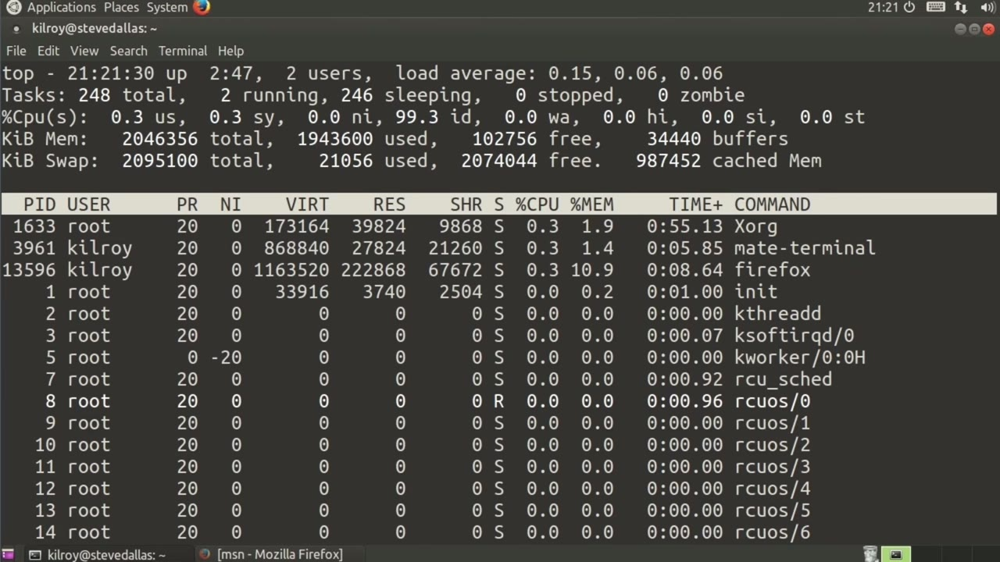
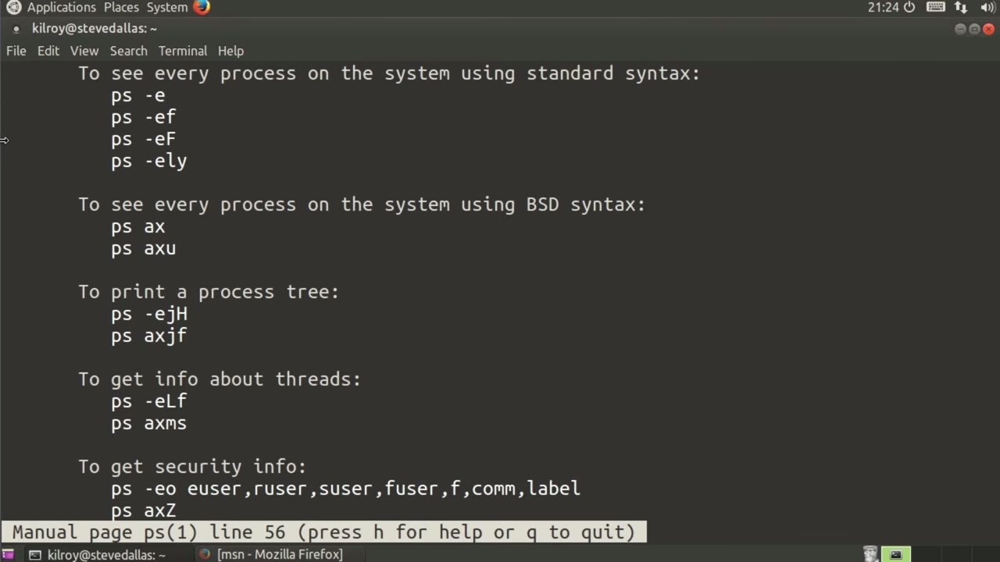
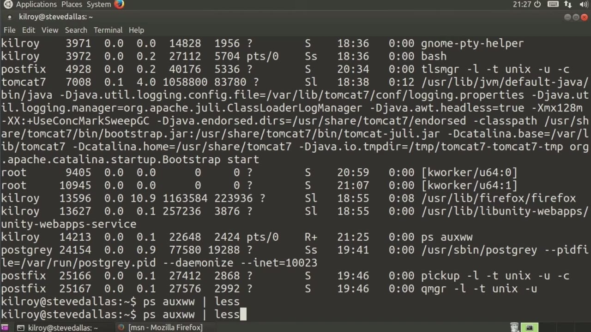

[← Course contents](../../02.md)

# 61. Process Management – top And ps

**Course:** [Linux Security & Administration From Boot Process to Firewalls](https://www.youtube.com/watch?v=_WB3evmgxYA)  
**Transcript:** [`Linux Security & Administration From Boot Process to Firewalls transcript`](../../../../course_videos/Linux%20Security%20%26%20Administration%20From%20Boot%20Process%20to%20Firewalls/Linux%20Security%20%26%20Administration%20From%20Boot%20Process%20to%20Firewalls.txt)  
**Video:** 04:21:01–04:26:18 ([open at this time](https://www.youtube.com/watch?v=_WB3evmgxYA&t=15661s))

## Introduction

Process management. One of those tools is called Top. Top gives you essentially a real-time list of the processes that are consuming CPU. So you can see here that this list is constantly updating. The one at the very top is the one that's consuming the most CPU at that given moment. And you can see that it refreshes on a regular basis. Now, on top of that, in addition to just the process information, we also get the total amount of memory on the system, the amount that's used, the amount that's free, and then we've got also statistics on the amount of swap.

## Detailed Explanation

<details>
  <summary>Step 1 — Process management. One of those tools is called Top. Top gives you</summary>

### Step 1 — Process management. One of those tools is called Top. Top gives you

- [x] **Process management. One of those tools is called Top. Top gives you**
  - Process management. One of those tools is called Top. Top gives you essentially a real-time list of the processes that are consuming CPU. So you can see here that this list is constantly updating.
  - The one at the very top is the one that's consuming the most CPU at that given moment.
  - And you can see that it refreshes on a regular basis.

- [x] **Now, on top of that, in addition to just the process information, we**
  - Now, on top of that, in addition to just the process information, we also get the total amount of memory on the system, the amount that's used, the amount that's free, and then we've got also statistics on the amount of swap.
  - So we've got total, used, and free there as well.
  - So we also get a list of the total number of tasks, and we've got, in this case, at this particular moment, there are two that are running and 246 that are sleeping.

- [x] **That will get updated on a consistent basis as well, depending on**
  - That will get updated on a consistent basis as well, depending on what else is going on on the system.
  - We may eventually see more or less running.
  - Now, at the very top, you'll see the load average.

- [x] **The load average is the number of processes that are in queue for the**
  - The load average is the number of processes that are in queue for the processor at any given moment in time.
  - So this is three snapshots where the first one is this particular moment in time, and then the other two are historical.
  - When I'm done with this, I can just type Q here.

- [x] **Now, the other way of getting process listings here is to say ps**
  - Now, the other way of getting process listings here is to say ps.
  - If I just do ps, I've got the processes that I am actually using.



</details>

<details>
  <summary>Step 2 — Run `ps -E`, `ps -ea`, `ps -eaf`</summary>

### Step 2 — Run `ps -E`, `ps -ea`, `ps -eaf`

- [x] **Right here, you can see that one of them is ps, because at the moment**
  - Right here, you can see that one of them is ps, because at the moment that we captured the process list, ps was one of the processes that was running.
  - Similarly, if we go back to Top, for example, often you will see Top as one of the processes running, and sometimes you'll actually see it at the very top of the list, which of course is not what we are doing here at the moment, other than we did just see it pop up for a second there.
  - Top does take process cycles while it's doing this update and giving you this list.

- [x] **So periodically you'll see Top and there's Top again part way down**
  - So periodically you'll see Top and there's Top again part way down the list there.
  - Because these processes are running, they do show up in the process list.
  - So again, we've got just the list of processes.

- [x] **If I want to get more information than this, first of all, let's just**
  - If I want to get more information than this, first of all, let's just take a look at the manual pages.
  - If you want to see every process on the system here, there's a couple of ways of doing it.
  - There's standard syntax and then there's bsd syntax.

- [x] **Use `ps -E`, `ps -ea`, `ps -eaf`**
  - One way of getting every process on the system, is `ps -E`. So this gives us a list of all of the processes that are on the system at this particular moment in time. I can also do `ps -ea`, `ps -eaf`, which is going to give us a wider listing and include more detail. So for example, we've got the owner of the process,
  - The process id, so this is the owner of the process. This is the process id. You've got date and time.
  - And then of course the actual process there.

- [x] **So another way of doing the same thing is I sometimes do psauxw**
  - So another way of doing the same thing is I sometimes do psauxw.
  - I've got kind of a history with both at&T Unix and bsd Unix, and I have acquired some personal quirks myself on how I run commands.

```bash
ps -E
ps -ea
ps -eaf
```



</details>

<details>
  <summary>Step 3 — Run `ps`, `grep`, `bash`</summary>

### Step 3 — Run `ps`, `grep`, `bash`

- [x] **There are different ways of passing parameters to some of these**
  - There are different ways of passing parameters to some of these common utilities that differ between the bsd style.
  - And what ends up being implemented under Linux commonly.
  - In this case, I just sometimes default to `ps`, auxw gives me a wide listing.

- [x] **I get all of the processes on the system, and I get all of the**
  - I get all of the processes on the system, and I get all of the detail, including the owner and the process id, as well as actually, let's just pipe this out to less here.
  - And you should see the columns that we've got.
  - So we've got percent CPU, percent memory, And then we've got the terminal that we are running on.

- [x] **And I don't see anything that's significantly different from there**
  - And I don't see anything that's significantly different from there.
  - You can see that we've got a couple of different ways of getting process lists.
  - You can do top and it will refresh automatically for you.

- [x] **Use `ps`, `grep`, `bash`**
  - You can use `ps`.
  - And if I use `ps`, there's a couple of things I can do actually.
  - Pipe it out to `grep` and then search for specific processes. So for example, let's see how many `bash` processes we've got. These are the `bash` processes. There's actually two of them that are running `at` the moment. One of them happens to be `grep` for `bash`. If I wanted to not include that,

- [x] **Use `grep -v`, `grep`**
  - What I could do is say `grep -v`, meaning leave this out, `grep -v` `grep`. And now I've just got that one single process.
  - I've got a couple of different ways of getting information about the processes that are currently running on the system `at` any given moment in time.

```bash
ps
grep
bash
at
grep -v
```



</details>

<details>
  <summary>Questions and Answers</summary>

## Questions and Answers

### Question 1: What does `ps -E` do in this chapter?

<details>
<summary>Answer</summary>

- [x] One way of getting every process on the system, is `ps -E`. So this gives us a list of all of the processes that are on the system at this particular moment in time. I can also do ps -ea, ps -eaf, which is going to give us a wider listing and include more detail. So for example, we've got the owner of the process,

</details>

### Question 2: What does `ps -ea` do in this chapter?

<details>
<summary>Answer</summary>

- [x] One way of getting every process on the system, is ps -E. So this gives us a list of all of the processes that are on the system at this particular moment in time. I can also do `ps -ea`, ps -eaf, which is going to give us a wider listing and include more detail. So for example, we've got the owner of the process,

</details>

### Question 3: What does `ps -eaf` do in this chapter?

<details>
<summary>Answer</summary>

- [x] One way of getting every process on the system, is ps -E. So this gives us a list of all of the processes that are on the system at this particular moment in time. I can also do ps -ea, `ps -eaf`, which is going to give us a wider listing and include more detail. So for example, we've got the owner of the process,

</details>

### Question 4: What does `ps` do in this chapter?

<details>
<summary>Answer</summary>

- [x] You can use `ps`.

</details>

### Question 5: What does `grep` do in this chapter?

<details>
<summary>Answer</summary>

- [x] Pipe it out to `grep` and then search for specific processes. So for example, let's see how many bash processes we've got. These are the bash processes. There's actually two of them that are running at the moment. One of them happens to be `grep` for bash. If I wanted to not include that,

</details>

### Question 6: What does `bash` do in this chapter?

<details>
<summary>Answer</summary>

- [x] Pipe it out to grep and then search for specific processes. So for example, let's see how many `bash` processes we've got. These are the `bash` processes. There's actually two of them that are running at the moment. One of them happens to be grep for `bash`. If I wanted to not include that,

</details>

### Question 7: What does `at` do in this chapter?

<details>
<summary>Answer</summary>

- [x] Pipe it out to grep and then search for specific processes. So for example, let's see how many bash processes we've got. These are the bash processes. There's actually two of them that are running `at` the moment. One of them happens to be grep for bash. If I wanted to not include that,

</details>

### Question 8: What does `grep -v` do in this chapter?

<details>
<summary>Answer</summary>

- [x] What I could do is say `grep -v`, meaning leave this out, `grep -v` grep. And now I've just got that one single process.

</details>

</details>

## Summary

This chapter, Process Management – top And ps, walks through Process management. One of those tools is called Top. Top gives you; Run ps -E, ps -ea, ps -eaf; Run ps, grep, bash. Commands from the transcript: `ps -E`, `ps -ea`, `ps -eaf`, `ps`, `grep`, `bash`, `at`, `grep -v`.

## References

- [Linux Security & Administration From Boot Process to Firewalls (YouTube)](https://www.youtube.com/watch?v=_WB3evmgxYA)
- [This chapter at 04:21:01](https://www.youtube.com/watch?v=_WB3evmgxYA&t=15661s)
- [Local transcript](../../../../course_videos/Linux%20Security%20%26%20Administration%20From%20Boot%20Process%20to%20Firewalls/Linux%20Security%20%26%20Administration%20From%20Boot%20Process%20to%20Firewalls.txt)
