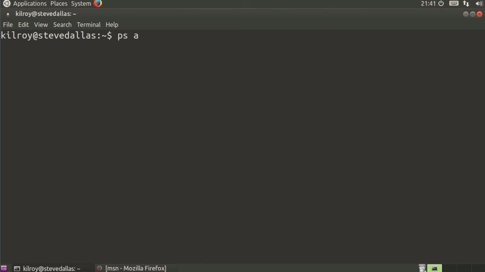
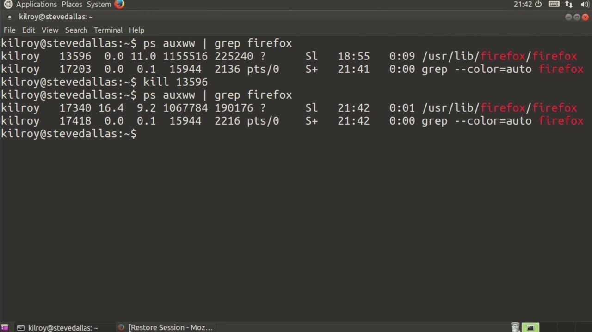
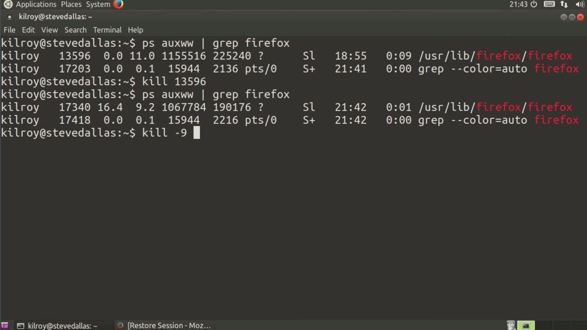

[← Course contents](../../02.md)

# 62. Process Management – kill

**Course:** [Linux Security & Administration From Boot Process to Firewalls](https://www.youtube.com/watch?v=_WB3evmgxYA)  
**Transcript:** [`Linux Security & Administration From Boot Process to Firewalls transcript`](../../../../course_videos/Linux%20Security%20%26%20Administration%20From%20Boot%20Process%20to%20Firewalls/Linux%20Security%20%26%20Administration%20From%20Boot%20Process%20to%20Firewalls.txt)  
**Video:** 04:26:18–04:30:26 ([open at this time](https://www.youtube.com/watch?v=_WB3evmgxYA&t=15978s))

## Introduction

Once you've got a handle on looking at the list of processes, there's a couple of things that you may want to be able to do with them. One of them is be able to kill them. Now, there's something that's interesting about processes. They sometimes get hung or otherwise in a state where you can't do much of anything with them. So I've actually got Firefox running here. Now, let's say Firefox had just become simply unresponsive and I wasn't able to do much of anything with it.

## Detailed Explanation

<details>
  <summary>Step 1 — Run `grep`</summary>

### Step 1 — Run `grep`

- [x] **Once you've got a handle on looking at the list of processes, there's**
  - Once you've got a handle on looking at the list of processes, there's a couple of things that you may want to be able to do with them.
  - One of them is be able to kill them. Now, there's something that's interesting about processes. They sometimes get hung or otherwise in a state where you can't do much of anything with them.
  - So I've actually got Firefox running here.

- [x] **Use `grep`**
  - Now, let's say Firefox had just become simply unresponsive and I wasn't able to do much of anything with it.
  - What I can do is I can get my process list here and then I can `grep` for Firefox.
  - So now I've got the two processes here, one of which is `grep`, so I can just ignore that.

- [x] **It's my second column here is the process id**
  - It's my second column here is the process id.
  - If I feed the process id to kill, you ought to see this minimized window down here just disappear.
  - And sure enough, that's exactly what happened.

- [x] **So that's kind of what I expect to happen**
  - So that's kind of what I expect to happen.
  - If I get something that's really, really stubborn though, and let me just run Firefox again, and then once it comes up, I'll just minimize it out of the way.

```bash
grep
```



</details>

<details>
  <summary>Step 2 — Run `kill -nine`</summary>

### Step 2 — Run `kill -nine`

- [x] **So now again I need to get my Firefox process id**
  - So now again I need to get my Firefox process id.
  - So let's just say it was being really stubborn.
  - I typed kill, the process id, nothing happened.

- [x] **Use `kill -nine`**
  - What I can do is say `kill -nine`, which is actually a specific signal that is going to terminate the process.
  - You might even say terminate with prejudice.
  - It would be really, really difficult to send this particular signal to a process and not...

```bash
kill -nine
```



</details>

<details>
  <summary>Step 3 — Run `kill`</summary>

### Step 3 — Run `kill`

- [x] **Use `kill`**
  - Have it die. Something really bad would have to happen for that to be the case. So let's say 17340. There are a number of other signals that I can send using `kill`. Because what `kill` does is it actually just sends a signal to the process. In this case, it's signal number
  - Nine, which just terminates the process. So the other signal that you might send is just an interrupt signal. We can actually send other signals as well.
  - Now this is kind of a pain here and let me just start up Firefox again so that we've got something to play with and minimize it out of the way. So I've got to look at the process id. Well that's kind of a pain and then I got to dig the process id out and sure I can select it and copy and then paste it but it would just be so much

- [x] **Easier if all I had to do would be to say kill Firefox right if all I**
  - Easier if all I had to do would be to say `kill` Firefox right if all I had to do was give the name of the process that would be so much better. Well that doesn't work.
  - `kill` All Firefox can look it up by the name of the process and then `kill` it.
  - Similarly, and again, let me just get Firefox running here, I can send the same signals with `kill` All that I can with `kill`.

- [x] **Now I've got a way to not only kill a process by process id**
  - Now I've got a way to not only `kill` a process by process id, Certainly there are ways you can craft a number of statements together in order to cut that second column out and get the process id for Firefox.
  - So much easier to just give it the name Firefox and say, `kill` All Firefox.
  - When you do that, though, if there were a number of processes running with the name Firefox, and let's just start up a few of these here.

- [x] **Look up the process IDs here. In this case, there's actually just one**
  - Look up the process IDs here. In this case, there's actually just one process id. Some processes actually may spawn several processes. This looks like it's forked out a few from a single process, but I could still do the same thing. If I `kill` all Firefox, all of those windows go away.
  - Even if I've got multiple process IDs, if I give it the name, I'm going to `kill` every single process with that particular name.

```bash
kill
```



</details>

<details>
  <summary>Questions and Answers</summary>

## Questions and Answers

### Question 1: What does `grep` do in this chapter?

<details>
<summary>Answer</summary>

- [x] What I can do is I can get my process list here and then I can `grep` for Firefox.

</details>

### Question 2: What does `kill` do in this chapter?

<details>
<summary>Answer</summary>

- [x] I typed `kill`, the process id, nothing happened.

</details>

### Question 3: What does `kill -nine` do in this chapter?

<details>
<summary>Answer</summary>

- [x] What I can do is say `kill -nine`, which is actually a specific signal that is going to terminate the process.

</details>

### Question 4: What does step 1 cover (Run grep)?

<details>
<summary>Answer</summary>

- [x] Once you've got a handle on looking at the list of processes, there's a couple of things that you may want to be able to do with them.
- [x] One of them is be able to kill them. Now, there's something that's interesting about processes. They sometimes get hung or otherwise in a state where you can't do much of anything with them.
- [x] So I've actually got Firefox running here.

</details>

### Question 5: What does step 2 cover (Run kill -nine)?

<details>
<summary>Answer</summary>

- [x] So now again I need to get my Firefox process id.
- [x] So let's just say it was being really stubborn.
- [x] I typed kill, the process id, nothing happened.

</details>

### Question 6: What does step 3 cover (Run kill)?

<details>
<summary>Answer</summary>

- [x] Have it die. Something really bad would have to happen for that to be the case. So let's say 17340. There are a number of other signals that I can send using `kill`. Because what `kill` does is it actually just sends a signal to the process. In this case, it's signal number
- [x] Nine, which just terminates the process. So the other signal that you might send is just an interrupt signal. We can actually send other signals as well.
- [x] Now this is kind of a pain here and let me just start up Firefox again so that we've got something to play with and minimize it out of the way. So I've got to look at the process id. Well that's kind of a pain and then I got to dig the process id out and sure I can select it and copy and then paste it but it would just be so much

</details>

</details>

## Summary

This chapter, Process Management – kill, walks through Run grep; Run kill -nine; Run kill. Commands from the transcript: `grep`, `kill -nine`, `kill`.

## References

- [Linux Security & Administration From Boot Process to Firewalls (YouTube)](https://www.youtube.com/watch?v=_WB3evmgxYA)
- [This chapter at 04:26:18](https://www.youtube.com/watch?v=_WB3evmgxYA&t=15978s)
- [Local transcript](../../../../course_videos/Linux%20Security%20%26%20Administration%20From%20Boot%20Process%20to%20Firewalls/Linux%20Security%20%26%20Administration%20From%20Boot%20Process%20to%20Firewalls.txt)
