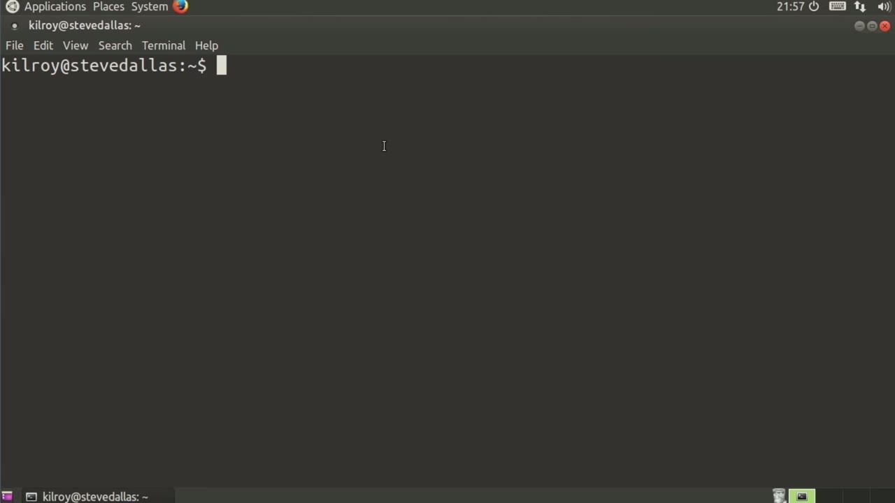
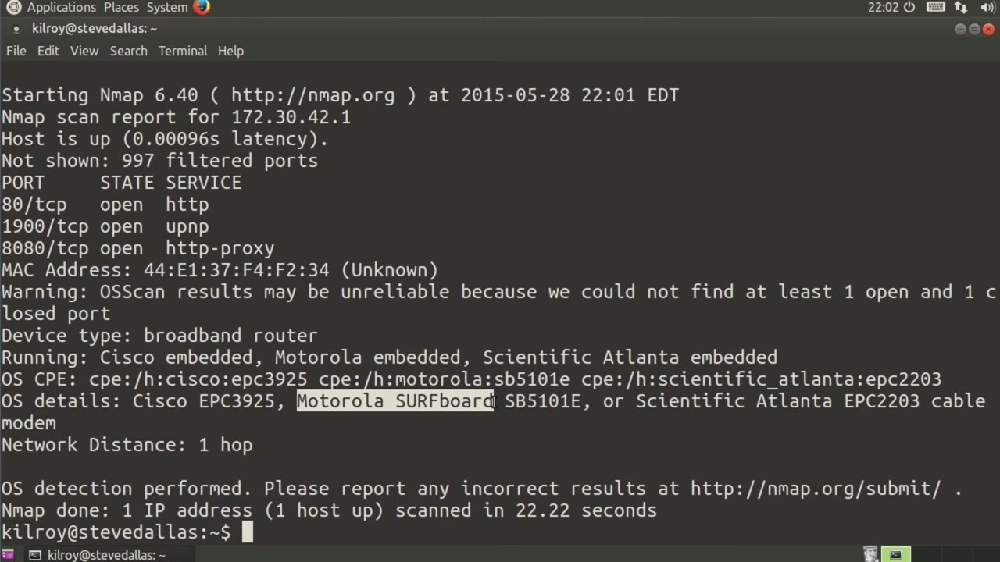
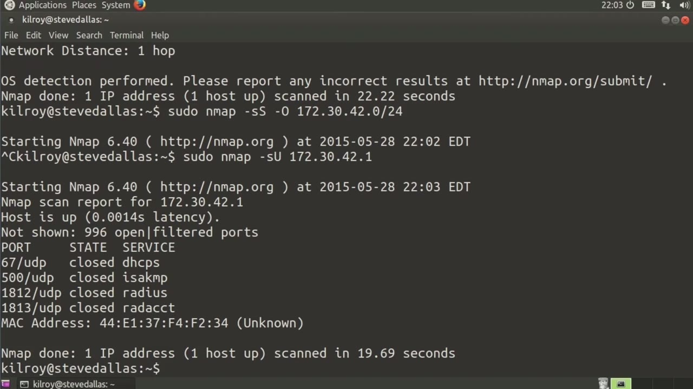

[← Course contents](../../02.md)

# 63. nmap

**Course:** [Linux Security & Administration From Boot Process to Firewalls](https://www.youtube.com/watch?v=_WB3evmgxYA)  
**Transcript:** [`Linux Security & Administration From Boot Process to Firewalls transcript`](../../../../course_videos/Linux%20Security%20%26%20Administration%20From%20Boot%20Process%20to%20Firewalls/Linux%20Security%20%26%20Administration%20From%20Boot%20Process%20to%20Firewalls.txt)  
**Video:** 04:30:26–04:35:57 ([open at this time](https://www.youtube.com/watch?v=_WB3evmgxYA&t=16226s))

## Introduction

One thing that you may want to be able to do as you are working on securing your Linux installations is be able to figure out what ports are open on remote systems. This is something called port scanning, and the best tool that is widely used for this particular activity is actually something called nmap. We're just going to do a couple of fairly basic ones, and I'll walk you through the settings here. I need to have administrative privileges, and then I'm going to run nmap.

## Detailed Explanation

<details>
  <summary>Step 1 — Run `nmap`</summary>

### Step 1 — Run `nmap`

- [x] **Use `nmap`**
  - One thing that you may want to be able to do as you are working on securing your Linux installations is be able to figure out what ports are open on remote systems.
  - This is something called port scanning, and the best tool that is widely used for this particular activity is actually something called `nmap`.
  - We're just going to do a couple of fairly basic ones, and I'll walk you through the settings here.

- [x] **Use `nmap`**
  - I need to have administrative privileges, and then I'm going to run `nmap`.
  - What I'm going to do here is a sin scan.
  - This is sometimes called a half open scan, because I'm going to send a TCP sin message.

- [x] **I'll get a sin act back, and then I'm just going to send a reset back**
  - I'll get a sin act back, and then I'm just going to send a reset back.
  - I'm not going to actually fully open the connection.
  - I'm just going to send a sin and then see what I get back for a response.

- [x] **And let me just say 172.30.42.42.1 here**
  - And let me just say 172.30.42.42.1 here.
  - And this is going to tell me what it's doing as it goes.
  - If I were to do it without -V, it would just give me the results, which would be this right here when it was actually done.

- [x] **So the other thing I can do, and I'm going to drop the -V at this**
  - So the other thing I can do, and I'm going to drop the -V at this point, is I can crank the throttle up.
  - If I go t5, it's going to go as fast as it possibly can.

```bash
nmap
```



</details>

<details>
  <summary>Step 2 — Run `nmap`</summary>

### Step 2 — Run `nmap`

- [x] **And then we should just get really quick results back as a general**
  - And then we should just get really quick results back as a general rule.
  - What we're doing here is we're testing about a thousand ports.
  - That thousand ports are really the commonly used ports.

- [x] **If I wanted to test a specific port, for example, I could do -p80**
  - If I wanted to test a specific port, for example, I could do -p80.
  - If I wanted to test a couple of ports, I could say 443.
  - The other thing I can do is actually scan all ports, and I can say -p 0 through 65535, which is every single port, or the quicker way of doing that is just -p dash or -p minus.

- [x] **Now, the other thing that I can do while I'm doing my Syn scan is I**
  - Now, the other thing that I can do while I'm doing my Syn scan is I can do an operating system scan and actually try to figure out what operating system is running on the remote end.
  - So this is going to do my port scan for me, and then it's going to do some checks as it goes to see what kind of responses it gets, and then it will check a fingerprint database that it actually has and be able to determine what the operating system on the remote end actually is.
  - It says it's a Motorola surfboard and that's what it is.

- [x] **Use `nmap`**
  - This is my router on my local network or my cable modem slash access point slash router.
  - The fingerprints on `nmap` are pretty good.
  - As a general rule, they will hit most of your systems pretty well here.

- [x] **So what I did was just a single IP address**
  - So what I did was just a single IP address.
  - That's my entire network here that I've got.

```bash
nmap
```



</details>

<details>
  <summary>Step 3 — Run `nmap`</summary>

### Step 3 — Run `nmap`

- [x] **And that's going to scan all of my hosts to figure out which ones are**
  - And that's going to scan all of my hosts to figure out which ones are up.
  - And the ones that are up, it will actually do a port scan.
  - So it's just going to do that roughly thousand well-known ports.

- [x] **And we're going to hop over to a different kind of scan here**
  - And we're going to hop over to a different kind of scan here.
  - That's also going to hit about 1,000 ports, and those are well-known ports.
  - So there's a well-defined pattern that we go through when we are making a connection to a system.

- [x] **On a closed port, I am going to get an ICMP port unreachable message**
  - On a closed port, I am going to get an ICMP port unreachable message.
  - On an open port, I didn't know what I'm going to get.
  - It will depend on the application that's running.

- [x] **Use `nmap`**
  - On the other hand, if the request message from `nmap` has been dropped, I may similarly get no response.
  - If for whatever reason the network just loses it or there's a firewall in the way, it may just get lost, which would mean no response.
  - If there's no response, I got to retransmit because I can't guarantee what that actually means.

- [x] **UDP scans often take quite a bit longer than TCP scans**
  - UDP scans often take quite a bit longer than TCP scans.
  - Again, depending on what's in the way, if obviously we're getting just a lot of closed ports, we're going to get these ICMP port unreachable messages back, and it's going to go pretty quickly.
  - If I've got a lot of open ports, not getting a response back, as they said, isn't really meaningful.

- [x] **Use `nmap`**
  - So that constant retransmit can actually be time-consuming.
  - So `nmap` is a great port scanner.
  - You can use it For TCP, UDP, there are a number of different types of scans.

- [x] **As I said, you can do an IP address, you can do an entire network**
  - As I said, you can do an IP address, you can do an entire network range

```bash
nmap
```



</details>

<details>
  <summary>Questions and Answers</summary>

## Questions and Answers

### Question 1: What does `nmap` do in this chapter?

<details>
<summary>Answer</summary>

- [x] This is something called port scanning, and the best tool that is widely used for this particular activity is actually something called `nmap`.

</details>

### Question 2: What does step 1 cover (Run nmap)?

<details>
<summary>Answer</summary>

- [x] One thing that you may want to be able to do as you are working on securing your Linux installations is be able to figure out what ports are open on remote systems.
- [x] This is something called port scanning, and the best tool that is widely used for this particular activity is actually something called `nmap`.
- [x] We're just going to do a couple of fairly basic ones, and I'll walk you through the settings here.

</details>

### Question 3: What does step 2 cover (Run nmap)?

<details>
<summary>Answer</summary>

- [x] And then we should just get really quick results back as a general rule.
- [x] What we're doing here is we're testing about a thousand ports.
- [x] That thousand ports are really the commonly used ports.

</details>

### Question 4: What does step 3 cover (Run nmap)?

<details>
<summary>Answer</summary>

- [x] And that's going to scan all of my hosts to figure out which ones are up.
- [x] And the ones that are up, it will actually do a port scan.
- [x] So it's just going to do that roughly thousand well-known ports.

</details>

</details>

## Summary

This chapter, nmap, walks through Run nmap; Run nmap; Run nmap. Commands from the transcript: `nmap`.

## References

- [Linux Security & Administration From Boot Process to Firewalls (YouTube)](https://www.youtube.com/watch?v=_WB3evmgxYA)
- [This chapter at 04:30:26](https://www.youtube.com/watch?v=_WB3evmgxYA&t=16226s)
- [Local transcript](../../../../course_videos/Linux%20Security%20%26%20Administration%20From%20Boot%20Process%20to%20Firewalls/Linux%20Security%20%26%20Administration%20From%20Boot%20Process%20to%20Firewalls.txt)
