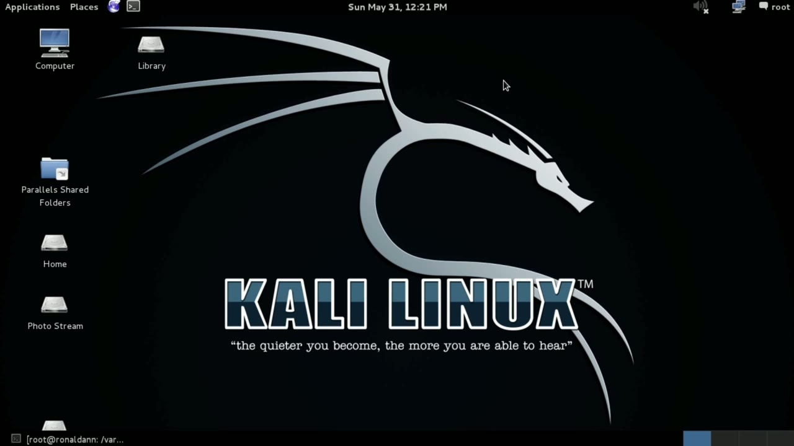
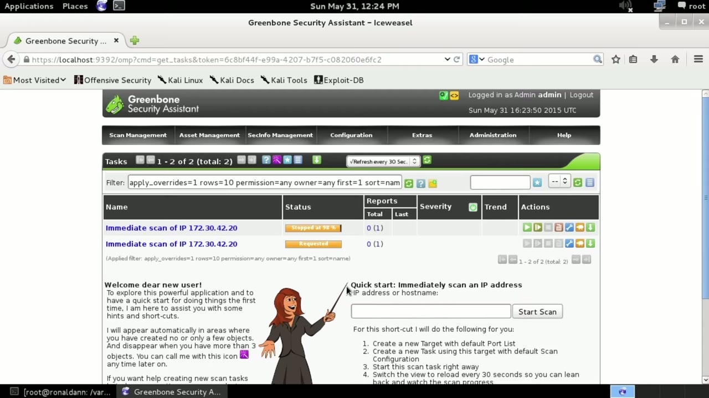
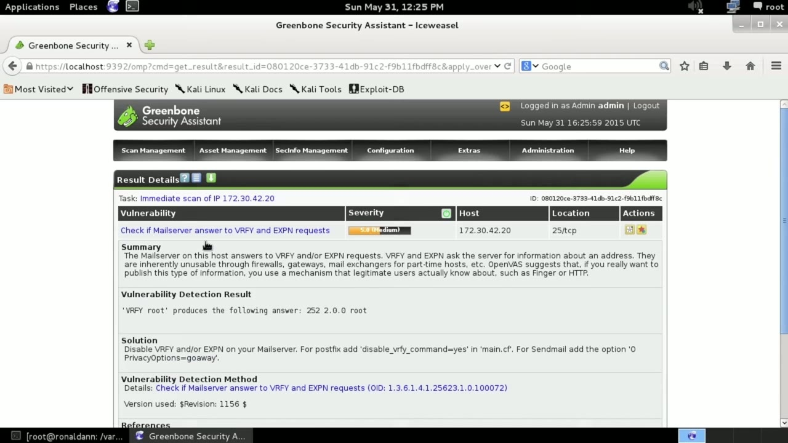

[← Course contents](../../02.md)

# 64. OpenVAS

**Course:** [Linux Security & Administration From Boot Process to Firewalls](https://www.youtube.com/watch?v=_WB3evmgxYA)  
**Transcript:** [`Linux Security & Administration From Boot Process to Firewalls transcript`](../../../../course_videos/Linux%20Security%20%26%20Administration%20From%20Boot%20Process%20to%20Firewalls/Linux%20Security%20%26%20Administration%20From%20Boot%20Process%20to%20Firewalls.txt)  
**Video:** 04:35:57–04:41:16 ([open at this time](https://www.youtube.com/watch?v=_WB3evmgxYA&t=16557s))

## Introduction

We're going to take a look at a new class of security utilities called Vulnerability Assessment Tools. We're going to first start with OpenVAS. I'm running this on Kali Linux, and Kali Linux actually has OpenVAS installed by default. You can see that if we go to the menu Kali Linux Vulnerability Analysis, there's a menu for OpenVAS.

## Detailed Explanation

  
Step 1 — going to take a look at a new class of security utilities called

### Step 1 — going to take a look at a new class of security utilities called

- [x] **We're going to take a look at a new class of security utilities**
  - We're going to take a look at a new class of security utilities called Vulnerability Assessment Tools.
  - We're going to first start with OpenVAS.
  - I'm running this on Kali Linux, and Kali Linux actually has OpenVAS installed by default.

- [x] **You can see that if we go to the menu Kali Linux Vulnerability**
  - You can see that if we go to the menu Kali Linux Vulnerability Analysis, there's a menu for OpenVAS.
  - It actually has multiple components to it.
  - You need to get all of the components installed and then make sure that they are started up in the proper order.

- [x] **When you get OpenVAS, you would need to do an initial setup And then**
  - When you get OpenVAS, you would need to do an initial setup And then if you're ever unsure whether things are correct or not, you can run OpenVaz check setup.
  - I've got OpenVaz started here, so I don't have to start anything.
  - I am going to go to the web interface, though.

- [x] **So I'm going to go to HTTP, and then we're going to go to Port 9392**
  - So I'm going to go to HTTP, and then we're going to go to Port 9392.
  - I can just do a very quick start here by plugging in an IP address.
  - I can also go to the menus up top here, and I can check on my port lists, I can check on my scan configs, and I can do scans based on different scan configurations.

- [x] **In this case, what I'm going to do, though, is I'm just going to go**
  - In this case, what I'm going to do, though, is I'm just going to go back to this page here, and I'm just going to do a very quick scan here.
  - So I'm going to do a system on my local host, and we're going to do an immediate scan.

  
Step 2 — It has been requested at this point, and this is

### Step 2 — It has been requested at this point, and this is

- [x] **It has been requested at this point, and this is**
  - It has been requested at this point, and this is...
  - Part of where I say it's a multi-component system, it's actually multi-tier.
  - So I've got my user interface that has sent a request to a different component to launch the scan against my local system here.

- [x] **Now, there are a couple of different ways of doing this vulnerability**
  - Now, there are a couple of different ways of doing this vulnerability analysis.
  - Of course, we're going to do a network scan.
  - For the open ports that are on the system.

- [x] **And we're also going to check for things like banners on the**
  - And we're also going to check for things like banners on the applications behind those open ports and see whether the version numbers that may come back in those banners map to any known vulnerability.
  - It's important to note that vulnerability scan tools do not exploit vulnerabilities.
  - They use static information like for instance, open ports or version numbers in banners against a database of information that they have where they know about specific vulnerabilities. They're going to poke and prod at the system.

- [x] **They are not going to exploit anything. That's not to say that you**
  - They are not going to exploit anything. That's not to say that you don't run the risk of potentially knocking a system over or causing issues with a vulnerability scanner. You just never know when you may run against a fragile service or a fragile system.
  - And you may inadvertently knock it over by running a vulnerability scanner.
  - So we've got our names here of the scans that we're running.

- [x] **I can click on this and it's going to bring me to a task details page**
  - I can click on this and it's going to bring me to a task details page.
  - I could click on reports here and that's going to bring me to a list of the reports that I've got and we're going to just click on this.

  
Step 3 — Current report here and then we'll get a list of what we've got

### Step 3 — Current report here and then we'll get a list of what we've got

- [x] **Current report here and then we'll get a list of what we've got**
  - Current report here and then we'll get a list of what we've got.
  - Here's a vulnerability. I can click on this and get details.
  - I've got a solution here. It actually tells me how to go about fixing the vulnerability and it actually gives me some detection results. So this is how they happen to know this particular vulnerability exists. When they sent the verify message to the mail server, they actually got a response.

- [x] **That wasn't an error response indicating that that particular message**
  - That wasn't an error response indicating that that particular message wasn't supported.
  - So we've got this vulnerability scanner.
  - Now we've got a number of potential vulnerabilities that it is found.

- [x] **Now, just because it flags of vulnerability here doesn't necessarily**
  - Now, just because it flags of vulnerability here doesn't necessarily mean that that vulnerability exists.
  - As I said, in some cases, it's making educated guesses as to whether a vulnerability is there based on information that it is received, which is why the results here are so important.
  - We got a result from the vulnerability scanner actually checking to see whether this works.

- [x] **Now this isn't an exploit itself, it's just seeing whether this**
  - Now this isn't an exploit itself, it's just seeing whether this particular request is available.
  - And you can see why this particular request is a potential vulnerability, because it allows you to possibly enumerate users on the system.
  - We've got this vulnerability scan utility here, OpenVAS.

- [x] **This is free and open source, and you can certainly download it and**
  - This is free and open source, and you can certainly download it and install it on most any Linux distribution.
  - As I said, if you've got Kali Linux comes automatically installed, all you need to do is just finish the configuration and get it started up.

  
Questions and Answers

## Questions and Answers

### Question 1: What does step 1 cover (going to take a look at a new class of security utilities called)?

Answer

- [x] We're going to take a look at a new class of security utilities called Vulnerability Assessment Tools.
- [x] We're going to first start with OpenVAS.
- [x] I'm running this on Kali Linux, and Kali Linux actually has OpenVAS installed by default.

### Question 2: What does step 2 cover (It has been requested at this point, and this is)?

Answer

- [x] It has been requested at this point, and this is...
- [x] Part of where I say it's a multi-component system, it's actually multi-tier.
- [x] So I've got my user interface that has sent a request to a different component to launch the scan against my local system here.

### Question 3: What does step 3 cover (Current report here and then we'll get a list of what we've got)?

Answer

- [x] Current report here and then we'll get a list of what we've got.
- [x] Here's a vulnerability. I can click on this and get details.
- [x] I've got a solution here. It actually tells me how to go about fixing the vulnerability and it actually gives me some detection results. So this is how they happen to know this particular vulnerability exists. When they sent the verify message to the mail server, they actually got a response.

## Summary

This chapter, OpenVAS, walks through going to take a look at a new class of security utilities called; It has been requested at this point, and this is; Current report here and then we'll get a list of what we've got.

## References

- [Linux Security & Administration From Boot Process to Firewalls (YouTube)](https://www.youtube.com/watch?v=_WB3evmgxYA)
- [This chapter at 04:35:57](https://www.youtube.com/watch?v=_WB3evmgxYA&t=16557s)
- [Local transcript](../../../../course_videos/Linux%20Security%20%26%20Administration%20From%20Boot%20Process%20to%20Firewalls/Linux%20Security%20%26%20Administration%20From%20Boot%20Process%20to%20Firewalls.txt)
