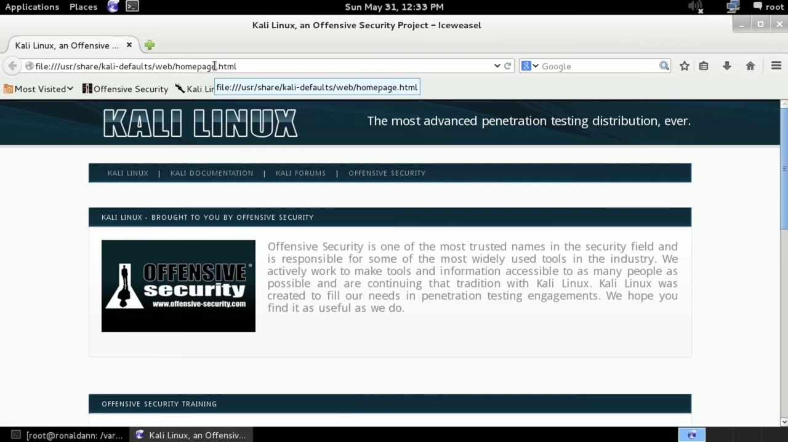
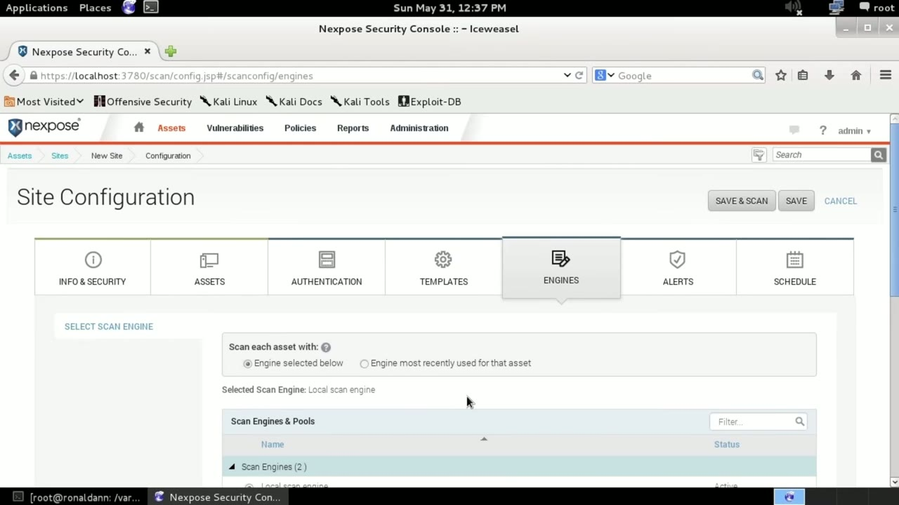
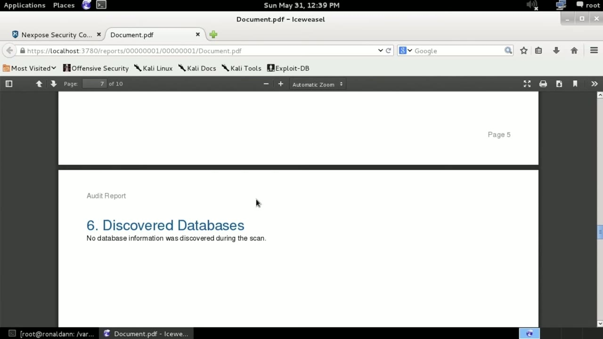

[← Course contents](../../02.md)

# 65. Nexpose

**Course:** [Linux Security & Administration From Boot Process to Firewalls](https://www.youtube.com/watch?v=_WB3evmgxYA)  
**Transcript:** [`Linux Security & Administration From Boot Process to Firewalls transcript`](../../../../course_videos/Linux%20Security%20%26%20Administration%20From%20Boot%20Process%20to%20Firewalls/Linux%20Security%20%26%20Administration%20From%20Boot%20Process%20to%20Firewalls.txt)  
**Video:** 04:41:16–04:47:09 ([open at this time](https://www.youtube.com/watch?v=_WB3evmgxYA&t=16876s))

## Introduction

Another vulnerability scanner that I want to take a look at is actually a community-based version of a commercial offering. So the company Rapid 7 has this vulnerability scan offering called Nexpose, and there is a community-based version of it. And we've got the community-based version of it here. Difference or one of the differences with the community-based version is that with the community-based version you can only scan up to 32 hosts you could certainly scan more than that but you have to dump your database and remove all evidence of those 32 that you had previously scanned before

## Detailed Explanation

  
Step 1 — Another vulnerability scanner that I want to take a look at is actually

### Step 1 — Another vulnerability scanner that I want to take a look at is actually

- [x] **Another vulnerability scanner that I want to take a look at is**
  - Another vulnerability scanner that I want to take a look at is actually a community-based version of a commercial offering.
  - So the company Rapid 7 has this vulnerability scan offering called Nexpose, and there is a community-based version of it.
  - And we've got the community-based version of it here.

- [x] **Difference or one of the differences with the community-based version**
  - Difference or one of the differences with the community-based version is that with the community-based version you can only scan up to 32 hosts you could certainly scan more than that but you have to dump your database and remove all evidence of those 32 that you had previously scanned before
  - Adding more next pose is a really good vulnerability scanner And what we're going to do here is start off a scan.
  - So we're going to go to sites, first of all, and I'm going to add a site.

- [x] **And I'm just going to say new scan site**
  - And I'm just going to say new scan site.
  - And if I wanted to, I could give organization name, the URL, primary contact, job title, et cetera.
  - It's more about the administrative stuff that you need to keep track of if you are doing penetration testing.

- [x] **Now, I don't need to do anything with access**
  - Now, I don't need to do anything with access.
  - I don't have any other users on this system.
  - It's just me and my admin user, so I don't need to provide access there.

- [x] **I do, though, need to provide at least one asset, which is a system**
  - I do, though, need to provide at least one asset, which is a system I'm going to scan.
  - So I'm going to scan a system on my local host.
  - I could, of course, add multiple addresses or host names or a range of addresses if I wanted to.

- [x] **And you can see that I've got the ability to exclude as well**
  - And you can see that I've got the ability to exclude as well.
  - Not going to exclude anything because I'm just going to scan one thing here.
  - If I wanted to, I could say local credds, for example, and then my account.

- [x] **This is an SSH account and then we'll just say my username here and**
  - This is an SSH account and then we'll just say my username here and then I have to plug in a password.
  - This is going to give me the ability to have the vulnerability scanner log on.
  - And then once it's logged on, it can run local checks, which it wouldn't be able to do unless I gave it local access.

- [x] **So now we've got the templates that are available**
  - So now we've got the templates that are available.
  - I'm going to do a full audit here rather than a full audit without WebSpiter.
  - That means this is going to go check web pages as well.

- [x] **You can see there are a number of templates**
  - You can see there are a number of templates.
  - There are some that are compliance related, Sarbanes, Oxley, and hipaa.
  - So we can do any one of these and there are specific features that are turned on and off.

- [x] **The engines, I'm not going to worry about**
  - The engines, I'm not going to worry about.

  
Step 2 — I could use the Rapid 7 hosted scan engine, but it wouldn't be able to

### Step 2 — I could use the Rapid 7 hosted scan engine, but it wouldn't be able to

- [x] **I could use the Rapid 7 hosted scan engine, but it wouldn't be able**
  - I could use the Rapid 7 hosted scan engine, but it wouldn't be able to get to my local network.
  - And I don't have any other scan engines that I need or could use.
  - So we're just going to use the local one, which means the one that's on this system.

- [x] **So I'm not going to worry about alerts or schedules and just want to**
  - So I'm not going to worry about alerts or schedules and just want to run it now.
  - You can see that it's a fairly well laid out web interface here.
  - If I want to go to reports, I can create my report here and just say new report.

- [x] **The template that they are using here is fine**
  - The template that they are using here is fine.
  - I do need to select a scan though, and we'll just pick this one just to do one.
  - And then we're going to say, yes, that's okay.

- [x] **And so we're going to save and run the report**
  - And so we're going to save and run the report.
  - Now it has created a new report for us, and we can open that up.
  - And this is the report that you would get.

- [x] **You can see this is actually a stop scan, so it's not going to be**
  - You can see this is actually a stop scan, so it's not going to be complete necessarily.
  - But we do have some ports that are open.

  
Step 3 — Apparently it found the NTP service and DNS, and then it didn't find

### Step 3 — Apparently it found the NTP service and DNS, and then it didn't find

- [x] **Apparently it found the NTP service and DNS, and then it didn't find**
  - Apparently it found the NTP service and DNS, and then it didn't find any databases or users, no file names because of course it didn't log in locally.
  - So this would be what a report or a partial report anyway would look like.
  - When it found a vulnerability, it would actually give you details about it.

- [x] **And I can go to the vulnerabilities tab and click on this for example**
  - And I can go to the vulnerabilities tab and click on this for example.
  - And this is going to give me more specifics about it.
  - There are a couple of solutions for this particular vulnerability.

- [x] **If I go back to my vulnerabilities page, and then of course, as I**
  - If I go back to my vulnerabilities page, and then of course, as I said, the list of vulnerabilities.
  - Now, one feature that this has, because Rapid 7 also happens to own Metisploit, is it gives you an indication as to whether a particular vulnerability is exploitable using Metisploit or not.
  - So it looks like this has an exploit that has been published, and this one happens to be from the exploit database.

- [x] **So it gives you more detail as to whether these vulnerabilities can**
  - So it gives you more detail as to whether these vulnerabilities can be exploited or not, and where you may be able to locate exploits.
  - So Nexpos is just another vulnerability scanner.
  - There are certainly plenty of vulnerability scanners.

- [x] **This one does happen to work on Linux, not all of them do**
  - This one does happen to work on Linux, not all of them do.
  - And it's a pretty nice, pretty complete web interface.
  - It's the community version of the commercial product that Rapid 7 offers.

  
Questions and Answers

## Questions and Answers

### Question 1: What does step 1 cover (Another vulnerability scanner that I want to take a look at is actually)?

Answer

- [x] Another vulnerability scanner that I want to take a look at is actually a community-based version of a commercial offering.
- [x] So the company Rapid 7 has this vulnerability scan offering called Nexpose, and there is a community-based version of it.
- [x] And we've got the community-based version of it here.

### Question 2: What does step 2 cover (I could use the Rapid 7 hosted scan engine, but it wouldn't be able to)?

Answer

- [x] I could use the Rapid 7 hosted scan engine, but it wouldn't be able to get to my local network.
- [x] And I don't have any other scan engines that I need or could use.
- [x] So we're just going to use the local one, which means the one that's on this system.

### Question 3: What does step 3 cover (Apparently it found the NTP service and DNS, and then it didn't find)?

Answer

- [x] Apparently it found the NTP service and DNS, and then it didn't find any databases or users, no file names because of course it didn't log in locally.
- [x] So this would be what a report or a partial report anyway would look like.
- [x] When it found a vulnerability, it would actually give you details about it.

## Summary

This chapter, Nexpose, walks through Another vulnerability scanner that I want to take a look at is actually; I could use the Rapid 7 hosted scan engine, but it wouldn't be able to; Apparently it found the NTP service and DNS, and then it didn't find.

## References

- [Linux Security & Administration From Boot Process to Firewalls (YouTube)](https://www.youtube.com/watch?v=_WB3evmgxYA)
- [This chapter at 04:41:16](https://www.youtube.com/watch?v=_WB3evmgxYA&t=16876s)
- [Local transcript](../../../../course_videos/Linux%20Security%20%26%20Administration%20From%20Boot%20Process%20to%20Firewalls/Linux%20Security%20%26%20Administration%20From%20Boot%20Process%20to%20Firewalls.txt)
