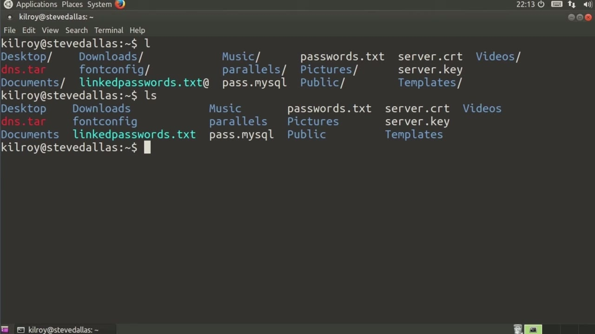
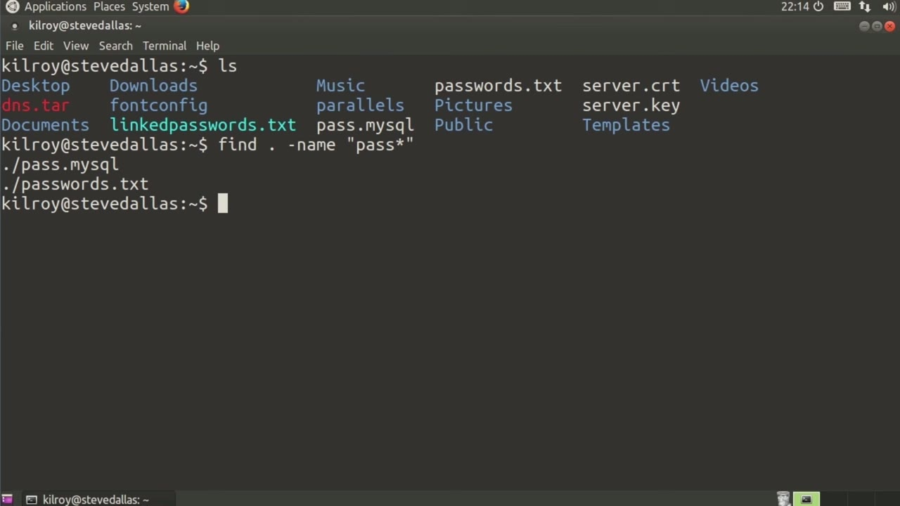
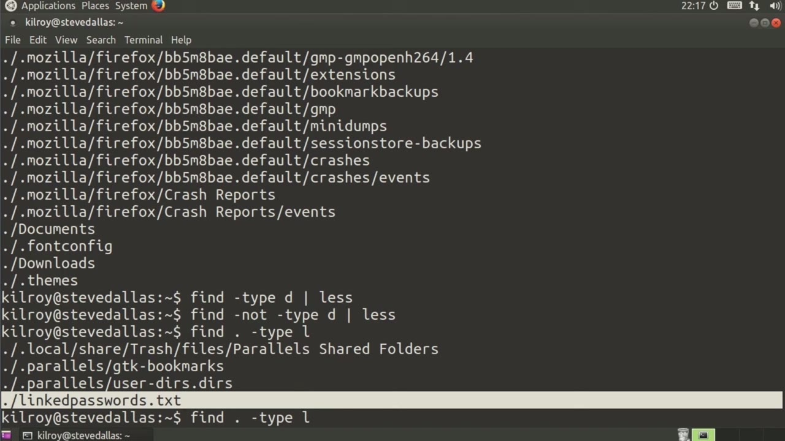

[← Course contents](../../02.md)

# 66. Find

**Course:** [Linux Security & Administration From Boot Process to Firewalls](https://www.youtube.com/watch?v=_WB3evmgxYA)  
**Transcript:** [`Linux Security & Administration From Boot Process to Firewalls transcript`](../../../../course_videos/Linux%20Security%20%26%20Administration%20From%20Boot%20Process%20to%20Firewalls/Linux%20Security%20%26%20Administration%20From%20Boot%20Process%20to%20Firewalls.txt)  
**Video:** 04:47:09–04:50:59 ([open at this time](https://www.youtube.com/watch?v=_WB3evmgxYA&t=17229s))

## Introduction

One thing that's really frustrating sometimes is knowing that there's a file somewhere on the file system and you just can't remember where it is. There's actually a utility that you can use, not surprisingly, it's called Find, where you can locate files. You can locate them by name, you can locate them by type. Different parameters that you can pass into find.

## Detailed Explanation

<details>
  <summary>Step 1 — Run `find -name`, `mysql`</summary>

### Step 1 — Run `find -name`, `mysql`

- [x] **One thing that's really frustrating sometimes is knowing that there's**
  - One thing that's really frustrating sometimes is knowing that there's a file somewhere on the file system and you just can't remember where it is.
  - There's actually a utility that you can use, not surprisingly, it's called Find, where you can locate files.
  - You can locate them by name, you can locate them by type.

- [x] **Use `find -name`**
  - Different parameters that you can pass into find.
  - Let's just take a look here and I'm going to say `find -name`, pass dot my SQL, and I'm just going to run that.
  - It says there that we located it and that's where it was found.

- [x] **Use `mysql`**
  - `mysql`.
  - Now this just sort of assumes that I'm going to start in my local directory.
  - And of course I'm getting a lot of permission denied because we're looking at files and directories that are only available to the root user. I didn't run it as root.

- [x] **There are a number of other things I can do. If I were to say**
  - There are a number of other things I can do. If I were to say something a little bit different here, where if I put it in quotes, I can feed regex to it. So if I say pass asterisk, I should get two files back. And I'm going to change this.
  - I'm just going to put the dot in here just to be very explicit about where I'm looking.

```bash
find -name
mysql
```



</details>

<details>
  <summary>Step 2 — Run `mysql`, `find -type`</summary>

### Step 2 — Run `mysql`, `find -type`

- [x] **Use `mysql`**
  - And sure enough, I get past.m. `mysql` and passwords.txte because that matches this pattern right here.
  - So if I put it in quotes, I can actually pattern match as well.
  - So one other thing that I can do is let's just try this.

- [x] **And what I should get is everything that doesn't match that**
  - And what I should get is everything that doesn't match that.
  - And sure enough, that's exactly what I get.
  - I get all of the files that are under this directory, and it is recursive.

- [x] **So it looks through all of the directories for me**
  - So it looks through all of the directories for me.
  - So that was the dash not, and then I provide a name here.
  - So there are ways that we can search for files and directories by type.

- [x] **Use `find -type`**
  - So I can say `find -type`.
  - And let's just look for all of the directories.
  - And actually let's pipe it out to less so that we can see all of them.

- [x] **And these are all, again, in my local directory here**
  - And these are all, again, in my local directory here.
  - And again, we're going very recursively.

```bash
mysql
find -type
```



</details>

<details>
  <summary>Step 3 — Run `type -L`</summary>

### Step 3 — Run `type -L`

- [x] **Let's say we wanted to do everything that wasn't a directory then**
  - Let's say we wanted to do everything that wasn't a directory then.
  - And of course, there are directory paths here, but what we're looking at specifically is a file.
  - If I do type L, and again, let's explicitly say we're...

- [x] **Looking in dot. I am getting symbolic links. This right here is the**
  - Looking in dot. I am getting symbolic links. This right here is the one I created specifically for this. This is a symbolic link. The others, they happen to be there as symbolic links. I wasn't really expecting those. I wanted to make sure I had one, so I created it. Those others also happen to
  - Be symbolic links. So I can look for regular files, which would be F. I can look for directories, which is D, symbolic links, which is L.
  - So I can do a couple of different things here.

- [x] **Use `type -L`**
  - So I can say `type -L` and then name is, let's say, asterisk pass, asterisk.
  - So I can actually chain a couple of these things together.
  - I can say I'm looking for a specific type as well as a name that matches a specific pattern.

- [x] **Find is a really helpful utility where you can locate files**
  - Find is a really helpful utility where you can locate files, directories on your Linux file system.
  - You can do it very quickly and very easily, and you can really narrow your search down.

```bash
type -L
```



</details>

<details>
  <summary>Questions and Answers</summary>

## Questions and Answers

### Question 1: What does `find -name` do in this chapter?

<details>
<summary>Answer</summary>

- [x] Let's just take a look here and I'm going to say `find -name`, pass dot my SQL, and I'm just going to run that.

</details>

### Question 2: What does `mysql` do in this chapter?

<details>
<summary>Answer</summary>

- [x] `mysql`.

</details>

### Question 3: What does `find -type` do in this chapter?

<details>
<summary>Answer</summary>

- [x] So I can say `find -type`.

</details>

### Question 4: What does `type -L` do in this chapter?

<details>
<summary>Answer</summary>

- [x] So I can say `type -L` and then name is, let's say, asterisk pass, asterisk.

</details>

### Question 5: What does step 1 cover (Run find -name, mysql)?

<details>
<summary>Answer</summary>

- [x] One thing that's really frustrating sometimes is knowing that there's a file somewhere on the file system and you just can't remember where it is.
- [x] There's actually a utility that you can use, not surprisingly, it's called Find, where you can locate files.
- [x] You can locate them by name, you can locate them by type.

</details>

### Question 6: What does step 2 cover (Run mysql, find -type)?

<details>
<summary>Answer</summary>

- [x] And sure enough, I get past.m. `mysql` and passwords.txte because that matches this pattern right here.
- [x] So if I put it in quotes, I can actually pattern match as well.
- [x] So one other thing that I can do is let's just try this.

</details>

### Question 7: What does step 3 cover (Run type -L)?

<details>
<summary>Answer</summary>

- [x] Let's say we wanted to do everything that wasn't a directory then.
- [x] And of course, there are directory paths here, but what we're looking at specifically is a file.
- [x] If I do type L, and again, let's explicitly say we're...

</details>

</details>

## Summary

This chapter, Find, walks through Run find -name, mysql; Run mysql, find -type; Run type -L. Commands from the transcript: `find -name`, `mysql`, `find -type`, `type -L`.

## References

- [Linux Security & Administration From Boot Process to Firewalls (YouTube)](https://www.youtube.com/watch?v=_WB3evmgxYA)
- [This chapter at 04:47:09](https://www.youtube.com/watch?v=_WB3evmgxYA&t=17229s)
- [Local transcript](../../../../course_videos/Linux%20Security%20%26%20Administration%20From%20Boot%20Process%20to%20Firewalls/Linux%20Security%20%26%20Administration%20From%20Boot%20Process%20to%20Firewalls.txt)
