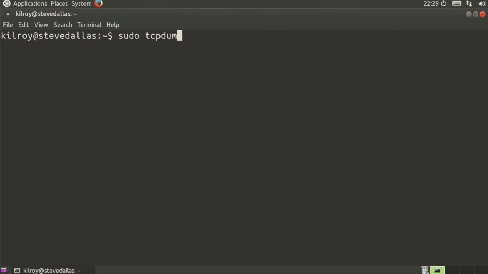
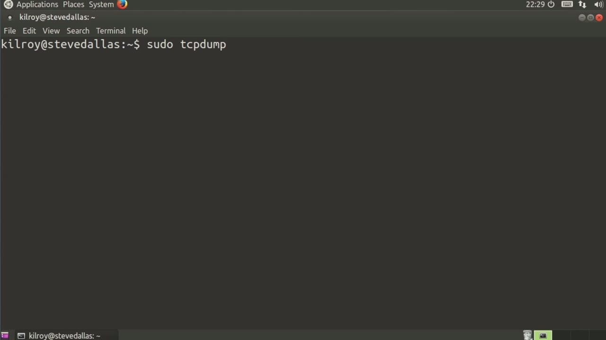
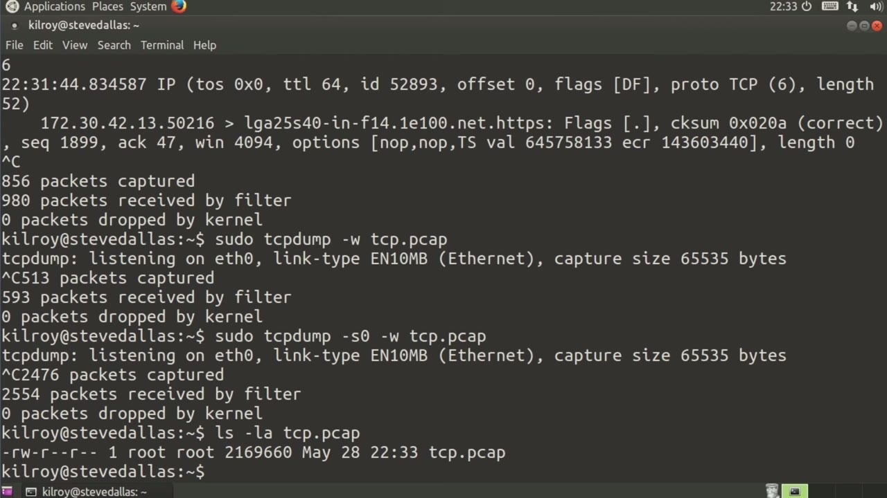

[← Course contents](../../02.md)

# 67. tcpdump

**Course:** [Linux Security & Administration From Boot Process to Firewalls](https://www.youtube.com/watch?v=_WB3evmgxYA)  
**Transcript:** [`Linux Security & Administration From Boot Process to Firewalls transcript`](../../../../course_videos/Linux%20Security%20%26%20Administration%20From%20Boot%20Process%20to%20Firewalls/Linux%20Security%20%26%20Administration%20From%20Boot%20Process%20to%20Firewalls.txt)  
**Video:** 04:50:59–04:55:18 ([open at this time](https://www.youtube.com/watch?v=_WB3evmgxYA&t=17459s))

## Introduction

Now, I'm going to grant you up front that it's quite a bit easier to do packet capturing using a graphical interface so you can really see what's going on. However, there are instances where the only thing you're going to have is a console interface. And so being able to capture packets and maybe write them out to a file so you can analyze them somewhere else is really important to have. So what am I talking about with packet capturing?

## Detailed Explanation

<details>
  <summary>Step 1 — Run `tcpdump`</summary>

### Step 1 — Run `tcpdump`

- [x] **Now, I'm going to grant you up front that it's quite a bit easier to**
  - Now, I'm going to grant you up front that it's quite a bit easier to do packet capturing using a graphical interface so you can really see what's going on.
  - However, there are instances where the only thing you're going to have is a console interface.
  - And so being able to capture packets and maybe write them out to a file so you can analyze them somewhere else is really important to have.

- [x] **Use `tcpdump`**
  - So what am I talking about with packet capturing?
  - Well, networks transmit packets, and these packets can be acquired at really any stage along the path of the network transmission.
  - And the utility that we use in order to capture packets is `tcpdump`.

- [x] **Use `tcpdump`**
  - Now, `tcpdump` is a command line utility.
  - As I said, there are cases where you're only going to have a console interface.
  - There are certainly cases where you may be trying to do this on a server where you just don't have a graphical interface.

```bash
tcpdump
```



</details>

<details>
  <summary>Step 2 — Run `tcpdump`</summary>

### Step 2 — Run `tcpdump`

- [x] **Use `tcpdump`**
  - So you really need to be able to capture these packets using this command line utility `tcpdump`.
  - So certainly I can do `tcpdump` and I can just let it run now.
  - So what you're seeing, is the header information from the packets that are coming by.

- [x] **I'm not actually capturing anything here**
  - I'm not actually capturing anything here.
  - All I'm doing is getting a display of the header information.
  - I want to see whether specific hosts are communicating or not.

- [x] **Let's just say, because this is one of them that's coming up, let's**
  - Let's just say, because this is one of them that's coming up, let's just say we're going to pick this one.
  - So now I'm only getting packets that are actually either to or from that particular host.
  - That's good. I can use a host. Of course, I can use an IP address there just as easily as I can use a host name.

- [x] **But being able to filter is really good**
  - But being able to filter is really good.
  - The other thing that I can do is if I had multiple interfaces, I can say eth zero, which is my primary interface, and I can capture on that interface as well.
  - Now, you'll notice as I'm starting these up, it's saying you can use -V to get more information than we did.

- [x] **And sure enough, that's breaking out a little bit more information**
  - And sure enough, that's breaking out a little bit more information than we had.
  - And I can also do -vv and get even a little bit more information than that.

```bash
tcpdump
```



</details>

<details>
  <summary>Step 3 — Run `tcpdump`</summary>

### Step 3 — Run `tcpdump`

- [x] **But again, we're still only doing just the header information here**
  - But again, we're still only doing just the header information here.
  - To a file so that I can maybe look at it later in a graphical utility where I can really do a lot of searching and popping things out so that I can really see the information better. So I can say tcp.
  - Pcap for example here. Now I'm writing all of this information out to a file. The thing about this though is I need to make sure that what I'm doing is getting the entire packet.

- [x] **So I'm going to set the snap length to zero, which really says as**
  - So I'm going to set the snap length to zero, which really says as much data as each packet holds, just write it out. I could specify a size, but if I say zero, it's really effectively infinity, which is capped at the maximum transmission unit. And in this particular case, we're talking about
  - Ethernet, which would be 1500 bytes. Now I'm not getting the output here because it's being written out to a file. Once I'm done, Ctrl+C, you can see I capture 2,554 packets.
  - P-Cap, you can see that it's got some size to it.

- [x] **Use `tcpdump`**
  - It looks like it's about 2 meg, give or take there.
  - `tcpdump`, as I said, really useful utility command line.
  - If you've got a server where you don't have a graphical interface, or if you've only got a console, or if you just want to let this run maybe without cluttering up a screen with a graphical interface, you just kind of let it sit and run.

- [x] **Use `tcpdump`**
  - You can do filtering on port, on host, on protocol, lots of different filters you can use.
  - But `tcpdump` is definitely a utility

```bash
tcpdump
```



</details>

<details>
  <summary>Questions and Answers</summary>

## Questions and Answers

### Question 1: What does `tcpdump` do in this chapter?

<details>
<summary>Answer</summary>

- [x] And the utility that we use in order to capture packets is `tcpdump`.

</details>

### Question 2: What does step 1 cover (Run tcpdump)?

<details>
<summary>Answer</summary>

- [x] Now, I'm going to grant you up front that it's quite a bit easier to do packet capturing using a graphical interface so you can really see what's going on.
- [x] However, there are instances where the only thing you're going to have is a console interface.
- [x] And so being able to capture packets and maybe write them out to a file so you can analyze them somewhere else is really important to have.

</details>

### Question 3: What does step 2 cover (Run tcpdump)?

<details>
<summary>Answer</summary>

- [x] So you really need to be able to capture these packets using this command line utility `tcpdump`.
- [x] So certainly I can do `tcpdump` and I can just let it run now.
- [x] So what you're seeing, is the header information from the packets that are coming by.

</details>

### Question 4: What does step 3 cover (Run tcpdump)?

<details>
<summary>Answer</summary>

- [x] But again, we're still only doing just the header information here.
- [x] To a file so that I can maybe look at it later in a graphical utility where I can really do a lot of searching and popping things out so that I can really see the information better. So I can say tcp.
- [x] Pcap for example here. Now I'm writing all of this information out to a file. The thing about this though is I need to make sure that what I'm doing is getting the entire packet.

</details>

</details>

## Summary

This chapter, tcpdump, walks through Run tcpdump; Run tcpdump; Run tcpdump. Commands from the transcript: `tcpdump`.

## References

- [Linux Security & Administration From Boot Process to Firewalls (YouTube)](https://www.youtube.com/watch?v=_WB3evmgxYA)
- [This chapter at 04:50:59](https://www.youtube.com/watch?v=_WB3evmgxYA&t=17459s)
- [Local transcript](../../../../course_videos/Linux%20Security%20%26%20Administration%20From%20Boot%20Process%20to%20Firewalls/Linux%20Security%20%26%20Administration%20From%20Boot%20Process%20to%20Firewalls.txt)
