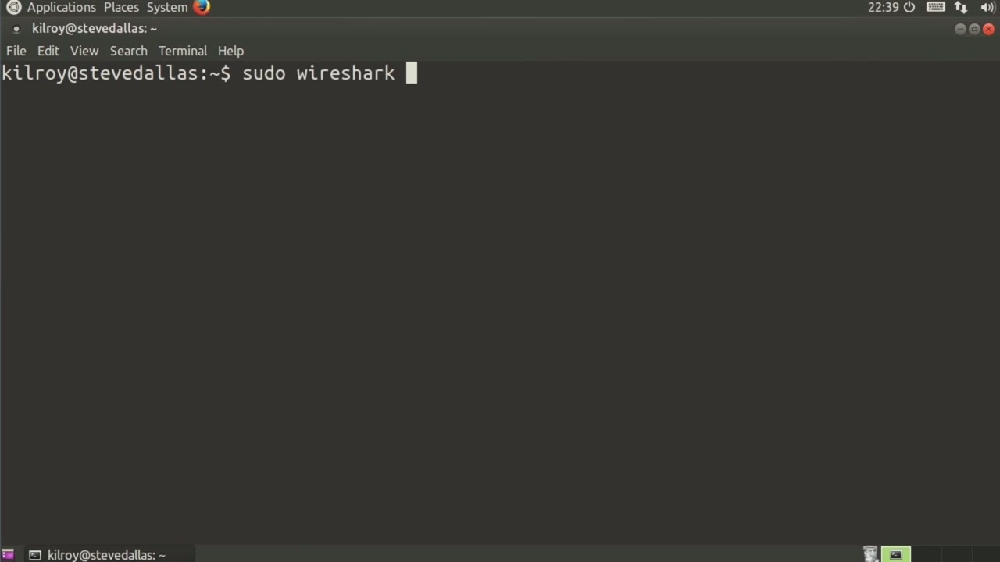
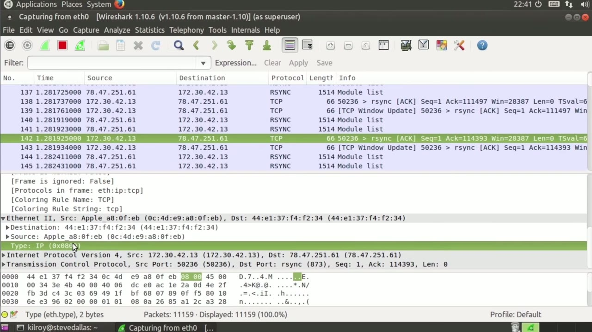
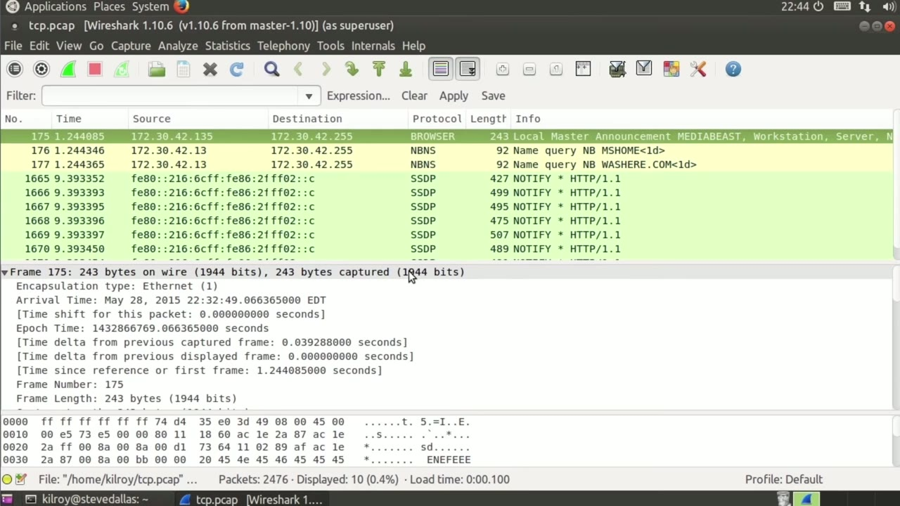

[← Course contents](../../02.md)

# 68. Wireshark

**Course:** [Linux Security & Administration From Boot Process to Firewalls](https://www.youtube.com/watch?v=_WB3evmgxYA)  
**Transcript:** [`Linux Security & Administration From Boot Process to Firewalls transcript`](../../../../course_videos/Linux%20Security%20%26%20Administration%20From%20Boot%20Process%20to%20Firewalls/Linux%20Security%20%26%20Administration%20From%20Boot%20Process%20to%20Firewalls.txt)  
**Video:** 04:55:18–05:00:49 ([open at this time](https://www.youtube.com/watch?v=_WB3evmgxYA&t=17718s))

## Introduction

Now that we've taken a look at the command line version of a packet capture utility, let's look at the graphical version of it. So it's given me an error because I'm running as root. I actually have to run as root because if I'm going to capture packets, I need administrative access, but it's going to complain at me because there are some potential risks in doing this. If there's a vulnerability in your packet capture utility at Wireshark specifically here, you run the risk of putting your system in a place where it could be compromised.

## Detailed Explanation

<details>
  <summary>Step 1 — that we've taken a look at the command line version of a packet capture</summary>

### Step 1 — that we've taken a look at the command line version of a packet capture

- [x] **Now that we've taken a look at the command line version of a packet**
  - Now that we've taken a look at the command line version of a packet capture utility, let's look at the graphical version of it.
  - So it's given me an error because I'm running as root.
  - I actually have to run as root because if I'm going to capture packets, I need administrative access, but it's going to complain at me because there are some potential risks in doing this.

- [x] **If there's a vulnerability in your packet capture utility at**
  - If there's a vulnerability in your packet capture utility at Wireshark specifically here, you run the risk of putting your system in a place where it could be compromised.
  - Here we've got Wireshark. We've got a number of panes here and let's just start off with the capture pane. We're going to look at the interface list. There's only one interface on this system. If I click the checkbox here and click start, I will immediately do a packet capture on that particular interface. I can also select
  - Any one of these and then just click start here. Same sort of thing. Immediately I am getting my list of packets.

- [x] **Now, the nice thing about Wireshark, what I've got here is a very**
  - Now, the nice thing about Wireshark, what I've got here is a very nice organization.
  - I've got the time that it came in on the source and destination IP address.
  - And then I've got some basic information about the frame.

- [x] **So you can see that we've got the port information here**
  - So you can see that we've got the port information here.
  - It originated on port, 50,000, 236, and is going to the R-Sync port.
  - And this happens to be an acc message, and I've got the acc number and the sequence number, as well as the window size here.

- [x] **I may actually want more information than that, though**
  - I may actually want more information than that, though.
  - So if I go down to this lower frame here, I've got my frame information.



</details>

<details>
  <summary>Step 2 — then I've got my Ethernet 2 information, which is the source and</summary>

### Step 2 — then I've got my Ethernet 2 information, which is the source and

- [x] **And then I've got my Ethernet 2 information, which is the source and**
  - And then I've got my Ethernet 2 information, which is the source and destination Mac address.
  - And it tells me that this is actually an IP packet.
  - If I open that up, I've got the version.

- [x] **I've got all of the IP header information**
  - I've got all of the IP header information.
  - And then finally, I've got the TCP header.
  - And then any data that's associated would be at the very bottom.

- [x] **Now you'll notice at the bottom, What we've got is the raw**
  - Now you'll notice at the bottom, What we've got is the raw hexadecimal dump of everything.
  - And if I were to select some header field up here, it would immediately highlight the actual hexadecimal value down at the bottom.
  - In this case, the four is actually the version, and then the five is actually the header length.

- [x] **So you'll see if I select both of these, it's pointing to the same**
  - So you'll see if I select both of these, it's pointing to the same byte value.
  - As I start clicking through here, you'll see the selection starting to change.
  - This total length is two bytes. It's these two bytes down here.

- [x] **I've got the ability to do filters. I can do IP. addr equals equals**
  - I've got the ability to do filters. I can do IP. addr equals equals, let's say, 172.30.42.42.13. For instance, I hit enter, it filters based on that IP address.
  - Is something to or from that IP address. So I can now clear that filter out. I could say, for example, IP, and that's only going to show me IP packets. I can say UDP. That should only show me UDP messages. So you'll see now I've just got UDP messages here. I can
  - Do a number of filters and you can do filter builders. You could use expression here.

- [x] **It'll give you field names. You can start selecting the field names**
  - It'll give you field names. You can start selecting the field names and the relation and then give value. So you can build your own filters there as well. So when I'm done capturing, I just click the stop there. Now I could save it or I could just close it, which is what I'm going to do. And the reason I'm going to do that is because I want to go to
  - And I want to open the one that we had done previously.
  - So I need to go to the home directory here and find my home so that I can find the p-cap that we had stored here.



</details>

<details>
  <summary>Step 3 — Run `tcpdump`</summary>

### Step 3 — Run `tcpdump`

- [x] **Use `tcpdump`**
  - So this is the pcap that we had created using `tcpdump`.
  - You'll see it can be easily opened here in Wireshark.
  - Because it's all just packet capture stuff.

- [x] **We've got a packet capture that we had created here, and now we've**
  - We've got a packet capture that we had created here, and now we've got, looks like there was a filter that was being applied.
  - We've got our list of all of our frames that looks exactly the same as the one that we were doing live here.
  - We can look at information in exactly the same way.

- [x] **Use `tcpdump`**
  - You'll see there were 2,476 packets that a displayed value is the same.
  - If I were to do a filter, it would show you the number of packets that were displayed as a result of the filter.
  - `tcpdump` is great for storing on disk if you've got a console.

- [x] **Wireshark is fabulous if you want to actually do some analysis and**
  - Wireshark is fabulous if you want to actually do some analysis and you can do captures with it as well, but really being able to look into each of the frames here and start digging into the information to see what's really going on as you are sending information across the wire very, very powerful.

```bash
tcpdump
```



</details>

<details>
  <summary>Questions and Answers</summary>

## Questions and Answers

### Question 1: What does `tcpdump` do in this chapter?

<details>
<summary>Answer</summary>

- [x] So this is the pcap that we had created using `tcpdump`.

</details>

### Question 2: What does step 1 cover (that we've taken a look at the command line version of a packet capture)?

<details>
<summary>Answer</summary>

- [x] Now that we've taken a look at the command line version of a packet capture utility, let's look at the graphical version of it.
- [x] So it's given me an error because I'm running as root.
- [x] I actually have to run as root because if I'm going to capture packets, I need administrative access, but it's going to complain at me because there are some potential risks in doing this.

</details>

### Question 3: What does step 2 cover (then I've got my Ethernet 2 information, which is the source and)?

<details>
<summary>Answer</summary>

- [x] And then I've got my Ethernet 2 information, which is the source and destination Mac address.
- [x] And it tells me that this is actually an IP packet.
- [x] If I open that up, I've got the version.

</details>

### Question 4: What does step 3 cover (Run tcpdump)?

<details>
<summary>Answer</summary>

- [x] So this is the pcap that we had created using `tcpdump`.
- [x] You'll see it can be easily opened here in Wireshark.
- [x] Because it's all just packet capture stuff.

</details>

</details>

## Summary

This chapter, Wireshark, walks through that we've taken a look at the command line version of a packet capture; then I've got my Ethernet 2 information, which is the source and; Run tcpdump. Commands from the transcript: `tcpdump`.

## References

- [Linux Security & Administration From Boot Process to Firewalls (YouTube)](https://www.youtube.com/watch?v=_WB3evmgxYA)
- [This chapter at 04:55:18](https://www.youtube.com/watch?v=_WB3evmgxYA&t=17718s)
- [Local transcript](../../../../course_videos/Linux%20Security%20%26%20Administration%20From%20Boot%20Process%20to%20Firewalls/Linux%20Security%20%26%20Administration%20From%20Boot%20Process%20to%20Firewalls.txt)
