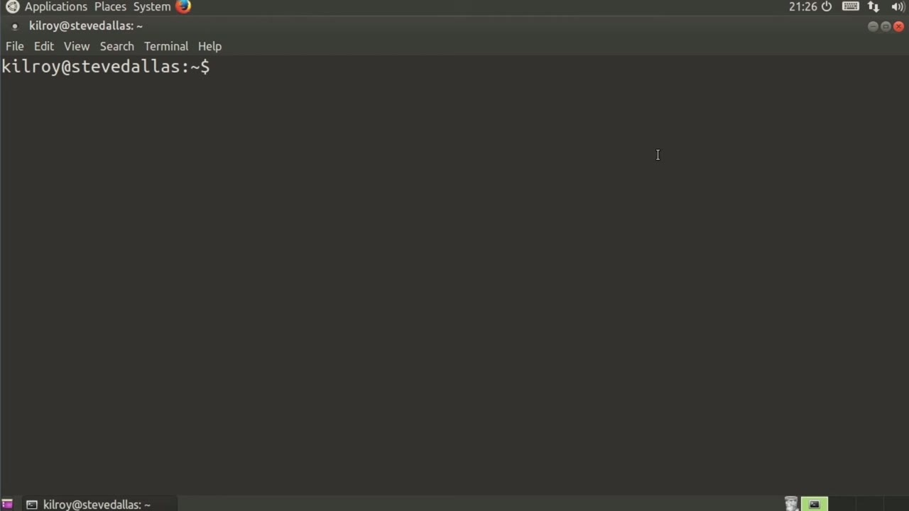
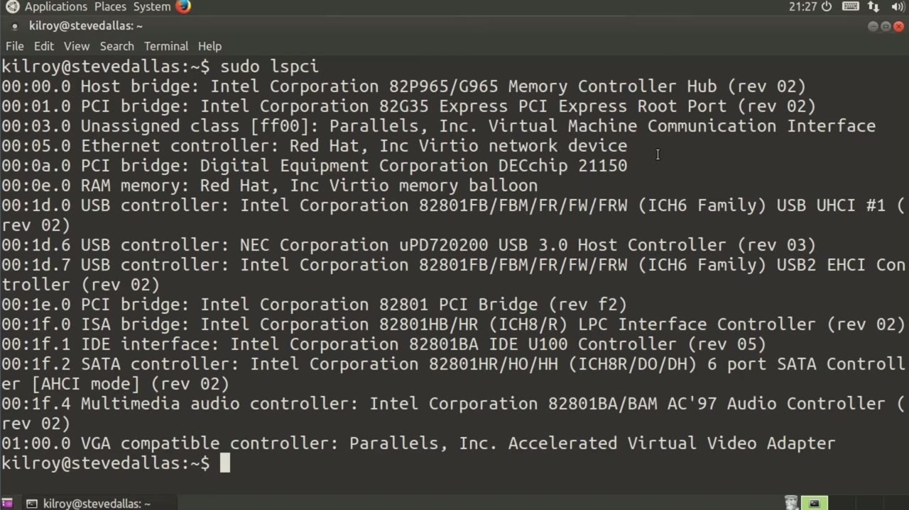
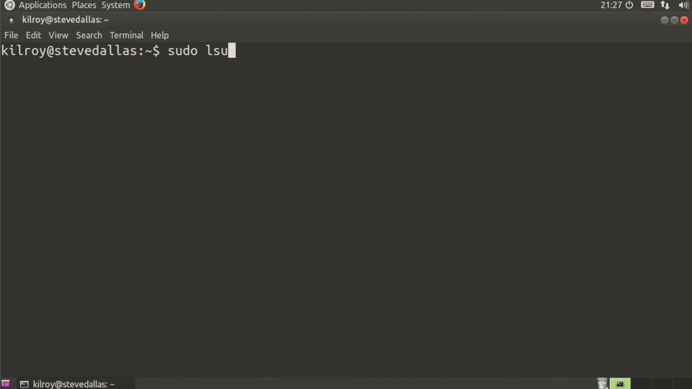

[← Course contents](../../02.md)

# 69. lspci And lsusb

**Course:** [Linux Security & Administration From Boot Process to Firewalls](https://www.youtube.com/watch?v=_WB3evmgxYA)  
**Transcript:** [`Linux Security & Administration From Boot Process to Firewalls transcript`](../../../../course_videos/Linux%20Security%20%26%20Administration%20From%20Boot%20Process%20to%20Firewalls/Linux%20Security%20%26%20Administration%20From%20Boot%20Process%20to%20Firewalls.txt)  
**Video:** 05:00:49–05:03:32 ([open at this time](https://www.youtube.com/watch?v=_WB3evmgxYA&t=18049s))

## Introduction

A couple of other utilities to take a look at here are maybe ones that you don't see used very often. Maybe you're not familiar at all with them, but they are really helpful in seeing actually what's on your system. And by that, I mean, let's take a look at one of them here. If I say lspi, it shows me all of the devices that are connected to the PCI bus.

## Detailed Explanation

<details>
  <summary>Step 1 — A couple of other utilities to take a look at here are maybe ones that</summary>

### Step 1 — A couple of other utilities to take a look at here are maybe ones that

- [x] **A couple of other utilities to take a look at here are maybe ones**
  - A couple of other utilities to take a look at here are maybe ones that you don't see used very often.
  - Maybe you're not familiar at all with them, but they are really helpful in seeing actually what's on your system.
  - And by that, I mean, let's take a look at one of them here.

- [x] **If I say lspi, it shows me all of the devices that are connected to**
  - If I say lspi, it shows me all of the devices that are connected to the PCI bus.
  - So you can see the host bridge, the PCI bridge.
  - If I had a number of devices that were attached here, you would see all of them.

- [x] **In this case, we're looking at the USB controller**
  - In this case, we're looking at the USB controller.



</details>

<details>
  <summary>Step 2 — you also get details about all of the hardware here</summary>

### Step 2 — you also get details about all of the hardware here

- [x] **So you also get details about all of the hardware here**
  - So you also get details about all of the hardware here.
  - This vga compatible controller is a Parallels accelerated virtual video adapter.
  - That's because I happen to be running this inside of a Parallels Virtual Machine.

- [x] **You can see that the SATA controller is an Intel Corporation SATA**
  - You can see that the SATA controller is an Intel Corporation SATA controller.
  - Looks like it's six ports here, and we've got USB controllers as well.
  - You can see all of the hardware that's associated with the PCI bus.



</details>

<details>
  <summary>Step 3 — Run `ls usb`, `lsusb`, `lspci`</summary>

### Step 3 — Run `ls usb`, `lsusb`, `lspci`

- [x] **Use `ls usb`**
  - Similarly, I can say `ls usb` and I'm going to get a list of all of the devices that are associated with the USB bus here.
  - And in this particular case, I don't have anything installed that's attached to this particular machine.
  - But if I actually had something associated with the USB, then I would get that showing up here.

- [x] **Use `lsusb`**
  - You can see a couple of these utilities here, lspi and `lsusb`, can be really helpful in doing system level troubleshooting and that sort of thing.
  - If I plug in a USB device, then rather than just the root hubs that you can see, I should get a whole other device.
  - Sure enough, I get my sand disk cruiser.

- [x] **That comes from just doing a plug-in here on the fly, and all of a**
  - That comes from just doing a plug-in here on the fly, and all of a sudden, I get this new USB device.
  - So I can see all of the USB devices that have shown up on my system here.
  - In this case, it's really just one plus the root hubs that are associated with just the USB controller itself.

- [x] **Use `lspci`**
  - And if I were to do `lspci`, as mentioned earlier, we get a list of all of the devices that are associated with your PCI bus as well.
  - These are a couple of good utilities to see what you've got for hardware that's actually attached to your system.

```bash
ls usb
lsusb
lspci
```



</details>

<details>
  <summary>Questions and Answers</summary>

## Questions and Answers

### Question 1: What does `ls usb` do in this chapter?

<details>
<summary>Answer</summary>

- [x] Similarly, I can say `ls usb` and I'm going to get a list of all of the devices that are associated with the USB bus here.

</details>

### Question 2: What does `lsusb` do in this chapter?

<details>
<summary>Answer</summary>

- [x] You can see a couple of these utilities here, lspi and `lsusb`, can be really helpful in doing system level troubleshooting and that sort of thing.

</details>

### Question 3: What does `lspci` do in this chapter?

<details>
<summary>Answer</summary>

- [x] And if I were to do `lspci`, as mentioned earlier, we get a list of all of the devices that are associated with your PCI bus as well.

</details>

### Question 4: What does step 1 cover (A couple of other utilities to take a look at here are maybe ones that)?

<details>
<summary>Answer</summary>

- [x] A couple of other utilities to take a look at here are maybe ones that you don't see used very often.
- [x] Maybe you're not familiar at all with them, but they are really helpful in seeing actually what's on your system.
- [x] And by that, I mean, let's take a look at one of them here.

</details>

### Question 5: What does step 2 cover (you also get details about all of the hardware here)?

<details>
<summary>Answer</summary>

- [x] So you also get details about all of the hardware here.
- [x] This vga compatible controller is a Parallels accelerated virtual video adapter.
- [x] That's because I happen to be running this inside of a Parallels Virtual Machine.

</details>

### Question 6: What does step 3 cover (Run ls usb, lsusb, lspci)?

<details>
<summary>Answer</summary>

- [x] Similarly, I can say `ls usb` and I'm going to get a list of all of the devices that are associated with the USB bus here.
- [x] And in this particular case, I don't have anything installed that's attached to this particular machine.
- [x] But if I actually had something associated with the USB, then I would get that showing up here.

</details>

</details>

## Summary

This chapter, lspci And lsusb, walks through A couple of other utilities to take a look at here are maybe ones that; you also get details about all of the hardware here; Run ls usb, lsusb, lspci. Commands from the transcript: `ls usb`, `lsusb`, `lspci`.

## References

- [Linux Security & Administration From Boot Process to Firewalls (YouTube)](https://www.youtube.com/watch?v=_WB3evmgxYA)
- [This chapter at 05:00:49](https://www.youtube.com/watch?v=_WB3evmgxYA&t=18049s)
- [Local transcript](../../../../course_videos/Linux%20Security%20%26%20Administration%20From%20Boot%20Process%20to%20Firewalls/Linux%20Security%20%26%20Administration%20From%20Boot%20Process%20to%20Firewalls.txt)
