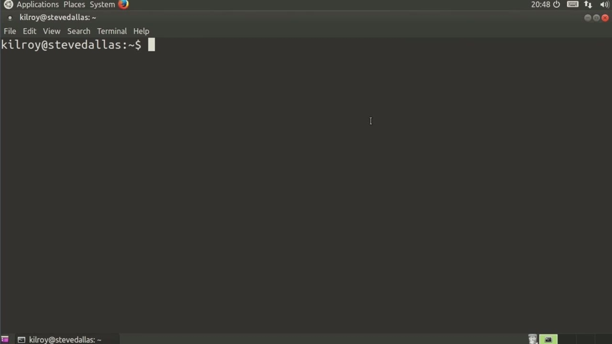
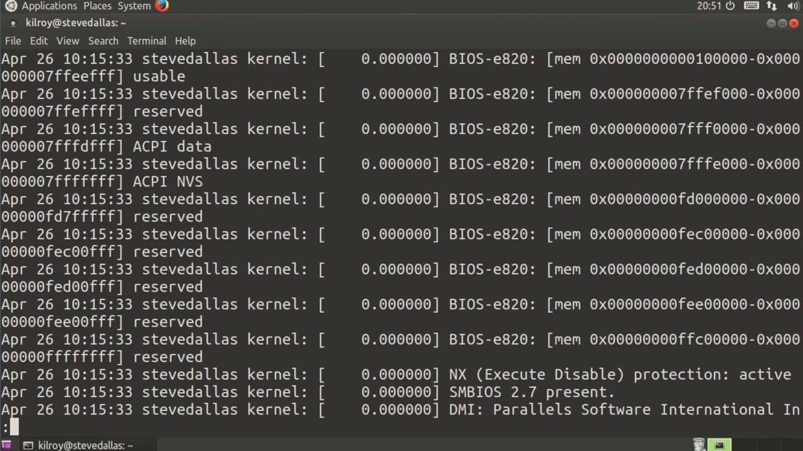
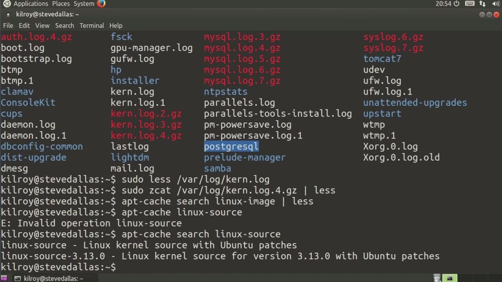

[← Course contents](../../02.md)

# 70. What you will learn in this Module

**Course:** [Linux Security & Administration From Boot Process to Firewalls](https://www.youtube.com/watch?v=_WB3evmgxYA)  
**Transcript:** [`Linux Security & Administration From Boot Process to Firewalls transcript`](../../../../course_videos/Linux%20Security%20%26%20Administration%20From%20Boot%20Process%20to%20Firewalls/Linux%20Security%20%26%20Administration%20From%20Boot%20Process%20to%20Firewalls.txt)  
**Video:** 05:03:32–05:08:03 ([open at this time](https://www.youtube.com/watch?v=_WB3evmgxYA&t=18212s))

## Introduction

Well, let's talk about the Linux kernel. The kernel is actually one of the most important components when we're talking about security. It also offers potential ways into the operating system. Actually, the kernel is the operating system.

## Detailed Explanation

  
Step 1 — Well, let's talk about the Linux kernel

### Step 1 — Well, let's talk about the Linux kernel

- [x] **Well, let's talk about the Linux kernel**
  - Well, let's talk about the Linux kernel.
  - The kernel is actually one of the most important components when we're talking about security.
  - It also offers potential ways into the operating system.

- [x] **Actually, the kernel is the operating system**
  - Actually, the kernel is the operating system.
  - So it's probably more accurate to say that vulnerabilities in the kernel or a poorly configured kernel could allow an attacker to get into your system.
  - So get access to your files, be able to corrupt services, do all sorts of really bad things.

- [x] **So it's helpful to talk about the kernel**
  - So it's helpful to talk about the kernel.
  - A couple of things here. First of all, let's take a look at var log. And we can take a look at the kernel log, for example.
  - Now, in this case, what we've got is a whole bunch of firewall messages. This is actually a set of messages that are generated by the kernel because the firewall is inside the kernel.

- [x] **So we can also take a look at some of the older log files and see**
  - So we can also take a look at some of the older log files and see some actual kernel messages.
  - So let's take a look at this one right here and go back past all of the firewall logs.
  - Now this is the type of message that the kernel spits out when it's actually booting up.

- [x] **So the kernel is the software component that interfaces with the**
  - So the kernel is the software component that interfaces with the hardware and the user space.
  - It's that layer that sits in between those two.

  
Step 2 — when your system is booting up, it's actually the kernel that's loading

### Step 2 — when your system is booting up, it's actually the kernel that's loading

- [x] **So when your system is booting up, it's actually the kernel that's**
  - So when your system is booting up, it's actually the kernel that's loading into memory and getting all of the device drivers working and all of that.
  - So what we're looking at here is output from the kernel.
  - So we can see the different pieces of hardware.

- [x] **That the kernel actually found as it was loading and getting**
  - That the kernel actually found as it was loading and getting everything functional.
  - Another thing that I want to take a look at here is the number of packages that are available, and this happens to be an Ubuntu system. So I'm going to search for Linux -image.
  - I'm going to pipe this out to less as well because there's going to be a bunch of them.

- [x] **So you can see we've got a lot of different possibilities when it**
  - So you can see we've got a lot of different possibilities when it comes to getting a Linux kernel installed here.
  - All of these packages that say Linux image are a binary version of the kernel.
  - So we've got a number of different versions here.

- [x] **And then there's a lot of patched versions that are based on 3.13**
  - And then there's a lot of patched versions that are based on 3.13.
  - These are specifically patched versions that are based on the 3.13 version of the Linux kernel.
  - You can see all of the Linux kernels we've got.

- [x] **I could install any one of those, and then I could boot to that**
  - I could install any one of those, and then I could boot to that specific kernel.
  - Now, in addition to all of these binary images of the kernel, there is also a source package, and I should be able to search for that by just looking for Linux-source.

  
Step 3 — you can see Linux -source, and that's just kind of a generic package

### Step 3 — you can see Linux -source, and that's just kind of a generic package

- [x] **So you can see Linux -source, and that's just kind of a generic**
  - So you can see Linux -source, and that's just kind of a generic package.
  - In this particular case, it should point to Linux -source -3.13.0.
  - And once you've got the source, of course, you can build your own specific kernel.

- [x] **And we'll take a look at that a little bit later on**
  - And we'll take a look at that a little bit later on.
  - But Ubuntu and any of the other Linux distributions have a number of binary images, meaning they're pre-built kernels.
  - So it's not just the source, and you don't have to go build it and configure it and all of that stuff.

- [x] **What you're working with is a kernel that has been pre-built for you**
  - What you're working with is a kernel that has been pre-built for you with all of the features that the maintainer, in this case canonical, believes you would need in order to have a functioning Linux system.
  - So we're gonna take a few lessons here and we're going to dig into the kernel a little bit.
  - And see what it's made of and how to actually build your own kernel and do some other cool things in order to help you get to a place where you can have a machine that's more hardened than what you would get with just a pre-built kernel that one of these Linux distributions

  
Questions and Answers

## Questions and Answers

### Question 1: What does step 1 cover (Well, let's talk about the Linux kernel)?

Answer

- [x] Well, let's talk about the Linux kernel.
- [x] The kernel is actually one of the most important components when we're talking about security.
- [x] It also offers potential ways into the operating system.

### Question 2: What does step 2 cover (when your system is booting up, it's actually the kernel that's loading)?

Answer

- [x] So when your system is booting up, it's actually the kernel that's loading into memory and getting all of the device drivers working and all of that.
- [x] So what we're looking at here is output from the kernel.
- [x] So we can see the different pieces of hardware.

### Question 3: What does step 3 cover (you can see Linux -source, and that's just kind of a generic package)?

Answer

- [x] So you can see Linux -source, and that's just kind of a generic package.
- [x] In this particular case, it should point to Linux -source -3.13.0.
- [x] And once you've got the source, of course, you can build your own specific kernel.

## Summary

This chapter, What you will learn in this Module, walks through Well, let's talk about the Linux kernel; when your system is booting up, it's actually the kernel that's loading; you can see Linux -source, and that's just kind of a generic package.

## References

- [Linux Security & Administration From Boot Process to Firewalls (YouTube)](https://www.youtube.com/watch?v=_WB3evmgxYA)
- [This chapter at 05:03:32](https://www.youtube.com/watch?v=_WB3evmgxYA&t=18212s)
- [Local transcript](../../../../course_videos/Linux%20Security%20%26%20Administration%20From%20Boot%20Process%20to%20Firewalls/Linux%20Security%20%26%20Administration%20From%20Boot%20Process%20to%20Firewalls.txt)
