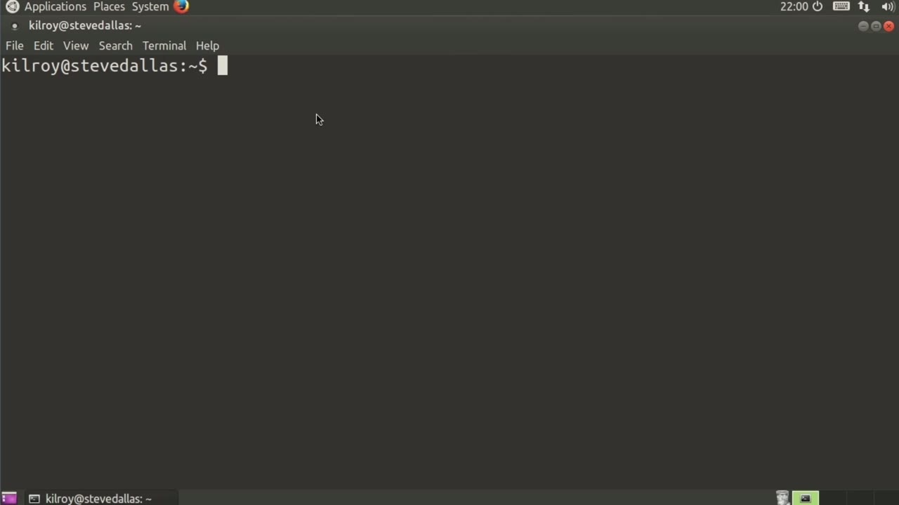
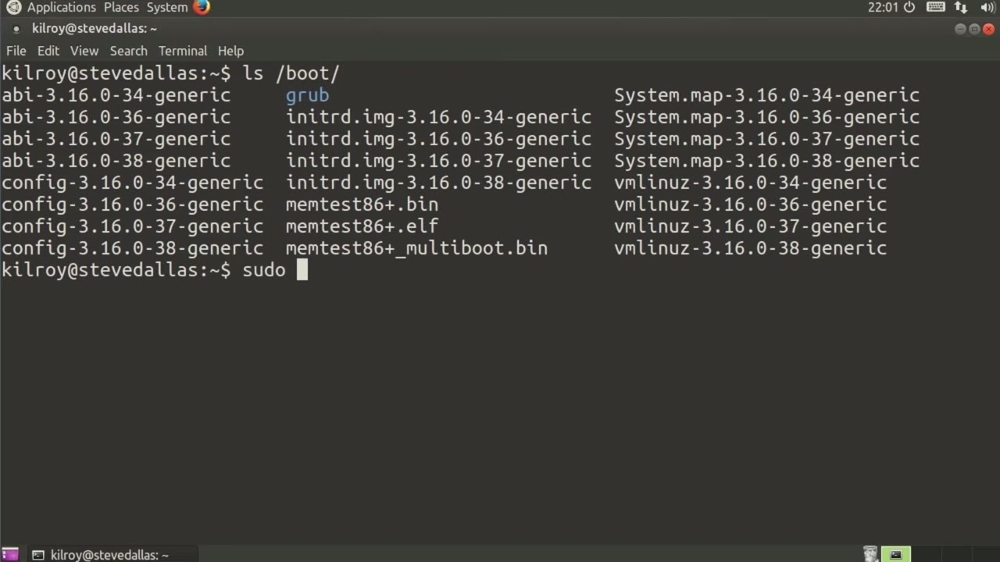
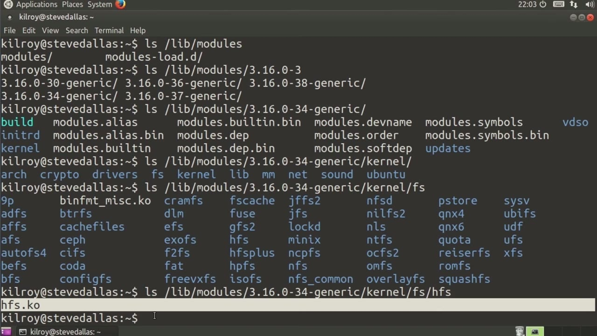

[← Course contents](../../02.md)

# 71. Kernel Modules

**Course:** [Linux Security & Administration From Boot Process to Firewalls](https://www.youtube.com/watch?v=_WB3evmgxYA)  
**Transcript:** [`Linux Security & Administration From Boot Process to Firewalls transcript`](../../../../course_videos/Linux%20Security%20%26%20Administration%20From%20Boot%20Process%20to%20Firewalls/Linux%20Security%20%26%20Administration%20From%20Boot%20Process%20to%20Firewalls.txt)  
**Video:** 05:08:03–05:12:18 ([open at this time](https://www.youtube.com/watch?v=_WB3evmgxYA&t=18483s))

## Introduction

Provides you with. There are actually a couple of types of Linux kernel. And this is a way of categorizing them that we haven't talked about so far, in spite of that long list of kernel images that we looked at previously. The couple of different ways of looking at the Linux kernel are, we might have a monolithic kernel, or we might have a modular kernel. With a monolithic kernel, what you have is one large kernel image.

## Detailed Explanation

<details>
  <summary>Step 1 — Provides you with. There are actually a couple of types of Linux kernel</summary>

### Step 1 — Provides you with. There are actually a couple of types of Linux kernel

- [x] **Provides you with. There are actually a couple of types of Linux**
  - Provides you with. There are actually a couple of types of Linux kernel.
  - And this is a way of categorizing them that we haven't talked about so far, in spite of that long list of kernel images that we looked at previously.
  - The couple of different ways of looking at the Linux kernel are, we might have a monolithic kernel, or we might have a modular kernel.

- [x] **With a monolithic kernel, what you have is one large kernel image**
  - With a monolithic kernel, what you have is one large kernel image.
  - And so what you've got here is a kernel image.
  - Now I'm not saying that this is a monolithic kernel.

- [x] **But when I say the kernel image, I'm talking about this file right**
  - But when I say the kernel image, I'm talking about this file right here.
  - This is actually the kernel itself that gets loaded into memory.
  - This one happens to be a compressed image.

- [x] **I can tell that by the Z that's right there**
  - I can tell that by the Z that's right there.
  - That's a zipped image, meaning that it's compressed.
  - It actually has to be expanded before it can be loaded into memory.

- [x] **So this is not actually a monolithic kernel, meaning that all of the**
  - So this is not actually a monolithic kernel, meaning that all of the features and the drivers are not built directly into this one single file.
  - Instead, what we've got is a number of modules that can be loaded up as necessary in memory.



</details>

<details>
  <summary>Step 2 — Run `lsmod`</summary>

### Step 2 — Run `lsmod`

- [x] **Use `lsmod`**
  - And I can take a look at the modules that have been loaded by running `lsmod`.
  - And you can see these are all of the modules that have been loaded into the kernel space as either features or as drivers for specific pieces of hardware that may actually be in place on this particular system.
  - I've got kernel modules that can be loaded up, and as I said, they may take the form of a particular feature.

- [x] **They may actually be a device driver, and we can take a look at**
  - They may actually be a device driver, and we can take a look at...
  - And then we've got a couple of choices here based on the specific kernel that we are looking for.
  - So I'm going to jump into 3.16.0-34-generic.

- [x] **So here are all of the modules that may be in place here**
  - So here are all of the modules that may be in place here.
  - So I'm going to hop into the kernel directory.
  - And you can see these are the categories.

- [x] **Drivers file system kernel lib and we've got sound and network**
  - Drivers file system kernel lib and we've got sound and network drivers these are all the different categories that the kernel modules would actually reside in let's just take a look into one of these and then you can see under this we've actually got directories now here's actually one of the
  - Kernel modules so ko is kernel object and this is the high performance file system so hfs Now, that's a kernel module.

```bash
lsmod
```



</details>

<details>
  <summary>Step 3 — Run `insmod`, `lsmod`</summary>

### Step 3 — Run `insmod`, `lsmod`

- [x] **Use `insmod`, `lsmod`**
  - If I wanted to actually load that one, what I would do would be to say `insmod`, and then I could give it to the full path here.
  - I'm going to copy this part, and then I will add in the actual kernel object.
  - So what may end up happening is, this may refuse to load because there may not be a need for it, but we can check to see whether it loaded by typing `lsmod`.

- [x] **And we didn't actually get an error that was associated with it, but**
  - And we didn't actually get an error that was associated with it, but I also don't see it listed.
  - But as they said earlier, if there's a particular driver that I want to load up, but there's no hardware that's associated with it, it may not load into the kernel space because there's nothing for it to do.
  - In the case of hfs, the kernel loader has no idea what I have in mind, what I'm loading it.

- [x] **Use `lsmod`**
  - There's certainly no hardware that's directly associated with it.
  - So we can load that up. You can do ins mod to insert modules, and then you can rm mod to drop them out.
  - We've got `lsmod`, ins mod, rm mod. These are all different ways of handling the kernel modules that you may have installed on your system. And we'll talk later on about how to build kernel modules

```bash
insmod
lsmod
```



</details>

<details>
  <summary>Questions and Answers</summary>

## Questions and Answers

### Question 1: What does `lsmod` do in this chapter?

<details>
<summary>Answer</summary>

- [x] And I can take a look at the modules that have been loaded by running `lsmod`.

</details>

### Question 2: What does `insmod` do in this chapter?

<details>
<summary>Answer</summary>

- [x] If I wanted to actually load that one, what I would do would be to say `insmod`, and then I could give it to the full path here.

</details>

### Question 3: What does step 1 cover (Provides you with. There are actually a couple of types of Linux kernel)?

<details>
<summary>Answer</summary>

- [x] Provides you with. There are actually a couple of types of Linux kernel.
- [x] And this is a way of categorizing them that we haven't talked about so far, in spite of that long list of kernel images that we looked at previously.
- [x] The couple of different ways of looking at the Linux kernel are, we might have a monolithic kernel, or we might have a modular kernel.

</details>

### Question 4: What does step 2 cover (Run lsmod)?

<details>
<summary>Answer</summary>

- [x] And I can take a look at the modules that have been loaded by running `lsmod`.
- [x] And you can see these are all of the modules that have been loaded into the kernel space as either features or as drivers for specific pieces of hardware that may actually be in place on this particular system.
- [x] I've got kernel modules that can be loaded up, and as I said, they may take the form of a particular feature.

</details>

### Question 5: What does step 3 cover (Run insmod, lsmod)?

<details>
<summary>Answer</summary>

- [x] If I wanted to actually load that one, what I would do would be to say `insmod`, and then I could give it to the full path here.
- [x] I'm going to copy this part, and then I will add in the actual kernel object.
- [x] So what may end up happening is, this may refuse to load because there may not be a need for it, but we can check to see whether it loaded by typing `lsmod`.

</details>

</details>

## Summary

This chapter, Kernel Modules, walks through Provides you with. There are actually a couple of types of Linux kernel; Run lsmod; Run insmod, lsmod. Commands from the transcript: `lsmod`, `insmod`.

## References

- [Linux Security & Administration From Boot Process to Firewalls (YouTube)](https://www.youtube.com/watch?v=_WB3evmgxYA)
- [This chapter at 05:08:03](https://www.youtube.com/watch?v=_WB3evmgxYA&t=18483s)
- [Local transcript](../../../../course_videos/Linux%20Security%20%26%20Administration%20From%20Boot%20Process%20to%20Firewalls/Linux%20Security%20%26%20Administration%20From%20Boot%20Process%20to%20Firewalls.txt)
