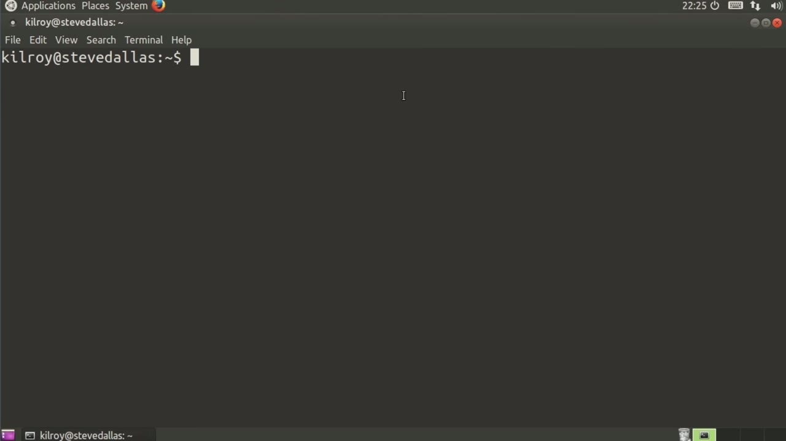
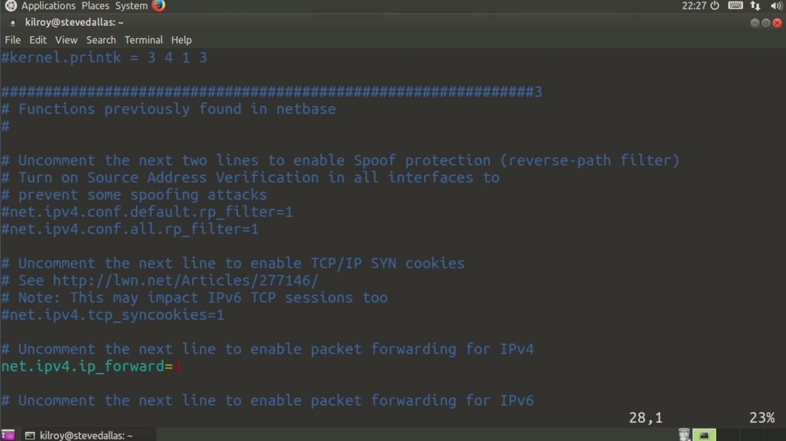
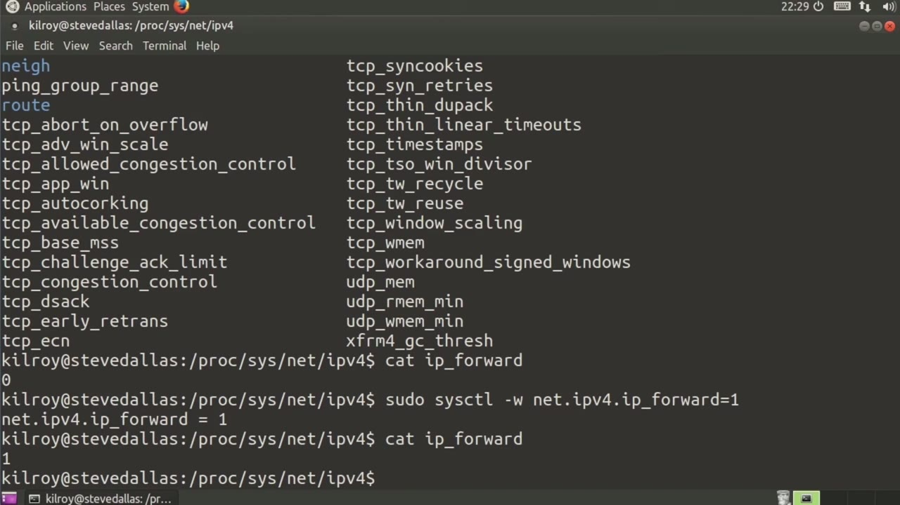

[← Course contents](../../02.md)

# 72. Managing Kernel Parameters

**Course:** [Linux Security & Administration From Boot Process to Firewalls](https://www.youtube.com/watch?v=_WB3evmgxYA)  
**Transcript:** [`Linux Security & Administration From Boot Process to Firewalls transcript`](../../../../course_videos/Linux%20Security%20%26%20Administration%20From%20Boot%20Process%20to%20Firewalls/Linux%20Security%20%26%20Administration%20From%20Boot%20Process%20to%20Firewalls.txt)  
**Video:** 05:12:18–05:16:12 ([open at this time](https://www.youtube.com/watch?v=_WB3evmgxYA&t=18738s))

## Introduction

Now, it's possible this goes without saying, although I'm going to say it anyway, just to make a particular point. The kernel is actually a piece of software. Now, it's a pretty complex piece of software, and what it does is really important, but at the end of the day, it's really just a piece of software. So we've got this software, and like most pieces of software, it has variables inside of it that get changed, altered, set, all of those things.

## Detailed Explanation

<details>
  <summary>Step 1 — Now, it's possible this goes without saying, although I'm going to say</summary>

### Step 1 — Now, it's possible this goes without saying, although I'm going to say

- [x] **Now, it's possible this goes without saying, although I'm going to**
  - Now, it's possible this goes without saying, although I'm going to say it anyway, just to make a particular point.
  - The kernel is actually a piece of software.
  - Now, it's a pretty complex piece of software, and what it does is really important, but at the end of the day, it's really just a piece of software.

- [x] **So we've got this software, and like most pieces of software, it has**
  - So we've got this software, and like most pieces of software, it has variables inside of it that get changed, altered, set, all of those things.
  - One of the nice things here is that we can go look at some of these variables or parameters, if you want to think of them that way, and we can pull them out of the running kernel.
  - So I can say, for example, sysetlnet.ipv4.ip underscore forward, and this tells me whether this particular system is set up to forward packets.

- [x] **From one interface to another interface if there happen to be**
  - From one interface to another interface if there happen to be multiple interfaces on this system.
  - Right now we've got this particular system set to IP Forward.
  - If I wanted to change that, I would again run sisctl.

- [x] **In this case I'm going to say -W for right and then net.ipv4**
  - In this case I'm going to say -W for right and then net.ipv4.
  - So that's a change that's made on the fly.
  - What if I actually want this to be persistent?

- [x] **Well, what I need to do then is I need to edit this sysctl.conf file**
  - Well, what I need to do then is I need to edit this sysctl.conf file, and that is where we can set these parameters.
  - What I'm doing here is I am making changes in a file that gets read when the system is booted up so that all of these parameters get set when the system boot.



</details>

<details>
  <summary>Step 2 — I could say net.ipv4.ipforg underscore forward equals 1</summary>

### Step 2 — I could say net.ipv4.ipforg underscore forward equals 1

- [x] **I could say net.ipv4.ipforg underscore forward equals 1**
  - I could say net.ipv4.ipforg underscore forward equals 1.
  - The default is zero, but if I wanted to change that so that it did allow forwarding every time the system loaded up, I could uncomment this particular line.
  - So there are a lot of different settings in the sysctl.com file.

- [x] **We could spend a pretty fair amount of time going through and what**
  - We could spend a pretty fair amount of time going through and what they all mean.
  - But if you want to go look at the different parameters that you can set within the kernel, you can certainly take a look at at ccdl.com.
  - Now, if I want to look at these on the file system, where would I go for that?

- [x] **So I'm going to go to a pseudophile system**
  - So I'm going to go to a pseudophile system.



</details>

<details>
  <summary>Step 3 — Run `sudo`, `file`</summary>

### Step 3 — Run `sudo`, `file`

- [x] **I'm going to go into Proc and then sis, and then we're going to say**
  - I'm going to go into Proc and then sis, and then we're going to say net.
  - And now here are the various parameters.
  - So all I have to do at this point is say cat IP forward, and this is zero.

- [x] **Now if I were to go back and do my SISCTL.com thing again, And then**
  - Now if I were to go back and do my SISCTL.com thing again, And then if I were to say net. ipv4, IP underscore forward equals one.
  - Now, if I cat that `file`, now it actually says one.
  - So if you go into the proc `file` system under the sis directory, you will find what appear to be files indicating the settings for these various kernel parameters.

- [x] **Use `sudo`, `file`**
  - So you can use sisctl, the utility, to change things on the fly.
  - You can go into the proc `file` system, `sudo` `file` system.
  - I could echo a value into that `file` or what appears to be a `file`, and it would change.

- [x] **But of course, if I want these parameters to remain persistent across**
  - But of course, if I want these parameters to remain persistent across reboots, I have to go into sysctl.com.
  - Those are a number of different ways you can look at and manipulate the various kernel parameters that will adjust the way that the kernel behaves.

```bash
sudo
file
```



</details>

<details>
  <summary>Questions and Answers</summary>

## Questions and Answers

### Question 1: What does `sudo` do in this chapter?

<details>
<summary>Answer</summary>

- [x] You can go into the proc file system, `sudo` file system.

</details>

### Question 2: What does `file` do in this chapter?

<details>
<summary>Answer</summary>

- [x] You can go into the proc `file` system, sudo `file` system.

</details>

### Question 3: What does step 1 cover (Now, it's possible this goes without saying, although I'm going to say)?

<details>
<summary>Answer</summary>

- [x] Now, it's possible this goes without saying, although I'm going to say it anyway, just to make a particular point.
- [x] The kernel is actually a piece of software.
- [x] Now, it's a pretty complex piece of software, and what it does is really important, but at the end of the day, it's really just a piece of software.

</details>

### Question 4: What does step 2 cover (I could say net.ipv4.ipforg underscore forward equals 1)?

<details>
<summary>Answer</summary>

- [x] I could say net.ipv4.ipforg underscore forward equals 1.
- [x] The default is zero, but if I wanted to change that so that it did allow forwarding every time the system loaded up, I could uncomment this particular line.
- [x] So there are a lot of different settings in the sysctl.com file.

</details>

### Question 5: What does step 3 cover (Run sudo, file)?

<details>
<summary>Answer</summary>

- [x] I'm going to go into Proc and then sis, and then we're going to say net.
- [x] And now here are the various parameters.
- [x] So all I have to do at this point is say cat IP forward, and this is zero.

</details>

</details>

## Summary

This chapter, Managing Kernel Parameters, walks through Now, it's possible this goes without saying, although I'm going to say; I could say net.ipv4.ipforg underscore forward equals 1; Run sudo, file. Commands from the transcript: `sudo`, `file`.

## References

- [Linux Security & Administration From Boot Process to Firewalls (YouTube)](https://www.youtube.com/watch?v=_WB3evmgxYA)
- [This chapter at 05:12:18](https://www.youtube.com/watch?v=_WB3evmgxYA&t=18738s)
- [Local transcript](../../../../course_videos/Linux%20Security%20%26%20Administration%20From%20Boot%20Process%20to%20Firewalls/Linux%20Security%20%26%20Administration%20From%20Boot%20Process%20to%20Firewalls.txt)
