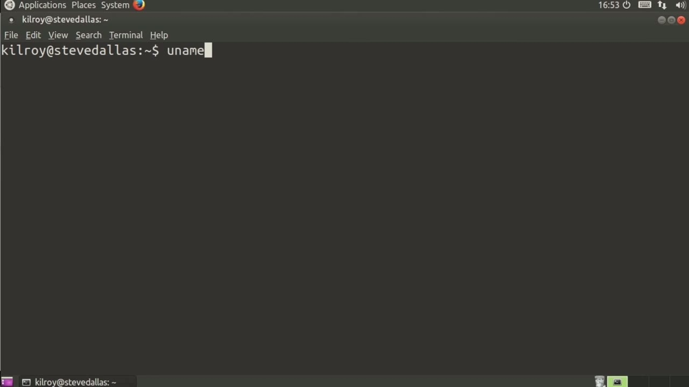
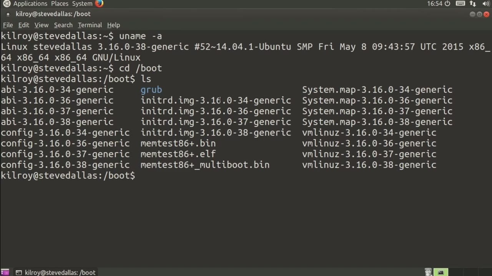
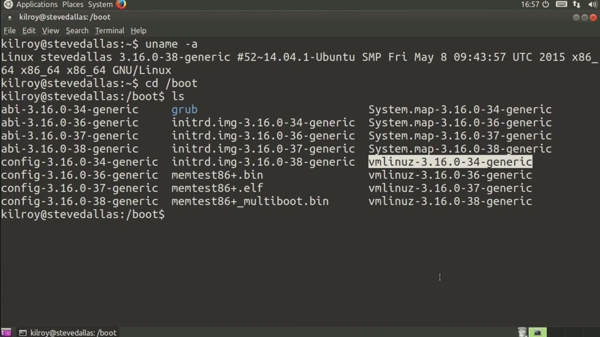

[← Course contents](../../02.md)

# 73. Kernel Builds

**Course:** [Linux Security & Administration From Boot Process to Firewalls](https://www.youtube.com/watch?v=_WB3evmgxYA)  
**Transcript:** [`Linux Security & Administration From Boot Process to Firewalls transcript`](../../../../course_videos/Linux%20Security%20%26%20Administration%20From%20Boot%20Process%20to%20Firewalls/Linux%20Security%20%26%20Administration%20From%20Boot%20Process%20to%20Firewalls.txt)  
**Video:** 05:16:12–05:21:23 ([open at this time](https://www.youtube.com/watch?v=_WB3evmgxYA&t=18972s))

## Introduction

We're going to talk a little bit about how you would build and configure kernels or maybe more accurately configure and build kernels, since before you build it, you've got to configure it. Before we get to the point where we're actually building it, there's a few things that I want to take a look at here. So the first thing is, let's see how we would figure out what kernel we are running at this particular moment in time. If I run, you name -A, it gives me a lot of information about the specific system that I'm on, the kernel that is in place, and then the build time for that particular kernel.

## Detailed Explanation

<details>
  <summary>Step 1 — Run `at`</summary>

### Step 1 — Run `at`

- [x] **Use `at`**
  - We're going to talk a little bit about how you would build and configure kernels or maybe more accurately configure and build kernels, since before you build it, you've got to configure it.
  - Before we get to the point where we're actually building it, there's a few things that I want to take a look `at` here.
  - So the first thing is, let's see how we would figure out what kernel we are running `at` this particular moment in time.

- [x] **If I run, you name -A, it gives me a lot of information about the**
  - If I run, you name -A, it gives me a lot of information about the specific system that I'm on, the kernel that is in place, and then the build time for that particular kernel.
  - We've got kernel build version 3.16.0-38-generic.
  - And then the kernel build time is right here.

- [x] **So you can also see that it's a 64-bit kernel because it's x86**
  - So you can also see that it's a 64-bit kernel because it's x86 underscore 64.
  - That's really kind of the information that we need right here.
  - We've got a 64-bit kernel that is 3.16 with some patches that have been applied so we get to -38. Now the other thing that I want to do is go into the boot directory.

- [x] **And you can see there are a number of files here**
  - And you can see there are a number of files here.
  - If you'll look closely, you will see that there are four different numbers for each of these files here.
  - That suggests that there are actually four different kernels that have been installed on this system.

- [x] **So the first thing that I want to take a look at here is the config**
  - So the first thing that I want to take a look `at` here is the config file.
  - Now, we're going to take a look `at` configs in more detail later on.

```bash
at
```



</details>

<details>
  <summary>Step 2 — I just want to mention that the kernel configuration is stored right</summary>

### Step 2 — I just want to mention that the kernel configuration is stored right

- [x] **So I just want to mention that the kernel configuration is stored**
  - So I just want to mention that the kernel configuration is stored right here.
  - The other thing I want to do is talk about the initial RAM disk or InitRD.
  - This is a set of data that has to be there when the kernel boots up.

- [x] **We had talked previously about modular versus monolithic kernels**
  - We had talked previously about modular versus monolithic kernels.
  - If you don't use a monolithic kernel and you use a slimmer, more scaled down modular kernel, If you are trying to gain access to a piece of hardware that is not built directly into the kernel image itself, that module has to be available. Let's say that you have built that driver as a module rather than in the kernel itself.
  - That module has to be available when the kernel loads. Without that SATa driver, you are not going to be able to get to the hard drive in order to load up anything else.

- [x] **The way we handle that is we put it into an initial RAM disk that**
  - The way we handle that is we put it into an initial RAM disk that gets loaded into memory and expands into what appears to be a drive to the Linux kernel where it can load the modules that it needs in order to finish booting the operating system.
  - Now, the system map here is actually a list of memory addresses that are important to the kernel This is the list of addresses where important information relative to the kernel actually is.
  - If you wanted to do a memory dump and you had a program that did memory dump and analysis, it would need this map file in order to figure out where all of the important operating system data structures actually are.

- [x] **This VM Linus, this is a compressed kernel**
  - This VM Linus, this is a compressed kernel.
  - I know that because it's a Z rather than an X.
  - at the end there that suggests it's zipped or compressed.

- [x] **The reason it is compressed is a historical thing**
  - The reason it is compressed is a historical thing.
  - It has to do with the fact that at some point we got to where the kernel image was larger than the memory space that is initially available when your system starts up.



</details>

<details>
  <summary>Step 3 — Compress the kernel, get it to a small size when it loads into memory</summary>

### Step 3 — Compress the kernel, get it to a small size when it loads into memory

- [x] **Compress the kernel, get it to a small size when it loads into memory**
  - Compress the kernel, get it to a small size when it loads into memory.
  - And first starts executing, the very first thing that it does is it extracts itself, so it uncompresses before really loading the main kernel.
  - So we've got four of them here, and these are all installed.

- [x] **The next thing I want to do is go into user source**
  - The next thing I want to do is go into user source.
  - And you'll see inside here are different source directories.
  - If I were to build a module for my kernel, I would actually have to have these headers.

- [x] **And then finally, we've got Linux source**
  - And then finally, we've got Linux source.
  - If I wanted to install the Linux source, I could do that just using something like app -get on an Ubuntu system.
  - And that would install the Linux source for me.

- [x] **It would put it into this directory structure for me**
  - It would put it into this directory structure for me.
  - So now I've got a tar ball here in a couple of directories.
  - What I want to do is untar that Linux source tarball here, meaning I need to say tar, and I also need to be admin.

- [x] **It's going to extract all of the source code into a directory**
  - It's going to extract all of the source code into a directory structure here.
  - Once we have that in place, we can go configure our kernel and build it.



</details>

<details>
  <summary>Questions and Answers</summary>

## Questions and Answers

### Question 1: What does `at` do in this chapter?

<details>
<summary>Answer</summary>

- [x] So the first thing is, let's see how we would figure out what kernel we are running `at` this particular moment in time.

</details>

### Question 2: What does step 1 cover (Run at)?

<details>
<summary>Answer</summary>

- [x] We're going to talk a little bit about how you would build and configure kernels or maybe more accurately configure and build kernels, since before you build it, you've got to configure it.
- [x] Before we get to the point where we're actually building it, there's a few things that I want to take a look `at` here.
- [x] So the first thing is, let's see how we would figure out what kernel we are running `at` this particular moment in time.

</details>

### Question 3: What does step 2 cover (I just want to mention that the kernel configuration is stored right)?

<details>
<summary>Answer</summary>

- [x] So I just want to mention that the kernel configuration is stored right here.
- [x] The other thing I want to do is talk about the initial RAM disk or InitRD.
- [x] This is a set of data that has to be there when the kernel boots up.

</details>

### Question 4: What does step 3 cover (Compress the kernel, get it to a small size when it loads into memory)?

<details>
<summary>Answer</summary>

- [x] Compress the kernel, get it to a small size when it loads into memory.
- [x] And first starts executing, the very first thing that it does is it extracts itself, so it uncompresses before really loading the main kernel.
- [x] So we've got four of them here, and these are all installed.

</details>

</details>

## Summary

This chapter, Kernel Builds, walks through Run at; I just want to mention that the kernel configuration is stored right; Compress the kernel, get it to a small size when it loads into memory. Commands from the transcript: `at`.

## References

- [Linux Security & Administration From Boot Process to Firewalls (YouTube)](https://www.youtube.com/watch?v=_WB3evmgxYA)
- [This chapter at 05:16:12](https://www.youtube.com/watch?v=_WB3evmgxYA&t=18972s)
- [Local transcript](../../../../course_videos/Linux%20Security%20%26%20Administration%20From%20Boot%20Process%20to%20Firewalls/Linux%20Security%20%26%20Administration%20From%20Boot%20Process%20to%20Firewalls.txt)
