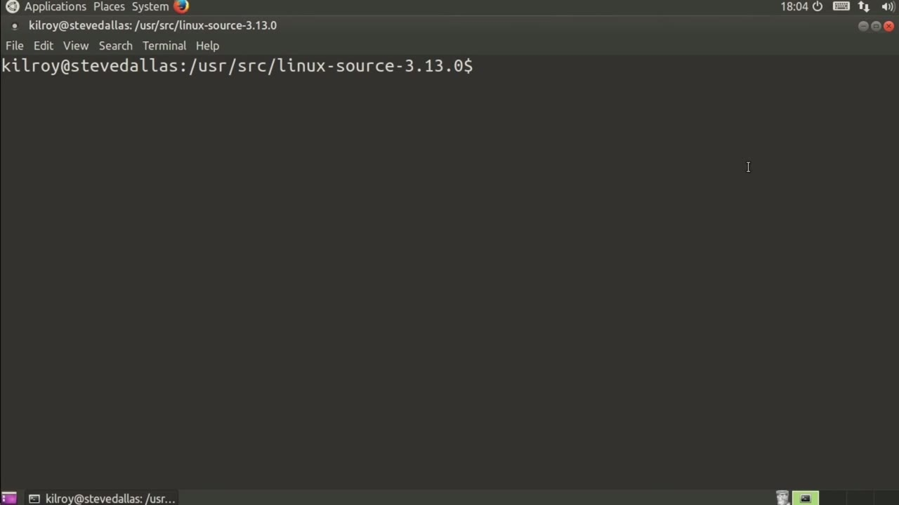
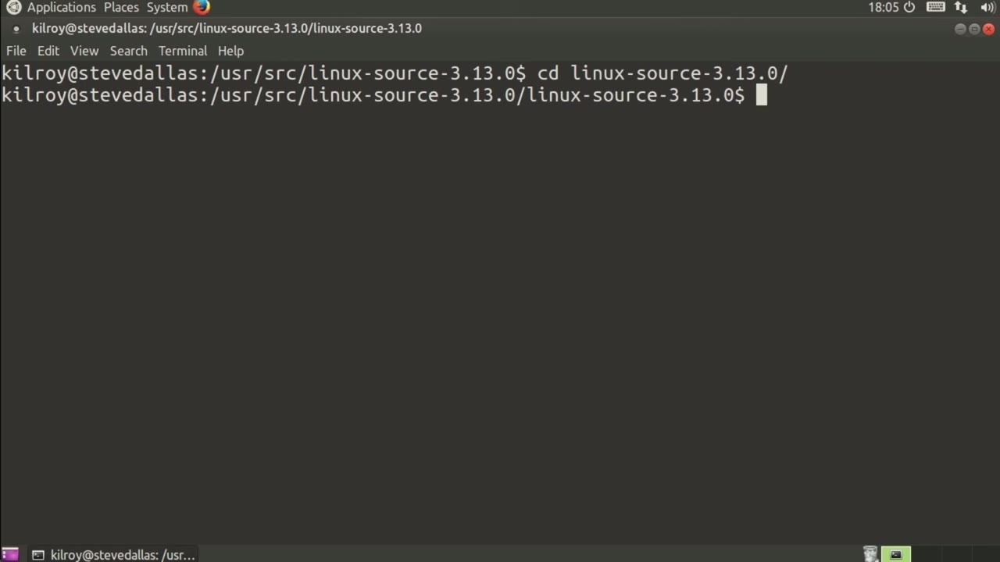
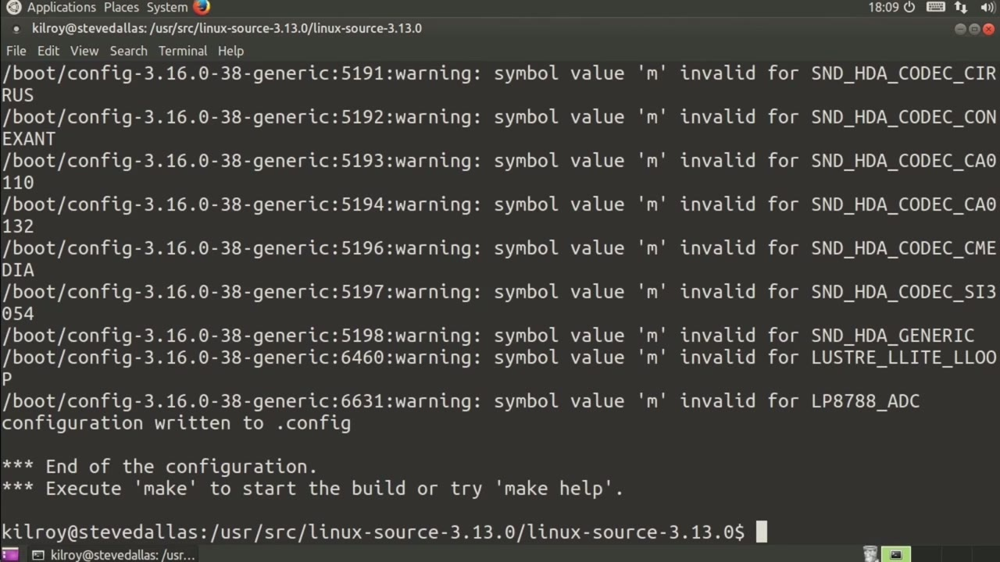

[← Course contents](../../02.md)

# 74. Kernel Config

**Course:** [Linux Security & Administration From Boot Process to Firewalls](https://www.youtube.com/watch?v=_WB3evmgxYA)  
**Transcript:** [`Linux Security & Administration From Boot Process to Firewalls transcript`](../../../../course_videos/Linux%20Security%20%26%20Administration%20From%20Boot%20Process%20to%20Firewalls/Linux%20Security%20%26%20Administration%20From%20Boot%20Process%20to%20Firewalls.txt)  
**Video:** 05:21:23–05:24:12 ([open at this time](https://www.youtube.com/watch?v=_WB3evmgxYA&t=19283s))

## Introduction

And we will take a look at that coming up. So far we've talked about where the kernel actually lives once it's been built and where it is when it boots up. We've talked about how to get the version number from the running kernel. Now let's actually talk about creating a kernel of our own based on our own configuration.

## Detailed Explanation

  
Step 1 — we will take a look at that coming up

### Step 1 — we will take a look at that coming up

- [x] **And we will take a look at that coming up**
  - And we will take a look at that coming up.
  - So far we've talked about where the kernel actually lives once it's been built and where it is when it boots up.
  - We've talked about how to get the version number from the running kernel.

- [x] **Now let's actually talk about creating a kernel of our own based on**
  - Now let's actually talk about creating a kernel of our own based on our own configuration.
  - So the thing that you need in place in order to do that is a set of build tools.
  - So you would need a C compiler, you need make, you need a number of other components.

- [x] **You basically need a whole build system on here because of course**
  - You basically need a whole build system on here because of course we're building from source.

  
Step 2 — the first thing is I've untarred my source tree here and I'm going to

### Step 2 — the first thing is I've untarred my source tree here and I'm going to

- [x] **So the first thing is I've untarred my source tree here and I'm going**
  - So the first thing is I've untarred my source tree here and I'm going to go into the directory.
  - And we can go through all of the configuration features.
  - So first of all, you want to do a 64-bit kernel, or do you want to do a 32-bit kernel?

- [x] **If I uncheck this by just hitting the space bar here, I would be**
  - If I uncheck this by just hitting the space bar here, I would be building a 32-bit kernel.
  - So there are a lot of features in here, and I'm certainly not going to go through all of them, but you would walk through all of these and determine whether you want to build them as a module, as you can see here, which would be M, and I can just toggle through these by hitting the space bar.
  - So M is module, the asterisk is build it into the kernel, and if I were just hit the space bar and get a blank there, that means don't build it at all.

- [x] **So I can use the tab or arrow keys to move around, and every time I**
  - So I can use the tab or arrow keys to move around, and every time I hit exit, I pop back up.

  
Step 3 — Once I'm done and I hit exit, it's going to ask me if I want to save my

### Step 3 — Once I'm done and I hit exit, it's going to ask me if I want to save my

- [x] **Once I'm done and I hit exit, it's going to ask me if I want to save**
  - Once I'm done and I hit exit, it's going to ask me if I want to save my new configuration.
  - And of course I do. Once I have saved it...
  - What I get is a file that is a dot config file.

- [x] **And that dot config file is just a text file and indicates whether**
  - And that dot config file is just a text file and indicates whether we're going to build features, whether we're not going to build features.
  - Once we have the config file, of course, we can just run Make.
  - And that's actually going to go build the entire kernel for us as well as building the various modules.

- [x] **Once we have gone through that, we can do an installation**
  - Once we have gone through that, we can do an installation.
  - And then, of course, you would need to change your GRUB entries or whatever else you needed to do in order to make sure that you were booting to the kernel that you just built.
  - This actually can take some period of time, but that's the process that you would go through in order to create a configuration file that is the dot config file.

- [x] **And then once that config file is in place, you can actually build**
  - And then once that config file is in place, you can actually build the kernel that you want, and then you can go about installing it and making use of it.

  
Questions and Answers

## Questions and Answers

### Question 1: What does step 1 cover (we will take a look at that coming up)?

Answer

- [x] And we will take a look at that coming up.
- [x] So far we've talked about where the kernel actually lives once it's been built and where it is when it boots up.
- [x] We've talked about how to get the version number from the running kernel.

### Question 2: What does step 2 cover (the first thing is I've untarred my source tree here and I'm going to)?

Answer

- [x] So the first thing is I've untarred my source tree here and I'm going to go into the directory.
- [x] And we can go through all of the configuration features.
- [x] So first of all, you want to do a 64-bit kernel, or do you want to do a 32-bit kernel?

### Question 3: What does step 3 cover (Once I'm done and I hit exit, it's going to ask me if I want to save my)?

Answer

- [x] Once I'm done and I hit exit, it's going to ask me if I want to save my new configuration.
- [x] And of course I do. Once I have saved it...
- [x] What I get is a file that is a dot config file.

## Summary

This chapter, Kernel Config, walks through we will take a look at that coming up; the first thing is I've untarred my source tree here and I'm going to; Once I'm done and I hit exit, it's going to ask me if I want to save my.

## References

- [Linux Security & Administration From Boot Process to Firewalls (YouTube)](https://www.youtube.com/watch?v=_WB3evmgxYA)
- [This chapter at 05:21:23](https://www.youtube.com/watch?v=_WB3evmgxYA&t=19283s)
- [Local transcript](../../../../course_videos/Linux%20Security%20%26%20Administration%20From%20Boot%20Process%20to%20Firewalls/Linux%20Security%20%26%20Administration%20From%20Boot%20Process%20to%20Firewalls.txt)
