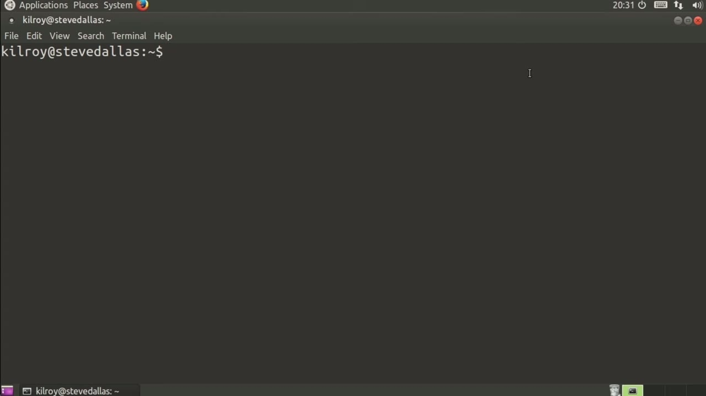
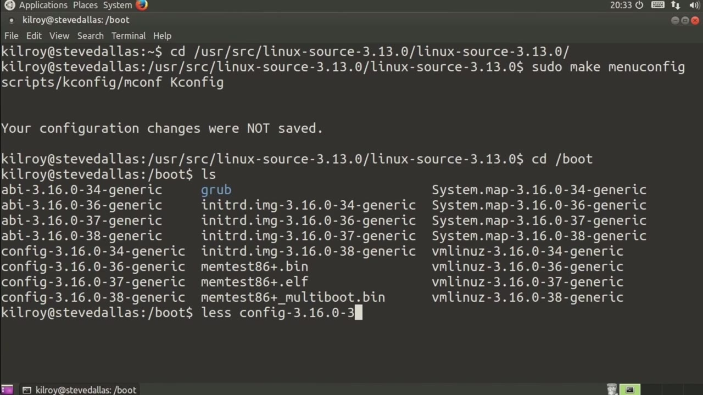
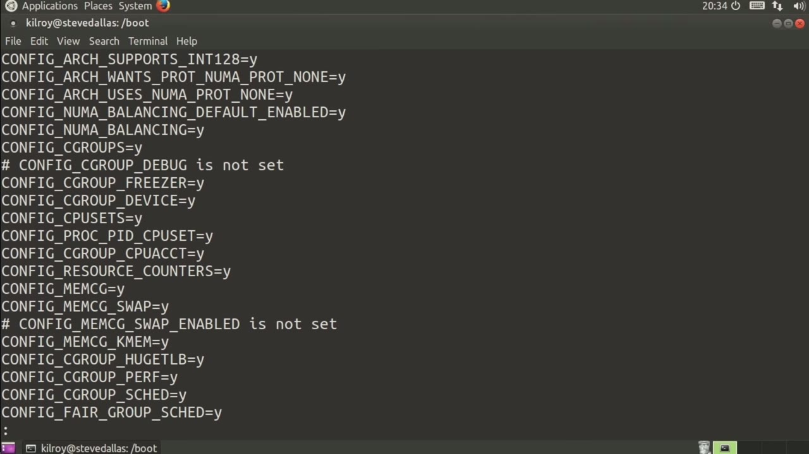

[← Course contents](../../02.md)

# 75. Viewing Kernel Config From Running Kernel

**Course:** [Linux Security & Administration From Boot Process to Firewalls](https://www.youtube.com/watch?v=_WB3evmgxYA)  
**Transcript:** [`Linux Security & Administration From Boot Process to Firewalls transcript`](../../../../course_videos/Linux%20Security%20%26%20Administration%20From%20Boot%20Process%20to%20Firewalls/Linux%20Security%20%26%20Administration%20From%20Boot%20Process%20to%20Firewalls.txt)  
**Video:** 05:24:12–05:27:46 ([open at this time](https://www.youtube.com/watch?v=_WB3evmgxYA&t=19452s))

## Introduction

Now, let's say you want to actually get the configuration from one particular system, and maybe you want to use that configuration. For the kernel on multiple systems, except that you don't have the kernel source installed on that system. You want to pull the configuration from the running kernel. Well, there's a couple of different ways to do that depending on what you may have on that particular system. So the first way to do it Is to actually pull it from the proc pseudophile system. The problem with that is that you need to have a particular configuration set on your kernel to begin with.

## Detailed Explanation

<details>
  <summary>Step 1 — Now, let's say you want to actually get the configuration from one</summary>

### Step 1 — Now, let's say you want to actually get the configuration from one

- [x] **Now, let's say you want to actually get the configuration from one**
  - Now, let's say you want to actually get the configuration from one particular system, and maybe you want to use that configuration.
  - For the kernel on multiple systems, except that you don't have the kernel source installed on that system. You want to pull the configuration from the running kernel. Well, there's a couple of different ways to do that depending on what you may have on that particular system. So the first way to do it
  - Is to actually pull it from the proc pseudophile system.

- [x] **The problem with that is that you need to have a particular**
  - The problem with that is that you need to have a particular configuration set on your kernel to begin with.
  - So let's take a look at that for just a second here.
  - Now, in order to have that configuration available from the running system, you need to, when you build it, go to a setting here where it's for kernel config mode.

- [x] **The setting is actually for kernel config support**
  - The setting is actually for kernel config support.
  - And so what we can do is turn it on there so that if this were enabled on this particular kernel, you would find it at this file right here, the slash proc slash config.g.
  - Now, that's not always available on many systems.

- [x] **So the other place is if we go to the boot directory, you'll see that**
  - So the other place is if we go to the boot directory, you'll see that there are a number of config files there.
  - So let's just take a look at one of these.



</details>

<details>
  <summary>Step 2 — Run `at`</summary>

### Step 2 — Run `at`

- [x] **Use `at`**
  - So this actually happens to be the kernel that's running `at` the moment.
  - And you can see what a configuration file looks like.
  - It's got the configuration settings and you either say Y or N, or in the case where you wanted something to be modular, you would set the value to be M.

- [x] **Now you'll also notice here that anything that doesn't have a**
  - Now you'll also notice here that anything that doesn't have a setting, it just simply has commented out and it says not set.
  - So what that means is this particular configuration just isn't built.
  - So it's effectively like having it set to n rather than why.

- [x] **So we just don't set it, it doesn't get built**
  - So we just don't set it, it doesn't get built.

```bash
at
```



</details>

<details>
  <summary>Step 3 — The ones that are configured and you can skim through this, it's a</summary>

### Step 3 — The ones that are configured and you can skim through this, it's a

- [x] **The ones that are configured and you can skim through this, it's a**
  - The ones that are configured and you can skim through this, it's a fairly long file, but you can see all of the configuration settings.
  - Now what I can do here, I could actually copy that particular configuration file into my source directory where I've got my Linux source, and then I would be able to build straight out of this running configuration.
  - So if I were to do this, and then we go into our Linux source directory, and then we do a Make Menu config again.

- [x] **What you'll see is all of the configuration options on the kernel**
  - What you'll see is all of the configuration options on the kernel that is currently running in memory will be enabled on this.
  - Now, of course, I could tweak it from here if I wanted to and just use the running configuration as a starting point.
  - But again, if I want to use the configuration from a particular system, there are a couple of places I can do it.

- [x] **Maybe it's available as a text file in the boot directory**
  - Maybe it's available as a text file in the boot directory.
  - Or it's possible that if the particular option in the kernel has been set, you could find it in the Proc pseudophile system as a configuration file there.



</details>

<details>
  <summary>Questions and Answers</summary>

## Questions and Answers

### Question 1: What does `at` do in this chapter?

<details>
<summary>Answer</summary>

- [x] So this actually happens to be the kernel that's running `at` the moment.

</details>

### Question 2: What does step 1 cover (Now, let's say you want to actually get the configuration from one)?

<details>
<summary>Answer</summary>

- [x] Now, let's say you want to actually get the configuration from one particular system, and maybe you want to use that configuration.
- [x] For the kernel on multiple systems, except that you don't have the kernel source installed on that system. You want to pull the configuration from the running kernel. Well, there's a couple of different ways to do that depending on what you may have on that particular system. So the first way to do it
- [x] Is to actually pull it from the proc pseudophile system.

</details>

### Question 3: What does step 2 cover (Run at)?

<details>
<summary>Answer</summary>

- [x] So this actually happens to be the kernel that's running `at` the moment.
- [x] And you can see what a configuration file looks like.
- [x] It's got the configuration settings and you either say Y or N, or in the case where you wanted something to be modular, you would set the value to be M.

</details>

### Question 4: What does step 3 cover (The ones that are configured and you can skim through this, it's a)?

<details>
<summary>Answer</summary>

- [x] The ones that are configured and you can skim through this, it's a fairly long file, but you can see all of the configuration settings.
- [x] Now what I can do here, I could actually copy that particular configuration file into my source directory where I've got my Linux source, and then I would be able to build straight out of this running configuration.
- [x] So if I were to do this, and then we go into our Linux source directory, and then we do a Make Menu config again.

</details>

</details>

## Summary

This chapter, Viewing Kernel Config From Running Kernel, walks through Now, let's say you want to actually get the configuration from one; Run at; The ones that are configured and you can skim through this, it's a. Commands from the transcript: `at`.

## References

- [Linux Security & Administration From Boot Process to Firewalls (YouTube)](https://www.youtube.com/watch?v=_WB3evmgxYA)
- [This chapter at 05:24:12](https://www.youtube.com/watch?v=_WB3evmgxYA&t=19452s)
- [Local transcript](../../../../course_videos/Linux%20Security%20%26%20Administration%20From%20Boot%20Process%20to%20Firewalls/Linux%20Security%20%26%20Administration%20From%20Boot%20Process%20to%20Firewalls.txt)
