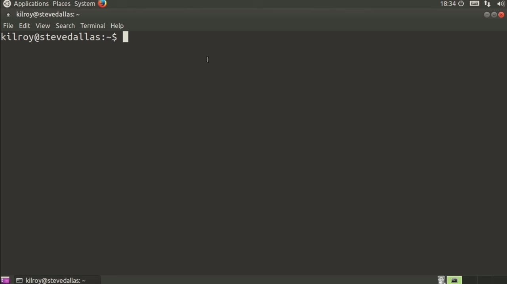
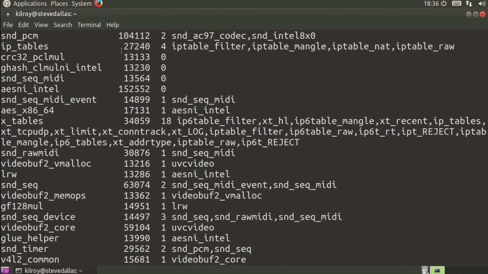

[← Course contents](../../02.md)

# 76. What you will learn in this Module

**Course:** [Linux Security & Administration From Boot Process to Firewalls](https://www.youtube.com/watch?v=_WB3evmgxYA)  
**Transcript:** [`Linux Security & Administration From Boot Process to Firewalls transcript`](../../../../course_videos/Linux%20Security%20%26%20Administration%20From%20Boot%20Process%20to%20Firewalls/Linux%20Security%20%26%20Administration%20From%20Boot%20Process%20to%20Firewalls.txt)  
**Video:** 05:27:46–05:29:08 ([open at this time](https://www.youtube.com/watch?v=_WB3evmgxYA&t=19666s))

## Introduction

We're going to take a quick look at iptables. iptables is the firewall that comes on Linux distribution. So iptables is actually a set of kernel modules. If we do an LSMod, we should be able to see the different modules that get loaded as part of iptables.

## Detailed Explanation

<details>
  <summary>Step 1 — Run `iptables`, `lsmod`</summary>

### Step 1 — Run `iptables`, `lsmod`

- [x] **Use `iptables`**
  - We're going to take a quick look at `iptables`.
  - `iptables` is the firewall that comes on Linux distribution.
  - So `iptables` is actually a set of kernel modules.

- [x] **Use `lsmod`, `iptables`**
  - If we do an `lsmod`, we should be able to see the different modules that get loaded as part of `iptables`.

```bash
iptables
lsmod
```



</details>

<details>
  <summary>Step 2 — Run `iptables`</summary>

### Step 2 — Run `iptables`

- [x] **Use `iptables`**
  - Now, the first one that we can see is `iptables` here.
  - And then there are others like IPTable filter, and we've got nfnat, nf Nat, FTP.
  - So there are a number of kernel modules that actually get loaded up, depending again on how you've configured your kernel and what you've allowed to be built in versus modules versus what you're just simply not building in at all.

- [x] **Use `iptables`**
  - So I can run the `iptables` command to get a listing of all of the `iptables` rules, and we're going to do verbose outputs.
  - So these are all of the rules that are loaded in the `iptables` rule set.
  - These are all loaded in the kernel at the moment.

- [x] **You can see there's an awful lot of them, and we'll take a look at**
  - You can see there's an awful lot of them, and we'll take a look at...
  - The different things that you can do with these rules and how you can manage them more effectively and more efficiently. And we'll do that coming up over the next few lessons.

```bash
iptables
```



</details>

<details>
  <summary>Questions and Answers</summary>

## Questions and Answers

### Question 1: What does `iptables` do in this chapter?

<details>
<summary>Answer</summary>

- [x] We're going to take a quick look at `iptables`.

</details>

### Question 2: What does `lsmod` do in this chapter?

<details>
<summary>Answer</summary>

- [x] If we do an `lsmod`, we should be able to see the different modules that get loaded as part of iptables.

</details>

### Question 3: What does step 1 cover (Run iptables, lsmod)?

<details>
<summary>Answer</summary>

- [x] We're going to take a quick look at `iptables`.
- [x] `iptables` is the firewall that comes on Linux distribution.
- [x] So `iptables` is actually a set of kernel modules.

</details>

### Question 4: What does step 2 cover (Run iptables)?

<details>
<summary>Answer</summary>

- [x] Now, the first one that we can see is `iptables` here.
- [x] And then there are others like IPTable filter, and we've got nfnat, nf Nat, FTP.
- [x] So there are a number of kernel modules that actually get loaded up, depending again on how you've configured your kernel and what you've allowed to be built in versus modules versus what you're just simply not building in at all.

</details>

</details>

## Summary

This chapter, What you will learn in this Module, walks through Run iptables, lsmod; Run iptables. Commands from the transcript: `iptables`, `lsmod`.

## References

- [Linux Security & Administration From Boot Process to Firewalls (YouTube)](https://www.youtube.com/watch?v=_WB3evmgxYA)
- [This chapter at 05:27:46](https://www.youtube.com/watch?v=_WB3evmgxYA&t=19666s)
- [Local transcript](../../../../course_videos/Linux%20Security%20%26%20Administration%20From%20Boot%20Process%20to%20Firewalls/Linux%20Security%20%26%20Administration%20From%20Boot%20Process%20to%20Firewalls.txt)
