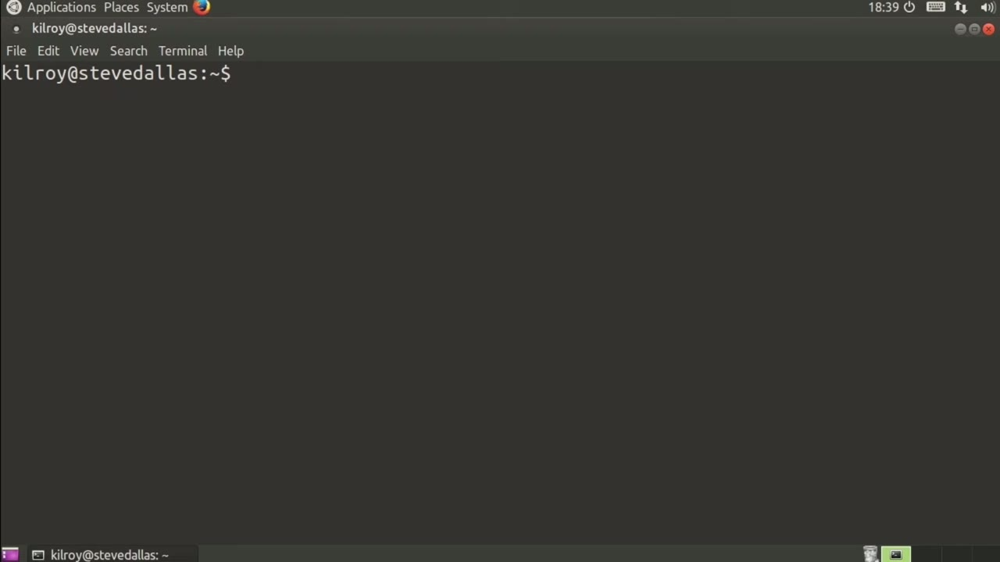
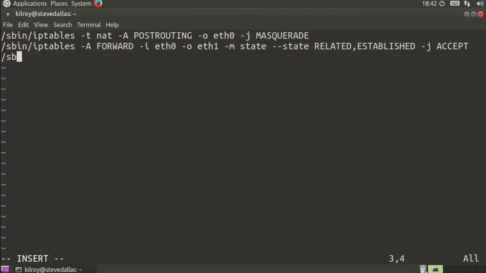
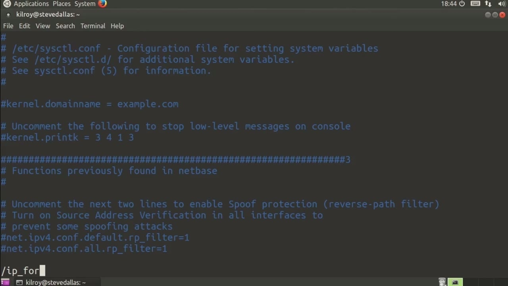

[← Course contents](../../02.md)

# 77. NAT With iptables

**Course:** [Linux Security & Administration From Boot Process to Firewalls](https://www.youtube.com/watch?v=_WB3evmgxYA)  
**Transcript:** [`Linux Security & Administration From Boot Process to Firewalls transcript`](../../../../course_videos/Linux%20Security%20%26%20Administration%20From%20Boot%20Process%20to%20Firewalls/Linux%20Security%20%26%20Administration%20From%20Boot%20Process%20to%20Firewalls.txt)  
**Video:** 05:29:08–05:33:44 ([open at this time](https://www.youtube.com/watch?v=_WB3evmgxYA&t=19748s))

## Introduction

One thing that people want to do with an iptables firewall is network address translation or NAT. What NAT does is it takes the IP address from the sending side and replaces it with a different address. So that when the return packet comes back from the server you're communicating with, then it's going to come back to the firewall first, and then the firewall is going to do that replace again to be able to get it back to its original sender. So there's a couple of things that we need to do in order to make this a reality.

## Detailed Explanation

<details>
  <summary>Step 1 — Run `iptables`</summary>

### Step 1 — Run `iptables`

- [x] **Use `iptables`**
  - One thing that people want to do with an `iptables` firewall is network address translation or NAT. What NAT does is it takes the IP address from the sending side and replaces it with a different address.
  - So that when the return packet comes back from the server you're communicating with, then it's going to come back to the firewall first, and then the firewall is going to do that replace again to be able to get it back to its original sender.
  - So there's a couple of things that we need to do in order to make this a reality.

- [x] **So the very first thing is we need to make a change to the system**
  - So the very first thing is we need to make a change to the system.
  - -w. So we need to make a kernel change here.
  - And the reason for doing this is because we actually need to be able to send packets that are coming in on one interface and to be able to send them out on another interface.

- [x] **Use `iptables`**
  - So now I'm just going to edit a rule here.
  - Now, I can certainly do this in memory and that will actually take, but let me just show these to you very simply here.
  - So when I create a rule in `iptables`, what I'm doing is really just calling the program `iptables` with a number of parameters.

- [x] **So I'm saying my table is going to be NAT and the chain that I'm**
  - So I'm saying my table is going to be NAT and the chain that I'm using here is post routing.
  - So we're going to append to our post routing chain.
  - And then my output interface is going to be eth0, and then I'm going to say masquerade, and that's going to turn on NAT for me.

- [x] **So now I need a couple of other rules here**
  - So now I need a couple of other rules here.
  - I need to say on my forward chain, I need to say my input eth zero and my output eth1, and I'm going to match on state, where the state is going to be related and established, meaning this is only going to work for messages that have already gone outbound for us.

```bash
iptables
```



</details>

<details>
  <summary>Step 2 — Run `iptables -A`</summary>

### Step 2 — Run `iptables -A`

- [x] **Use `iptables -A`**
  - This isn't going to work the other way around.
  - Any new connection is not going to be accepted in this direction.
  - So now we're going to say S-Bin `iptables -A` forward again here.

- [x] **-i etH1 so basically we're going in the other direction and we're**
  - -i etH1 so basically we're going in the other direction and we're just going to accept these.
  - So basically anything that is coming in from my internal interface is going to be okay and it's going to be forwarded out to the external interface where eth1 is my internal interface and eth0 is my external interface.
  - But anything that is coming in the other direction is only going to be allowed if we first sent something out.

- [x] **So this one is going to be my outbound rule, and this one is going to**
  - So this one is going to be my outbound rule, and this one is going to be my inbound rule here, and that's only going to be acceptable if we've actually sent something out first.
  - If we have sent something out, anything coming back.
  - Is going to be either related or established.

- [x] **So we're going to allow the things coming back in without allowing**
  - So we're going to allow the things coming back in without allowing anything new.
  - If you actually want to use this on a persistent basis, and we have talked about this previously, but let's just take a look at sysctl.com.

```bash
iptables -A
```



</details>

<details>
  <summary>Step 3 — Run `reboot`, `iptables`</summary>

### Step 3 — Run `reboot`, `iptables`

- [x] **Use `reboot`, `iptables`**
  - And then if we find IP Forward, Now what I would want to do here is un-comment this in order to allow forwarding to take place as soon as I did a `reboot`.
  - And that would allow this particular setting to be persistent across multiple reboots.
  - Once that was the case, the rest of the rules in the `iptables` firewall would take effect, and then we would have network address translation across the two interfaces on our system.

- [x] **This assumes, of course, that you've got two interfaces**
  - This assumes, of course, that you've got two interfaces.
  - Otherwise, network address translation doesn't work as well.
  - So you really need the two network interfaces.

- [x] **You set those rules and then set the kernel parameter IP forward,**
  - You set those rules and then set the kernel parameter IP forward,

```bash
reboot
iptables
```



</details>

<details>
  <summary>Questions and Answers</summary>

## Questions and Answers

### Question 1: What does `iptables` do in this chapter?

<details>
<summary>Answer</summary>

- [x] One thing that people want to do with an `iptables` firewall is network address translation or NAT. What NAT does is it takes the IP address from the sending side and replaces it with a different address.

</details>

### Question 2: What does `iptables -A` do in this chapter?

<details>
<summary>Answer</summary>

- [x] So now we're going to say S-Bin `iptables -A` forward again here.

</details>

### Question 3: What does `reboot` do in this chapter?

<details>
<summary>Answer</summary>

- [x] And then if we find IP Forward, Now what I would want to do here is un-comment this in order to allow forwarding to take place as soon as I did a `reboot`.

</details>

### Question 4: What does step 1 cover (Run iptables)?

<details>
<summary>Answer</summary>

- [x] One thing that people want to do with an `iptables` firewall is network address translation or NAT. What NAT does is it takes the IP address from the sending side and replaces it with a different address.
- [x] So that when the return packet comes back from the server you're communicating with, then it's going to come back to the firewall first, and then the firewall is going to do that replace again to be able to get it back to its original sender.
- [x] So there's a couple of things that we need to do in order to make this a reality.

</details>

### Question 5: What does step 2 cover (Run iptables -A)?

<details>
<summary>Answer</summary>

- [x] This isn't going to work the other way around.
- [x] Any new connection is not going to be accepted in this direction.
- [x] So now we're going to say S-Bin `iptables -A` forward again here.

</details>

### Question 6: What does step 3 cover (Run reboot, iptables)?

<details>
<summary>Answer</summary>

- [x] And then if we find IP Forward, Now what I would want to do here is un-comment this in order to allow forwarding to take place as soon as I did a `reboot`.
- [x] And that would allow this particular setting to be persistent across multiple reboots.
- [x] Once that was the case, the rest of the rules in the `iptables` firewall would take effect, and then we would have network address translation across the two interfaces on our system.

</details>

</details>

## Summary

This chapter, NAT With iptables, walks through Run iptables; Run iptables -A; Run reboot, iptables. Commands from the transcript: `iptables`, `iptables -A`, `reboot`.

## References

- [Linux Security & Administration From Boot Process to Firewalls (YouTube)](https://www.youtube.com/watch?v=_WB3evmgxYA)
- [This chapter at 05:29:08](https://www.youtube.com/watch?v=_WB3evmgxYA&t=19748s)
- [Local transcript](../../../../course_videos/Linux%20Security%20%26%20Administration%20From%20Boot%20Process%20to%20Firewalls/Linux%20Security%20%26%20Administration%20From%20Boot%20Process%20to%20Firewalls.txt)
