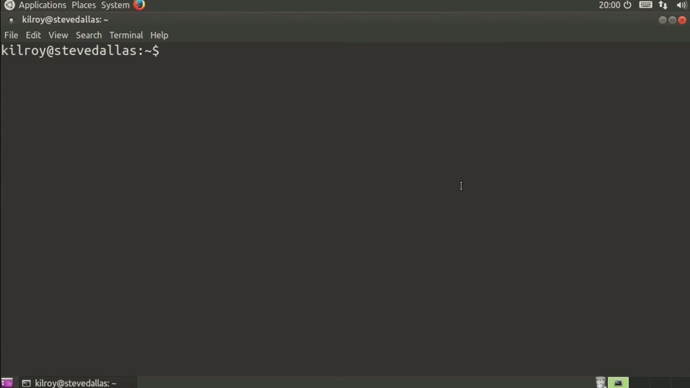
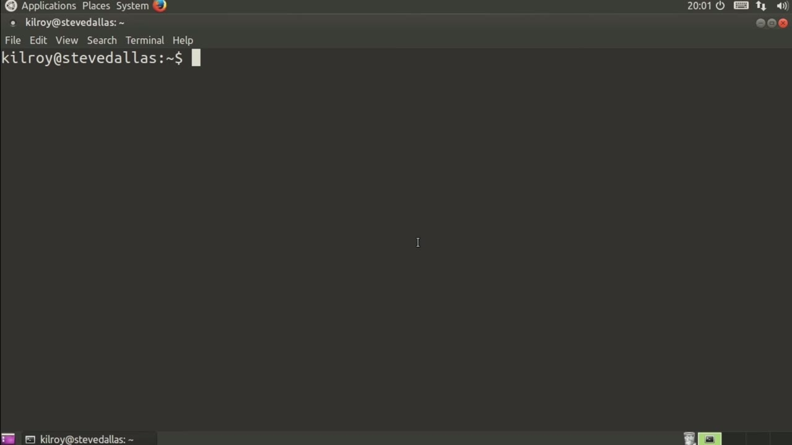
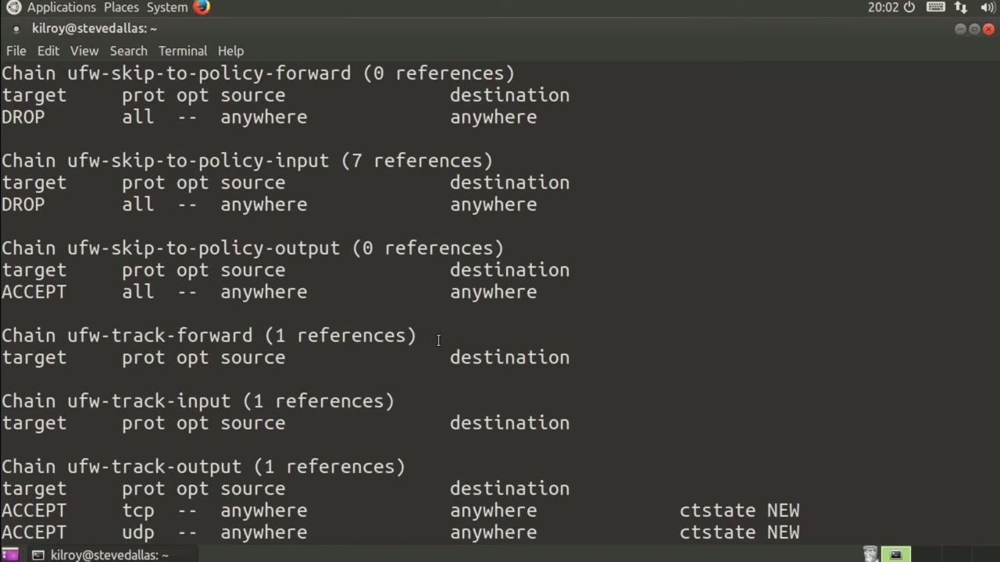

[← Course contents](../../02.md)

# 78. iptables Tables

**Course:** [Linux Security & Administration From Boot Process to Firewalls](https://www.youtube.com/watch?v=_WB3evmgxYA)  
**Transcript:** [`Linux Security & Administration From Boot Process to Firewalls transcript`](../../../../course_videos/Linux%20Security%20%26%20Administration%20From%20Boot%20Process%20to%20Firewalls/Linux%20Security%20%26%20Administration%20From%20Boot%20Process%20to%20Firewalls.txt)  
**Video:** 05:33:44–05:35:58 ([open at this time](https://www.youtube.com/watch?v=_WB3evmgxYA&t=20024s))

## Introduction

And you've got network address translation. Let's talk a little bit about the way iptables organizes itself in memory and how it puts all of the rules together. At the very top, you've got a number of tables. And with iptables, there are actually four built-in tables.

## Detailed Explanation

<details>
  <summary>Step 1 — Run `iptables`</summary>

### Step 1 — Run `iptables`

- [x] **Use `iptables`**
  - And you've got network address translation.
  - Let's talk a little bit about the way `iptables` organizes itself in memory and how it puts all of the rules together.
  - At the very top, you've got a number of tables.

- [x] **Use `iptables`**
  - And with `iptables`, there are actually four built-in tables.
  - The first table is the filter table, and then there is the Nat table, the Mangled Table, the Raw table, and underneath each of the tables is a set of chains, and that specifies where the rules actually get applied.
  - So for example, in the filter table, you get an input chain, an output chain, and a forward chain.

- [x] **With the Nat table, you'll get a pre-routing chain, a post-routing**
  - With the Nat table, you'll get a pre-routing chain, a post-routing chain, and an output chain.

```bash
iptables
```



</details>

<details>
  <summary>Step 2 — Run `iptables`</summary>

### Step 2 — Run `iptables`

- [x] **Use `iptables`**
  - We can see the different tables by doing `iptables`, and then I can specify the, for example, the mangled table, and then I just want to get a list of what's in there.
  - So at the moment, there is nothing in the mangled table.
  - And we can take a look at the Nat table as well in the same way.

- [x] **Use `iptables`**
  - Now, the default table for `iptables` is the filter table.
  - This is where you're going to see all of the rules on this particular system.
  - If I had multiple interfaces on here, then what I might do would be to have more in the NAT table so that there would be pre-routing, post-routing, based on the interface that we were coming in or out of.

```bash
iptables
```



</details>

<details>
  <summary>Step 3 — Run `iptables`</summary>

### Step 3 — Run `iptables`

- [x] **Use `iptables`**
  - Again, we've got a number of built-in tables with `iptables`.
  - Tables as well. Most installations aren't going to have much of a need to do something like that because the filter table, Nat table, Mangled Table, and Raw Table are really going to suit their needs.
  - Again, you want to think about how `iptables` is actually organized. At the very top is the table.

- [x] **Underneath that, there are chains that the rules would then be**
  - Underneath that, there are chains that the rules would then be applied to. So you can have a lot of different rules.
  - And some of those rules are going to be part of one chain inside one table, and then others are going to be part of a different chain inside a completely different table.

```bash
iptables
```



</details>

<details>
  <summary>Questions and Answers</summary>

## Questions and Answers

### Question 1: What does `iptables` do in this chapter?

<details>
<summary>Answer</summary>

- [x] Let's talk a little bit about the way `iptables` organizes itself in memory and how it puts all of the rules together.

</details>

### Question 2: What does step 1 cover (Run iptables)?

<details>
<summary>Answer</summary>

- [x] And you've got network address translation.
- [x] Let's talk a little bit about the way `iptables` organizes itself in memory and how it puts all of the rules together.
- [x] At the very top, you've got a number of tables.

</details>

### Question 3: What does step 2 cover (Run iptables)?

<details>
<summary>Answer</summary>

- [x] We can see the different tables by doing `iptables`, and then I can specify the, for example, the mangled table, and then I just want to get a list of what's in there.
- [x] So at the moment, there is nothing in the mangled table.
- [x] And we can take a look at the Nat table as well in the same way.

</details>

### Question 4: What does step 3 cover (Run iptables)?

<details>
<summary>Answer</summary>

- [x] Again, we've got a number of built-in tables with `iptables`.
- [x] Tables as well. Most installations aren't going to have much of a need to do something like that because the filter table, Nat table, Mangled Table, and Raw Table are really going to suit their needs.
- [x] Again, you want to think about how `iptables` is actually organized. At the very top is the table.

</details>

</details>

## Summary

This chapter, iptables Tables, walks through Run iptables; Run iptables; Run iptables. Commands from the transcript: `iptables`.

## References

- [Linux Security & Administration From Boot Process to Firewalls (YouTube)](https://www.youtube.com/watch?v=_WB3evmgxYA)
- [This chapter at 05:33:44](https://www.youtube.com/watch?v=_WB3evmgxYA&t=20024s)
- [Local transcript](../../../../course_videos/Linux%20Security%20%26%20Administration%20From%20Boot%20Process%20to%20Firewalls/Linux%20Security%20%26%20Administration%20From%20Boot%20Process%20to%20Firewalls.txt)
