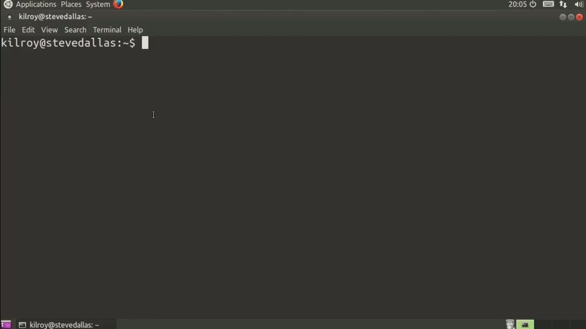
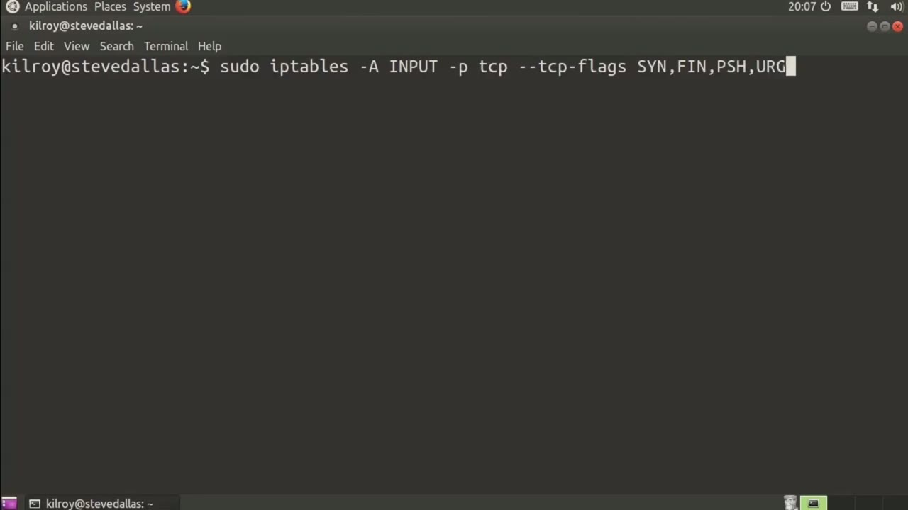
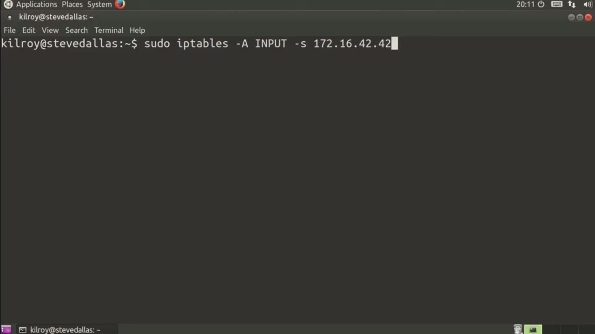

[← Course contents](../../02.md)

# 79. Matching On Protocol

**Course:** [Linux Security & Administration From Boot Process to Firewalls](https://www.youtube.com/watch?v=_WB3evmgxYA)  
**Transcript:** [`Linux Security & Administration From Boot Process to Firewalls transcript`](../../../../course_videos/Linux%20Security%20%26%20Administration%20From%20Boot%20Process%20to%20Firewalls/Linux%20Security%20%26%20Administration%20From%20Boot%20Process%20to%20Firewalls.txt)  
**Video:** 05:35:58–05:40:07 ([open at this time](https://www.youtube.com/watch?v=_WB3evmgxYA&t=20158s))

## Introduction

In order to have an iptables rule, you need to have something that you are going to apply that rule to. So commonly, you're going to do some sort of matching because you need to have kind of a bucket to put the packet into so that you can figure out what you're going to do with that particular packet. Let's take a look at some different things that you can do with matching in iptables. So let's say we're going to do iptables and we're going to use the input chain.

## Detailed Explanation

<details>
  <summary>Step 1 — Run `iptables`</summary>

### Step 1 — Run `iptables`

- [x] **Use `iptables`**
  - In order to have an `iptables` rule, you need to have something that you are going to apply that rule to.
  - So commonly, you're going to do some sort of matching because you need to have kind of a bucket to put the packet into so that you can figure out what you're going to do with that particular packet.
  - Let's take a look at some different things that you can do with matching in `iptables`.

- [x] **Use `iptables`**
  - So let's say we're going to do `iptables` and we're going to use the input chain.
  - Of course, this is going to go into the filter table, which is the default.
  - It's not necessary in this case because `iptables` assumes we're putting it into the filter table since we didn't specify a specific table to put it into.

- [x] **Now, I'm going to say -P is going to be protocol**
  - Now, I'm going to say -P is going to be protocol.
  - TCP is the protocol that we're going to match on, and I can do a source port of, for example, 4567.
  - Now, similarly, I can do D for destination port, and then I could say, for example, 22, or I could say 80.

- [x] **So that's how you would match on ports associated with a particular**
  - So that's how you would match on ports associated with a particular protocol.
  - Now, I can also match with flags associated with TCP.
  - So what I can do is match again on TCP, and then I can say TCP -flags, and then specify the flags that I actually want to match on.

```bash
iptables
```



</details>

<details>
  <summary>Step 2 — I could say sin, fin, push, and urge</summary>

### Step 2 — I could say sin, fin, push, and urge

- [x] **So I could say sin, fin, push, and urge**
  - So I could say sin, fin, push, and urge.
  - If a packet came in with all of those flags turned on, first of all, it would be really bizarre.
  - And secondly, if those were matched, then I could do something with it.

- [x] **Probably what I would want to do with it would be to simply drop it**
  - Probably what I would want to do with it would be to simply drop it, because clearly that's not a well-formed packet.
  - It can't possibly be doing anything good.
  - So similarly, I can also just look for sin messages.

- [x] **So if I just do -dash sin, that would work as well**
  - So if I just do -dash sin, that would work as well.
  - And then I can also look for TCP options.
  - So if I were to be looking for a particular TCP option, I could specify that there as well.

- [x] **We can also say UDP, and then again, I can do S port, and I can do D**
  - We can also say UDP, and then again, I can do S port, and I can do D port.
  - Since there aren't really a lot of options with UDP, that's really about the only thing that we're going to be able to do is just source port and destination port.
  - That's really kind of about the only thing in a UDP header that you're going to have much of any interest in looking at.

- [x] **There's not really much else in a UDP header**
  - There's not really much else in a UDP header.
  - We're going to look for source port and we're going to look for destination port.



</details>

<details>
  <summary>Step 3 — Run `iptables`</summary>

### Step 3 — Run `iptables`

- [x] **Now, when it comes to ICMP, we can match on ICMP**
  - Now, when it comes to ICMP, we can match on ICMP.
  - So we can specify the ICMP type or we could say ICMP type 8.
  - And then once you have matched on that, you could make a determination as to what you want to do with the packet.

- [x] **The other thing we can do is match on destination IP address**
  - The other thing we can do is match on destination IP address.
  - We could say the destination there and then we could of course also match on protocol is tcp and then d port is let's say the destination port is 80 so similarly i can also specify a source address so let's say my source address is 172.16 dot 42.42 and then I might say P is TCP and then my source port, I might match on something like this,
  - Although I could just match on source address. I don't have to match on ports as well. I could just use the address.

- [x] **Use `iptables`**
  - So you can see there's a lot of different ways we can write matching rules using `iptables` and we've just looked at some small number of these rules and these are fairly common ones that you would actually use.

```bash
iptables
```



</details>

<details>
  <summary>Questions and Answers</summary>

## Questions and Answers

### Question 1: What does `iptables` do in this chapter?

<details>
<summary>Answer</summary>

- [x] In order to have an `iptables` rule, you need to have something that you are going to apply that rule to.

</details>

### Question 2: What does step 1 cover (Run iptables)?

<details>
<summary>Answer</summary>

- [x] In order to have an `iptables` rule, you need to have something that you are going to apply that rule to.
- [x] So commonly, you're going to do some sort of matching because you need to have kind of a bucket to put the packet into so that you can figure out what you're going to do with that particular packet.
- [x] Let's take a look at some different things that you can do with matching in `iptables`.

</details>

### Question 3: What does step 2 cover (I could say sin, fin, push, and urge)?

<details>
<summary>Answer</summary>

- [x] So I could say sin, fin, push, and urge.
- [x] If a packet came in with all of those flags turned on, first of all, it would be really bizarre.
- [x] And secondly, if those were matched, then I could do something with it.

</details>

### Question 4: What does step 3 cover (Run iptables)?

<details>
<summary>Answer</summary>

- [x] Now, when it comes to ICMP, we can match on ICMP.
- [x] So we can specify the ICMP type or we could say ICMP type 8.
- [x] And then once you have matched on that, you could make a determination as to what you want to do with the packet.

</details>

</details>

## Summary

This chapter, Matching On Protocol, walks through Run iptables; I could say sin, fin, push, and urge; Run iptables. Commands from the transcript: `iptables`.

## References

- [Linux Security & Administration From Boot Process to Firewalls (YouTube)](https://www.youtube.com/watch?v=_WB3evmgxYA)
- [This chapter at 05:35:58](https://www.youtube.com/watch?v=_WB3evmgxYA&t=20158s)
- [Local transcript](../../../../course_videos/Linux%20Security%20%26%20Administration%20From%20Boot%20Process%20to%20Firewalls/Linux%20Security%20%26%20Administration%20From%20Boot%20Process%20to%20Firewalls.txt)
