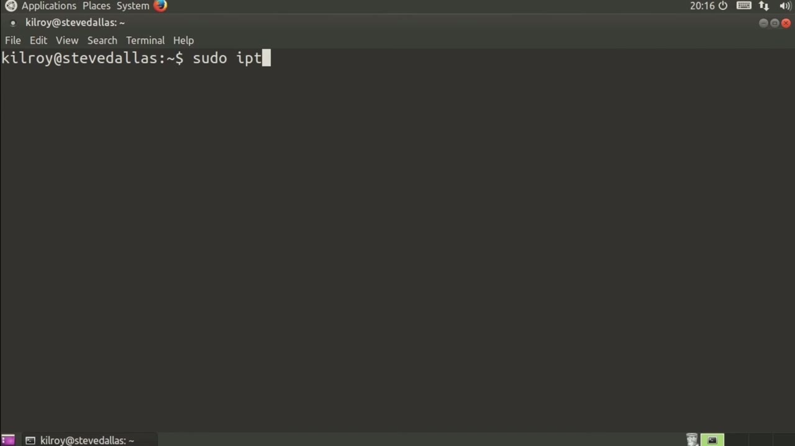
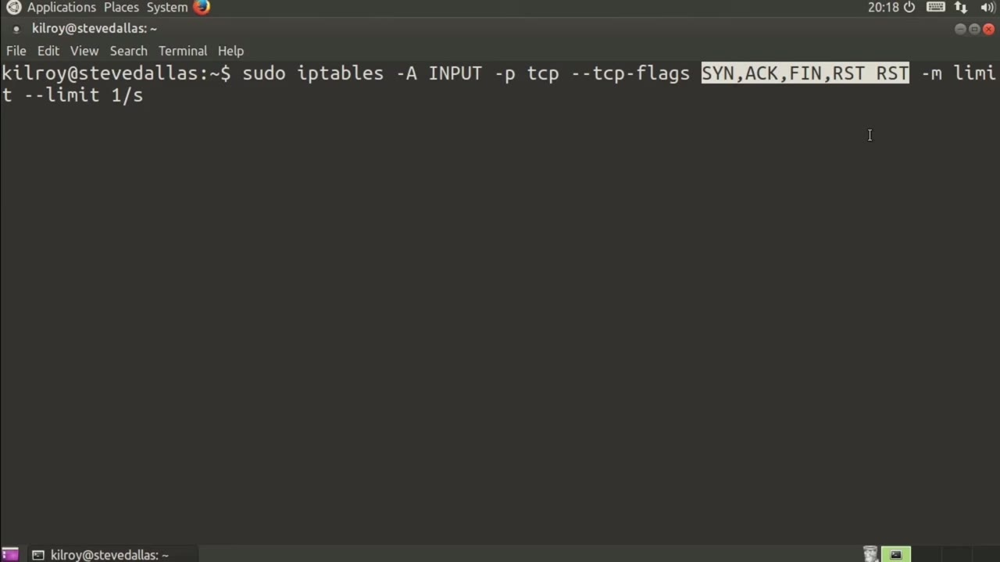
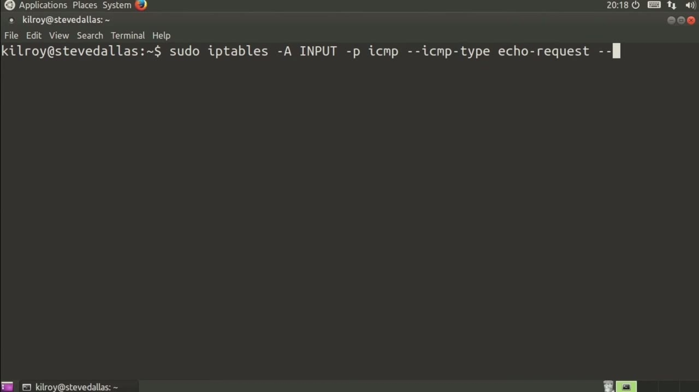

[← Course contents](../../02.md)

# 80. Rate limiting

**Course:** [Linux Security & Administration From Boot Process to Firewalls](https://www.youtube.com/watch?v=_WB3evmgxYA)  
**Transcript:** [`Linux Security & Administration From Boot Process to Firewalls transcript`](../../../../course_videos/Linux%20Security%20%26%20Administration%20From%20Boot%20Process%20to%20Firewalls/Linux%20Security%20%26%20Administration%20From%20Boot%20Process%20to%20Firewalls.txt)  
**Video:** 05:40:07–05:42:59 ([open at this time](https://www.youtube.com/watch?v=_WB3evmgxYA&t=20407s))

## Introduction

I want to take a look at some additional matching rules. There are more complicated ways to match and you may or may not use some of these but it's worth taking a look at them anyway. We're going to again run iptables. And then we're going to say this is going to be on my input chain. So -P, TCP, and then we're looking for sin messages.

## Detailed Explanation

<details>
  <summary>Step 1 — Run `iptables`</summary>

### Step 1 — Run `iptables`

- [x] **Use `iptables`**
  - I want to take a look at some additional matching rules. There are more complicated ways to match and you may or may not use some of these but it's worth taking a look at them anyway.
  - We're going to again run `iptables`.
  - And then we're going to say this is going to be on my input chain.

- [x] **So -P, TCP, and then we're looking for sin messages**
  - So -P, TCP, and then we're looking for sin messages.
  - So we're going to say that we have one packet per second, and then we can say -J accept.
  - So we're only going to allow one packet per second that has a sin flag.

- [x] **Use `iptables`**
  - So we're only going to really allow one connection per second to be established with our server.
  - We can do rate limiting with `iptables`.
  - So there are some other things that we can do, for example, -P, TCP, and we're going to look at TCP flags.

- [x] **So the flags that we are going to look at are sin, ac, fin, and reset**
  - So the flags that we are going to look at are sin, ac, fin, and reset.
  - And again, we're going to do a limit rule here.
  - And again, we can do limit is one per second.

- [x] **So this is really the important part here**
  - So this is really the important part here.

```bash
iptables
```



</details>

<details>
  <summary>Step 2 — Run `iptables`</summary>

### Step 2 — Run `iptables`

- [x] **Use `iptables`**
  - What it says is `iptables` needs to look at sin, act, fin, and reset.
  - Out of those flags, only reset can be set as a flag.
  - If any of the others are set, it won't match this rule.

- [x] **So this isn't just a question of, is reset set?**
  - So this isn't just a question of, is reset set?
  - What this says is reset exclusively out of SynAC, Finn, and Reset.
  - So what this says is it's a way of slowing down a port scanner, for example.

- [x] **The other thing that we can do is we can protect ourselves with some**
  - The other thing that we can do is we can protect ourselves with some rules that would protect against ICMP flood.

```bash
iptables
```



</details>

<details>
  <summary>Step 3 — We could say ICMP type is echo request, and then we're going to do a</summary>

### Step 3 — We could say ICMP type is echo request, and then we're going to do a

- [x] **We could say ICMP type is echo request, and then we're going to do a**
  - We could say ICMP type is echo request, and then we're going to do a limit match again, and we're going to say limit one per second, and again, we're only going to accept that one per second.
  - So we're rate limiting echo request messages.
  - There's really no great reason to have echo request messages coming in any faster than that anyway.

- [x] **We're going to rate limit our ICMP echo requests here**
  - We're going to rate limit our ICMP echo requests here.
  - We can do all of those things with just this matching capability that we've got in IP table.
  - We can match based on flags, making sure that specific flags are exclusively set,



</details>

<details>
  <summary>Questions and Answers</summary>

## Questions and Answers

### Question 1: What does `iptables` do in this chapter?

<details>
<summary>Answer</summary>

- [x] We're going to again run `iptables`.

</details>

### Question 2: What does step 1 cover (Run iptables)?

<details>
<summary>Answer</summary>

- [x] I want to take a look at some additional matching rules. There are more complicated ways to match and you may or may not use some of these but it's worth taking a look at them anyway.
- [x] We're going to again run `iptables`.
- [x] And then we're going to say this is going to be on my input chain.

</details>

### Question 3: What does step 2 cover (Run iptables)?

<details>
<summary>Answer</summary>

- [x] What it says is `iptables` needs to look at sin, act, fin, and reset.
- [x] Out of those flags, only reset can be set as a flag.
- [x] If any of the others are set, it won't match this rule.

</details>

### Question 4: What does step 3 cover (We could say ICMP type is echo request, and then we're going to do a)?

<details>
<summary>Answer</summary>

- [x] We could say ICMP type is echo request, and then we're going to do a limit match again, and we're going to say limit one per second, and again, we're only going to accept that one per second.
- [x] So we're rate limiting echo request messages.
- [x] There's really no great reason to have echo request messages coming in any faster than that anyway.

</details>

</details>

## Summary

This chapter, Rate limiting, walks through Run iptables; Run iptables; We could say ICMP type is echo request, and then we're going to do a. Commands from the transcript: `iptables`.

## References

- [Linux Security & Administration From Boot Process to Firewalls (YouTube)](https://www.youtube.com/watch?v=_WB3evmgxYA)
- [This chapter at 05:40:07](https://www.youtube.com/watch?v=_WB3evmgxYA&t=20407s)
- [Local transcript](../../../../course_videos/Linux%20Security%20%26%20Administration%20From%20Boot%20Process%20to%20Firewalls/Linux%20Security%20%26%20Administration%20From%20Boot%20Process%20to%20Firewalls.txt)
