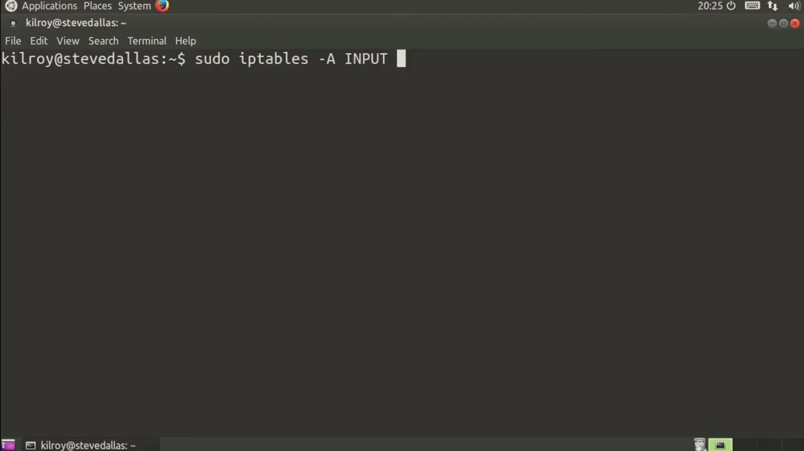
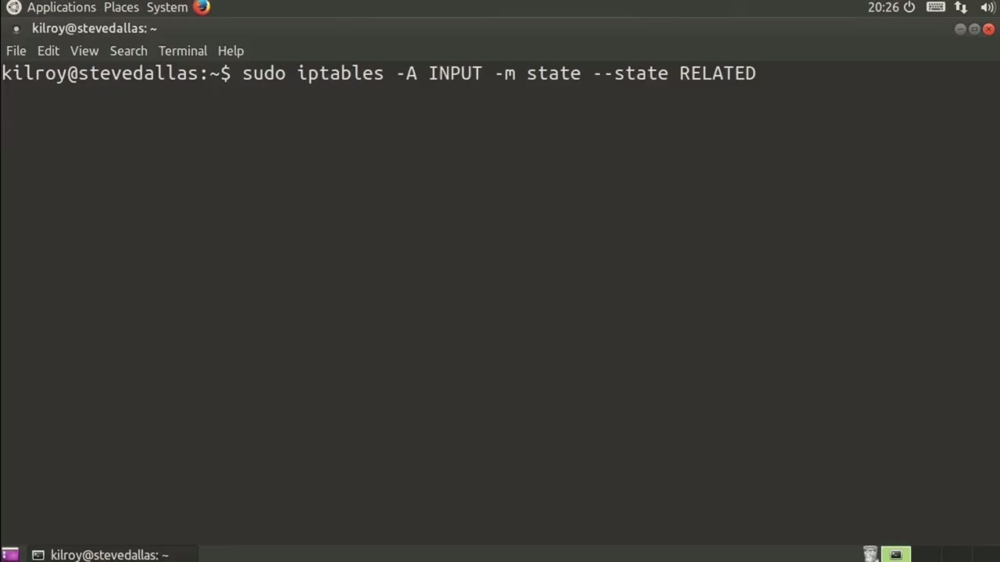

[← Course contents](../../02.md)

# 81. New Versus Established Versus Related

**Course:** [Linux Security & Administration From Boot Process to Firewalls](https://www.youtube.com/watch?v=_WB3evmgxYA)  
**Transcript:** [`Linux Security & Administration From Boot Process to Firewalls transcript`](../../../../course_videos/Linux%20Security%20%26%20Administration%20From%20Boot%20Process%20to%20Firewalls/Linux%20Security%20%26%20Administration%20From%20Boot%20Process%20to%20Firewalls.txt)  
**Video:** 05:42:59–05:46:50 ([open at this time](https://www.youtube.com/watch?v=_WB3evmgxYA&t=20579s))

## Introduction

And of course we can rate limit using iptables as well. We're going to take a look at another way of doing matching, and this is very specifically related to the stateful nature of iptables. When I talk about stateful nature, what I'm talking about is the fact that iptables actually keeps track of every connection flow that is going through it. Every protocol, every connection has a state when it goes through iptables.

## Detailed Explanation

<details>
  <summary>Step 1 — Run `iptables`</summary>

### Step 1 — Run `iptables`

- [x] **Use `iptables`**
  - And of course we can rate limit using `iptables` as well.
  - We're going to take a look at another way of doing matching, and this is very specifically related to the stateful nature of `iptables`.
  - When I talk about stateful nature, what I'm talking about is the fact that `iptables` actually keeps track of every connection flow that is going through it.

- [x] **Use `iptables`**
  - Every protocol, every connection has a state when it goes through `iptables`.
  - When a message goes through the firewall for the first time related to a specific source port and destination port, that is a new connection.
  - When we've got one where we've already seen the initial packet, then we've got an established state.

- [x] **Once we get the cinac back, now we've got an established connection**
  - Once we get the cinac back, now we've got an established connection.

```bash
iptables
```


</details>

<details>
  <summary>Step 2 — Run `iptables`</summary>

### Step 2 — Run `iptables`

- [x] **Because we've already sent the new one through, even though the**
  - Because we've already sent the new one through, even though the three-way handshake is not yet complete, from the perspective of the firewall, we are still talking about an established connection.
  - The reason for that is because from the firewalls perspective, we've already seen a message go through.
  - So the next message coming through in the reverse direction is established because we already know about it.

- [x] **Use `iptables`**
  - What we can do here is we can say -M state, So we're going to match on the state, and that is not the state of the individual packet that's actually referring to the state table that `iptables` keeps track of.
  - I can say state now, and I can say new. And with that, I can say accept.
  - So new messages I'm going to accept. With established states, we might also say -J accept.

- [x] **Now, the other state that's a little bit harder to explain is the**
  - Now, the other state that's a little bit harder to explain is the related state.

```bash
iptables
```



</details>

<details>
  <summary>Step 3 — Run `iptables`</summary>

### Step 3 — Run `iptables`

- [x] **This is a little bit easier to understand when you think about FTP**
  - This is a little bit easier to understand when you think about FTP, and maybe you don't know how FTP actually works at a protocol level.
  - What happens with FTP is your client establishes a connection with the server.
  - When you are connecting to the server and asking for a file to be sent to you, In some cases, specifically cases where you are using active FTP rather than passive FTP, in most cases, this is handled by the client and it's not something you're even aware of necessarily.

- [x] **Use `iptables`**
  - But if you are using an active FTP server, what happens is a connection comes back to you from the server. This is a brand new connection, but from the perspective of `iptables`, we already knew about this because it's FTP, it's a different port, yes, but since we already knew about the control channel connection,
  - We kind of expected a data channel connection as well. So that related means that it's associated with an established connection. So we already know about the established connection. The related says, yeah, this is one that's going to be attached to one that's already established. So we're
  - Going to allow that one as well. Now there is another state.

- [x] **We can say invalid. Those are ones that you may want to discard**
  - We can say invalid. Those are ones that you may want to discard.
  - Eventually you may see just an invalid state, and certainly those are ones you probably want to dump, if not maybe log.
  - When we're talking about matching state, we are talking about new, we're talking about established, and we are talking about related primarily, although an invalid state is possible.

- [x] **That just means that the packet for some reason couldn't be identified**
  - That just means that the packet for some reason couldn't be identified.

```bash
iptables
```



</details>

<details>
  <summary>Questions and Answers</summary>

## Questions and Answers

### Question 1: What does `iptables` do in this chapter?

<details>
<summary>Answer</summary>

- [x] And of course we can rate limit using `iptables` as well.

</details>

### Question 2: What does step 1 cover (Run iptables)?

<details>
<summary>Answer</summary>

- [x] And of course we can rate limit using `iptables` as well.
- [x] We're going to take a look at another way of doing matching, and this is very specifically related to the stateful nature of `iptables`.
- [x] When I talk about stateful nature, what I'm talking about is the fact that `iptables` actually keeps track of every connection flow that is going through it.

</details>

### Question 3: What does step 2 cover (Run iptables)?

<details>
<summary>Answer</summary>

- [x] Because we've already sent the new one through, even though the three-way handshake is not yet complete, from the perspective of the firewall, we are still talking about an established connection.
- [x] The reason for that is because from the firewalls perspective, we've already seen a message go through.
- [x] So the next message coming through in the reverse direction is established because we already know about it.

</details>

### Question 4: What does step 3 cover (Run iptables)?

<details>
<summary>Answer</summary>

- [x] This is a little bit easier to understand when you think about FTP, and maybe you don't know how FTP actually works at a protocol level.
- [x] What happens with FTP is your client establishes a connection with the server.
- [x] When you are connecting to the server and asking for a file to be sent to you, In some cases, specifically cases where you are using active FTP rather than passive FTP, in most cases, this is handled by the client and it's not something you're even aware of necessarily.

</details>

</details>

## Summary

This chapter, New Versus Established Versus Related, walks through Run iptables; Run iptables; Run iptables. Commands from the transcript: `iptables`.

## References

- [Linux Security & Administration From Boot Process to Firewalls (YouTube)](https://www.youtube.com/watch?v=_WB3evmgxYA)
- [This chapter at 05:42:59](https://www.youtube.com/watch?v=_WB3evmgxYA&t=20579s)
- [Local transcript](../../../../course_videos/Linux%20Security%20%26%20Administration%20From%20Boot%20Process%20to%20Firewalls/Linux%20Security%20%26%20Administration%20From%20Boot%20Process%20to%20Firewalls.txt)
