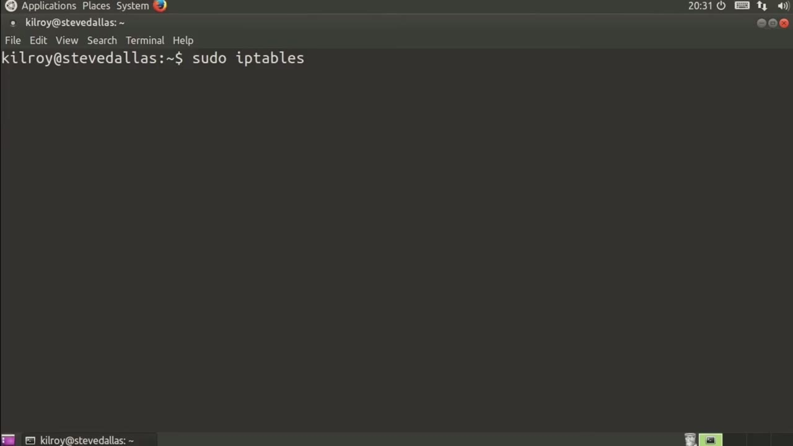
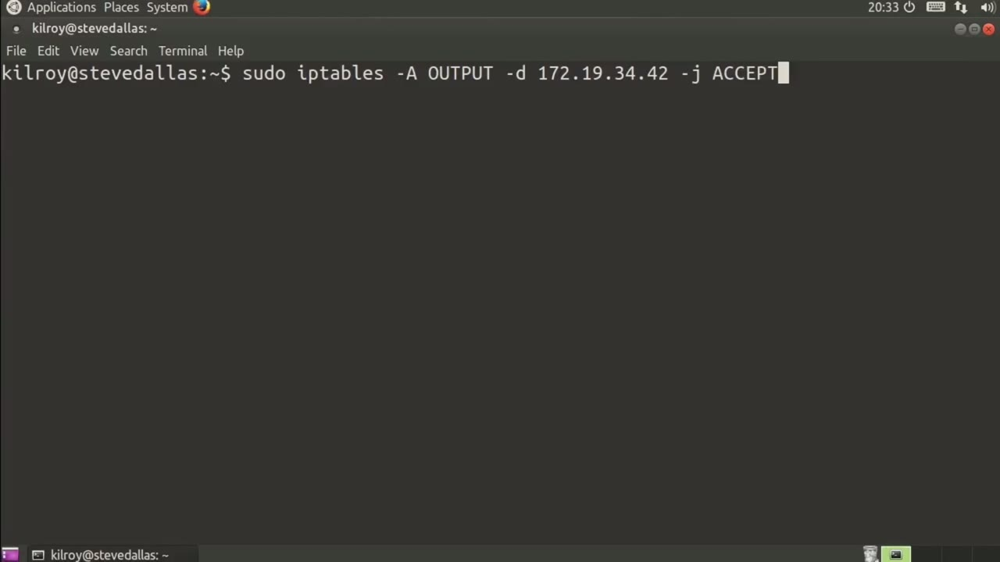
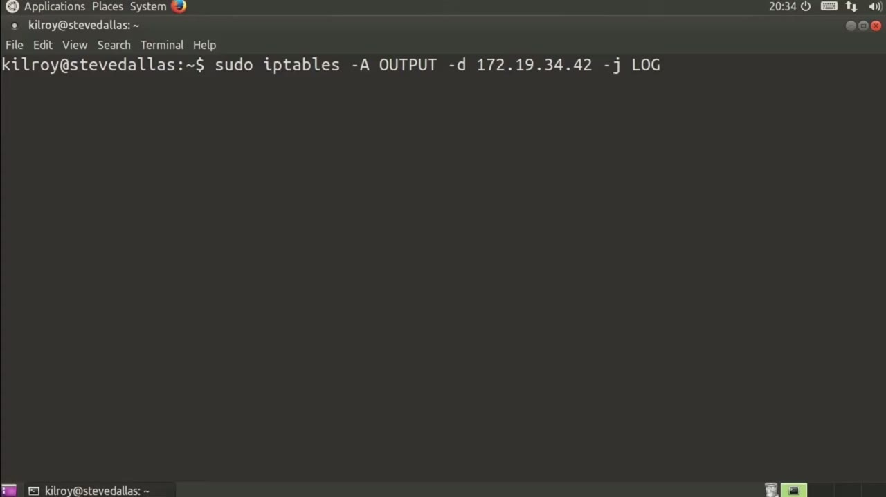

[← Course contents](../../02.md)

# 82. Targets

**Course:** [Linux Security & Administration From Boot Process to Firewalls](https://www.youtube.com/watch?v=_WB3evmgxYA)  
**Transcript:** [`Linux Security & Administration From Boot Process to Firewalls transcript`](../../../../course_videos/Linux%20Security%20%26%20Administration%20From%20Boot%20Process%20to%20Firewalls/Linux%20Security%20%26%20Administration%20From%20Boot%20Process%20to%20Firewalls.txt)  
**Video:** 05:46:50–05:49:10 ([open at this time](https://www.youtube.com/watch?v=_WB3evmgxYA&t=20810s))

## Introduction

Now that we've figured out how to do all of these matching, we need to figure out what we are going to do with the packets once we have matched them. Let's say that again we are working on the input chain, although we could just be working on the output chain as well. Let's talk about using the output chain. Just for example, it doesn't much matter what we're talking about.

## Detailed Explanation

  
Step 1 — that we've figured out how to do all of these matching, we need to

### Step 1 — that we've figured out how to do all of these matching, we need to

- [x] **Now that we've figured out how to do all of these matching, we need**
  - Now that we've figured out how to do all of these matching, we need to figure out what we are going to do with the packets once we have matched them.
  - Let's say that again we are working on the input chain, although we could just be working on the output chain as well.
  - Let's talk about using the output chain.

- [x] **Just for example, it doesn't much matter what we're talking about**
  - Just for example, it doesn't much matter what we're talking about.
  - So let's say that we are matching on a destination IP address.
  - Let's say we are talking about 172.19.34.42.42.

- [x] **So we are going to jump to a particular target**
  - So we are going to jump to a particular target.

  
Step 2 — there are a couple of targets that you're going to see a lot

### Step 2 — there are a couple of targets that you're going to see a lot

- [x] **And there are a couple of targets that you're going to see a lot**
  - And there are a couple of targets that you're going to see a lot.
  - What this says is if this matches, we just automatically accept it and the packet is allowed to pass through the firewall.
  - By contrast, of course, you can do drop.

- [x] **Now, drop just means just discard the packet**
  - Now, drop just means just discard the packet.
  - There is another target that you probably want to know about, and that's log.
  - write a log message out. It's going to go to the system log utility or syslog, and it's going to write a message indicating what was found from the packet.

- [x] **The thing about this is if you want to do something like drop and log**
  - The thing about this is if you want to do something like drop and log so that you know whether something was dropped.

  
Step 3 — A drop doesn't automatically generate a log message

### Step 3 — A drop doesn't automatically generate a log message

- [x] **A drop doesn't automatically generate a log message**
  - A drop doesn't automatically generate a log message.
  - So you can just drop it without necessarily logging it as well.
  - I could do a -J drop and then a log message indicating that the packet actually came in.

- [x] **We're going to be using targets, no matter which table or which chain**
  - We're going to be using targets, no matter which table or which chain you are talking about.
  - Rule or -j in order to jump to a target whether it's allow or whether it's drop or whether it's

  
Questions and Answers

## Questions and Answers

### Question 1: What does step 1 cover (that we've figured out how to do all of these matching, we need to)?

Answer

- [x] Now that we've figured out how to do all of these matching, we need to figure out what we are going to do with the packets once we have matched them.
- [x] Let's say that again we are working on the input chain, although we could just be working on the output chain as well.
- [x] Let's talk about using the output chain.

### Question 2: What does step 2 cover (there are a couple of targets that you're going to see a lot)?

Answer

- [x] And there are a couple of targets that you're going to see a lot.
- [x] What this says is if this matches, we just automatically accept it and the packet is allowed to pass through the firewall.
- [x] By contrast, of course, you can do drop.

### Question 3: What does step 3 cover (A drop doesn't automatically generate a log message)?

Answer

- [x] A drop doesn't automatically generate a log message.
- [x] So you can just drop it without necessarily logging it as well.
- [x] I could do a -J drop and then a log message indicating that the packet actually came in.

## Summary

This chapter, Targets, walks through that we've figured out how to do all of these matching, we need to; there are a couple of targets that you're going to see a lot; A drop doesn't automatically generate a log message.

## References

- [Linux Security & Administration From Boot Process to Firewalls (YouTube)](https://www.youtube.com/watch?v=_WB3evmgxYA)
- [This chapter at 05:46:50](https://www.youtube.com/watch?v=_WB3evmgxYA&t=20810s)
- [Local transcript](../../../../course_videos/Linux%20Security%20%26%20Administration%20From%20Boot%20Process%20to%20Firewalls/Linux%20Security%20%26%20Administration%20From%20Boot%20Process%20to%20Firewalls.txt)
