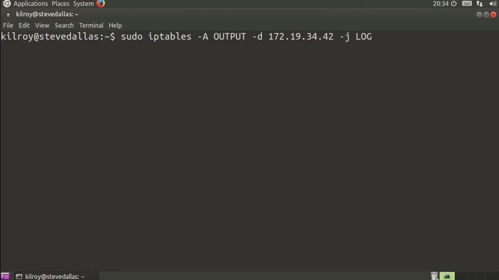
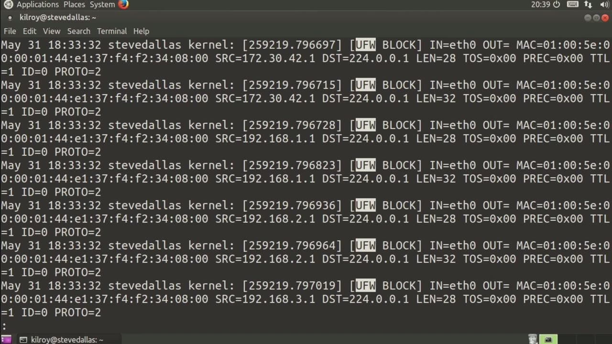
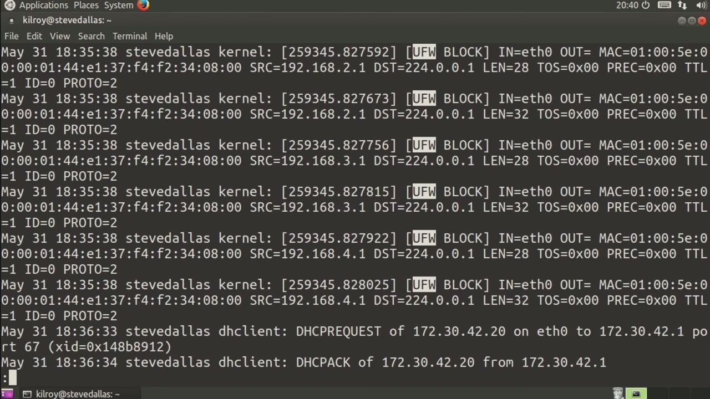

[← Course contents](../../02.md)

# 83. iptables Logs

**Course:** [Linux Security & Administration From Boot Process to Firewalls](https://www.youtube.com/watch?v=_WB3evmgxYA)  
**Transcript:** [`Linux Security & Administration From Boot Process to Firewalls transcript`](../../../../course_videos/Linux%20Security%20%26%20Administration%20From%20Boot%20Process%20to%20Firewalls/Linux%20Security%20%26%20Administration%20From%20Boot%20Process%20to%20Firewalls.txt)  
**Video:** 05:49:10–05:51:57 ([open at this time](https://www.youtube.com/watch?v=_WB3evmgxYA&t=20950s))

## Introduction

Just log. At this point I want to take a look at the logs that iptables will actually generate. Typically these are kernel logs and so just like the startup messages that a kernel will generate if I were to say type D message which would spit out the kernel messages. I'm going to get the most recent kernel messages and all of these have overwritten all of the startup messages. So what I'm getting now is just these iptables logs. So the other place that I can get these is and I need to have administrative privileges to get them.

## Detailed Explanation

<details>
  <summary>Step 1 — Run `iptables`</summary>

### Step 1 — Run `iptables`

- [x] **Use `iptables`**
  - Just log. At this point I want to take a look at the logs that `iptables` will actually generate.
  - Typically these are kernel logs and so just like the startup messages that a kernel will generate if I were to say type D message which would spit out the kernel messages. I'm going to get the most recent kernel messages and all of these have overwritten all of the startup messages. So what I'm getting now is just these `iptables` logs.
  - So the other place that I can get these is and I need to have administrative privileges to get them.

- [x] **So I'm just going to say var log, syslog**
  - So I'm just going to say var log, syslog.
  - On this particular system, it's going out to the syslog file.
  - It may go out to the file messages on other systems.

- [x] **This Ubuntu system happens to write it out to the file syslog**
  - This Ubuntu system happens to write it out to the file syslog.

```bash
iptables
```



</details>

<details>
  <summary>Step 2 — what I've got is a set of kernel messages that show up in the syslog</summary>

### Step 2 — what I've got is a set of kernel messages that show up in the syslog

- [x] **So what I've got is a set of kernel messages that show up in the**
  - So what I've got is a set of kernel messages that show up in the syslog file.
  - You can see that what we've got here is a message saying that it was blocked.
  - The output interface is left blank here because there isn't one.

- [x] **Eth is the only interface on this particular system**
  - Eth is the only interface on this particular system.
  - Then we've got the Mac address that is associated.
  - We've got a source IP address and then a destination IP address.

- [x] **In this case, this happens to be a multicast address**
  - In this case, this happens to be a multicast address.



</details>

<details>
  <summary>Step 3 — Run `iptables`</summary>

### Step 3 — Run `iptables`

- [x] **Use `iptables`**
  - So what we're doing is we are blocking multicast messages from coming in.
  - So we've got a length, and then we've got type of service, we've got ttl, we've got an id, and then we've got the protocol number, which in this case happens to be zero.
  - These are the messages that we get when `iptables` actually logs out.

- [x] **Use `iptables`**
  - They look exactly like this. Of course, they're going to be variant depending on the type of messages that you're getting, you may have an out interface specified, but typically this is what it's going to look like. You're going to get a line that looks exactly like this, and this is what an `iptables` log message actually looks like.
  - Once you've gotten used to seeing them, they aren't really that difficult to understand.
  - You're not going to get a ton of information about it.

- [x] **You're going to have to figure out what happened based on what you**
  - You're going to have to figure out what happened based on what you are seeing.
  - So you're getting a source address and a destination address.
  - You should also get a source port and a destination port.

- [x] **If we were doing something other than blocking multicast messages**
  - If we were doing something other than blocking multicast messages, you would get a little bit more information.
  - In this case, they're just multicast messages, so there's not much else to actually say here.

```bash
iptables
```



</details>

<details>
  <summary>Questions and Answers</summary>

## Questions and Answers

### Question 1: What does `iptables` do in this chapter?

<details>
<summary>Answer</summary>

- [x] Just log. At this point I want to take a look at the logs that `iptables` will actually generate.

</details>

### Question 2: What does step 1 cover (Run iptables)?

<details>
<summary>Answer</summary>

- [x] Just log. At this point I want to take a look at the logs that `iptables` will actually generate.
- [x] Typically these are kernel logs and so just like the startup messages that a kernel will generate if I were to say type D message which would spit out the kernel messages. I'm going to get the most recent kernel messages and all of these have overwritten all of the startup messages. So what I'm getting now is just these `iptables` logs.
- [x] So the other place that I can get these is and I need to have administrative privileges to get them.

</details>

### Question 3: What does step 2 cover (what I've got is a set of kernel messages that show up in the syslog)?

<details>
<summary>Answer</summary>

- [x] So what I've got is a set of kernel messages that show up in the syslog file.
- [x] You can see that what we've got here is a message saying that it was blocked.
- [x] The output interface is left blank here because there isn't one.

</details>

### Question 4: What does step 3 cover (Run iptables)?

<details>
<summary>Answer</summary>

- [x] So what we're doing is we are blocking multicast messages from coming in.
- [x] So we've got a length, and then we've got type of service, we've got ttl, we've got an id, and then we've got the protocol number, which in this case happens to be zero.
- [x] These are the messages that we get when `iptables` actually logs out.

</details>

</details>

## Summary

This chapter, iptables Logs, walks through Run iptables; what I've got is a set of kernel messages that show up in the syslog; Run iptables. Commands from the transcript: `iptables`.

## References

- [Linux Security & Administration From Boot Process to Firewalls (YouTube)](https://www.youtube.com/watch?v=_WB3evmgxYA)
- [This chapter at 05:49:10](https://www.youtube.com/watch?v=_WB3evmgxYA&t=20950s)
- [Local transcript](../../../../course_videos/Linux%20Security%20%26%20Administration%20From%20Boot%20Process%20to%20Firewalls/Linux%20Security%20%26%20Administration%20From%20Boot%20Process%20to%20Firewalls.txt)
