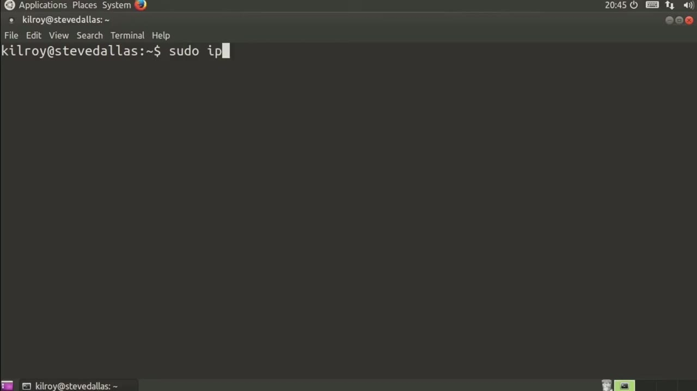
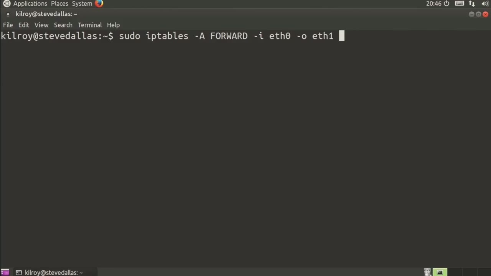
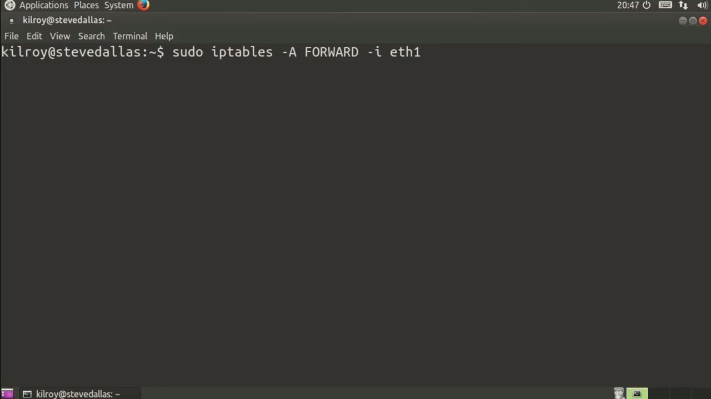

[← Course contents](../../02.md)

# 84. iptables With Multiple Interfaces

**Course:** [Linux Security & Administration From Boot Process to Firewalls](https://www.youtube.com/watch?v=_WB3evmgxYA)  
**Transcript:** [`Linux Security & Administration From Boot Process to Firewalls transcript`](../../../../course_videos/Linux%20Security%20%26%20Administration%20From%20Boot%20Process%20to%20Firewalls/Linux%20Security%20%26%20Administration%20From%20Boot%20Process%20to%20Firewalls.txt)  
**Video:** 05:51:57–05:54:54 ([open at this time](https://www.youtube.com/watch?v=_WB3evmgxYA&t=21117s))

## Introduction

When we're talking about multiple interfaces, there's a couple of things to be concerned with. First of all, I need to be concerned with the interface. Let me just put this into the input chain for a start here. What I need to be worried about is which interface that I'm talking about.

## Detailed Explanation

  
Step 1 — When we're talking about multiple interfaces, there's a couple of

### Step 1 — When we're talking about multiple interfaces, there's a couple of

- [x] **When we're talking about multiple interfaces, there's a couple of**
  - When we're talking about multiple interfaces, there's a couple of things to be concerned with.
  - First of all, I need to be concerned with the interface.
  - Let me just put this into the input chain for a start here.

- [x] **What I need to be worried about is which interface that I'm talking**
  - What I need to be worried about is which interface that I'm talking about.
  - -I specifies the interface. So I could be eth0, eth1, eth2, and so on.
  - The other thing that I need to be worried about is forwarding.

- [x] **So if I've got an input interface, so that's going to be eth0, for**
  - So if I've got an input interface, so that's going to be eth0, for example, and then I've got an output interface.

  
Step 2 — If I'm doing forwarding, I'm sending messages from one interface to

### Step 2 — If I'm doing forwarding, I'm sending messages from one interface to

- [x] **If I'm doing forwarding, I'm sending messages from one interface to**
  - If I'm doing forwarding, I'm sending messages from one interface to another.
  - So now I've got to have both an input interface and an output interface, and then I can specify match rules.
  - As we've talked about previously, to determine what I'm going to do with that.

- [x] **So let's say TCP and then S port or D port rather and 80 and we'll**
  - So let's say TCP and then S port or D port rather and 80 and we'll just accept all of those.
  - Now I've got an accept rule where I'm forwarding from eth 0 to eth1, TCP with a destination port of 80. I'm going to allow all of those.
  - Of course, the input interface isn't always going to be the same.

- [x] **This has to do with the direction of traffic**
  - This has to do with the direction of traffic.

  
Step 3 — let's say my eth interface is going to be my internet-facing interface

### Step 3 — let's say my eth interface is going to be my internet-facing interface

- [x] **So let's say my eth interface is going to be my internet-facing**
  - So let's say my eth interface is going to be my internet-facing interface and my inside interface is going to be eth zero. Well, now I'm talking about messages that are coming in from the internet and being forwarded onto my local network. So now we're talking about a whole
  - Different ballpark here where I may have different sets of rules that I would want to apply.
  - So I'm going to forward from the outside to the inside and then I'm going to specify -P, TCP, and then we'll say source port, for example, is 80 and J accept.

- [x] **If the source port is 80, that means it was something that was**
  - If the source port is 80, that means it was something that was communicated with on the outside as a web server probably. So the destination port on the outbound is going to be 80, which means on the inbound, the source port is going to be 80. If that's the case, we'll just accept that.
  - If I've got multiple interfaces, I need to be concerned about directionality.
  - I need to be concerned about whether it's the input interface or the output interface, if we're talking about forwarding rules, and if we're just talking about input-output rules, you still need to be worried about what interface you're actually talking about, whether it's eth0, eth1, or the name of some other interface.

  
Questions and Answers

## Questions and Answers

### Question 1: What does step 1 cover (When we're talking about multiple interfaces, there's a couple of)?

Answer

- [x] When we're talking about multiple interfaces, there's a couple of things to be concerned with.
- [x] First of all, I need to be concerned with the interface.
- [x] Let me just put this into the input chain for a start here.

### Question 2: What does step 2 cover (If I'm doing forwarding, I'm sending messages from one interface to)?

Answer

- [x] If I'm doing forwarding, I'm sending messages from one interface to another.
- [x] So now I've got to have both an input interface and an output interface, and then I can specify match rules.
- [x] As we've talked about previously, to determine what I'm going to do with that.

### Question 3: What does step 3 cover (let's say my eth interface is going to be my internet-facing interface)?

Answer

- [x] So let's say my eth interface is going to be my internet-facing interface and my inside interface is going to be eth zero. Well, now I'm talking about messages that are coming in from the internet and being forwarded onto my local network. So now we're talking about a whole
- [x] Different ballpark here where I may have different sets of rules that I would want to apply.
- [x] So I'm going to forward from the outside to the inside and then I'm going to specify -P, TCP, and then we'll say source port, for example, is 80 and J accept.

## Summary

This chapter, iptables With Multiple Interfaces, walks through When we're talking about multiple interfaces, there's a couple of; If I'm doing forwarding, I'm sending messages from one interface to; let's say my eth interface is going to be my internet-facing interface.

## References

- [Linux Security & Administration From Boot Process to Firewalls (YouTube)](https://www.youtube.com/watch?v=_WB3evmgxYA)
- [This chapter at 05:51:57](https://www.youtube.com/watch?v=_WB3evmgxYA&t=21117s)
- [Local transcript](../../../../course_videos/Linux%20Security%20%26%20Administration%20From%20Boot%20Process%20to%20Firewalls/Linux%20Security%20%26%20Administration%20From%20Boot%20Process%20to%20Firewalls.txt)
