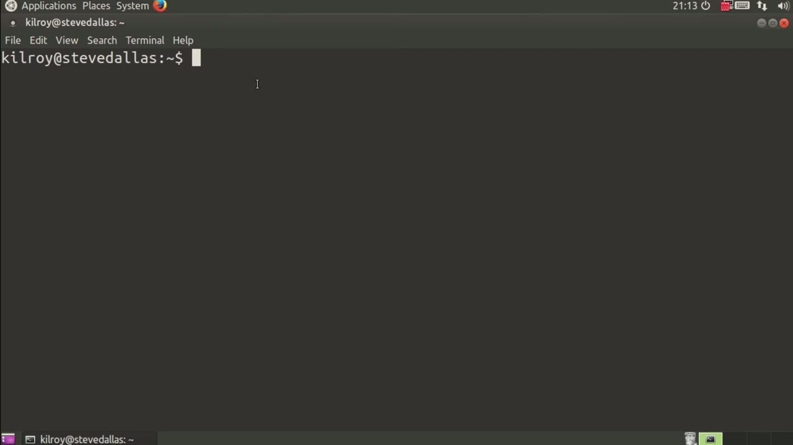
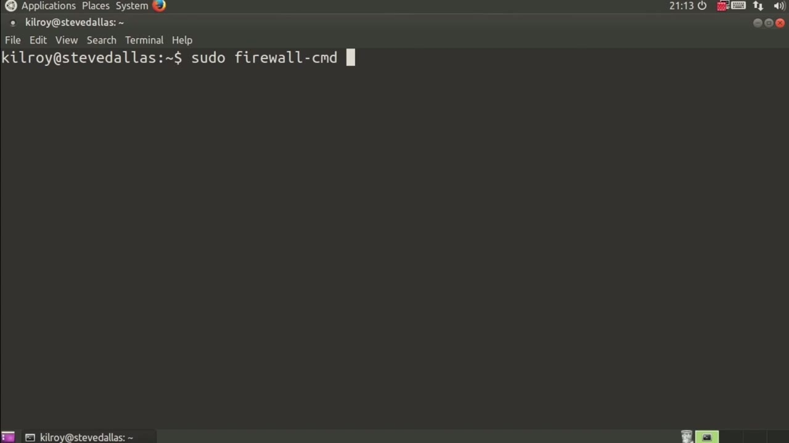
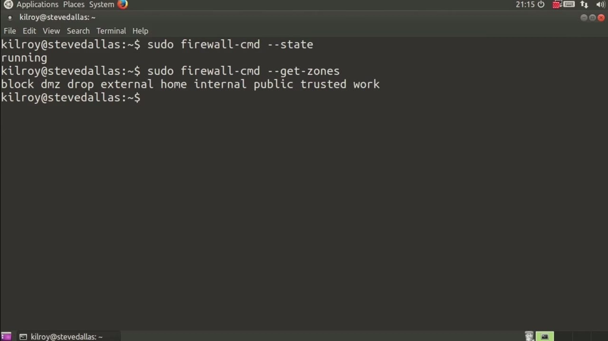

[← Course contents](../../02.md)

# 85. Firewalld

**Course:** [Linux Security & Administration From Boot Process to Firewalls](https://www.youtube.com/watch?v=_WB3evmgxYA)  
**Transcript:** [`Linux Security & Administration From Boot Process to Firewalls transcript`](../../../../course_videos/Linux%20Security%20%26%20Administration%20From%20Boot%20Process%20to%20Firewalls/Linux%20Security%20%26%20Administration%20From%20Boot%20Process%20to%20Firewalls.txt)  
**Video:** 05:54:54–05:57:50 ([open at this time](https://www.youtube.com/watch?v=_WB3evmgxYA&t=21294s))

## Introduction

Firewalld is a different type of firewall. It's really an enhancement, or I guess maybe you can think of it as the next generation firewall for iptables. What we have with firewalld is perhaps a simpler way of administering your firewall, but it also provides the ability to better handle mobile systems. We didn't have the kind of roaming that we have now.

## Detailed Explanation

<details>
  <summary>Step 1 — Run `iptables`</summary>

### Step 1 — Run `iptables`

- [x] **Use `iptables`**
  - Firewalld is a different type of firewall.
  - It's really an enhancement, or I guess maybe you can think of it as the next generation firewall for `iptables`.
  - What we have with firewalld is perhaps a simpler way of administering your firewall, but it also provides the ability to better handle mobile systems.

- [x] **We didn't have the kind of roaming that we have now**
  - We didn't have the kind of roaming that we have now.
  - So you've got laptops that are all over the place, that are connecting to multiple networks.

```bash
iptables
```



</details>

<details>
  <summary>Step 2 — Run `iptables`</summary>

### Step 2 — Run `iptables`

- [x] **Use `iptables`**
  - `iptables` isn't really designed to be able to easily handle lots of different rules.
  - And so what we end up with is a lot of different rules that may only apply in certain cases, or you may have a number of different rule sets that you have to constantly load and reload. That's fixed with firewalld.
  - What firewalld gives us is the ability to have multiple zones. And we will look at the different zones a little bit later on, but what we get with zones is really the ability to cluster a group of firewall rules so that Those rules apply to specific situations.

- [x] **So you would have a public zone, for example, or a private zone, or**
  - So you would have a public zone, for example, or a private zone, or you may have a home zone.
  - Using this firewall command tool, I can check the state of the firewall, which tells me that it's running.
  - So here I've got block, dmz, drop, external home, internal public, trusted, and work.

- [x] **Now, there are a lot of other capabilities that we get with firewalld**
  - Now, there are a lot of other capabilities that we get with firewalld.

```bash
iptables
```



</details>

<details>
  <summary>Step 3 — Let's just talk about what firewalld gets us is the ability to have</summary>

### Step 3 — Let's just talk about what firewalld gets us is the ability to have

- [x] **Let's just talk about what firewalld gets us is the ability to have**
  - Let's just talk about what firewalld gets us is the ability to have collections of rules that are more easily applied and make more sense because I can name them in ways with these zones that apply very easily to the situation that I'm in.
  - So the home zone makes perfect sense to me, right?
  - Public zone. Well, that's if we're down at your neighborhood coffee shop or at an airport where there's shared Wi-Fi.

- [x] **Firewalld is the default firewall on Red Hat servers**
  - Firewalld is the default firewall on Red Hat servers.
  - But it's also something you can put on Ubuntu servers and other Linux distributions as well.
  - So I happen to be running it here on an Ubuntu system.

- [x] **You actually have to go install it and you can uninstall the**
  - You actually have to go install it and you can uninstall the uncomplicated firewall in order to install firewalld on an Ubuntu system.
  - But we'll talk more about zones and services coming up in subsequent lessons.



</details>

<details>
  <summary>Questions and Answers</summary>

## Questions and Answers

### Question 1: What does `iptables` do in this chapter?

<details>
<summary>Answer</summary>

- [x] It's really an enhancement, or I guess maybe you can think of it as the next generation firewall for `iptables`.

</details>

### Question 2: What does step 1 cover (Run iptables)?

<details>
<summary>Answer</summary>

- [x] Firewalld is a different type of firewall.
- [x] It's really an enhancement, or I guess maybe you can think of it as the next generation firewall for `iptables`.
- [x] What we have with firewalld is perhaps a simpler way of administering your firewall, but it also provides the ability to better handle mobile systems.

</details>

### Question 3: What does step 2 cover (Run iptables)?

<details>
<summary>Answer</summary>

- [x] `iptables` isn't really designed to be able to easily handle lots of different rules.
- [x] And so what we end up with is a lot of different rules that may only apply in certain cases, or you may have a number of different rule sets that you have to constantly load and reload. That's fixed with firewalld.
- [x] What firewalld gives us is the ability to have multiple zones. And we will look at the different zones a little bit later on, but what we get with zones is really the ability to cluster a group of firewall rules so that Those rules apply to specific situations.

</details>

### Question 4: What does step 3 cover (Let's just talk about what firewalld gets us is the ability to have)?

<details>
<summary>Answer</summary>

- [x] Let's just talk about what firewalld gets us is the ability to have collections of rules that are more easily applied and make more sense because I can name them in ways with these zones that apply very easily to the situation that I'm in.
- [x] So the home zone makes perfect sense to me, right?
- [x] Public zone. Well, that's if we're down at your neighborhood coffee shop or at an airport where there's shared Wi-Fi.

</details>

</details>

## Summary

This chapter, Firewalld, walks through Run iptables; Run iptables; Let's just talk about what firewalld gets us is the ability to have. Commands from the transcript: `iptables`.

## References

- [Linux Security & Administration From Boot Process to Firewalls (YouTube)](https://www.youtube.com/watch?v=_WB3evmgxYA)
- [This chapter at 05:54:54](https://www.youtube.com/watch?v=_WB3evmgxYA&t=21294s)
- [Local transcript](../../../../course_videos/Linux%20Security%20%26%20Administration%20From%20Boot%20Process%20to%20Firewalls/Linux%20Security%20%26%20Administration%20From%20Boot%20Process%20to%20Firewalls.txt)
