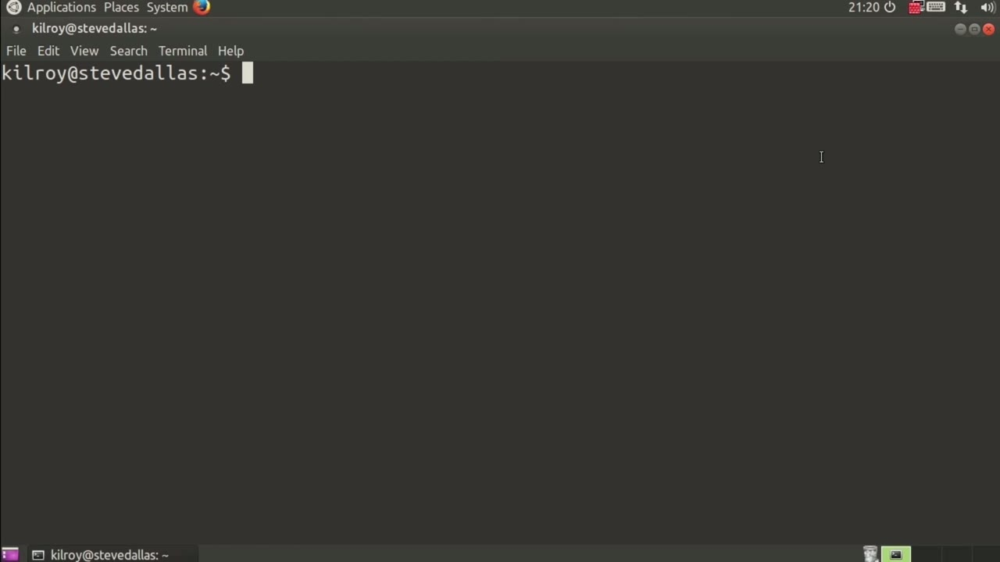
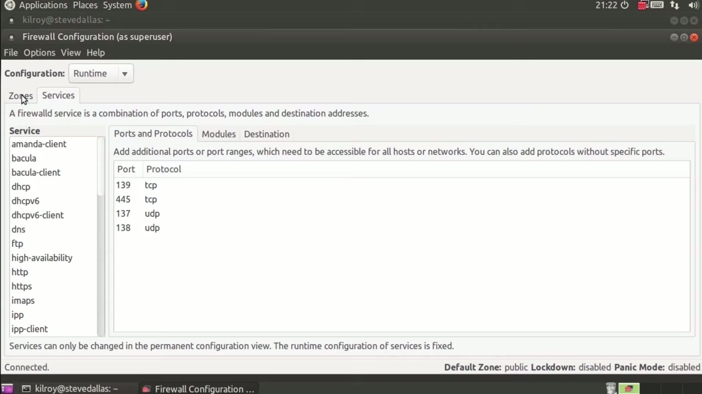
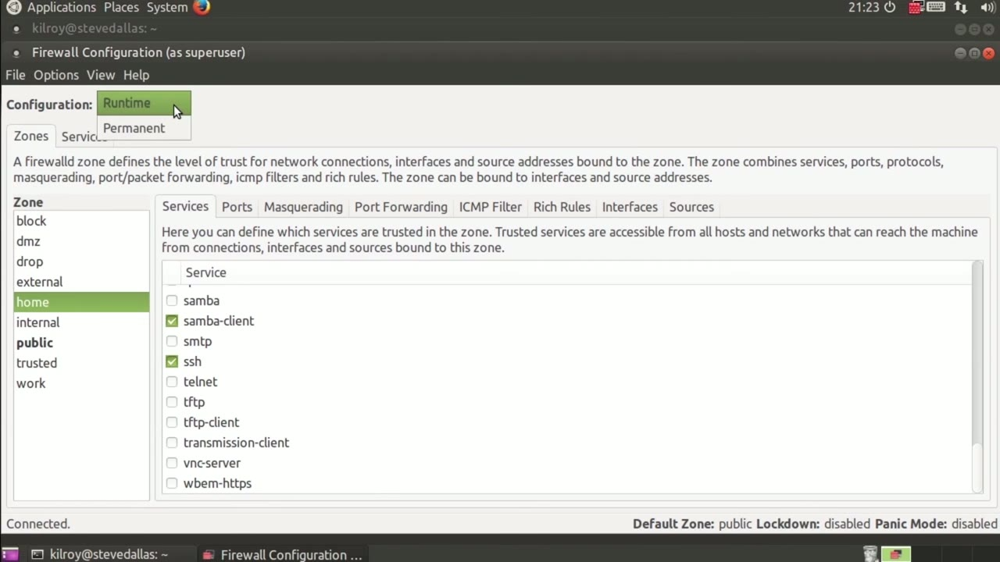

[← Course contents](../../02.md)

# 86. Zones And Services

**Course:** [Linux Security & Administration From Boot Process to Firewalls](https://www.youtube.com/watch?v=_WB3evmgxYA)  
**Transcript:** [`Linux Security & Administration From Boot Process to Firewalls transcript`](../../../../course_videos/Linux%20Security%20%26%20Administration%20From%20Boot%20Process%20to%20Firewalls/Linux%20Security%20%26%20Administration%20From%20Boot%20Process%20to%20Firewalls.txt)  
**Video:** 05:57:50–06:00:25 ([open at this time](https://www.youtube.com/watch?v=_WB3evmgxYA&t=21470s))

## Introduction

Now previously we had used the firewall command command line program. This time around we're going to take a look at the graphical interface here. What I want to do is edit firewall settings. So what I've got is the firewall applet installed and turned on on my Ubuntu system. You can see what we've got is a list of the zones and the different zones have different services that are enabled in them. So you can see the list of services that we've got, and if I were to click on one of them, you could see the ports and protocols that were in use. We also get modules if there were any and then any destination rules if we needed any of those.

## Detailed Explanation

<details>
  <summary>Step 1 — previously we had used the firewall command command line program. This</summary>

### Step 1 — previously we had used the firewall command command line program. This

- [x] **Now previously we had used the firewall command command line program**
  - Now previously we had used the firewall command command line program. This time around we're going to take a look at the graphical interface here.
  - What I want to do is edit firewall settings. So what I've got is the firewall applet installed and turned on on my Ubuntu system. You can see what we've got is a list of the zones and the different zones have different services that are enabled in them.
  - So you can see the list of services that we've got, and if I were to click on one of them, you could see the ports and protocols that were in use. We also get modules if there were any and then any destination rules if we needed any of those.

- [x] **You can just kind of click through and see that I've got the ability**
  - You can just kind of click through and see that I've got the ability to specify really rich services here.
  - I can have multiple ports and protocols associated with any particular service.



</details>

<details>
  <summary>Step 2 — Run `iptables`</summary>

### Step 2 — Run `iptables`

- [x] **Use `iptables`**
  - This is different, of course, from `iptables` where I would have to have a different rule based on each specific port.
  - What I can do is go to any of the zones here and specify the services that I actually want to allow through.
  - I can also add specific ports if that's what I want to do.

- [x] **And I could do masquerading, which would be NAT**
  - And I could do masquerading, which would be NAT.
  - I've also got to the interfaces that I want to include in the zone.
  - And you can see we've got a lot of capabilities just from this really simple firewall tool here.

```bash
iptables
```



</details>

<details>
  <summary>Step 3 — Run `iptables`</summary>

### Step 3 — Run `iptables`

- [x] **Use `iptables`**
  - Now, one of the things that we had a problem with, with `iptables` was I could make changes in memory.
  - And we never really talked about this before, but I want to talk about it now.
  - If I were to make changes in memory, then they were not permanent.

- [x] **Use `iptables`**
  - In order to make them permanent, I had to write them out to a file out of memory, and then I had to make sure that I was loading in from that file when I loaded up my firewall.
  - We can specify a runtime configuration, meaning any change that I made.
  - Is going to be made in memory. I can specify a permanent configuration change, which means it's actually going to be written out to disk. Here's a place where they've really kind of addressed very nicely, I think, the difference between in-memory changes and on-disc changes. With `iptables`, as I said, if I changed one, I didn't

- [x] **Necessarily change the other. And of course, that's true here as**
  - Necessarily change the other. And of course, that's true here as well. It's just

```bash
iptables
```



</details>

<details>
  <summary>Questions and Answers</summary>

## Questions and Answers

### Question 1: What does `iptables` do in this chapter?

<details>
<summary>Answer</summary>

- [x] This is different, of course, from `iptables` where I would have to have a different rule based on each specific port.

</details>

### Question 2: What does step 1 cover (previously we had used the firewall command command line program. This)?

<details>
<summary>Answer</summary>

- [x] Now previously we had used the firewall command command line program. This time around we're going to take a look at the graphical interface here.
- [x] What I want to do is edit firewall settings. So what I've got is the firewall applet installed and turned on on my Ubuntu system. You can see what we've got is a list of the zones and the different zones have different services that are enabled in them.
- [x] So you can see the list of services that we've got, and if I were to click on one of them, you could see the ports and protocols that were in use. We also get modules if there were any and then any destination rules if we needed any of those.

</details>

### Question 3: What does step 2 cover (Run iptables)?

<details>
<summary>Answer</summary>

- [x] This is different, of course, from `iptables` where I would have to have a different rule based on each specific port.
- [x] What I can do is go to any of the zones here and specify the services that I actually want to allow through.
- [x] I can also add specific ports if that's what I want to do.

</details>

### Question 4: What does step 3 cover (Run iptables)?

<details>
<summary>Answer</summary>

- [x] Now, one of the things that we had a problem with, with `iptables` was I could make changes in memory.
- [x] And we never really talked about this before, but I want to talk about it now.
- [x] If I were to make changes in memory, then they were not permanent.

</details>

</details>

## Summary

This chapter, Zones And Services, walks through previously we had used the firewall command command line program. This; Run iptables; Run iptables. Commands from the transcript: `iptables`.

## References

- [Linux Security & Administration From Boot Process to Firewalls (YouTube)](https://www.youtube.com/watch?v=_WB3evmgxYA)
- [This chapter at 05:57:50](https://www.youtube.com/watch?v=_WB3evmgxYA&t=21470s)
- [Local transcript](../../../../course_videos/Linux%20Security%20%26%20Administration%20From%20Boot%20Process%20to%20Firewalls/Linux%20Security%20%26%20Administration%20From%20Boot%20Process%20to%20Firewalls.txt)
