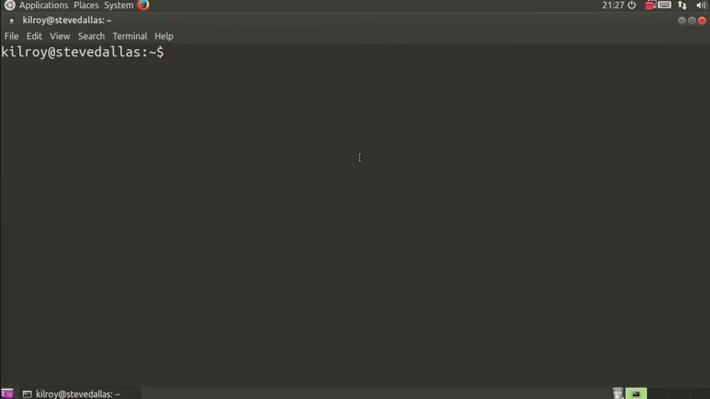
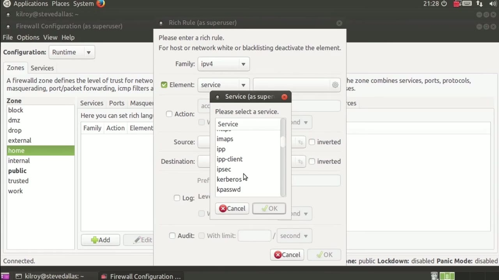
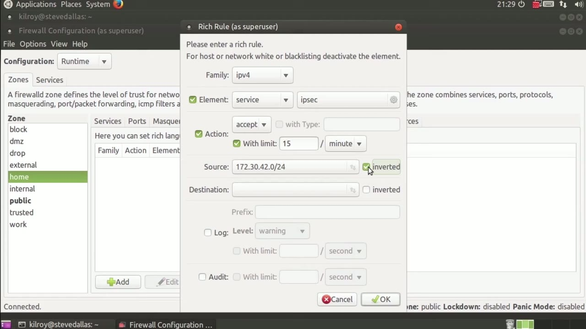

[← Course contents](../../02.md)

# 87. Matching On Owner

**Course:** [Linux Security & Administration From Boot Process to Firewalls](https://www.youtube.com/watch?v=_WB3evmgxYA)  
**Transcript:** [`Linux Security & Administration From Boot Process to Firewalls transcript`](../../../../course_videos/Linux%20Security%20%26%20Administration%20From%20Boot%20Process%20to%20Firewalls/Linux%20Security%20%26%20Administration%20From%20Boot%20Process%20to%20Firewalls.txt)  
**Video:** 06:00:25–06:03:31 ([open at this time](https://www.youtube.com/watch?v=_WB3evmgxYA&t=21625s))

## Introduction

more apparent which one you're actually doing. One other thing that I can do with firewalld, and I'm going to go back into editing my firewall settings here, is let's just go to my home zone. And again, you can see the tabs across the top here indicating the things that I can do on my home zone. I can make changes to ports and add rules based on that, masquerading, port forwarding, ICMP filtering.

## Detailed Explanation

  
Step 1 — more apparent which one you're actually doing

### Step 1 — more apparent which one you're actually doing

- [x] **more apparent which one you're actually doing**
  - more apparent which one you're actually doing.
  - One other thing that I can do with firewalld, and I'm going to go back into editing my firewall settings here, is let's just go to my home zone.
  - And again, you can see the tabs across the top here indicating the things that I can do on my home zone.

- [x] **I can make changes to ports and add rules based on that**
  - I can make changes to ports and add rules based on that, masquerading, port forwarding, ICMP filtering.
  - What I want to talk about here, though, is the rich rules.
  - So if you've got a more complicated rule than just services or ports or masquerading, what you can do is go into the rich rules and you can add those.

- [x] **Let's just say I want to do ipv4 only in this case**
  - Let's just say I want to do ipv4 only in this case.

  
Step 2 — the element I want to do is work on a service here

### Step 2 — the element I want to do is work on a service here

- [x] **So the element I want to do is work on a service here**
  - So the element I want to do is work on a service here.
  - In this case, I want to accept with limit.
  - I could say five per minute, or I could say one per second, for example.

- [x] **That I want to accept as a source IP address**
  - That I want to accept as a source IP address.
  - So for example, I could say 172.30.42.42.0 slash 24.
  - And then I could do a destination here as well.

- [x] **If I wanted to do that. In this case, I don't want to**
  - If I wanted to do that. In this case, I don't want to.

  
Step 3 — But I could certainly do inverted, meaning that everything other than

### Step 3 — But I could certainly do inverted, meaning that everything other than

- [x] **But I could certainly do inverted, meaning that everything other than**
  - But I could certainly do inverted, meaning that everything other than this would be what the source would be.
  - So now I can log and I can specify the level of the logging that I want to do.
  - And then of course I can limit the amount of logging that I want to do as well.

- [x] **And if you were using Audit D, for example, as system auditing, you**
  - And if you were using Audit D, for example, as system auditing, you could enable this and it would send messages out to your audit demon.
  - So once I specified all of this, Now I create my rule and you can see the rule is right there.
  - We have the capability to do rich rules, but if you're really just doing pretty basic firewalling, you're going to be talking about services and ports, maybe some port forwarding, and certainly you've got the capability to do rich rules if that's what you would want,

- [x] **Where it's really a combination of a number of different elements**
  - Where it's really a combination of a number of different elements.
  - So you can add those rich rules in and really add as many as you want, of course, realizing that the more rich rules you add and the more firewall rules you add in general, the more complicated your firewall rule set is going to be.
  - And complex rules can sometimes lead to less secure firewall installations.

  
Questions and Answers

## Questions and Answers

### Question 1: What does step 1 cover (more apparent which one you're actually doing)?

Answer

- [x] more apparent which one you're actually doing.
- [x] One other thing that I can do with firewalld, and I'm going to go back into editing my firewall settings here, is let's just go to my home zone.
- [x] And again, you can see the tabs across the top here indicating the things that I can do on my home zone.

### Question 2: What does step 2 cover (the element I want to do is work on a service here)?

Answer

- [x] So the element I want to do is work on a service here.
- [x] In this case, I want to accept with limit.
- [x] I could say five per minute, or I could say one per second, for example.

### Question 3: What does step 3 cover (But I could certainly do inverted, meaning that everything other than)?

Answer

- [x] But I could certainly do inverted, meaning that everything other than this would be what the source would be.
- [x] So now I can log and I can specify the level of the logging that I want to do.
- [x] And then of course I can limit the amount of logging that I want to do as well.

## Summary

This chapter, Matching On Owner, walks through more apparent which one you're actually doing; the element I want to do is work on a service here; But I could certainly do inverted, meaning that everything other than.

## References

- [Linux Security & Administration From Boot Process to Firewalls (YouTube)](https://www.youtube.com/watch?v=_WB3evmgxYA)
- [This chapter at 06:00:25](https://www.youtube.com/watch?v=_WB3evmgxYA&t=21625s)
- [Local transcript](../../../../course_videos/Linux%20Security%20%26%20Administration%20From%20Boot%20Process%20to%20Firewalls/Linux%20Security%20%26%20Administration%20From%20Boot%20Process%20to%20Firewalls.txt)
