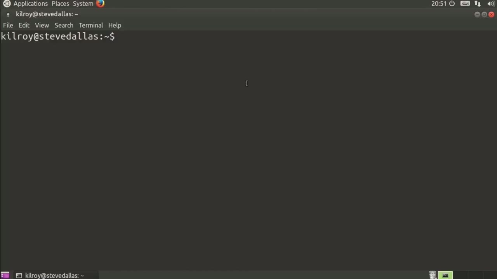
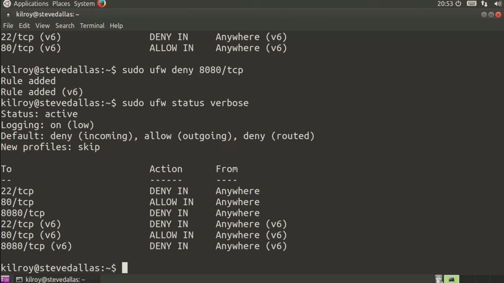
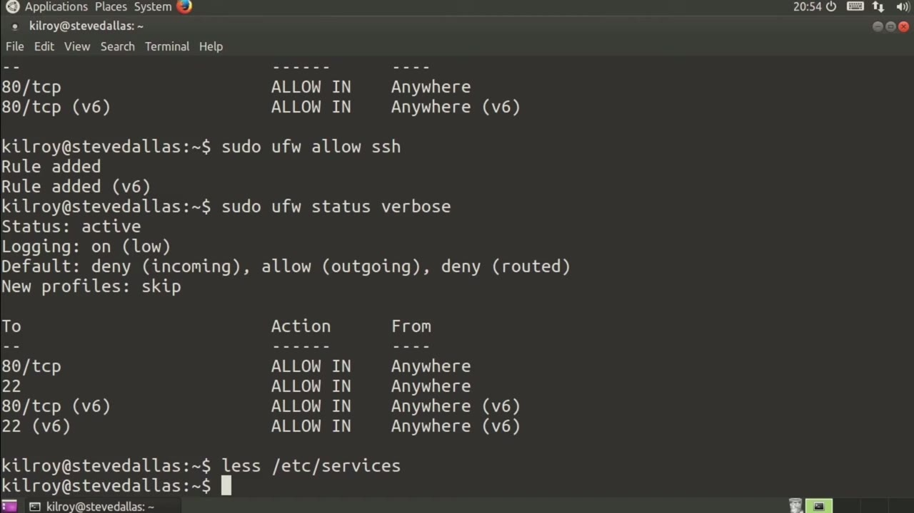

[← Course contents](../../02.md)

# 88. ufw

**Course:** [Linux Security & Administration From Boot Process to Firewalls](https://www.youtube.com/watch?v=_WB3evmgxYA)  
**Transcript:** [`Linux Security & Administration From Boot Process to Firewalls transcript`](../../../../course_videos/Linux%20Security%20%26%20Administration%20From%20Boot%20Process%20to%20Firewalls/Linux%20Security%20%26%20Administration%20From%20Boot%20Process%20to%20Firewalls.txt)  
**Video:** 06:03:31–06:06:24 ([open at this time](https://www.youtube.com/watch?v=_WB3evmgxYA&t=21811s))

## Introduction

We've been talking about iptables and really at the heart of older versions of Linux is iptables, but with Ubuntu systems, they've actually got a system that overlays on top of iptables. And that is something called ufw or uncomplicated firewall. And what it is is kind of a wrapper, I guess you could think about it, over the top of iptables. So with ufw, I can do very simple things. I can do something like enable and I can also disable. So if I were to say ufw status verbose, I would get the status of it, including some rules that were in place.

## Detailed Explanation

<details>
  <summary>Step 1 — Run `iptables`, `ufw`, `ufw status verbose`</summary>

### Step 1 — Run `iptables`, `ufw`, `ufw status verbose`

- [x] **Use `iptables`, `ufw`**
  - We've been talking about `iptables` and really at the heart of older versions of Linux is `iptables`, but with Ubuntu systems, they've actually got a system that overlays on top of `iptables`. And that is something called `ufw` or uncomplicated firewall.
  - And what it is is kind of a wrapper, I guess you could think about it, over the top of `iptables`.
  - So with `ufw`, I can do very simple things. I can do something like enable and I can also disable.

- [x] **Use `ufw status verbose`, `ufw`, `iptables`**
  - So if I were to say `ufw status verbose`, I would get the status of it, including some rules that were in place.
  - Now, I want to talk about how to actually create rules.
  - So I can say `ufw`, and this is much easier than `iptables`.

- [x] **Use `ufw`**
  - And suddenly we've got a rule there both for ipv4 and ipv6 as a matter of fact.
  - The other thing that I can do is I can say `ufw` and we're going to deny, let's say, 8080 on TCP.
  - So now we've got our rule again. I've got my status and I can show that.

- [x] **The other thing that I can do is reverse the rule and I can re-enable**
  - The other thing that I can do is reverse the rule and I can re-enable 80-80.

```bash
iptables
ufw
ufw status verbose
```



</details>

<details>
  <summary>Step 2 — Run `ufw delete deny`</summary>

### Step 2 — Run `ufw delete deny`

- [x] **Use `ufw delete deny`**
  - Perhaps it's just easier to say ufw delete, deny 80-80 TCP.
  - Now, if I check my status, the rule is entirely gone.
  - So as a matter of fact, I want to at this point, remove that rule as well, and I can check that.

- [x] **Allow SSH. Now, if I check the status, we have allowed port 22**
  - Allow SSH. Now, if I check the status, we have allowed port 22 because of course that's the SSH port.
  - What happens here is it actually looks up the name of the service.
  - From the /etc/Services file and then just puts the correct port in place for us.

- [x] **So you don't even have to know the port necessarily**
  - So you don't even have to know the port necessarily.

```bash
ufw delete deny
```



</details>

<details>
  <summary>Step 3 — Run `ufw`, `iptables`</summary>

### Step 3 — Run `ufw`, `iptables`

- [x] **Use `ufw`, `iptables`**
  - You just enable the service name and `ufw` figures out the port for you and puts it into the rule set automatically.
  - `ufw` makes it so much easier to be administering your firewall that `iptables` almost becomes obsolete just by using `ufw` on an Ubuntu system.
  - You don't have to worry about the complicated rules that you are using with `iptables`.

- [x] **If you're just doing simple things like enabling and disabling**
  - If you're just doing simple things like enabling and disabling services,

```bash
ufw
iptables
```



</details>

<details>
  <summary>Questions and Answers</summary>

## Questions and Answers

### Question 1: What does `iptables` do in this chapter?

<details>
<summary>Answer</summary>

- [x] We've been talking about `iptables` and really at the heart of older versions of Linux is `iptables`, but with Ubuntu systems, they've actually got a system that overlays on top of `iptables`. And that is something called ufw or uncomplicated firewall.

</details>

### Question 2: What does `ufw` do in this chapter?

<details>
<summary>Answer</summary>

- [x] We've been talking about iptables and really at the heart of older versions of Linux is iptables, but with Ubuntu systems, they've actually got a system that overlays on top of iptables. And that is something called `ufw` or uncomplicated firewall.

</details>

### Question 3: What does `ufw status verbose` do in this chapter?

<details>
<summary>Answer</summary>

- [x] So if I were to say `ufw status verbose`, I would get the status of it, including some rules that were in place.

</details>

### Question 4: What does `ufw delete deny` do in this chapter?

<details>
<summary>Answer</summary>

- [x] Perhaps it's just easier to say ufw delete, deny 80-80 TCP.

</details>

### Question 5: What does step 1 cover (Run iptables, ufw, ufw status verbose)?

<details>
<summary>Answer</summary>

- [x] We've been talking about `iptables` and really at the heart of older versions of Linux is `iptables`, but with Ubuntu systems, they've actually got a system that overlays on top of `iptables`. And that is something called `ufw` or uncomplicated firewall.
- [x] And what it is is kind of a wrapper, I guess you could think about it, over the top of `iptables`.
- [x] So with `ufw`, I can do very simple things. I can do something like enable and I can also disable.

</details>

### Question 6: What does step 2 cover (Run ufw delete deny)?

<details>
<summary>Answer</summary>

- [x] Perhaps it's just easier to say ufw delete, deny 80-80 TCP.
- [x] Now, if I check my status, the rule is entirely gone.
- [x] So as a matter of fact, I want to at this point, remove that rule as well, and I can check that.

</details>

### Question 7: What does step 3 cover (Run ufw, iptables)?

<details>
<summary>Answer</summary>

- [x] You just enable the service name and `ufw` figures out the port for you and puts it into the rule set automatically.
- [x] `ufw` makes it so much easier to be administering your firewall that `iptables` almost becomes obsolete just by using `ufw` on an Ubuntu system.
- [x] You don't have to worry about the complicated rules that you are using with `iptables`.

</details>

</details>

## Summary

This chapter, ufw, walks through Run iptables, ufw, ufw status verbose; Run ufw delete deny; Run ufw, iptables. Commands from the transcript: `iptables`, `ufw`, `ufw status verbose`, `ufw delete deny`.

## References

- [Linux Security & Administration From Boot Process to Firewalls (YouTube)](https://www.youtube.com/watch?v=_WB3evmgxYA)
- [This chapter at 06:03:31](https://www.youtube.com/watch?v=_WB3evmgxYA&t=21811s)
- [Local transcript](../../../../course_videos/Linux%20Security%20%26%20Administration%20From%20Boot%20Process%20to%20Firewalls/Linux%20Security%20%26%20Administration%20From%20Boot%20Process%20to%20Firewalls.txt)
